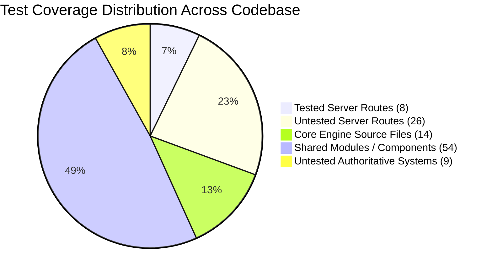
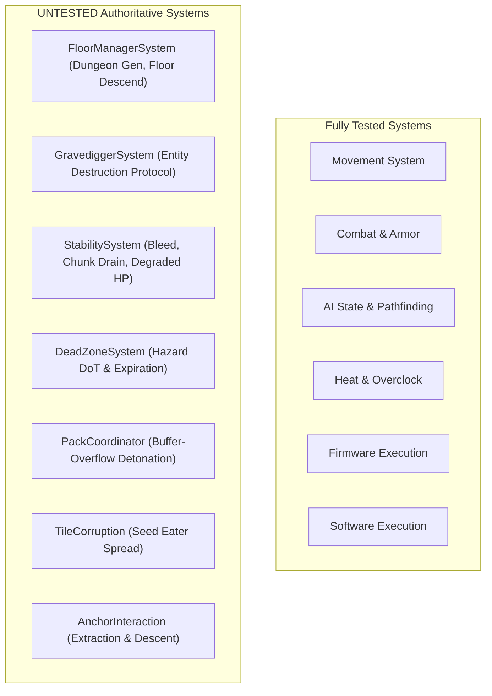
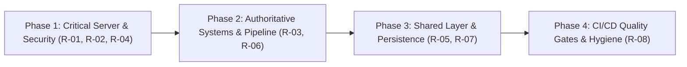

# Full Codebase Test Suite Review: Server, Engine, and Shared Systems

**Date:** 2026-10-27  
**Scope:** Server Layer (`src/server`, `src/app/api`), Engine Layer (`src/engine`), Shared Layer (`src/shared`), Authoritative Game Systems (`src/game/systems`), and Persistence (`src/app/persistence`).

---

## Executive Summary

A comprehensive audit was performed across the **Server**, **Engine**, and **Shared** layers of the Nirmata Runner codebase (alongside authoritative server-side game systems).

The test suite currently contains **99 test files** with **570 passing tests** running in ~6.2 seconds under Vitest. While core engine primitives (ECS World, Grid, EventBus, BSP generation) and specific client/rendering subsystems have strong test cases, **critical server and authoritative shared systems suffer from severe test blindness**.



### Key Quantitative Findings

| Layer / Subsystem | Total Source Files | Dedicated Test Files | Estimated Logic Coverage | Primary Concern |
| :--- | :---: | :---: | :---: | :--- |
| **Server & API** (`src/server`, `src/app/api`) | 37 | 8 | ~22% | 26 API routes completely untested; client-spoofed leaderboard scores; session memory leak. |
| **Engine Core** (`src/engine`) | 20 | 9 | ~85% | Solid core, but serialization & hierarchical cleanup lack edge-case tests. |
| **Shared** (`src/shared`) | 62 | 8 | ~35% | 11/16 pipeline intents untested; untested economy formulas; inverted `@shared -> @game` dependency. |
| **Authoritative Game Systems** (`src/game/systems`) | 31 | 18 | ~58% | Floor transition, Gravedigger death cleanup, Reality Stability, and Dead Zones have zero tests. |
| **Persistence** (`src/app/persistence`) | 2 | 1 | ~50% | Seed rotation logic completely unverified; race condition risk on uninitialized files. |

---

## Detailed Findings by Layer

### 1. Server Layer (`src/server` & `src/app/api`)

#### A. Session Lifecycle & Memory Management
- **Source**: [`SessionManager`](file:///Users/chadmowery/personal/dev/dungeon-runner/nirmata-run/src/server/session/session-manager.ts#L23-L73) (and [`SessionManager.ts`](file:///Users/chadmowery/personal/dev/dungeon-runner/nirmata-run/src/server/session/SessionManager.ts#L1))
- **Status**: **No dedicated unit test file** (`session-manager.test.ts` is absent). Only exercised indirectly via [`action.test.ts`](file:///Users/chadmowery/personal/dev/dungeon-runner/nirmata-run/src/app/api/action/__tests__/action.test.ts) and [`session.test.ts`](file:///Users/chadmowery/personal/dev/dungeon-runner/nirmata-run/src/app/api/session/__tests__/session.test.ts).
- **Findings**:
  1. `sessions = new Map<string, unknown>()` has **no TTL, no max capacity, and no pruning**. Sessions created via [`POST /api/session`](file:///Users/chadmowery/personal/dev/dungeon-runner/nirmata-run/src/app/api/session/route.ts#L10) will accumulate in memory indefinitely in production Node.js runtimes.
  2. Functions [`hasSession`](file:///Users/chadmowery/personal/dev/dungeon-runner/nirmata-run/src/server/session/session-manager.ts#L65), [`listSessions`](file:///Users/chadmowery/personal/dev/dungeon-runner/nirmata-run/src/server/session/session-manager.ts#L61), [`deleteSession`](file:///Users/chadmowery/personal/dev/dungeon-runner/nirmata-run/src/server/session/session-manager.ts#L56), and session isolation across concurrent requests are untested.

#### B. API Route Coverage (26 of 34 routes untested)
Out of 34 Next.js route handlers in `src/app/api`, only **8 have tests**:

| Route Category | Tested Routes | Untested Routes (0% coverage) |
| :--- | :--- | :--- |
| **Turn & Action** | [`/api/action`](file:///Users/chadmowery/personal/dev/dungeon-runner/nirmata-run/src/app/api/action/route.ts) | *None* (all tested in [`action.test.ts`](file:///Users/chadmowery/personal/dev/dungeon-runner/nirmata-run/src/app/api/action/__tests__/action.test.ts)) |
| **Competitive / Leaderboards** | *None* | [`/api/leaderboard/submit`](file:///Users/chadmowery/personal/dev/dungeon-runner/nirmata-run/src/app/api/leaderboard/submit/route.ts), [`/api/leaderboard/daily`](file:///Users/chadmowery/personal/dev/dungeon-runner/nirmata-run/src/app/api/leaderboard/daily/route.ts), [`/api/leaderboard/weekly`](file:///Users/chadmowery/personal/dev/dungeon-runner/nirmata-run/src/app/api/leaderboard/weekly/route.ts) |
| **Profile & Progression** | *None* | [`/api/profile`](file:///Users/chadmowery/personal/dev/dungeon-runner/nirmata-run/src/app/api/profile/route.ts) |
| **Economy & Vault** | `/api/economy/compile`, `/api/economy/install`, `/api/economy/upgrade`, `/api/vault/move-to-vault` | [`/api/economy/purchase`](file:///Users/chadmowery/personal/dev/dungeon-runner/nirmata-run/src/app/api/economy/purchase/route.ts), [`/api/economy/uninstall`](file:///Users/chadmowery/personal/dev/dungeon-runner/nirmata-run/src/app/api/economy/uninstall/route.ts), [`/api/vault/sell`](file:///Users/chadmowery/personal/dev/dungeon-runner/nirmata-run/src/app/api/vault/sell/route.ts), [`/api/vault/discard`](file:///Users/chadmowery/personal/dev/dungeon-runner/nirmata-run/src/app/api/vault/discard/route.ts), [`/api/vault/equip-from-vault`](file:///Users/chadmowery/personal/dev/dungeon-runner/nirmata-run/src/app/api/vault/equip-from-vault/route.ts), [`/api/vault/overflow`](file:///Users/chadmowery/personal/dev/dungeon-runner/nirmata-run/src/app/api/vault/overflow/route.ts) |
| **Run Mode Lifecycle** | `/api/run-mode/launch` | [`/api/run-mode/available`](file:///Users/chadmowery/personal/dev/dungeon-runner/nirmata-run/src/app/api/run-mode/available/route.ts) |
| **Shells & Admin** | `/api/admin/reset` | [`/api/shells`](file:///Users/chadmowery/personal/dev/dungeon-runner/nirmata-run/src/app/api/shells/route.ts), [`/api/admin/grant`](file:///Users/chadmowery/personal/dev/dungeon-runner/nirmata-run/src/app/api/admin/grant/route.ts), [`/api/admin/inspect`](file:///Users/chadmowery/personal/dev/dungeon-runner/nirmata-run/src/app/api/admin/inspect/route.ts), [`/api/admin/reset-attempts`](file:///Users/chadmowery/personal/dev/dungeon-runner/nirmata-run/src/app/api/admin/reset-attempts/route.ts), [`/api/admin/seed-rotation`](file:///Users/chadmowery/personal/dev/dungeon-runner/nirmata-run/src/app/api/admin/seed-rotation/route.ts), [`/api/debug/log`](file:///Users/chadmowery/personal/dev/dungeon-runner/nirmata-run/src/app/api/debug/log/route.ts) |
| **Dev / Gamedata CMS** | `ecs-rules.ts`, `schema-introspect.ts`, `schemas.ts` | 10 routes under `/api/dev/gamedata/...` (`components`, `entities`, `mixins`, `shells`, `spawn-tables`) |

#### C. Shallow Coverage on Authoritative Action API
In [`src/app/api/action/__tests__/action.test.ts`](file:///Users/chadmowery/personal/dev/dungeon-runner/nirmata-run/src/app/api/action/__tests__/action.test.ts):
- Only `MOVE` and `WAIT` intents are validated.
- **Untested Action Intents in route**: `USE_FIRMWARE`, `VENT`, `STAIRCASE_DESCEND`, `ANCHOR_DESCEND`, `ANCHOR_EXTRACT`, `INVENTORY_SWAP`, `EQUIP`, `UNEQUIP`, `BURN_SOFTWARE`, `DEBUG_COMMAND`.
- **Untested Run-End Persistence**: When an action emits `RUN_ENDED`, the route calculates final Scrap and Flux, moves items into `profile.vault` vs `profile.overflow`, caps currencies, and saves the profile. **None of this persistence logic is asserted in tests.**
- **Untested Sync Strategy**: Gating between `FULL` sync (e.g. on `FLOOR_TRANSITION` or `DUNGEON_GENERATED`) and `DELTA` sync is not tested in the API test suite.

---

## Detailed Findings by Layer (Engine, Shared, Game Systems, Persistence)

### 2. Engine Layer (`src/engine`)

The Engine layer is the most mature part of the system, with high test coverage on core algorithms.

#### A. Strengths
- [`EventBus`](file:///Users/chadmowery/personal/dev/dungeon-runner/nirmata-run/src/engine/events/event-bus.ts#L10-L100): Excellent test suite ([`event-bus.test.ts`](file:///Users/chadmowery/personal/dev/dungeon-runner/nirmata-run/src/engine/events/event-bus.test.ts)) verifying handlers, recursive flushes, max depth cutoff (10), and cleanup.
- [`TurnManager`](file:///Users/chadmowery/personal/dev/dungeon-runner/nirmata-run/src/engine/turn/turn-manager.ts): Thoroughly tested with a mock adapter ([`turn-manager.test.ts`](file:///Users/chadmowery/personal/dev/dungeon-runner/nirmata-run/src/engine/turn/turn-manager.test.ts)) covering action costs, energy accumulation, input gating, and actor sequence.
- [`StateMachine`](file:///Users/chadmowery/personal/dev/dungeon-runner/nirmata-run/src/engine/state-machine/state-machine.ts): Clean tests for transition validation, enter/exit lifecycle, and context updating.
- [`Grid`](file:///Users/chadmowery/personal/dev/dungeon-runner/nirmata-run/src/engine/grid/grid.ts): Covers coordinates, bounds, tile walkability, and spatial indexing for entities and items.
- [`BSP`](file:///Users/chadmowery/personal/dev/dungeon-runner/nirmata-run/src/engine/generation/bsp.ts) & [`FloodFill`](file:///Users/chadmowery/personal/dev/dungeon-runner/nirmata-run/src/engine/generation/flood-fill.ts): Determinism, seed reproducibility, room interior constraints, and corridor bounds are well verified.

#### B. Gaps & Hidden Risks
1. **ECS World Hierarchy Recursion Crash Risk**:
   In [`World.destroyEntity`](file:///Users/chadmowery/personal/dev/dungeon-runner/nirmata-run/src/engine/ecs/world.ts#L49-L73):
   ```ts
   if (this.config.childComponentKey) {
     const childrenStore = this.stores.get(this.config.childComponentKey);
     if (childrenStore && childrenStore.has(id)) {
       const childrenData = childrenStore.get(id) as { entityIds: number[] };
       for (const childId of childrenData.entityIds) {
         this.destroyEntity(childId);
       }
     }
   }
   this.entities.delete(id);
   ```
   `this.entities.delete(id)` happens **after** the child recursion. If child entity definitions have cyclic or cross-parent relationships, this immediately triggers a fatal `RangeError: Maximum call stack size exceeded`. No test guards against circular hierarchies.
2. **Untested Engine Methods**:
   - [`World.getSerializableState`](file:///Users/chadmowery/personal/dev/dungeon-runner/nirmata-run/src/engine/ecs/world.ts#L226) and [`World.loadSerializableState`](file:///Users/chadmowery/personal/dev/dungeon-runner/nirmata-run/src/engine/ecs/world.ts#L242) have zero assertions in [`world.test.ts`](file:///Users/chadmowery/personal/dev/dungeon-runner/nirmata-run/src/engine/ecs/world.test.ts).
   - [`World.unregisterSystem`](file:///Users/chadmowery/personal/dev/dungeon-runner/nirmata-run/src/engine/ecs/world.ts#L198) is untested.
   - [`Grid.clear`](file:///Users/chadmowery/personal/dev/dungeon-runner/nirmata-run/src/engine/grid/grid.ts#L19), [`Grid.getSerializableTiles`](file:///Users/chadmowery/personal/dev/dungeon-runner/nirmata-run/src/engine/grid/grid.ts#L142), and [`Grid.loadSerializableTiles`](file:///Users/chadmowery/personal/dev/dungeon-runner/nirmata-run/src/engine/grid/grid.ts#L153) (including dimension mismatch throws) are untested in [`grid.test.ts`](file:///Users/chadmowery/personal/dev/dungeon-runner/nirmata-run/src/engine/grid/grid.test.ts).
   - [`EntityFactory`](file:///Users/chadmowery/personal/dev/dungeon-runner/nirmata-run/src/engine/entity/factory.ts#L11-L55) lacks a dedicated unit test (`src/engine/entity/factory.test.ts`).
   - [`EventOriginContext`](file:///Users/chadmowery/personal/dev/dungeon-runner/nirmata-run/src/engine/utils/event-context.ts#L3) & [`logger`](file:///Users/chadmowery/personal/dev/dungeon-runner/nirmata-run/src/engine/utils/logger.ts#L30) have zero tests.

---

### 3. Shared Layer (`src/shared`)

The Shared layer bridges client and server, containing network sync, state delta pipeline, component schemas, and economic types.

#### A. Pipeline Test Redundancy & Coverage Gaps
- **Duplicate test files**: Both [`src/shared/pipeline.test.ts`](file:///Users/chadmowery/personal/dev/dungeon-runner/nirmata-run/src/shared/pipeline.test.ts) and [`src/shared/__tests__/pipeline.test.ts`](file:///Users/chadmowery/personal/dev/dungeon-runner/nirmata-run/src/shared/__tests__/pipeline.test.ts) exist and execute simultaneously.
- **Untested Intent Pipelines**: In [`runActionPipeline`](file:///Users/chadmowery/personal/dev/dungeon-runner/nirmata-run/src/shared/pipeline.ts#L39-L99), 11 of 16 action types are completely untested in the pure pipeline harness:
  - Untested: `PICKUP`, `ATTACK` (explicit), `BURN_SOFTWARE`, `SELECT_SHELL`, `UPGRADE_SHELL`, `USE_FIRMWARE`, `VENT`, `MOVE_AND_USE_FIRMWARE`, `ANCHOR_DESCEND`, `ANCHOR_EXTRACT`, `STAIRCASE_DESCEND`, `PICKUP_CURRENCY`.
  - Tested: `MOVE`, `WAIT`, `EQUIP`, `UNEQUIP`.

#### B. Architectural Inverted Dependency
Per [`ARCHITECTURE.md`](file:///Users/chadmowery/personal/dev/dungeon-runner/nirmata-run/GEMINI.md#architecture), `src/shared/` depends strictly on the Engine layer and is used by Game Logic, Server API, and Client. However:
- [`src/shared/pipeline.ts`](file:///Users/chadmowery/personal/dev/dungeon-runner/nirmata-run/src/shared/pipeline.ts#L27-L32) imports `checkAutoLoader` and `registerCoreSystems` from `@game/systems/...`.
- [`src/shared/utils/economy-util.ts`](file:///Users/chadmowery/personal/dev/dungeon-runner/nirmata-run/src/shared/utils/economy-util.ts#L1) imports from `../../game/entities/templates/economy.json`.
Shared code is thus tightly coupled upwards to game rules and entity templates, violating clean layering.

#### C. Untested Utility Formulas
- [`src/shared/utils/economy-util.ts`](file:///Users/chadmowery/personal/dev/dungeon-runner/nirmata-run/src/shared/utils/economy-util.ts): **0 tests anywhere in the codebase.**
  - [`calculatePityScrap`](file:///Users/chadmowery/personal/dev/dungeon-runner/nirmata-run/src/shared/utils/economy-util.ts#L7)
  - [`calculateExtractionFluxBonus`](file:///Users/chadmowery/personal/dev/dungeon-runner/nirmata-run/src/shared/utils/economy-util.ts#L14)
  - [`mapInventoryToVaultItems`](file:///Users/chadmowery/personal/dev/dungeon-runner/nirmata-run/src/shared/utils/economy-util.ts#L22)
- [`src/shared/utils/inventory-util.ts`](file:///Users/chadmowery/personal/dev/dungeon-runner/nirmata-run/src/shared/utils/inventory-util.ts): Has no direct unit tests (`inventory-util.test.ts`). Currency add/remove/overflow behaviors are only exercised through downstream system tests.

#### D. Misplaced Reconciliation Test
- [`applyStateDelta`](file:///Users/chadmowery/personal/dev/dungeon-runner/nirmata-run/src/shared/reconciliation.ts#L16) is the single core reconciliation entry point, but its tests reside in [`tests/rendering/reconciliation.test.ts`](file:///Users/chadmowery/personal/dev/dungeon-runner/nirmata-run/tests/rendering/reconciliation.test.ts). There is no pure unit test verifying FULL vs DELTA application, event replay, or floor change event triggering in isolation.

#### E. Component Registry Redundancy
In [`src/shared/components/index.ts`](file:///Users/chadmowery/personal/dev/dungeon-runner/nirmata-run/src/shared/components/index.ts#L137), `SoftwareSlots` is registered twice in `COMPONENTS_REGISTRY` (lines 137 and 183).

---

### 4. Authoritative Game Systems (`src/game/systems`)

Systems executed during authoritative server ticks (`registerCoreSystems`) have critical testing blind spots:



1. **[`createFloorManagerSystem`](file:///Users/chadmowery/personal/dev/dungeon-runner/nirmata-run/src/game/systems/floor-manager.ts#L29) (0 tests)**:
   - Manages entire floor descent, entity purging, player preservation, RNG re-seeding, dungeon generation, and camera/event resetting.
   - If this fails, the run breaks or wipes player inventory.
2. **[`createGravediggerSystem`](file:///Users/chadmowery/personal/dev/dungeon-runner/nirmata-run/src/game/systems/gravedigger.ts#L12) (0 tests)**:
   - Declared as "the only one authorized to destroy entities" under the Death Protocol. No tests verify that spatial grid indexes are cleared before entity destruction.
3. **[`createStabilitySystem`](file:///Users/chadmowery/personal/dev/dungeon-runner/nirmata-run/src/game/systems/stability.ts#L41) (0 tests)**:
   - Controls Reality Stability drain: per-floor chunk loss, per-turn bleed, and degraded HP damage.
4. **[`createDeadZoneSystem`](file:///Users/chadmowery/personal/dev/dungeon-runner/nirmata-run/src/game/systems/dead-zone.ts#L12) (0 tests)**:
   - Spawns spatial hazard tiles, applies DoT damage intents, decrements turns, and expires.
5. **[`createTileCorruptionSystem`](file:///Users/chadmowery/personal/dev/dungeon-runner/nirmata-run/src/game/systems/tile-corruption.ts#L17) (0 tests)**:
   - 279 lines of complex BFS spread, nearest-walkable searches, and boss entity spawning.
6. **[`createPackCoordinatorSystem`](file:///Users/chadmowery/personal/dev/dungeon-runner/nirmata-run/src/game/systems/pack-coordinator.ts#L21) (0 tests)**:
   - Buffer-Overflow pack detonation logic, movement slowing, and suicide damage.

---

### 5. Persistence Layer (`src/app/persistence`)

1. **[`seed-rotation.ts`](file:///Users/chadmowery/personal/dev/dungeon-runner/nirmata-run/src/app/persistence/seed-rotation.ts) (0 tests)**:
   - **Desynchronization Risk**: [`getCurrentDailySeed`](file:///Users/chadmowery/personal/dev/dungeon-runner/nirmata-run/src/app/persistence/seed-rotation.ts#L44) computes elapsed time from `lastDailyUpdate` timestamp (`now - rotation.lastDailyUpdate >= ONE_DAY`), whereas [`/api/leaderboard/submit`](file:///Users/chadmowery/personal/dev/dungeon-runner/nirmata-run/src/app/api/leaderboard/submit/route.ts#L37) computes `periodId` using epoch day numbers (`Math.floor(now.getTime() / 86400000)`). The seed rotation and the leaderboard storage period will drift out of sync.
   - **Race Condition on First Run**: If `rotation.json` does not exist, `loadSeedRotation` generates in-memory seeds but does not save them immediately. Multiple concurrent requests will each receive distinct seeds.
2. **[`fs-profile-repository.ts`](file:///Users/chadmowery/personal/dev/dungeon-runner/nirmata-run/src/app/persistence/fs-profile-repository.ts)**:
   - Tested for basic happy-path save/load.
   - Missing tests for malformed JSON, Zod schema validation errors, and permission failures.

---

## Prioritized Risk Register

| ID | Severity | Category | Risk Description & Impact |
| :--- | :---: | :--- | :--- |
| **R-01** | **CRITICAL** | Security & Integrity | **Client-Authoritative Leaderboard Spoofing**: [`POST /api/leaderboard/submit`](file:///Users/chadmowery/personal/dev/dungeon-runner/nirmata-run/src/app/api/leaderboard/submit/route.ts#L12) accepts raw `stats` from client POST request without validating against server session state. An attacker can submit arbitrary scores to the Weekly One-Shot leaderboard. Untested route. |
| **R-02** | **CRITICAL** | Reliability & Memory | **Unbounded Session Memory Leak**: [`SessionManager`](file:///Users/chadmowery/personal/dev/dungeon-runner/nirmata-run/src/server/session/session-manager.ts#L25) stores all game sessions indefinitely in a Node.js `Map` with no eviction or TTL. Production server will eventually OOM under sustained traffic. Untested. |
| **R-03** | **HIGH** | Stability & Gameplay | **Untested Floor Progression & Death Protocol**: Neither [`floor-manager.ts`](file:///Users/chadmowery/personal/dev/dungeon-runner/nirmata-run/src/game/systems/floor-manager.ts) nor [`gravedigger.ts`](file:///Users/chadmowery/personal/dev/dungeon-runner/nirmata-run/src/game/systems/gravedigger.ts) have test coverage. Regressions in floor generation, entity cleanup, or equipment preservation will break runs without test failure. |
| **R-04** | **HIGH** | Economy Integrity | **Untested Vault & Shop Endpoints**: 6 Vault and Economy endpoints (`purchase`, `uninstall`, `sell`, `discard`, `equip-from-vault`, `overflow`) are untested. Risks include item duplication, Date.now ID collisions, and negative currency balances. |
| **R-05** | **HIGH** | Architecture | **Inverted Layering (`@shared` -> `@game`)**: [`pipeline.ts`](file:///Users/chadmowery/personal/dev/dungeon-runner/nirmata-run/src/shared/pipeline.ts) and [`economy-util.ts`](file:///Users/chadmowery/personal/dev/dungeon-runner/nirmata-run/src/shared/utils/economy-util.ts) import systems and data from `@game`, violating project architecture rules. |
| **R-06** | **MEDIUM** | Test Debt | **Action Pipeline Blind Spots (11/16 Untested Intents)**: Most action intents in [`pipeline.ts`](file:///Users/chadmowery/personal/dev/dungeon-runner/nirmata-run/src/shared/pipeline.ts#L101-L210) (firmware, vent, anchor, descent, pickup currency, burn software) are untested in the pure pipeline. Duplicate test files exist. |
| **R-07** | **MEDIUM** | Game Logic | **Seed Rotation vs Leaderboard Period Drift**: Mismatch between elapsed-time rotation logic in [`seed-rotation.ts`](file:///Users/chadmowery/personal/dev/dungeon-runner/nirmata-run/src/app/persistence/seed-rotation.ts) and UTC-calendar day indexing in leaderboard routes can corrupt leaderboard submission attribution. |
| **R-08** | **LOW** | Code Hygiene | **Duplicate Component Registration**: `SoftwareSlots` registered twice in [`COMPONENTS_REGISTRY`](file:///Users/chadmowery/personal/dev/dungeon-runner/nirmata-run/src/shared/components/index.ts#L183). |

---

## Phased Remediation Plan



### Phase 1: Critical Server & Security Hardening (Immediate)
1. **Leaderboard Route Protection**:
   - Write unit and integration test suite `src/app/api/leaderboard/__tests__/leaderboard.test.ts`.
   - Validate that score submissions pull stats authoritatively from [`sessionManager.getSession`](file:///Users/chadmowery/personal/dev/dungeon-runner/nirmata-run/src/server/session/session-manager.ts#L46) rather than trusting client JSON payload.
2. **Session Manager TTL & Direct Unit Test**:
   - Add `src/server/session/__tests__/session-manager.test.ts` covering creation, retrieval, deletion, list, and clear.
   - Add TTL / inactivity pruning to [`SessionManager`](file:///Users/chadmowery/personal/dev/dungeon-runner/nirmata-run/src/server/session/session-manager.ts#L23) with configurable expiry.
3. **Vault & Economy API Tests**:
   - Create `src/app/api/vault/__tests__/vault-routes.test.ts` covering `sell`, `discard`, `equip-from-vault`, and `overflow`.
   - Create `src/app/api/economy/__tests__/purchase-uninstall.test.ts` verifying currency deduction, capacity bounds, and ID generation.

### Phase 2: Authoritative Systems & Pipeline Coverage
1. **Floor Transition & Gravedigger Tests**:
   - Create `src/game/systems/__tests__/floor-manager.test.ts`: test descending floors, equipment preservation, non-protected entity death marking, and terrain recreation.
   - Create `src/game/systems/__tests__/gravedigger.test.ts`: test entity destruction and spatial grid cleanup order.
2. **Action Pipeline Completeness**:
   - Consolidate duplicate pipeline test files (remove redundant `src/shared/pipeline.test.ts` in favor of `src/shared/__tests__/pipeline.test.ts`).
   - Add test cases in `src/shared/__tests__/pipeline.test.ts` for all remaining action types (`USE_FIRMWARE`, `VENT`, `ANCHOR_DESCEND`, `ANCHOR_EXTRACT`, `BURN_SOFTWARE`, `PICKUP_CURRENCY`).
3. **Stability & Dead Zone Tests**:
   - Add `src/game/systems/__tests__/stability.test.ts` (floor chunk drain, turn bleed, 0-stability damage).
   - Add `src/game/systems/__tests__/dead-zone.test.ts` (DoT application, turn countdown, expiration).

### Phase 3: Shared Architecture & Persistence Hardening
1. **Decouple Shared Layer**:
   - Move game-specific pipeline initialization out of `src/shared/pipeline.ts` into a factory pattern or into `src/game/pipeline/` so `@shared` does not import `@game`.
   - Relocate `src/shared/utils/economy-util.ts` to `src/game/` or invert config injection.
   - Add direct unit test `src/shared/utils/__tests__/economy-util.test.ts`.
2. **Reconciliation Unit Test Relocation**:
   - Relocate `tests/rendering/reconciliation.test.ts` logic into `src/shared/__tests__/reconciliation.test.ts` to isolate ECS state reconciliation from browser/rendering mocks.
3. **Seed Rotation Test & Synchronization**:
   - Create `src/app/persistence/__tests__/seed-rotation.test.ts`.
   - Align rotation period calculation with leaderboard period IDs to prevent desynchronization.

### Phase 4: CI/CD Quality Gates & Hygiene
1. **Vitest Coverage Threshold Enforcement**:
   - Add `@vitest/coverage-v8` to `devDependencies` and configure Vitest coverage thresholds for `@engine`, `@server`, and `@shared` (e.g. 85%+ statement coverage).
2. **ESLint Boundary Enforcement**:
   - Add lint rules in `eslint.config.js` to block `@shared` from importing `@game` or `@rendering`.
3. **Code Hygiene**:
   - Deduplicate `SoftwareSlots` in `COMPONENTS_REGISTRY` ([`index.ts:183`](file:///Users/chadmowery/personal/dev/dungeon-runner/nirmata-run/src/shared/components/index.ts#L183)).
   - Remove redundant alias `src/server/session/SessionManager.ts`.

---

## Key Decisions & Required Inputs

The following architectural and operational decisions should be resolved to guide the phased implementation:

1. **Leaderboard Authority & Anti-Cheat Validation ([`POST /api/leaderboard/submit`](file:///Users/chadmowery/personal/dev/dungeon-runner/nirmata-run/src/app/api/leaderboard/submit/route.ts#L10-L82))**
   - **Current State**: The route currently trusts raw `stats` sent in the client request body (`stats.floorNumber`, `stats.scrapExtracted`, etc.).
   - **Decision Needed**: Should the server strictly look up the authoritative run stats directly from [`SessionManager`](file:///Users/chadmowery/personal/dev/dungeon-runner/nirmata-run/src/server/session/session-manager.ts#L23-L73) / [`FSProfileRepository`](file:///Users/chadmowery/personal/dev/dungeon-runner/nirmata-run/src/app/persistence/fs-profile-repository.ts#L8-L44) and reject any unverified client-provided scores to protect the integrity of the Weekly One-Shot challenge?

2. **Server Session Eviction & Memory Management ([`SessionManager`](file:///Users/chadmowery/personal/dev/dungeon-runner/nirmata-run/src/server/session/session-manager.ts#L23-L73))**
   - **Current State**: Sessions are stored indefinitely in an in-memory `Map` without TTL or maximum capacity limits.
   - **Decision Needed**: What eviction model should be implemented?
     - *Option A (Recommended)*: Inactivity sliding TTL (e.g. 60-minute expiry since last action) with periodic cleanup and graceful profile persistence.
     - *Option B*: Bounded LRU ring-buffer with a maximum concurrent session cap.

3. **Resolving Inverted Layer Dependencies (`@shared` -> `@game`)**
   - **Current State**: [`runActionPipeline`](file:///Users/chadmowery/personal/dev/dungeon-runner/nirmata-run/src/shared/pipeline.ts#L39-L99) and [`calculatePityScrap`](file:///Users/chadmowery/personal/dev/dungeon-runner/nirmata-run/src/shared/utils/economy-util.ts#L7-L9) import directly from `@game/` modules (`registerCoreSystems`, `checkAutoLoader`, `economy.json`), violating architectural layering boundaries.
   - **Decision Needed**:
     - *Option A (Recommended)*: Move the action pipeline orchestrator into `@game/pipeline/` (since it executes game rules and systems) and keep `@shared/` strictly for shared data structures, schemas, serialization, and diffing.
     - *Option B*: Invert the dependency by injecting the system registration and economy configuration into `@shared` via dependency injection / factory registrations.

4. **Synchronizing Seed Rotation and Leaderboard Periods**
   - **Current State**: [`seed-rotation.ts`](file:///Users/chadmowery/personal/dev/dungeon-runner/nirmata-run/src/app/persistence/seed-rotation.ts) checks elapsed time from `lastDailyUpdate` timestamp (`now - lastDailyUpdate >= 24h`), whereas [`/api/leaderboard/submit`](file:///Users/chadmowery/personal/dev/dungeon-runner/nirmata-run/src/app/api/leaderboard/submit/route.ts#L37) indexes leaderboard files by UTC calendar epoch days (`Math.floor(now.getTime() / 86400000)`).
   - **Decision Needed**: Should seed rotation switch to calendar-aligned UTC midnight / weekly boundaries so that seeds and leaderboard periods are always 1:1 synchronized?

5. **Phased Execution Priority**
   - **Decision Needed**: Confirm starting with **Phase 1** (securing the leaderboard endpoint, implementing session manager TTL with tests, and testing all untested economy/vault API routes).
