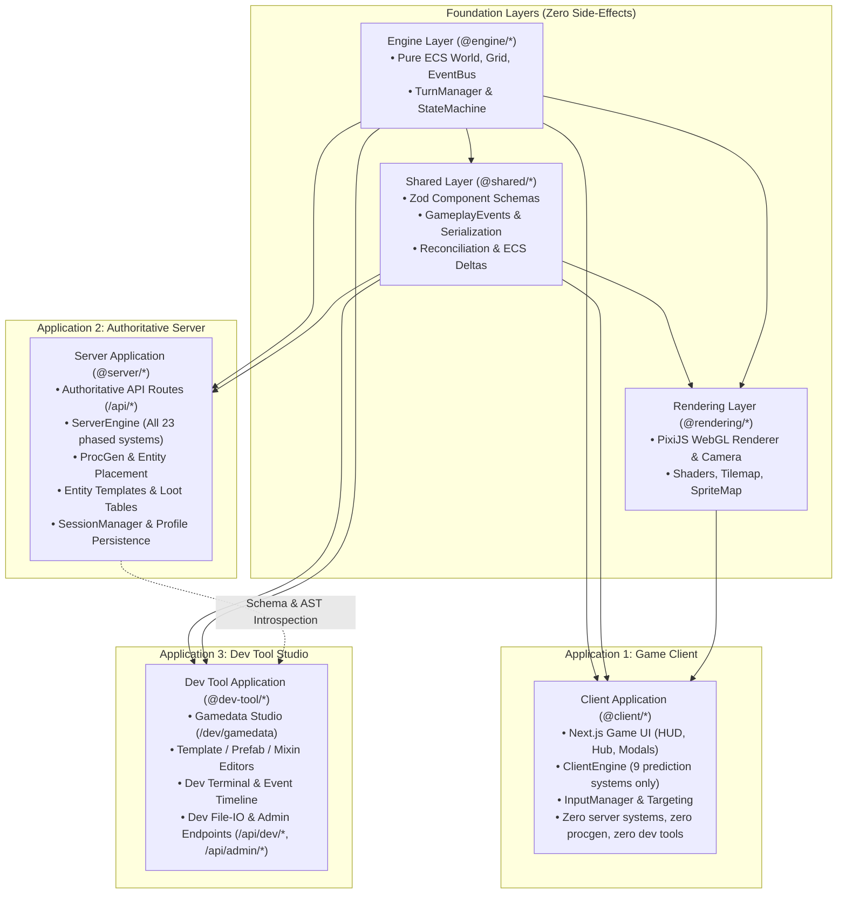
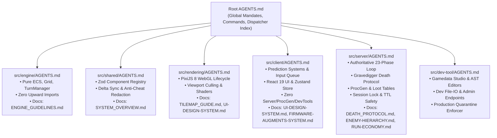

# Application Separation Architecture Spec (Client, Server, Dev Tool)

## 1. Executive Summary & Problem Analysis

Nirmata Runner is a turn-based, server-authoritative extraction roguelike built on Next.js 16, React 19, PixiJS 8, TypeScript, Zustand, and Zod.

Previously, the project operated as a monolithic Next.js repository where the player-facing client (`src/app/page.tsx`), the authoritative server (`src/app/api/*`, `src/server/*`), and developer tooling (`src/app/dev/gamedata/*`, `src/dev-tool/*`, `src/app/api/admin/*`) shared code and runtime instances without physical or build-time boundaries.

### Architectural Deficiencies Addressed

1. **Server Logic Shipped to the Client**:
   - `createEngineInstance` previously imported all 23 phased gameplay systems, procedural dungeon generation (`generateDungeon`), entity placement algorithms, and 80+ JSON entity/loot templates into the client bundle.
2. **Client-Side ProcGen Leak (Anti-Cheat Violation)**:
   - Run initialization previously executed `createEngineInstance({ isClient: true, seed })` locally in the browser, creating unredacted enemy placements and container loot before running `redactWorldForClient`.
3. **Dev Tools & Cheats Exposed to Players**:
   - `DevTerminal`, `EventTimelinePanel`, and `window.__DEBUG__` (`DebugAPI`) were bundled directly into client components.
   - `DEBUG_COMMAND` intents were processed by the server without environment checks.
   - Administrative (`/api/admin/*`) and dev data (`/api/dev/gamedata/*`) endpoints lacked build-level gating.
4. **Server Coupled to Client Concerns**:
   - Server route handlers imported from `@game/*` containing client UI types, input bindings, and debug hooks without compile-time boundary enforcement.

---

## 2. Target Architecture Overview

The system is partitioned into **three distinct applications** supported by **three shared foundation layers**:



### Boundary & Isolation Matrix

| Layer / App | May Import From | FORBIDDEN From Importing | Shipped to Client? |
| :--- | :--- | :--- | :--- |
| **`@engine`** | Self only | Everything | Yes (Core ECS) |
| **`@shared`** | `@engine`, `@shared` | `@game`, `@rendering`, `@server`, `@client`, `@dev-tool`, UI | Yes (Contracts) |
| **`@rendering`** | `@engine`, `@shared`, `@rendering` | `@server`, `@dev-tool`, Server Systems, ProcGen | Yes (Client-only) |
| **`@client`** | `@engine`, `@shared`, `@rendering`, `@client` | `@server`, `@dev-tool`, ProcGen, Entity Templates, Server Systems | **YES (Player Web)** |
| **`@server`** | `@engine`, `@shared`, `@server` | `@rendering`, `@client`, `@dev-tool` UI, PixiJS, Canvas, React DOM | **NO (Server only)** |
| **`@dev-tool`** | `@engine`, `@shared`, `@server` (schemas/AST), `@rendering` (previews) | Production runtime code should NOT import `@dev-tool` | **NO (Dev only)** |

---

## 3. Detailed Design of the Three Applications

### 3.1 Application 1: Game Client (`@client`)
- **Scope**:
  - Web UI: `HUDOverlay`, `MainMenu`, `HubLayout`, and gameplay modals.
  - Renderer: `RenderSystem`, camera, FOV shading, sprite management.
  - Client Engine (`createClientEngine`): Instantiates an empty `World`, `Grid`, and registers **only the 9 prediction-safe systems**:
    - `MovementSystem` (`isClient: true`)
    - `TeleportSystem`
    - `EquipmentSystem`
    - `AnchorInteractionSystem`
    - `FirmwareSystem`
    - `AugmentSystem`
    - `SoftwareSystem`
    - `ShellStatsSystem`
    - `TagCleanupSystem`
  - Network Reconciliation: Sends player actions (`MOVE`, `VENT`, `USE_FIRMWARE`, `INTERACT_PROP`, etc.) to `/api/action` and reconciles authoritative server snapshots/deltas via `applyStateDelta`.
- **Anti-Cheat & Hardening**:
  - **No Client ProcGen**: The client NEVER runs `generateDungeon` or `placeEntities`.
  - **Initial State Handshake**: `/api/run-mode/launch` and `/api/session` return a pre-redacted initial `FULL` state snapshot (`world`, `grid`, `playerId`). The client loads this via `applyStateDelta` without knowing the run seed or hidden entities.
  - **Zero Dev Tool Artifacts**: No `DevTerminal`, `EventTimelinePanel`, `window.__DEBUG__`, `AutoPathfinder`, or debug hotkeys in production builds.

### 3.2 Application 2: Authoritative Server (`@server`)
- **Scope**:
  - Authoritative API routes: `/api/action`, `/api/run-mode/launch`, `/api/run-mode/available`, `/api/session`, `/api/profile`, `/api/vault/*`, `/api/economy/*`, `/api/leaderboard/*`.
  - Authoritative Simulation (`createServerEngine`): Instantiates `World`, `Grid`, deterministic `TurnManager`, and registers all 23 systems (including `CombatSystem`, `AISystem`, `RewardDropSystem`, `StabilitySystem`, `TileCorruptionSystem`, `GravediggerSystem`, `HeatSystem`, `KernelPanicSystem`).
  - ProcGen: Authoritative procedural dungeon generator (`dungeon-generator.ts`) and entity placement (`entity-placement.ts`).
  - Game Templates: All JSON entity templates, mixins, shells, and spawn tables.
  - Persistence & Security: `SessionManager` (session locks, LRU eviction, sliding TTL), `FsProfileRepository`, `LeaderboardService`, and client redaction (`redactWorldForClient`).
- **Hardening**:
  - Zero imports of `@rendering`, PixiJS, WebGL, or React DOM.
  - Rejection of `DEBUG_COMMAND` in production environments with `403 Forbidden`.

### 3.3 Application 3: Dev Tool Studio (`@dev-tool`)
- **Scope**:
  - Gamedata Studio UI: Editors for Prefabs, Shells, Entities, Mixins, Configs, Spawn Tables, Component Schemas, and Augment AST.
  - Dev API Endpoints: `/api/dev/gamedata/*` for reading and writing filesystem templates and schema introspection.
  - Admin Endpoints: `/api/admin/*` for item grants, currency testing, attempt resets, and seed inspection.
  - In-Engine Diagnostics: Standalone `DevTerminal`, `EventTimelinePanel`, `DebugAPI`, and `AutoPathfinder`.
- **Isolation Strategy**:
  - Excluded from the production client bundle and production server routing table.
  - Next.js 16 route proxy (`src/proxy.ts`) returns `404 Not Found` for dev/admin routes in production.
  - Runs in development mode (`NODE_ENV === 'development'`) or via `npm run dev:studio`.

---

## 4. Implementation Details

### 4.1 Client vs. Server Factory Functions
- `src/client/game/client-engine-factory.ts`: Boots client engine with an empty `World` and `Grid`. Zero imports of server systems, procgen, or templates.
- `src/server/game/server-engine-factory.ts`: Boots authoritative server engine with deterministic turn scheduling, 23 phased systems, procedural generation, and entity placement.

### 4.2 Route Protection Proxy (`src/proxy.ts`)
```ts
import { NextResponse, type NextRequest } from 'next/server';

export function proxy(request: NextRequest) {
  if (process.env.NODE_ENV === 'production') {
    const pathname = request.nextUrl.pathname;
    if (
      pathname.startsWith('/dev') ||
      pathname.startsWith('/api/dev') ||
      pathname.startsWith('/api/admin') ||
      pathname.startsWith('/api/debug')
    ) {
      return new NextResponse('Not Found', { status: 404 });
    }
  }

  return NextResponse.next();
}

export const config = {
  matcher: ['/dev/:path*', '/api/dev/:path*', '/api/admin/:path*', '/api/debug/:path*'],
};
```

### 4.3 ESLint Boundary Enforcement (`eslint.config.js`)
Configured `import-x/no-restricted-paths` across all architectural boundaries:
- `@engine/**` pure (0 external dependencies).
- `@shared/**` pure (imports only `@engine` and `@shared`).
- `@client/**` cannot import `@server/**` or `@dev-tool/**`.
- `@rendering/**` cannot import `@server/**` or `@dev-tool/**`.
- `@server/**` cannot import `@rendering/**`, `@client/**`, or `@dev-tool/**`.

---

## 5. Progressive Disclosure Documentation (`AGENTS.md` Hierarchy)

To eliminate cognitive overload, maintain strict architectural discipline, and provide scoped guidance for autonomous agents and engineers, the codebase employs a **Progressive Disclosure** model anchored by nested `AGENTS.md` files:



### Layer Rulebooks Summary
1. **Root `AGENTS.md`**: Global dispatch table, development commands, and core non-negotiable mandates.
2. **`src/engine/AGENTS.md`**: Pure ECS, TurnManager adapter hooks, spatial grid indexing, zero dependencies.
3. **`src/shared/AGENTS.md`**: Zod component registry, delta serialization, client redaction invariants, event taxonomy.
4. **`src/rendering/AGENTS.md`**: PixiJS WebGL lifecycle, sprite map sync, FOV shaders, filter destruction.
5. **`src/client/AGENTS.md`**: 9 prediction systems, input buffer queue, Zustand store, zero server/procgen/dev tools.
6. **`src/server/AGENTS.md`**: Authoritative 23-phase loop, Gravedigger Death Protocol, procgen, session locks/TTL.
7. **`src/dev-tool/AGENTS.md`**: Gamedata Studio editors, schema AST builders, dev APIs, production quarantine.
