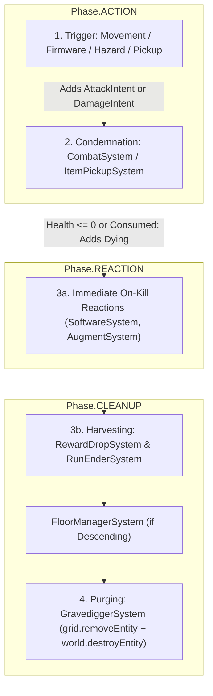

# Death Protocol: The `Dying` Pipeline

This document defines the canonical process for entity destruction in Nirmata Runner. To ensure simulation determinism, spatial grid consistency, and proper reward processing, all entity removals **must** follow this lifecycle.

## The Golden Rule of Death
**No gameplay system except [`GravediggerSystem`](../../src/game/systems/gravedigger.ts) is allowed to call `world.destroyEntity()`.**

Any system that determines an entity should be removed (due to fatal combat damage, item pickup, software consumption, hazard expiration, or floor teardown) must instead mark the entity with the [`Dying`](../../src/shared/components/dying.ts) component.

---

## Architecture Overview



## The 4-Step Lifecycle

### 1. The Trigger (Intent)
An entity's removal is initiated by an action or environmental tick:
- **Combat Damage**: A system attaches [`AttackIntent`](../../src/shared/components/intents.ts) or [`DamageIntent`](../../src/shared/components/intents.ts) to an entity.
- **Item / Currency Pickup**: An actor moves onto an item tile (`MovedThisTurn`).
- **Hazard Expiration**: A `DeadZone` entity's `remainingTurns` reaches zero.
- **Floor Transition**: The player triggers a `DescentIntent`.

### 2. Condemnation (Marking as `Dying`)
The authoritative system for that trigger marks the entity with `Dying`:
- **[`CombatSystem`](../../src/game/systems/combat.ts) (`Phase.REACTION`)**: Resolves `AttackIntent` and `DamageIntent`. If `Health.current <= 0`, sets `isAlive: false`, emits `ENTITY_DIED`, and attaches `Dying` (`{ killerId, reason: 'damage' }`).
- **[`StatusEffectSystem`](../../src/game/systems/status-effects.ts) (`Phase.PRE_TURN`)**: If `BLEED` DoT reduces `Health.current <= 0`, emits `ENTITY_DIED` and attaches `Dying` (`{ reason: 'bleed' }`).
- **[`ItemPickupSystem`](../../src/game/systems/item-pickup.ts) (`Phase.REACTION`)**: Attaches `Dying` (`{ reason: 'picked_up' }` or `{ reason: 'currency_picked_up' }`) to collected map items.
- **[`DeadZoneSystem`](../../src/game/systems/dead-zone.ts) (`Phase.ACTION`)**: Attaches `Dying` (`{ reason: 'expiration' }`) when a hazard expires.
- **[`FloorManagerSystem`](../../src/game/systems/floor-manager.ts) (`Phase.CLEANUP`)**: Attaches `Dying` (`{ reason: 'floor_transition' }`) to all non-protected entities before generating the next floor.

### 3. Reaction & Harvesting
While the entity still has all of its components intact (`Position`, `LootTable`, `Hostile`, etc.) alongside `Dying`:
- **Immediate Combat Reactions (`Phase.REACTION`)**: [`SoftwareSystem`](../../src/game/systems/software.ts) (`Vampire.exe` heal-on-kill) and [`AugmentSystem`](../../src/game/systems/augment.ts) (`Static_Siphon.arc`, `Neural_Feedback.arc`) query `Dying` entities after `CombatSystem` runs in `Phase.REACTION`.
- **Loot & Run Resolution (`Phase.CLEANUP`)**:
  - **[`RewardDropSystem`](../../src/game/systems/reward-drop.ts)**: Queries `(Dying, Position)`, rolls currency and `LootTable` drops, and spawns item entities at the dying entity's coordinates.
  - **[`RunEnderSystem`](../../src/game/systems/run-ender.ts)**: Checks if the Player has `Dying` (or if stability collapsed / `System_Admin` made contact) to emit `RUN_ENDED`.

### 4. Purging (The Gravedigger)
[`GravediggerSystem`](../../src/game/systems/gravedigger.ts) runs in `Phase.CLEANUP` after `RewardDropSystem`, `RunEnderSystem`, and `FloorManagerSystem`:
1. Queries all entities with `Dying`.
2. Reads `Position` (if present) and calls `grid.removeEntity(id, pos.x, pos.y)` and `grid.removeItem(id, pos.x, pos.y)`.
3. Calls `world.destroyEntity(id)` to permanently remove the entity (and any hierarchical children) from the ECS stores.
4. Finally, [`TagCleanupSystem`](../../src/game/systems/tag-cleanup.ts) and [`KernelPanicSystem`](../../src/game/systems/kernel-panic.ts) complete the end-of-sequence cleanup.

---

## Technical Specifications

### The `Dying` Component ([`src/shared/components/dying.ts`](../../src/shared/components/dying.ts))
```typescript
export const Dying = defineComponent(
  'Dying',
  z.object({
    killerId: z.number().optional(),
    reason: z.string().default('damage'),
  }),
);
```

### The `DamageIntent` Component ([`src/shared/components/intents.ts`](../../src/shared/components/intents.ts))
Use `DamageIntent` to request damage without calculating armor mitigation manually:
```typescript
export const DamageIntent = defineComponent(
  'damageIntent',
  z.object({
    attackerId: z.number(),
    targetId: z.number(),
    amount: z.number(),
    damageType: z.enum(['physical', 'neural', 'environmental']).default('physical'),
  }),
);
```

### Implementation Checklist
- [ ] **Never** call `world.destroyEntity()` outside `GravediggerSystem`.
- [ ] **Always** attach `Dying` when an entity's health reaches zero or an item/hazard is consumed.
- [ ] Pass `killerId` on `Dying` whenever an actor is responsible for the kill so on-kill Augments and Software can identify the killer.
