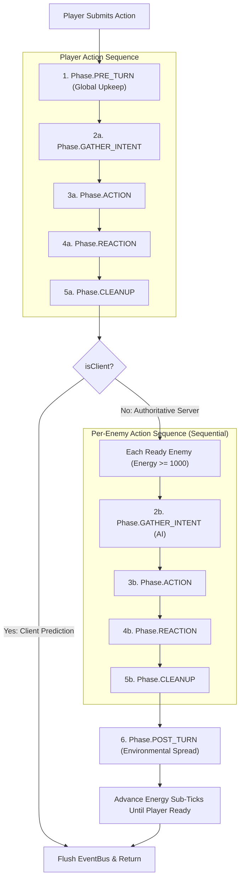

# Engine Architecture & ECS Guidelines

This document outlines the strict design patterns governing the Entity-Component-System (ECS) architecture in Nirmata Runner. All features, components, and systems **must** adhere to these rules to maintain a deterministic, serializable, and bug-free simulation.

---

## Core Philosophy: The Phase-Driven Intent Pattern

**The Golden Rule:** No internal gameplay system may emit an event to command another internal system to perform game logic, nor call another system's methods directly (no internal RPCs).

If System A needs System B to perform an action, System A must attach an **Intent Component** (or transient **Tag Component**) to the target entity. System B will then query and evaluate that component during its designated execution `Phase`.

The `EventBus` is strictly reserved for crossing domain boundaries:
* **Engine/Game → UI**: Signaling the React/Zustand UI bridge (`sync-bridge.ts`) to refresh (e.g., `HEAT_CHANGED`, `STATE_RECONCILED`).
* **Engine/Game → Renderer**: Signaling PixiJS (`render-system.ts`) to play animations or shaders (e.g., `ENTITY_MOVED`, `DAMAGE_DEALT`).
* **UI/Input → Engine**: External layers signaling user decisions (e.g., `PLAYER_ACTION`, `ANCHOR_DECISION_MADE`).

---

## The Turn Lifecycle

The simulation advances deterministically through discrete phases orchestrated by [`TurnManager`](../../src/engine/turn/turn-manager.ts) and [`GameTurnAdapter`](../../src/game/turn/game-turn-adapter.ts). Systems are registered to phases in [`registerCoreSystems`](../../src/game/systems/registration.ts) (and [`createEngineInstance`](../../src/game/engine-factory.ts)).



### Why the 4-Phase Action Sequence Runs Per-Actor
During a turn cycle on the server, the 4-phase sequence (`GATHER_INTENT → ACTION → REACTION → CLEANUP`) runs once for the acting player (`Acting` tag attached), and then **repeats sequentially for each ready enemy** rather than batching all actors simultaneously:
1. **Sequential Board Truth**: Enemy B evaluates `GATHER_INTENT` against the updated grid positions resulting from the Player's and Enemy A's moves.
2. **Immediate Death Pruning**: If the player kills an enemy during the player's action sequence, `GravediggerSystem` purges that enemy in the player's `CLEANUP` phase before `processEnemyTurns()` checks `isActorActive(enemyId)`.
3. **Scoped Transient Tags**: Single-actor tags (`Acting`, `MovedThisTurn`, `DealtDamageThisTurn`, `FirmwareActivatedThisTurn`) are wiped by `TagCleanupSystem` at the end of each actor's `CLEANUP` phase so they never bleed across actors.

### Phase Definitions & Registered Systems
1. **`PRE_TURN`**: Global upkeep before action resolution (`ShellStatsSystem`, `StabilitySystem`, `HeatSystem` passive dissipation, `StatusEffectSystem` duration ticks & DoT).
2. **`GATHER_INTENT`**: Decision making (`AISystem`, `PackCoordinatorSystem` evaluate board state for the `Acting` enemy and attach `MoveIntent`, `AttackIntent`, `TeleportIntent`).
3. **`ACTION`**: Primary movement and ability execution (`TeleportSystem`, `MovementSystem` — converts blocked moves into `AttackIntent` — `EquipmentSystem`, `FirmwareSystem`, `DeadZoneSystem` hazard damage intents, `HeatSystem` active venting).
4. **`REACTION`**: Consequence & combat resolution (`CombatSystem` resolves `AttackIntent`, `DamageIntent`, `HealIntent`, and attaches `Dying`; `ItemPickupSystem`; `AnchorInteractionSystem`; `AugmentSystem` and `SoftwareSystem` evaluate on-activation/on-hit/on-kill reactions).
5. **`CLEANUP`**: Death harvesting, floor transitions, and garbage collection (`RewardDropSystem`, `RunEnderSystem`, `FloorManagerSystem`, `GravediggerSystem` entity destruction, `TagCleanupSystem`, `KernelPanicSystem`).
6. **`POST_TURN`**: Global environmental propagation (`TileCorruptionSystem`).
7. **`RENDER`**: Client-only visual presentation updates.

---

## Patterns and Anti-Patterns

### 1. Requesting Actions (Intents vs. RPC)

Do not use the `EventBus` or direct system references to string gameplay logic together.

❌ **Anti-Pattern:**
```typescript
// System A
eventBus.emit('VENT_HEAT_REQUESTED', { entityId: 123 });

// System B
eventBus.on('VENT_HEAT_REQUESTED', (payload) => { ... });
```

✅ **Correct Pattern:**
```typescript
// Input / Action Handler
world.addComponent(entityId, VentIntent, {});

// HeatSystem (registered to Phase.ACTION)
const ventingEntities = world.query(VentIntent);
for (const id of ventingEntities) {
  // Process vent...
  world.removeComponent(id, VentIntent);
}
```

### 2. Entity Destruction (The `Dying` Tag)

See [DEATH_PROTOCOL.md](./DEATH_PROTOCOL.md). Entities must never be destroyed mid-phase because downstream reaction and cleanup systems still need to read their components (`Position`, `LootTable`, `Hostile`). Only `GravediggerSystem` may call `world.destroyEntity()`.

### 3. Component Mutation

`world.getComponent()` returns a `Readonly<T>` reference. Direct in-place mutation bypasses component store tracking and breaks delta serialization.

❌ **Anti-Pattern:**
```typescript
const health = world.getComponent(entityId, Health);
health.current -= 5; // TypeScript compile error & state drift!
```

✅ **Correct Pattern:**
```typescript
// Partial update (preferred)
world.patchComponent(entityId, Health, { current: Math.max(0, health.current - 5) });

// Full replacement
world.addComponent(entityId, Health, { ...health, current: health.current - 5 });
```

---

## Summary Checklist for New Systems

When creating a new gameplay feature:
1. [ ] **State Schema**: Define a strict Zod component schema in [`src/shared/components/`](../../src/shared/components/) and export it in `COMPONENTS_REGISTRY`.
2. [ ] **Action Trigger**: Define an `Intent` component in [`src/shared/components/intents.ts`](../../src/shared/components/intents.ts) if triggered by an actor decision.
3. [ ] **Phase Registration**: Register the system to the appropriate `Phase` in [`src/game/systems/registration.ts`](../../src/game/systems/registration.ts) (`registerCoreSystems`), respecting the `isClient` flag if the system is server-authoritative.
4. [ ] **State Updates**: Mutate components exclusively via `world.patchComponent()` or `world.addComponent()`, and route damage through `DamageIntent`.
5. [ ] **Event Tiering**: Place any new events in the proper tier (`EngineEvents`, `GameplayEvents`, or `GameEvents` — see [`AGENTS.md`](../../AGENTS.md)).
