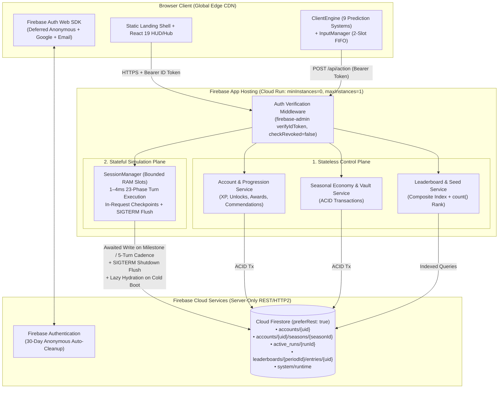
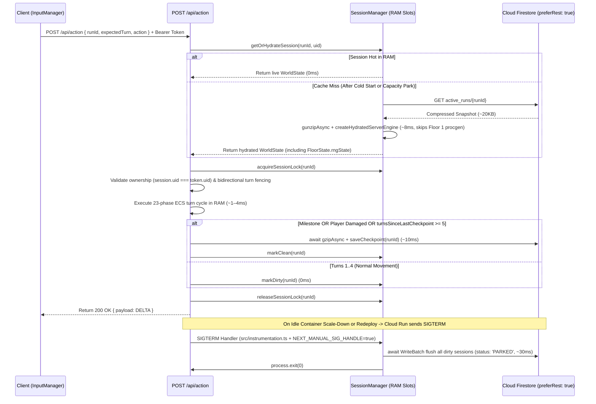

# Cloud Persistence, Session Handling & Firebase Hosting Specification

> **Status:** Draft Specification (`v3.4` — Hardened Serverless & Slot-Reservation Architecture)  
> **Companion Spec:** [`docs/design/ACCOUNTS-AUTH-AND-PROGRESSION-SPEC.md`](../design/ACCOUNTS-AUTH-AND-PROGRESSION-SPEC.md)  
> **Related Rules:** [`src/server/AGENTS.md`](../../src/server/AGENTS.md), [`docs/architecture/APPLICATION_SEPARATION_SPEC.md`](./APPLICATION_SEPARATION_SPEC.md)

---

## 1. Executive Summary & Architectural Goals

Nirmata Runner requires a production-grade, server-authoritative persistence and hosting architecture capable of supporting concurrent players with **1–4ms in-memory turn execution**, **ACID transactional meta-progression**, **crash/scale-down resilience**, **predictable near-zero baseline costs**, and **minimal operational overhead for a solo developer**.

### 1.1 Legacy Deficiencies Replaced
1. **Ephemeral Filesystem Persistence (`FSProfileRepository`, `leaderboard-service.ts`, `seed-rotation.ts`)**:
   - Replaces local `data/profiles/`, `data/leaderboards/`, and `data/seeds/` JSON file reads/writes in production with **Cloud Firestore** (via `firebase-admin` configured with `preferRest: true`), while retaining an optional fast in-memory/local repository adapter for zero-dependency offline unit/UI workflows.
   - Eliminates race conditions from unsynchronized JSON file read-modify-writes during concurrent run completions or Hub economy actions.
2. **Volatile Single-Node `SessionManager` & Global Singleton PRNG**:
   - Upgrades [`SessionManager`](../../src/server/session/session-manager.ts) into a **Bounded Slot Manager with In-Request Milestone/Cadence Checkpointing, Park-on-Eviction, and Graceful `SIGTERM` Flushing** backed by `active_runs/{runId}`.
   - Replaces module-global `rot-js` `RNG` singleton mutations during gameplay (`RewardDropSystem`, `PropInteractionSystem`, `FloorManagerSystem`) with a deterministic 32-bit `rngState` persisted directly inside the player's `FloorState` component so concurrent players never cross-contaminate RNG streams and hydrated checkpoints remain 100% deterministic.
3. **Conflated Identity (`sessionId` as Account + Run Key)**:
   - Decouples player identity (`uid` from Firebase Auth), seasonal cycle (`seasonId`), and active dungeon deployment (`runId`).

---

## 2. Hosting & Server Topology ("Logical Split Now, Physical Split Later")

### 2.1 Logical Plane Separation on Firebase App Hosting (Cloud Run)
The backend is architected as **two strictly decoupled logical planes** inside the monorepo:
1. **Stateless Control Plane (Out-of-Game Meta-Backend)**:
   - Handles Firebase Auth verification, Account & Season bootstrap (`/api/account/*`), Workshop & Vault ACID transactions (`/api/economy/*`, `/api/vault/*`), Leaderboards (`/api/leaderboard/*`), and Run Matchmaking/Slot Reservation (`/api/run-mode/launch`, `/api/run-mode/resume`, `/api/run-mode/abort`).
2. **Stateful Simulation Plane (In-Game Slot Manager)**:
   - Manages active dungeon deployments in [`SessionManager`](../../src/server/session/session-manager.ts) RAM and processes `/api/action` turns through the 23-phase ECS loop in `1–4ms`.
   - Uses a dedicated `createHydratedServerEngine()` factory on cache-miss/park recovery that registers all 23 systems without wasting CPU on throwaway Floor 1 procedural generation.

### 2.2 Single-Instance Pinning (`minInstances: 0, maxInstances: 1`) & Scale-Out Path
- **Phase 1 Deployment (Unified Container, `minInstances: 0`, `maxInstances: 1`)**:
  - Both logical planes deploy together as a single Next.js 16 container on **Firebase App Hosting** (`cpu: 1`, `memoryMiB: 1024`, `concurrency: 80`, `minInstances: 0`, `maxInstances: 1`).
  - **Why `maxInstances: 1`**:
    1. **Zero Split-Brain State Corruption**: Guarantees that 100% of active `/api/action` requests hit the single warm container instance holding `SessionManager` RAM and in-memory session locks (`tryAcquireSessionLock`). No fragile cookie-based sticky-session hacks required.
    2. **Hard Billing Circuit-Breaker**: Caps compute scaling to at most 1 container while supporting up to ~500 simultaneously active runs in RAM (~10,000+ DAU).
  - **Why `minInstances: 0` (During Dev & Limited Playtesting)**:
    - Scales to `$0.00/month` when no one has played for 15 minutes.
    - The landing page (`src/app/page.tsx`) renders as a fast static CDN shell (~150ms) and displays the thematic Taikoku `"INITIALIZING NEURAL UPLINK..."` boot sequence during the 3–5s cold start when `/api/account/bootstrap` wakes the container. Once awake, the container stays warm for 15 minutes after every action.
- **Phase 2 Upgrade Paths (Zero Code Changes)**:
  - **Eliminate Cold Starts**: Flip `minInstances: 0` → `1` in `apphosting.yaml` (or deploy the unified container to an always-on $5–$7/mo host).
  - **Physical Plane Split (Multi-Node Scale)**: Because the Control Plane and Simulation Plane only share state via `active_runs/{runId}` and signed session tickets, `SessionManager` + `/api/action` can be spun out into dedicated stateful Simulation Server containers if concurrency ever exceeds a single node.
- **100% Server-Only Database Boundary**:
  - The browser client **never** imports `firebase/firestore` or reads/writes Firestore directly.
  - All database operations execute exclusively inside `@server/*` via `firebase-admin` initialized with **`preferRest: true`** (stateless HTTP/2 transport rather than stateful gRPC sockets, shaving ~500ms off cold starts and preventing stale-socket hangs after idle CPU throttling).
  - [`firestore.rules`](../../firestore.rules) denies all direct client traffic (`allow read, write: if false;`), guaranteeing that [`redactWorldForClient()`](../../src/shared/serialization.ts) and server-side economy validation can never be bypassed.



### 2.3 Internal Server Module Boundaries (`src/server/`)
While deployed as a single service, `src/server/` is partitioned into strict domain modules so that game simulation and account management remain cleanly decoupled:

| Module Path | Plane | Responsibility |
| :--- | :--- | :--- |
| `src/server/firebase/admin.ts` | Shared | Singleton initialization of `firebase-admin` (`App`, `Auth`, `Firestore` with `{ preferRest: true }`) and automatic detection of `FIREBASE_AUTH_EMULATOR_HOST` / `FIRESTORE_EMULATOR_HOST`. |
| `src/server/auth/verify-request.ts` | Shared | Extracts and verifies the Firebase Auth Bearer ID token (`verifyIdToken(token, false)`), returning `{ uid, isAnonymous, email, providerIds }`. |
| `src/server/persistence/*` | Shared | Repository interfaces + Firestore implementations (`FirestoreAccountRepository`, `FirestoreSeasonRepository`, `FirestoreRunRepository`, `FirestoreLeaderboardRepository`, `FirestoreSystemRepository`) + local dev adapter. |
| `src/server/session/*` | **Simulation** | `SessionManager` (bounded in-memory slot store, per-run mutex lock, in-request milestone/5-turn checkpointing, LRU park-to-storage eviction, lazy hydration via `createHydratedServerEngine`, and `SIGTERM` flush handler). |
| `src/server/progression/*` | **Control** | `ProgressionEvaluator` (Account/Season XP curves, permanent/seasonal unlock evaluation, award rule matching, and `pendingCommendations` dispatch). |
| `src/server/leaderboard/*` | **Control** | Atomic leaderboard score submission, period rotation, and `count()` rank aggregation. |
| `src/instrumentation.ts` | **Simulation** | Next.js server startup hook registering the `SIGTERM` handler (`NEXT_MANUAL_SIG_HANDLE=true`) to flush all dirty sessions before `process.exit(0)`. |

---

## 3. Cloud Firestore Data Model & Collections

All documents are validated at the repository boundary using Zod schemas in `@shared/*`.

### 3.1 Collection Hierarchy Overview

```text
firestore-root/
├── accounts/{uid}                                 # Permanent player account, XP, unlocks, lifetime stats
│   └── seasons/{seasonId}                         # Multi-week seasonal profile, wallet, vault, blueprints, awards
├── active_runs/{runId}                            # Hot run metadata + gzipped ECS World & Grid checkpoint
├── run_history/{runId}                            # Immutable completed run summary (extraction/death telemetry)
├── leaderboards/{periodId}                        # Metadata for daily-YYYY-MM-DD or weekly-YYYY-WW
│   └── entries/{uid}                              # Player's best score & stats for that period
└── system/
    ├── seed_rotation                              # Current Daily/Weekly seeds & rotation timestamps
    └── season_config                              # Active seasonId, season schedule, and global flags
```

### 3.2 `active_runs/{runId}` Document Schema
Stores the authoritative checkpoint for an in-progress or parked dungeon run. Only **one** run per `uid` may have `status === 'ACTIVE' | 'PARKED'` at any time (enforced via `accounts/{uid}.activeRunId`).

```ts
export const ActiveRunDocumentSchema = z.object({
  runId: z.string().uuid(),
  uid: z.string().min(1),
  seasonId: z.string().min(1),
  runMode: z.nativeEnum(RunMode), // SIMULATION | DAILY | WEEKLY
  shellId: z.string().min(1),
  seed: z.string().min(1),
  status: z.enum(['ACTIVE', 'PARKED', 'EXTRACTED', 'FAILED', 'ABORTED']),
  floorNumber: z.number().int().min(1),
  turnNumber: z.number().int().min(0),
  playerId: z.number().int(),
  phase: z.string(),
  /**
   * Gzipped + Base64-encoded JSON payload of:
   * { world: SerializedWorld, grid: SerializedGrid }
   * Note: FloorState inside SerializedWorld includes deterministic per-session `rngState: number`.
   * Typical size: ~18–25 KB (well below Firestore's 1 MiB document limit).
   */
  compressedStateB64: z.string(),
  checkpointReason: z.enum([
    'LAUNCH',
    'TURN_CADENCE',
    'PLAYER_DAMAGED',
    'FLOOR_TRANSITION',
    'ANCHOR_INTERACTION',
    'DEAD_DROP',
    'CAPACITY_PARK',
    'SIGTERM_FLUSH',
    'RUN_ENDED',
  ]),
  createdAt: z.number(),
  updatedAt: z.number(),
  expiresAt: z.number(), // TTL timestamp (e.g., updatedAt + 14 days) for Firestore TTL auto-cleanup
});
```

### 3.3 `leaderboards/{periodId}/entries/{uid}` Document Schema
Replaces the single-file JSON array in `data/leaderboards/{periodId}.json`. Each player gets a single document keyed by their `uid` inside the period subcollection (`periodId` = `daily-20560` or `weekly-2937`).

```ts
export const LeaderboardEntryDocumentSchema = z.object({
  uid: z.string(),
  callsign: z.string(),          // e.g. "KESTREL"
  discriminator: z.string(),     // e.g. "4821" -> displayed as "KESTREL#4821"
  titleBadge: z.string().optional(),
  shellId: z.string(),
  score: z.number().int().min(0),
  floorNumber: z.number().int().min(1),
  stats: z.object({
    scrapExtracted: z.number().int(),
    softwareExtracted: z.number().int(),
    fluxExtracted: z.number().int(),
    vaultsBreached: z.number().int(),
    trapsDisarmed: z.number().int(),
    turnsElapsed: z.number().int().optional(),
  }),
  runId: z.string(),
  updatedAt: z.number(),
});
```

#### Fast Global Rank Calculation without Full Table Scans
- **Top 50 Query**:
  ```ts
  db.collection(`leaderboards/${periodId}/entries`)
    .orderBy('score', 'desc')
    .orderBy('updatedAt', 'asc') // Tie-breaker: earlier submission wins
    .limit(50)
    .get();
  ```
- **Player's Exact Global Rank (`count()` Aggregation)**:
  ```ts
  const higherScoresSnap = await db
    .collection(`leaderboards/${periodId}/entries`)
    .where('score', '>', playerScore)
    .count()
    .get();
  const rank = higherScoresSnap.data().count + 1;
  ```
  This computes a player's exact rank across 100,000+ entries in **a single server-side index aggregation** (~5ms, billed as 1 document read per 1,000 index entries matched).

### 3.4 `system/seed_rotation` & `system/season_config`
- **`system/seed_rotation`**: Stores `{ currentDailySeed, currentWeeklySeed, dailyPeriodId, weeklyPeriodId, updatedAt }`. When [`getCurrentDailySeed()`](../../src/app/persistence/seed-rotation.ts) or `getCurrentWeeklySeed()` detects that the UTC day/week period has advanced, it executes a **Firestore Transaction** (`db.runTransaction`) so that if 50 players request the new daily seed at `00:00:01 UTC`, only the first transaction generates the new seed and all 50 receive the identical seed.
- **`system/season_config`**: Stores `{ currentSeasonId, seasonName, seasonNumber, startsAt, endsAt }`.

---

## 4. High-Speed In-Game Session Handling & Server-Only Checkpointing

### 4.1 Hot In-Memory Execution + In-Request / `SIGTERM` Persistence
Because Cloud Run with `minInstances: 0` uses request-based CPU allocation (throttling container CPU to ~0% once an HTTP response completes), **all checkpoint writes must occur either synchronously inside an active HTTP request or inside the unthrottled `SIGTERM` container shutdown window**—never via post-response background `setTimeout` timers.



### 4.2 Checkpoint Triggers & Anti-Save-Scum Guarantees
A session in `SessionManager` is marked `dirty = true` after every turn, and flushed to `active_runs/{runId}` via async `promisify(zlib.gzip)(JSON.stringify({ world, grid }))` (preventing main-thread event-loop stalls) under the following policies:

1. **In-Request Milestone & Combat Checkpoints (Awaited Before HTTP Response)**:
   - **Run Launch (`LAUNCH`)**: Written inside the launch transaction before returning `initialState`.
   - **Floor Transition (`FLOOR_TRANSITION`)**: Flushed immediately when descending via Staircase or Stability Anchor.
   - **Anchor Stabilization (`ANCHOR_INTERACTION`)**: Flushed immediately when an Anchor is consumed.
   - **Player Damaged (`PLAYER_DAMAGED`)**: Flushed immediately whenever a turn emits `DAMAGE_DEALT` targeting the player or triggers `KERNEL_PANIC`, preventing players from waiting out container eviction to save-scum combat rolls.
   - **Dead-Drop Uplink (`DEAD_DROP`)**: Flushed alongside the profile Vault update transaction so a player cannot transmit an item to their Vault and then crash-rollback the run to keep both the item and their Flux.
   - **Run Ended (`RUN_ENDED`)**: Marks `active_runs/{runId}.status` as `'EXTRACTED' | 'FAILED' | 'ABORTED'`, clears `accounts/{uid}.activeRunId`, and writes an immutable summary to `run_history/{runId}` inside the end-of-run Firestore transaction.
2. **In-Request 5-Turn Cadence Checkpoints (`TURN_CADENCE`)**:
   - Awaited inside `/api/action` whenever **`turnsSinceLastCheckpoint >= 5`**.
   - Cuts Firestore write volume by **~80%** while adding only ~10ms once every 5 steps and keeping the number of `dirty` in-memory sessions tiny at all times.
3. **LRU Capacity Park (`CAPACITY_PARK`)**:
   - If `SessionManager` reaches `maxSessions` (e.g., `500` slots), the least-recently-accessed session is flushed to `active_runs/{runId}` with `status: 'PARKED'` *before* being evicted from RAM—never silently dropped.
4. **Reliable Container Shutdown Flush (`SIGTERM_FLUSH`)**:
   - By default, Next.js's internal `start-server.js` calls `process.exit(0)` synchronously on `SIGTERM`, which would kill async database writes mid-flight.
   - To guarantee completion:
     1. `apphosting.yaml` sets `NEXT_MANUAL_SIG_HANDLE: "true"`.
     2. `src/instrumentation.ts` registers a `process.once('SIGTERM', ...)` hook that calls `await sessionManager.flushAllDirtySessions('SIGTERM_FLUSH')` (chunked into `WriteBatch` commits of $\le 100$ docs over `preferRest: true` HTTP/2) and only calls `process.exit(0)` after the promise resolves.

### 4.3 Per-Session Deterministic PRNG (`FloorState.rngState`)
- Gameplay systems (`RewardDropSystem`, `PropInteractionSystem`, `FloorManagerSystem`) must **never** call the module-global `rot-js` `RNG.getUniform()` singleton, which would cause cross-player RNG pollution under `concurrency: 80` and lose PRNG state across checkpoint hydrations.
- Instead, the player's [`FloorState`](../../src/shared/components/floor-state.ts) component stores `rngState: number` (seeded deterministically from `runSeed` and advanced via Mulberry32 on each roll). Because `FloorState` is part of `World` (and redacted from client wire payloads if needed), PRNG state is automatically checkpointed and restored with `SerializedWorld`.

### 4.4 Bidirectional Turn Fencing, Multi-Tab Safety & Self-Healing Locks
1. **Per-Account Single Active Run Lock & Self-Healing Recovery**:
   - `accounts/{uid}` maintains `activeRunId: string | null` and `activeShellId: string | null`.
   - While `activeRunId !== null`:
     - Launching a new run returns `409 Conflict` (`ACTIVE_RUN_EXISTS`) until the player either resumes or aborts the existing run.
     - Mutating the active Shell's installed items or Vault loadout via `/api/economy/*` or `/api/vault/*` is rejected (`423 Locked: Cannot modify loadout while a deployment is active`).
   - **Self-Healing Zombie Lock Guard**: If `/api/run-mode/resume` or `/api/account/bootstrap` sees `account.activeRunId !== null`, but `active_runs/{activeRunId}` is missing, expired, or already terminal in Firestore, the server automatically clears `account.activeRunId = null` without applying a death penalty so an account can never be permanently soft-locked.
2. **Bidirectional Turn Number Fencing (`expectedTurnNumber`)**:
   - `ActionRequestSchema` includes `turnNumber: z.number().int().optional()`.
   - When `SessionManager` processes an action:
     - **Server Ahead (`serverTurn > clientTurn`)**: E.g., the player acted in another tab. The server skips executing the stale action and responds with a `FULL` sync payload at the authoritative `serverTurn`.
     - **Server Behind (`serverTurn < clientTurn`)**: E.g., an unhandled container crash recovered from an earlier 5-turn checkpoint. The server does not execute the out-of-sync delta action; instead, it responds with a `FULL` sync payload at `serverTurn` plus a `MESSAGE_EMITTED` notification (`"SIGNAL RESYNCED TO LAST CHECKPOINT"`) so the client reconciles cleanly.
     - **Checkpoint Write Precondition**: Firestore checkpoint updates verify `turnNumber >= existing.turnNumber` to prevent out-of-order overwrites.

---

## 5. Transactional Economy & Concurrency Control

All out-of-game state mutations (`/api/economy/*`, `/api/vault/*`, `/api/run-mode/launch`, and `DEAD_DROP_TRANSMITTED` / `RUN_ENDED` in `/api/action`) must execute inside **`db.runTransaction()`**:

```ts
await db.runTransaction(async (tx) => {
  const accountRef = db.collection('accounts').doc(uid);
  const seasonRef = accountRef.collection('seasons').doc(seasonId);
  const [accountSnap, seasonSnap] = await tx.getAll(accountRef, seasonRef);

  // 1. Validate preconditions (no active run lock, sufficient Scrap/Flux, slot capacity)
  // 2. Apply pure domain logic mutations
  // 3. Commit atomically via tx.set / tx.update
});
```

This guarantees that rapid double-clicks or parallel requests to `/api/economy/compile`, `/api/vault/sell`, or `/api/run-mode/launch` serialize cleanly at the database level with zero possibility of currency duplication or negative balances.

---

## 6. Firebase Configuration & Local Development Workflow

### 6.1 Required Project Configuration Files
1. **`firebase.json`**:
   - Configures `apphosting`, `firestore` (`firestore.rules`, `firestore.indexes.json`), `auth` providers (Anonymous with 30-day auto-cleanup, Email/Password, Google), and `emulators` (`auth` on port `9099`, `firestore` on port `8080`, `ui` on port `4000`).
2. **`apphosting.yaml`**:
   - Configures Cloud Run resource limits (`cpu: 1`, `memoryMiB: 1024`, `concurrency: 80`, `minInstances: 0`, `maxInstances: 1`) and sets `NEXT_MANUAL_SIG_HANDLE: "true"`.
   - Configure a GCP Artifact Registry cleanup policy retaining only the 3 most recent container images to stay within the free storage tier.
3. **`firestore.rules`**:
   ```firestore
   rules_version = '2';
   service cloud.firestore {
     match /databases/{database}/documents {
       // 100% Server-Authoritative: All reads and writes go through Next.js API routes via firebase-admin.
       match /{document=**} {
         allow read, write: if false;
       }
     }
   }
   ```
4. **`firestore.indexes.json`**:
   - Composite index on collection group `entries`: `score DESC`, `updatedAt ASC` for instant leaderboard queries.
   - Composite index on `active_runs`: `uid ASC`, `status ASC` for active deployment lookup.

### 6.2 Local Development & Testing Workflow
- **Repository Abstraction (`src/server/persistence/*`)**:
  - Production and full-stack integration tests use `Firestore*Repository` (connected to Cloud Firestore or `FIRESTORE_EMULATOR_HOST="127.0.0.1:8080"`).
  - For fast offline UI/gameplay iteration without booting the JVM-based Firebase Emulator Suite, `npm run dev` can optionally fall back to an in-memory/file repository implementation conforming to the exact same repository interfaces when `FIRESTORE_EMULATOR_HOST` is unset.
- **Unit & Integration Tests (`npm test`)**:
  - Unit tests for API routes inject an in-memory repository implementation, keeping `npm test` execution under a few seconds.
  - Repository contract tests validate Firestore transactions and composite queries against the local Firestore emulator.
