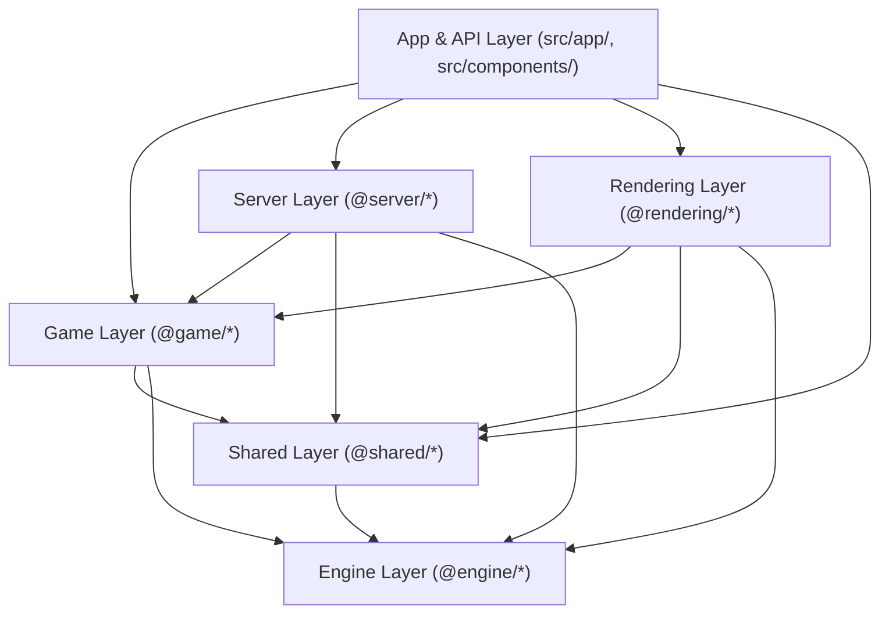

# System Architecture Overview

Nirmata Runner is a server-authoritative, turn-based extraction roguelike built with **Next.js (App Router)**, **React 19**, **PixiJS 8**, **Zustand**, **Zod**, and a custom data-oriented **Entity-Component-System (ECS)** engine.

---

## 1. Layer Hierarchy & Dependency Boundaries

Strict module boundaries are enforced via TypeScript path aliases (`tsconfig.json`) and ESLint (`eslint.config.js` `import-x/no-restricted-paths`).

| Layer | Alias / Path | Responsibility | Allowed Internal Imports |
| :--- | :--- | :--- | :--- |
| **Engine** | `@engine/*` (`src/engine/`) | Pure, game-agnostic ECS (`World`), 2D spatial `Grid`, queued `EventBus`, energy-based `TurnManager` (via `TurnSchedulerAdapter`), `StateMachine`, JSON `EntityBuilder`/`EntityFactory`, and BSP/FloodFill generation primitives. | `@engine/*` only (**zero** upward dependencies). |
| **Shared** | `@shared/*` (`src/shared/`) | Cross-environment contracts: 40+ Zod component schemas (`src/shared/components/`), `GameplayEvents`, world/grid serialization, component-level delta calculation (`ecs-delta.ts`), client reconciliation (`reconciliation.ts`), and profile/vault schemas. | `@engine/*`, `@shared/*`. *(Note: legacy imports into `@game/*` in `pipeline.ts` and `economy-util.ts` are tracked for decoupling in [TRACKING.md](../TRACKING.md)).* |
| **Game** | `@game/*` (`src/game/`) | Nirmata Runner gameplay systems (`src/game/systems/`), `GameTurnAdapter`, JSON entity/mixin/shell templates, dungeon & entity placement, client input/targeting, and the Zustand UI store + `syncEngineToStore` bridge. | `@engine/*`, `@shared/*`, `@game/*`. |
| **Rendering** | `@rendering/*` (`src/rendering/`) | PixiJS WebGL renderer, `@pixi/tilemap` terrain builder, camera lerp & viewport culling, FOV shading, sprite lifecycle management (`EntitySpriteMap`), and post-processing filters (Heat, Glitch, Death particles). | `@engine/*`, `@shared/*`, `@game/*`, `@rendering/*`. |
| **Server** | `@server/*` (`src/server/`) | In-memory active session store (`session-manager.ts`) and authoritative leaderboard persistence service (`leaderboard-service.ts`). | `@engine/*`, `@shared/*`, `@game/*`, `@server/*`. |
| **App / UI** | `src/app/`, `@components/*` | Next.js App Router pages (`/` game client, `/dev/gamedata` authoring studio), REST API routes (`src/app/api/`), filesystem profile/seed persistence (`src/app/persistence/`), and React HUD/Hub overlays (`src/components/ui/`). | All layers. |

---

## 2. Client Prediction & Server Authority Flow

The runtime operates on a **Client Prediction + Authoritative Server Delta Reconciliation** model:

1. **Client Engine Initialization (`isClient: true`)**:
   - [`createEngineInstance`](../../src/game/engine-factory.ts) and [`registerCoreSystems`](../../src/game/systems/registration.ts) initialize **only** prediction-safe movement/intent systems on the client (`shellStats`, `teleport`, `movement`, `equipment`, `anchorInteraction`, `augment`, `software`, `firmware`, `tagCleanup`).
   - Server-authoritative simulation systems (`combat`, `ai`, `itemPickup`, `stability`, `deadZone`, `statusEffect`, `packCoordinator`, `tileCorruption`, `rewardDrop`, `runEnder`, `floorManager`, `gravedigger`, `heat`, `kernelPanic`) run exclusively on the server (`isClient: false`).
   - On the client, [`TurnManager.executeTurnCycle`](../../src/engine/turn/turn-manager.ts) executes `PRE_TURN` and the player's 4-phase action sequence (`GATHER_INTENT -> ACTION -> REACTION -> CLEANUP`), then returns immediately without simulating enemy turns or energy sub-ticks.

2. **Buffered Input & Action Submission**:
   - [`InputManager`](../../src/game/input/input-manager.ts) buffers rapid keystrokes (FIFO queue up to 2 actions) while an HTTP request is in flight.
   - Local player movement predicts immediately on the client (tagged with `EventOriginContext.current = 'client'`).
   - The client sends `POST /api/action` with `{ sessionId, action }`.

3. **Authoritative Server Tick (`src/app/api/action/route.ts`)**:
   - Snapshots the pre-turn `World` and `Grid` states.
   - Attaches the corresponding Intent component or submits the action key to the server's `TurnManager`.
   - Executes the full turn cycle: `PRE_TURN` → Player 4-phase sequence → Enemy 4-phase sequences → `POST_TURN` → Energy sub-ticks until the player is next ready to act.
   - Captures all emitted `GameplayEvents` during the tick.
   - If `RUN_ENDED` is emitted, persists currency/extracted items to the player profile (`data/profiles/{sessionId}.json`) and records competitive scores via `submitLeaderboardEntry`.
   - Returns either:
     - `FULL` sync payload (on turn 1, `FLOOR_TRANSITION`, or `DUNGEON_GENERATED`), or
     - `DELTA` sync payload containing component-level diffs (`createECSWorldDelta` in [`src/shared/ecs-delta.ts`](../../src/shared/ecs-delta.ts)), grid tile diffs (`json-diff-ts`), and captured server events.

4. **Client Reconciliation (`src/shared/reconciliation.ts`)**:
   - [`applyStateDelta`](../../src/shared/reconciliation.ts) sets `EventOriginContext.current = 'server'`.
   - Applies `world.applyDelta(payload.worldDelta)` (or `world.loadSerializableState` on `FULL` sync) and patches the `Grid`.
   - Replays server events onto the client `EventBus` and emits `STATE_RECONCILED`.
   - [`RenderSystem`](../../src/rendering/render-system.ts) deduplicates already-predicted player movement animations and reconciles `EntitySpriteMap` against the authoritative ECS `Sprite` store to clean up destroyed entities and spawn newly created ones.

---

## 3. Key Entry Points

| Entry Point | File | Purpose |
| :--- | :--- | :--- |
| **Web Client Root** | [`src/app/page.tsx`](../../src/app/page.tsx) | Mounts the PixiJS canvas, React HUD overlays, and Neural Deck Hub UI. |
| **Game Bootstrap** | [`src/game/setup.ts`](../../src/game/setup.ts) | Wires client `EngineInstance`, `InputManager`, network sync, and `syncEngineToStore`. |
| **Engine Factory** | [`src/game/engine-factory.ts`](../../src/game/engine-factory.ts) | Creates `World`, `Grid`, `EventBus`, `TurnManager`, and spawns floor 1 entities. |
| **System Registry** | [`src/game/systems/registration.ts`](../../src/game/systems/registration.ts) | Registers gameplay systems into their deterministic `Phase` slots. |
| **Action API** | [`src/app/api/action/route.ts`](../../src/app/api/action/route.ts) | Validates and executes authoritative player actions, persistence, and state deltas. |
| **Run Launch API** | [`src/app/api/run-mode/launch/route.ts`](../../src/app/api/run-mode/launch/route.ts) | Enforces Daily/Weekly attempt limits, initializes server sessions, and returns initial state. |
| **Gamedata Studio** | [`src/app/dev/gamedata/page.tsx`](../../src/app/dev/gamedata/page.tsx) | Visual editor for entity templates, mixins, shells, spawn tables, and Zod component schemas. |
