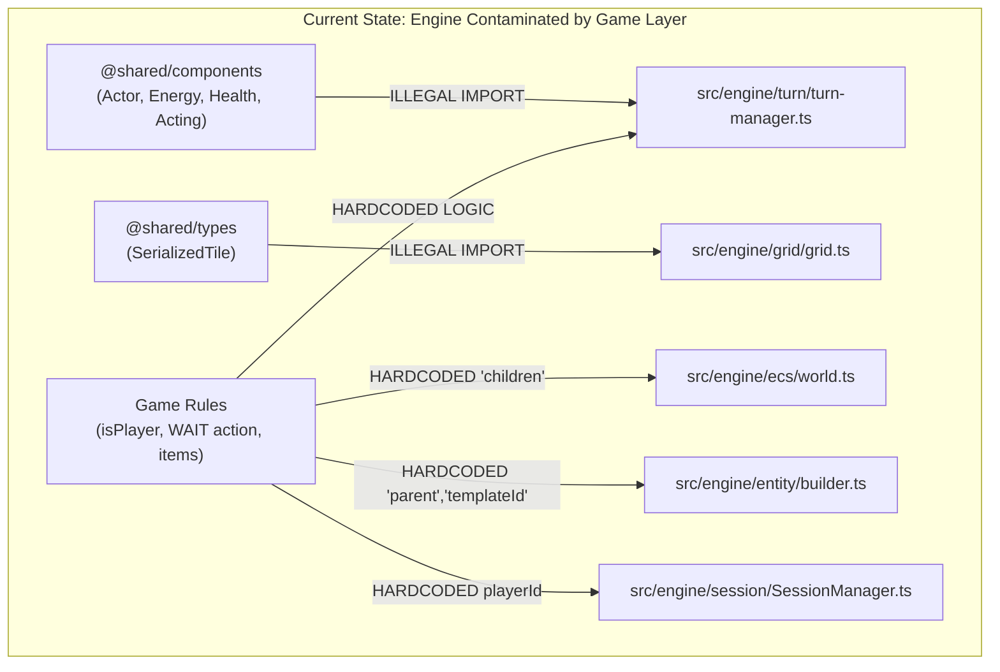

# Nirmata Runner: Engine & Game Decoupling Report
**Date**: October 26, 2026  
**Scope**: Complete Architectural Review, Exhaustive Feature Inventory, Coupling Audit, and Engine Decoupling Blueprint  
**Status**: Authoritative Architectural Plan  

---

## 1. Executive Summary

This report delivers a comprehensive architectural review of **Nirmata Runner**, specifically focusing on the separation between the **Engine Layer** (`src/engine/`) and the **Game Layer** (`src/game/` and `src/shared/`).

### 1.1 Architectural Vision
As established in `ARCHITECTURE.md` and `GEMINI.md`:
* **The Engine Layer (`src/engine/`)** must provide pure, generic Entity-Component-System (ECS), spatial grid, event bus, and turn-scheduling primitives. **It must depend on nothing outside `src/engine/`** and possess zero knowledge of Nirmata Runner's game mechanics, rules, component definitions, or content schemas.
* **The Shared Layer (`src/shared/`)** contains cross-cutting contracts, authoritative serialization, reconciliation logic, and game components shared by client and server.
* **The Game Layer (`src/game/`)** implements the game rules, systems, state machines, entity templates, level generation algorithms, input handling, and client-side stores.

### 1.2 Current State Assessment
The codebase is currently in a highly functional state, with **560 tests passing across 98 test files**, a clean TypeScript check (`tsc --noEmit`), and a successful production build (`next build`). Following earlier architectural initiatives, the game has largely adopted the **Phase-Driven Intent Pattern** and the **Death Protocol (`GravediggerSystem`)**.

However, an audit of the boundary reveals that **the Engine Layer is not yet fully decoupled from game data and game features**. Specific leaks, including hardcoded component keys in the core ECS `World`, direct imports of `@shared/components` inside `TurnManager`, hardcoded item layers and shared type imports in `Grid`, and game-specific fields in `SessionManager`, compromise the engine's generic purity.

This document details:
1. An exhaustive inventory of all features accounted for in both the engine and game.
2. A forensic breakdown of every coupling and data leak between engine and game.
3. A concrete, phased implementation plan to achieve 100% engine purity without regressions.

---

## 2. Complete Inventory of Features Accounted For

Below is the exhaustive, categorized inventory of every feature implemented across `src/engine/`, `src/game/`, and `src/shared/`.

### 2.1 Engine Features (`src/engine/`)

| Subsystem | File / Module | Core Capabilities & Features Accounted For |
| :--- | :--- | :--- |
| **ECS World** | `src/engine/ecs/world.ts`<br>`src/engine/ecs/types.ts` | • Sequential numeric entity ID generation (`EntityId`).<br>• Entity lifecycle management (`createEntity`, `destroyEntity`, `entityExists`).<br>• Component store management (`Map<string, Map<EntityId, unknown>>`).<br>• Type-safe Component definitions via Zod schemas (`ComponentDef<T>`, `defineComponent`).<br>• Component CRUD (`addComponent`, `getComponent`, `patchComponent`, `removeComponent`, `hasComponent`).<br>• Multi-component entity querying with store-size optimization (`query(...defs)`).<br>• System registration & execution pipeline by phase (`registerSystem`, `unregisterSystem`, `executeSystems`).<br>• Full world state serialization & hydration (`getSerializableState`, `loadSerializableState`). |
| **System Phases** | `src/engine/ecs/types.ts` | • Discrete turn phases: `PRE_TURN`, `GATHER_INTENT`, `ACTION`, `REACTION`, `CLEANUP`, `POST_TURN`, `RENDER`. |
| **Event Bus** | `src/engine/events/event-bus.ts`<br>`src/engine/events/types.ts` | • Type-safe queued event emitter (`on`, `off`, `emit`, `onAny`, `offAny`).<br>• Deferred batch event flushing (`flush`) with max flush depth guard against cascading loops.<br>• Queue clearing and inspection (`clear`, `getPendingQueue`).<br>• Structural engine lifecycle events: `ENTITY_CREATED`, `ENTITY_DESTROYED`, `COMPONENT_ADDED`, `COMPONENT_REMOVED`, `TURN_START`, `TURN_END`. |
| **Spatial Grid** | `src/engine/grid/grid.ts`<br>`src/engine/grid/types.ts` | • 1D flat array representation of 2D coordinates (`width * height`).<br>• Coordinate conversions (`toIndex`, `inBounds`).<br>• Tile inspection and mutation (`getTile`, `setTile`, `isWalkable`, `isTransparent`).<br>• Entity spatial index (`addEntity`, `removeEntity`, `moveEntity`, `getEntitiesAt`).<br>• Item spatial index (`addItem`, `removeItem`, `getItemsAt`).<br>• Grid serialization and hydration (`getSerializableTiles`, `loadSerializableTiles`). |
| **Entity Composition & Templates** | `src/engine/entity/registry.ts`<br>`src/engine/entity/factory.ts`<br>`src/engine/entity/builder.ts`<br>`src/engine/entity/types.ts` | • Raw JSON template storage (`EntityRegistry`).<br>• Recursive mixin inheritance resolution (`resolveMixins`).<br>• Cyclic dependency detection and max recursion depth enforcement.<br>• Component conflict validation across mixins.<br>• Deep-merge override application.<br>• Schema parsing and deep-clone isolation per component (`buildEntity`).<br>• Recursive child entity instantiation with hierarchical linking.<br>• Template ID tagging. |
| **Procedural Generation Utilities** | `src/engine/generation/bsp.ts`<br>`src/engine/generation/flood-fill.ts`<br>`src/engine/generation/types.ts` | • Binary Space Partitioning (BSP) tree room splitting.<br>• Room dimension constraints (`minRoomSize`, `maxRoomSize`, `minRooms`, `maxSplitDepth`).<br>• L-shaped corridor connecting algorithm between adjacent partitions.<br>• Deterministic rot-js RNG integration.<br>• Flood-fill connectivity validator (`validateConnectivity`).<br>• Geometric data structures (`Room`, `Corridor`, `GeneratorConfig`, `GeneratorResult`). |
| **Finite State Machine** | `src/engine/state-machine/state-machine.ts`<br>`src/engine/state-machine/types.ts` | • Generic state machine with typed states (`StateMachine<TState, TContext>`).<br>• State transition validation against an explicit transition matrix.<br>• State lifecycle callbacks (`onEnter`, `onExit`).<br>• Context passing to active states. |
| **Turn & Energy Scheduler** | `src/engine/turn/turn-manager.ts`<br>`src/engine/turn/types.ts` | • Discrete turn number tracking.<br>• Energy threshold accumulation loop (`ENERGY_THRESHOLD = 1000`).<br>• Speed-based energy ticks across living actors.<br>• Execution cycle orchestration: `PRE_TURN` → Player Action Sequence → Enemy Turns → `POST_TURN` → Energy Sub-ticks.<br>• Action sequence stepping: `GATHER_INTENT` → `ACTION` → `REACTION` → `CLEANUP`.<br>• Turn state pause/resume controls (`pause`, `resume`, `isPaused`).<br>• State hydration (`loadState`). |
| **Session Store** | `src/engine/session/SessionManager.ts` | • In-memory multi-session store singleton (`Map<string, WorldState>`).<br>• Session container holding `World`, `Grid`, `TurnManager`, `EventBus`, and `systems`.<br>• Global development instance preservation across hot reloads. |
| **Diagnostics & Logging** | `src/engine/utils/logger.ts`<br>`src/engine/utils/event-context.ts` | • Structured console logger with categories (`TURN`, `ECS`, `SESSION`, etc.).<br>• Asynchronous context tracking via `AsyncLocalStorage` (`EventOriginContext`).<br>• Multi-environment styling: ANSI terminal color codes and browser CSS styling. |

---

### 2.2 Game Features (`src/game/` & `src/shared/`)

| Gameplay Domain | Components & Modules | Features Accounted For |
| :--- | :--- | :--- |
| **Shell Customization System** | `src/game/shells/`<br>`src/shared/components/shell.ts`<br>`src/shared/components/port-config.ts`<br>`src/game/systems/shell-stats.ts` | • Starter & unlockable shell chassis archetypes: `Vanguard-v1`, `Ghost-v1`, `Bastion-v1`.<br>• Chassis stats: Base HP, Base Energy Speed, Armor, Heat Dissipation, Max Safe Heat.<br>• Dynamic port capacities: Firmware slots (1-3), Augment slots (1-4), Software slots (1-4), Weapon & Armor slots.<br>• Runtime stat calculation and scaling based on chassis upgrade levels.<br>• Dynamic JSON archetype template loading. |
| **Neural Heat & Overclocking** | `src/shared/components/heat.ts`<br>`src/game/systems/heat.ts`<br>`src/game/systems/kernel-panic.ts`<br>`src/game/config/heat-tiers.ts` | • Heat accumulation from firing weapons, firmware abilities, and environmental corruption.<br>• Heat thresholds: Safe (0-60%), Warning (60-80%), Danger (80-100%), Overclock (>100%).<br>• Manual venting mechanic via `VentIntent` (burns full turn to dump heat).<br>• Passive heat dissipation during `PRE_TURN`.<br>• Kernel Panic trigger on critical overheat: firmware lockout, continuous self-damage ticks, and terminal shutdown risk. |
| **Firmware Ability System** | `src/shared/components/firmware-slots.ts`<br>`src/shared/components/ability-def.ts`<br>`src/game/systems/firmware.ts`<br>`src/game/input/targeting.ts` | • Active shell abilities: Dash, Dash-Attack, Ghost Pulse, System Admin, Kinetic Shock.<br>• Cooldown tracking and per-turn decrementing.<br>• Heat generation per ability activation.<br>• Targeted skill execution using mouse/keyboard reticle targeting.<br>• Ability activation intent processing via `FirmwareIntent`. |
| **Software Modules & Procs** | `src/shared/components/software-slots.ts`<br>`src/shared/components/software-def.ts`<br>`src/game/systems/software.ts`<br>`src/game/systems/software-effects.ts` | • Executable software items: `vampire.exe` (on-kill heal), `auto-loader.exe` (free ammo/cooldown recovery), `null-pointer.exe`, `logic-jam.exe`, `buffer-overflow.exe`.<br>• Run-scoped Software Inventory (`RunInventory`).<br>• Trigger evaluations during `REACTION` phase on damage dealt, kills, or moves.<br>• Software burning / deletion protocol. |
| **Augments & Synergies** | `src/shared/components/augment-slots.ts`<br>`src/shared/components/augment-data.ts`<br>`src/shared/components/augment-state.ts`<br>`src/game/systems/augment.ts`<br>`src/game/systems/augment-util.ts` | • Passive geometric hardware augments: `Kinetic Link`, `Static Siphon`, `Phase Shift`, `Displacement Venting`, `Neural Feedback`.<br>• Synergy detection across equipped augments.<br>• Visual synergy signaling via `AUGMENT_FLASH` game events. |
| **Equipment & Loadout Management** | `src/shared/components/equipment-slots.ts`<br>`src/shared/components/equipment-def.ts`<br>`src/shared/components/intents.ts`<br>`src/game/systems/equipment.ts` | • Primary weapon and armor equipping (`EquipIntent`, `UnequipIntent`).<br>• Rarity tiers: Common (v0), Uncommon (v1), Rare (v2), Legendary (v3).<br>• Loadout restrictions based on shell port configurations.<br>• In-run item swapping with action point / energy costs. |
| **Turn-Based Movement & Collision** | `src/shared/components/position.ts`<br>`src/shared/components/blocks-movement.ts`<br>`src/shared/components/moved-this-turn.ts`<br>`src/game/systems/movement.ts`<br>`src/game/systems/teleport.ts` | • 4-directional and 8-directional discrete grid movement via `MoveIntent`.<br>• Spatial blocking checks against walls, fixtures, and other entities.<br>• Automatic bump-to-attack intent conversion when moving into hostiles.<br>• Teleportation system via `TeleportIntent` (bypasses physical obstacles).<br>• Tracking of per-turn movement tags (`MovedThisTurn`). |
| **Combat & Damage Pipeline** | `src/shared/components/attack.ts`<br>`src/shared/components/defense.ts`<br>`src/shared/components/health.ts`<br>`src/shared/components/dealt-damage-this-turn.ts`<br>`src/game/systems/combat.ts` | • Authoritative damage calculation: `Math.max(1, rawDamage - armor)`.<br>• Melee bump attacks and ranged attacks via `AttackIntent` and `DamageIntent`.<br>• Status effect and critical damage integration.<br>• Death detection: tags entities with `Dying` without mid-phase destruction.<br>• Combat event emission (`DAMAGE_DEALT`, `ENTITY_DIED`). |
| **Status Effects** | `src/shared/components/status-effects.ts`<br>`src/game/systems/status-effects.ts` | • Status conditions: `BLEED` (DoT), `STUN` (energy freeze), `SLOW` (speed reduction), `CORRUPTION`.<br>• Duration ticks during `PRE_TURN`.<br>• Severity scaling and expiration events (`STATUS_EFFECT_APPLIED`, `STATUS_EFFECT_EXPIRED`). |
| **Stability & Anchor Extraction** | `src/shared/components/stability.ts`<br>`src/shared/components/anchor-marker.ts`<br>`src/game/systems/stability.ts`<br>`src/game/systems/anchor-interaction.ts` | • Floor entry stability penalties and continuous turn bleed.<br>• Degraded stability threshold penalties (stat debuffs, glitch damage).<br>• Stability Anchor fixtures providing the tactical choice: Refill Stability & Descend Deeper OR Extract Immediately.<br>• Extraction Intent handling (`ExtractionIntent`). |
| **Procedural Level & Entity Generation** | `src/game/generation/dungeon-generator.ts`<br>`src/game/generation/entity-placement.ts`<br>`src/game/generation/loot-distribution.json`<br>`src/game/generation/depth-config.json` | • Rot-js cellular and BSP floor carving.<br>• Level zoning, corridor punching, and wall border placement.<br>• Fixture placement: Staircases (`StaircaseMarker`) and Stability Anchors (`AnchorMarker`).<br>• Depth-based monster spawning (threat budget scaling by floor depth).<br>• Depth-based loot distribution curves (tier weights from v0 to v3). |
| **Enemy AI & Behavioral Archetypes** | `src/shared/components/ai-state.ts`<br>`src/shared/components/hostile.ts`<br>`src/shared/components/pack-member.ts`<br>`src/game/systems/ai.ts`<br>`src/game/systems/pack-coordinator.ts` | • **Null-Pointer**: Blink/teleport specialist, evades player line-of-sight and ambushes.<br>• **Logic-Leaker**: Ranged suppression attacker, keeps distance and fires debuffs.<br>• **Fragmenter**: High-damage suicide rusher.<br>• **Seed-Eater**: Disruptor enemy targeting resource nodes.<br>• **Pack Coordinator**: Swarm tactics, sharing target awareness and coordinating flanking. |
| **Loot, Currency & Economy** | `src/shared/components/wallet.ts`<br>`src/shared/components/currency-item.ts`<br>`src/shared/components/loot-table.ts`<br>`src/game/systems/reward-drop.ts`<br>`src/game/systems/shop-rotation.ts`<br>`src/shared/vault.ts` | • Currencies: **Scrap** (standard upgrade currency), **Blueprints** (archetype unlock tokens), **Flux** (meta-progression currency).<br>• On-kill reward drops generated in `Phase.CLEANUP` via `RewardDropSystem`.<br>• Deterministic seed-based shop inventory generation and hourly/daily rotation.<br>• Account-level permanent Vault storage (`VaultItem`, move-to-vault, overflow, sell).<br>• Compiler & upgrade station economy endpoints. |
| **Death Protocol & Gravedigger** | `src/shared/components/dying.ts`<br>`src/game/systems/gravedigger.ts`<br>`src/game/systems/run-ender.ts`<br>`src/shared/__tests__/death-pity.test.ts` | • Two-stage entity death protocol: System marks `Dying` → Systems react (loot, score, animations) → `GravediggerSystem` purges entity in `Phase.CLEANUP`.<br>• Run-ender triggering on player death or extraction.<br>• Death Pity currency retention calculation. |
| **Game Modes & Competition** | `src/shared/run-mode.ts`<br>`src/game/systems/run-mode-config.ts`<br>`src/game/systems/weekly-reset.ts`<br>`src/shared/profile.ts` | • **Neural Simulation**: Low-stakes practice mode with random seeds.<br>• **Daily Run**: Shared daily seed with public leaderboard.<br>• **One Shot Weekly Challenge**: Exactly one life per week on a global seed, permadeath enforcement, verified run submission. |
| **Floor Manager & Descent** | `src/shared/components/floor-state.ts`<br>`src/shared/components/floor-transitioned.ts`<br>`src/game/systems/floor-manager.ts` | • Floor depth tracking (`FloorState`).<br>• Staircase interaction triggering `DescentIntent`.<br>• Level teardown (marking non-player entities `Dying`) and dynamic generation of subsequent floor. |
| **Environmental Hazards** | `src/shared/components/dead-zone.ts`<br>`src/shared/components/corruption-state.ts`<br>`src/game/systems/dead-zone.ts`<br>`src/game/systems/tile-corruption.ts` | • Dead Zone hazard tiles dealing periodic environmental damage during `Phase.POST_TURN`.<br>• Tile corruption propagation spreading corrupt tiles across turns and elevating player heat. |
| **Client UI & Sync Bridge** | `src/game/ui/store.ts`<br>`src/game/ui/sync-bridge.ts`<br>`src/game/input/input-manager.ts`<br>`src/game/input/input-bridge.ts` | • Zustand client store mirroring world state for React components.<br>• Event-driven and tick-driven sync bridge (`syncEngineToStore`).<br>• Keyboard and mouse input bindings with configurable action mapping. |
| **State Machine & Flow** | `src/game/states/game-states.ts`<br>`src/game/states/types.ts` | • High-level game states: `INIT`, `PLAYING`, `COMBAT`, `DEATH`, `VICTORY`, `PAUSED`.<br>• Valid state transitions table (`GAME_TRANSITIONS`). |
| **Debug Tools & Automation** | `src/game/debug/` | • `AutoPathfinder` for autonomous navigation and testing.<br>• `DebugAPI` mounted on `window.__DEBUG__`.<br>• Server-side debug actions for inspecting world state and testing systems. |

---

### 2.3 Cross-Cutting Infrastructure (`src/shared/` & `src/engine/utils/`)

| Cross-Cutting Area | Modules | Features Accounted For |
| :--- | :--- | :--- |
| **Authoritative Action Pipeline** | `src/shared/pipeline.ts` | • Server-side intent validation and action processing (`MOVE`, `ATTACK`, `PICKUP`, `WAIT`, `USE_FIRMWARE`, `VENT_HEAT`, `EQUIP`, `UNEQUIP`, `DESCEND`, `EXTRACT`).<br>• Intent application into ECS components.<br>• Delta generation via `json-diff-ts`. |
| **Client Prediction & Reconciliation** | `src/shared/reconciliation.ts` | • Local client-side prediction of player actions.<br>• Server delta patching and rollback on reconciliation failure. |
| **State Serialization** | `src/shared/serialization.ts` | • Complete state bundle: ECS component stores + Grid tiles + TurnManager state.<br>• Deterministic JSON serialization. |
| **Event Tier Hierarchy** | `src/engine/events/types.ts`<br>`src/shared/events/types.ts`<br>`src/game/events/types.ts` | • **EngineEvents**: Structural ECS lifecycle (`ENTITY_CREATED`, etc.).<br>• **GameplayEvents**: Authoritative shared action/result events (`DAMAGE_DEALT`, `ENTITY_DIED`, etc.).<br>• **GameEvents**: Client-only rendering and UI effects (`AUGMENT_FLASH`). |

---

## 3. Coupling & Architectural Leak Audit

A forensic examination of the boundaries reveals several critical violations where game data, game concepts, and game rules have leaked into the engine layer.



### 3.1 Leak #1: `TurnManager` Imports and Hardcodes Game Components
* **Location**: `src/engine/turn/turn-manager.ts` (Lines 11, 71, 132-138, 148, 200-212, 226-229, 234-240)
* **Violation**:
  ```typescript
  import { Actor, Energy, Health, Acting } from '@shared/components';
  ```
* **Specific Issues**:
  1. `TurnManager` explicitly queries `Actor`, `Energy`, `Health`, and `Acting`.
  2. It contains hardcoded checks for `actor.isPlayer`.
  3. It inspects `Health.isAlive` to determine if an entity can act.
  4. It hardcodes action cost evaluation: `action === 'WAIT' ? this.config.waitActionCost : this.config.defaultActionCost`.
  5. It assumes the game has "Player Turns" vs "Enemy Turns".
* **Architectural Impact**: `src/engine` cannot be compiled or reused without `@shared/components`. An engine turn scheduler should know nothing about "players", "enemies", or "health".

### 3.2 Leak #2: `Grid` Imports Shared Types and Hardcodes "Items"
* **Location**: `src/engine/grid/grid.ts` (Line 3) and `src/engine/grid/types.ts` (Lines 13-16)
* **Violation**:
  ```typescript
  import { SerializedTile } from '@shared/types';
  ```
  And in `types.ts`:
  ```typescript
  export interface Tile {
    terrain: string;
    walkable: boolean;
    transparent: boolean;
    entities: Set<EntityId>;
    items: Set<EntityId>; // <--- GAME CONCEPT HARDCODED
  }
  ```
* **Specific Issues**:
  1. `Grid` imports `SerializedTile` from `@shared/types`. The Engine layer is supposed to depend on **nothing** outside `src/engine/`.
  2. The grid hardcodes an `items` layer separate from `entities`. In an ECS, items are entities. Hardcoding `items` into the tile structure bakes game-specific mechanics into a spatial index.

### 3.3 Leak #3: `World.destroyEntity` Hardcodes `'children'` Component Shape
* **Location**: `src/engine/ecs/world.ts` (Lines 40-46)
* **Violation**:
  ```typescript
  // Recursively destroy children first
  const childrenStore = this.stores.get('children');
  if (childrenStore && childrenStore.has(id)) {
    const childrenData = childrenStore.get(id) as { entityIds: number[] };
    for (const childId of childrenData.entityIds) {
      this.destroyEntity(childId);
    }
  }
  ```
* **Specific Issues**:
  The pure ECS `World` class hardcodes the literal string `'children'` and assumes a specific object structure `{ entityIds: number[] }`. If a different game or component uses `'children'` with another shape, or if the key changes, the engine breaks.

### 3.4 Leak #4: `builder.ts` Hardcodes Component Keys (`'parent'`, `'children'`, `'templateId'`)
* **Location**: `src/engine/entity/builder.ts` (Lines 121-122, 151)
* **Violation**:
  ```typescript
  const parentDef = componentRegistry.get('parent');
  const childrenDef = componentRegistry.get('children');
  ...
  const templateIdDef = componentRegistry.get('templateId');
  ```
* **Specific Issues**:
  `builder.ts` looks up `'parent'`, `'children'`, and `'templateId'` via magic strings. While it retrieves them from `componentRegistry`, the engine builder assumes these exact three component names must exist for hierarchy and templating.

### 3.5 Leak #5: `SessionManager` in Engine Contains Game-Specific State
* **Location**: `src/engine/session/SessionManager.ts` (Line 15)
* **Violation**:
  ```typescript
  export interface WorldState<T extends EngineEvents = EngineEvents, S = unknown> {
    world: World<T>;
    grid: Grid;
    turnManager: TurnManager<T>;
    eventBus: EventBus<T>;
    playerId: number; // <--- GAME SPECIFIC
    systems?: S;
  }
  ```
* **Specific Issues**:
  Session management for an HTTP API / game server is an application/server concern, not an engine primitive. Furthermore, `WorldState` embeds `playerId: number`.

### 3.6 Leak #6: ESLint Configuration Boundary Gap
* **Location**: `eslint.config.js` (Lines 30-57)
* **Violation**:
  The ESLint `import-x/no-restricted-paths` rule strictly forbade `src/engine/**` from importing `src/game/**`, `src/rendering/**`, `src/network/**`, and `src/ui/**`, **but omitted `src/shared/**`**. Because this rule was missing, developers inadvertently imported `@shared/components` and `@shared/types` into `src/engine/turn/turn-manager.ts` and `src/engine/grid/grid.ts` without triggering lint warnings.

### 3.7 Leak #7: Dead Code in Shared Layer
* **Location**: `src/shared/systems/equipment.ts`
* **Violation**:
  This file exports `handleEquip(...)`, which was an early prototype. It is never imported anywhere in `src/` or `tests/`. It is completely superseded by `src/game/systems/equipment.ts`.

---

## 4. Decoupling Blueprint: Clean Engine Architecture

To fully clean up the engine from game data and game features, we implement the following target architecture:

```mermaid
graph TD
    subgraph "Pure Engine Layer (src/engine/) - DEPENDS ON NONE"
        ECS[World & Phase Pipeline]
        EventBus[EventBus & EngineEvents]
        SpatialGrid[Generic Layered Grid]
        StateEngine[Finite State Machine]
        GenUtils[BSP & FloodFill]
        TurnScheduler[Generic Energy/Actor Scheduler]
    end

    subgraph "Shared Domain (src/shared/)"
        SharedTypes[Serialization & Pipeline Schemas]
        SharedEvents[GameplayEvents]
        Components[All 44 Gameplay Components]
        Reconcile[Reconciliation & JSON-Diff]
    end

    subgraph "Game Layer (src/game/)"
        GameTurn[Game Turn Adapter & Action Costs]
        GameSystems[24 Phased Gameplay Systems]
        Templates[Shells, Mixins, Entities JSON]
        GameGen[Dungeon & Entity Placement]
        GameEvents[GameEvents UI Signals]
    end

    subgraph "Application / Server (src/app/ & src/server/)"
        SessionManager[Session Store & Multi-Session Routing]
        APIRoutes[Next.js API Handlers]
    end

    GameTurn -->|Implements| TurnScheduler
    GameSystems -->|Registers into| ECS
    Components -->|Defines schemas for| ECS
    SpatialGrid -->|Used by| GameSystems
    SessionManager -->|Manages| ECS
```



### 4.1 Step 1: Abstract the Turn Manager via Inversion of Control
Move all game logic (`Actor`, `Health`, `Energy`, `Acting`, `isPlayer`, `WAIT`) out of `src/engine/turn/turn-manager.ts`.

#### Engine Interface Contract (`src/engine/turn/scheduler.ts`):
```typescript
export interface TurnSchedulerAdapter<TActorId = number> {
  /** Get all candidate actor IDs eligible for scheduling. */
  getCandidateActors(): TActorId[];
  /** Check if an actor is still active/alive. */
  isActorActive(actorId: TActorId): boolean;
  /** Check if an actor has accumulated enough energy/initiative to act. */
  canActorAct(actorId: TActorId, threshold: number): boolean;
  /** Deduct action cost from the actor. */
  deductActionCost(actorId: TActorId, cost: number): void;
  /** Increment initiative/energy for an actor based on its speed. */
  accumulateEnergy(actorId: TActorId): void;
  /** Check if an actor is the primary player / user input driver. */
  isPrimaryActor(actorId: TActorId): boolean;
}
```
`TurnManager` in the engine now simply takes this adapter.
In `src/game/turn/game-turn-adapter.ts`, we implement `TurnSchedulerAdapter` using `world.getComponent(id, Actor)`, `world.getComponent(id, Energy)`, and `world.getComponent(id, Health)`.

### 4.2 Step 2: Generalize the Grid and Move `SerializedTile` to Engine
1. Move the canonical definition of `Tile` and `SerializedTile` into `src/engine/grid/types.ts`.
2. Remove `import { SerializedTile } from '@shared/types'` from `src/engine/grid/grid.ts`.
3. In `src/shared/types.ts`, re-export or derive the Zod schema from the engine definition.
4. Replace the hardcoded `items: Set<EntityId>` with generic spatial layers:
   ```typescript
   export interface Tile {
     terrain: string;
     walkable: boolean;
     transparent: boolean;
     entities: Set<EntityId>;
     layers: Map<string, Set<EntityId>>;
   }
   ```
   Or retain convenience helpers `getItemsAt` / `addItem` as syntactic sugar over `layers.get('items')`.

### 4.3 Step 3: Decouple Hierarchy & Templates from Magic Strings
In `src/engine/ecs/world.ts`:
Replace the hardcoded `'children'` check with a configurable hierarchy hook:
```typescript
export interface WorldConfig {
  childComponentKey?: string; // Default: undefined
}
```
Or use a system-level lifecycle event listener (`onEntityDestroyed`) in `src/game/` to handle child destruction, keeping `World` 100% agnostic.

In `src/engine/entity/builder.ts`:
Allow custom keys or options for hierarchy:
```typescript
export interface HierarchyConfig {
  parentKey: string;
  childrenKey: string;
  templateIdKey: string;
}
```

### 4.4 Step 4: Relocate `SessionManager` Out of the Engine
Move `SessionManager.ts` from `src/engine/session/SessionManager.ts` to `src/server/session/session-manager.ts` (or `src/shared/session/session-manager.ts`).
Session management is a server/application orchestrator holding game instances, not an engine primitive.

### 4.5 Step 5: Enforce ESLint Restricted Paths for Engine
Update `eslint.config.js` to seal the engine boundary:
```javascript
{
  target: './src/engine/**',
  from: './src/shared/**',
  message: 'Engine layer is forbidden from importing from shared layer',
}
```
With this rule enabled, no game component or shared game type can ever accidentally leak into `src/engine/`.

### 4.6 Step 6: Prune Dead Code
Delete `src/shared/systems/equipment.ts`. All equipment logic is authoritatively implemented in `src/game/systems/equipment.ts`.

---

## 5. Phased Implementation Roadmap

| Phase | Tasks | Risk Level | Validation Verification |
| :--- | :--- | :--- | :--- |
| **Phase 1: Grid & Types Purity** | • Move `SerializedTile` into `src/engine/grid/types.ts`.<br>• Eliminate `@shared/types` import in `src/engine/grid/grid.ts`.<br>• Update `src/shared/types.ts` to reference engine grid types. | Low | `npm test`<br>`npm run typecheck` |
| **Phase 2: Turn Scheduler Inversion** | • Define `TurnSchedulerAdapter` in `src/engine/turn/types.ts`.<br>• Refactor `TurnManager` to use the adapter without importing `@shared/components`.<br>• Create `GameTurnAdapter` in `src/game/turn/` implementing the adapter.<br>• Update `engine-factory.ts` to pass `GameTurnAdapter` into `TurnManager`. | Medium | Run all turn & combat tests (`turn-manager.test.ts`, `tech-demo.test.ts`). |
| **Phase 3: ECS Hierarchy Hook** | • Remove hardcoded `'children'` store lookup from `World.destroyEntity`.<br>• Pass child component key via `WorldConfig` or register an entity destruction listener. | Medium | Run `world.test.ts` and `builder.test.ts`. |
| **Phase 4: Session Manager Relocation** | • Move `SessionManager.ts` to `src/server/session/SessionManager.ts`.<br>• Update API routes (`src/app/api/...`) to import from new location.<br>• Remove `src/engine/session/`. | Low | Run API route integration tests. |
| **Phase 5: ESLint Guardrail & Pruning** | • Add `./src/shared/**` restriction for `./src/engine/**` in `eslint.config.js`.<br>• Delete orphaned `src/shared/systems/equipment.ts`. | Low | `npm run lint`<br>`npm run build` |

---

## 6. Verification & Quality Gates

Before and after executing the cleanup phases, the following quality gates must be satisfied:
1. **Vitest Suite**: `npm test` passes 100% of the 560 tests.
2. **Type Checking**: `npm run typecheck` produces 0 errors with `noEmit: true`.
3. **Build**: `npm run build` produces successful Next.js production bundles for all routes.
4. **Linting**: Boundary validation confirms zero imports from `@game`, `@shared`, `@rendering`, or `@ui` within `src/engine`.

---

## 7. Conclusion

By completing the steps in this blueprint, **Nirmata Runner** will achieve a textbook engine architecture:
- `src/engine/` will stand as an autonomous, 100% data-agnostic 2D turn-based ECS game engine.
- All game rules, components, templates, and systems will reside strictly in `src/game/` and `src/shared/`.
- Regressions and accidental coupling will be permanently prevented by ESLint boundary enforcement.
