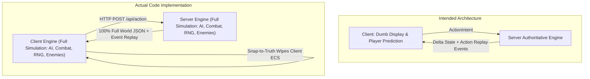
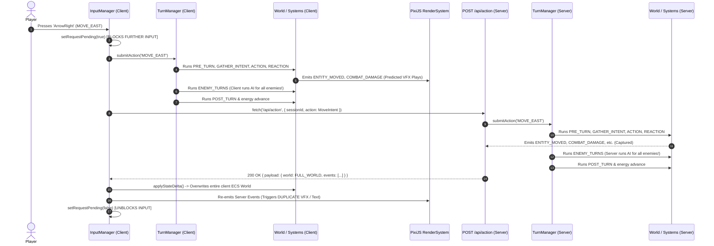
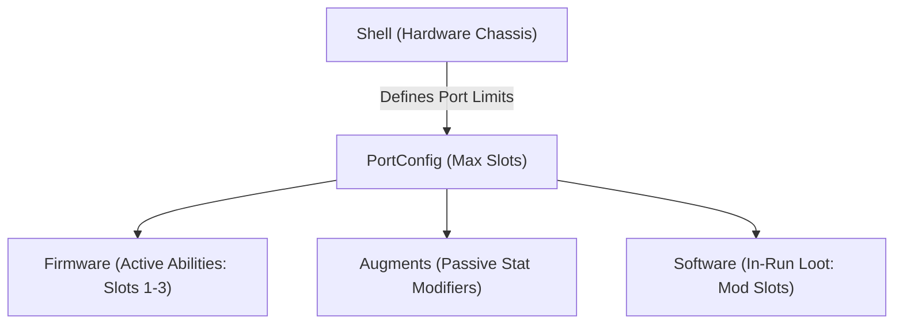
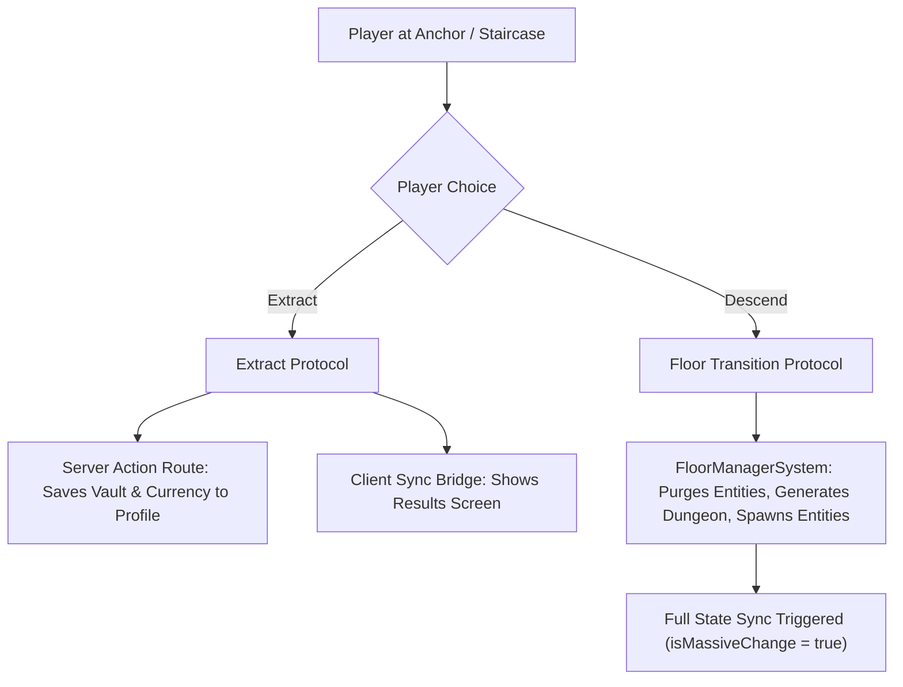
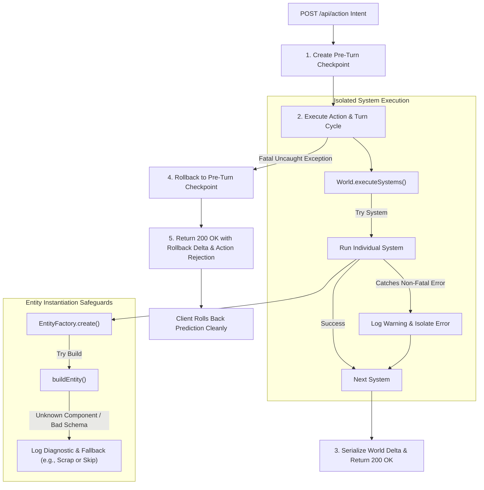

# Deep Architecture Review: Server Authority, State Replication, and Core Game Systems

**Date:** 2026-10-27  
**Scope:** Server-Authoritative Data Flow, Client Prediction & Replay, Object Replication & Desync Recovery, State Management, and Core Game Features.

---

## 1. Executive Summary

Nirmata Runner's design vision calls for a **server-authoritative turn-based roguelike** where the client acts as a **"dumb replay" display layer with local player movement prediction**, synchronized via delta states.

Our architectural audit revealed that while the conceptual design is solid, **the current implementation significantly diverges from this vision in three foundational areas**:



### Key Architectural Diagnoses
1. **The "Dual-Simulation" Anti-Pattern**: Rather than the client being a lightweight renderer with player prediction, the client runs an identical, full-weight ECS simulation (complete with enemy AI, combat calculations, status effects, and turn scheduling). Both client and server execute the entire turn cycle, leading to dual RNG progression, divergent states, and event doubling.
2. **The "Fake Delta" Replication Illusion**: While the networking layer types state updates as `DELTA`, `src/app/api/action/route.ts` actually transmits the **entire ECS World JSON on every single turn**. True delta patching was disabled because `json-diff-ts` previously caused unhandled `TypeError` crashes during partial state application.
3. **Lockstep Synchronous Network Input Freezing**: When an action is sent, the client disables keyboard inputs (`isRequestPending = true`) and synchronously awaits the HTTP fetch. This eliminates input buffering and causes noticeable control stutter under real-world latency.
4. **Disconnected Leaderboard & Run-Attempt Bypass**: The competitive Weekly One-Shot mode has an orphaned submission route (`/api/leaderboard/submit`) that is never called by the client upon run completion, while the legacy `/api/session` endpoint allows arbitrary runs that bypass daily/weekly attempt limits entirely.

---

## 2. Server-Authoritative Flow & Client Prediction

### 2.1 The Current Action Pipeline Lifecycle

Tracing an action from player keystroke to server reconciliation:



### 2.2 Architectural Failures in the Flow

#### A. Dual Simulation vs. Dumb Replay
- **Evidence**: [`src/game/setup.ts:59-105`](file:///Users/chadmowery/personal/dev/dungeon-runner/nirmata-run/src/game/setup.ts#L59-L105) instantiates all 22 game systems on the client, including [`aiSystem`](file:///Users/chadmowery/personal/dev/dungeon-runner/nirmata-run/src/game/systems/ai.ts#L32), [`combatSystem`](file:///Users/chadmowery/personal/dev/dungeon-runner/nirmata-run/src/game/systems/combat.ts#L22), [`tileCorruptionSystem`](file:///Users/chadmowery/personal/dev/dungeon-runner/nirmata-run/src/game/systems/tile-corruption.ts#L17), and [`packCoordinatorSystem`](file:///Users/chadmowery/personal/dev/dungeon-runner/nirmata-run/src/game/systems/pack-coordinator.ts#L21).
- **The Problem**: In a client-predicted turn-based game, **the client must only predict the local player's immediate movement or interaction**. It should never simulate enemy turns, AI pathfinding, procedural hazard spreading, or combat reactions.
- **Consequence**:
  1. Client CPU waste running heavy pathfinding algorithms.
  2. If the client's internal RNG state diverges from the server by even one call, the client predicts an enemy moving in one direction, only to violently snap the enemy to a different tile when the server response arrives.

#### B. Visual Double-Play & Event Doubling
- **Evidence**: In [`src/shared/reconciliation.ts:59-64`](file:///Users/chadmowery/personal/dev/dungeon-runner/nirmata-run/src/shared/reconciliation.ts#L59-L64):
  ```ts
  if (payload.events) {
    for (const event of payload.events) {
      eventBus.emit(event.type as any, event.payload as any);
    }
  }
  ```
- **The Problem**: Visual systems (e.g. [`render-system.ts`](file:///Users/chadmowery/personal/dev/dungeon-runner/nirmata-run/src/rendering/render-system.ts), [`damage-text.ts`](file:///Users/chadmowery/personal/dev/dungeon-runner/nirmata-run/src/rendering/filters/damage-text.ts)) subscribe directly to [`eventBus`](file:///Users/chadmowery/personal/dev/dungeon-runner/nirmata-run/src/engine/events/event-bus.ts#L10). When a bump attack occurs:
  1. Prediction phase emits `COMBAT_DAMAGE` -> triggers melee lunge and spawns floating damage text.
  2. Server response arrives 80ms later with `DAMAGE_DEALT` and `COMBAT_DAMAGE` in `payload.events`.
  3. `applyStateDelta` fires those events into `eventBus` a second time.
  4. Floating damage text has zero deduplication ([`damage-text.ts:27-54`](file:///Users/chadmowery/personal/dev/dungeon-runner/nirmata-run/src/rendering/filters/damage-text.ts#L27-L54)), spawning a second burst of floating combat numbers and re-tinting the defender sprite.

#### C. Input Freezing & Latency Sensitivity
- **Evidence**: In [`src/game/input/input-manager.ts:54-55`](file:///Users/chadmowery/personal/dev/dungeon-runner/nirmata-run/src/game/input/input-manager.ts#L54-L55):
  ```ts
  // Ignore if a request is pending
  if (this.isRequestPending) return;
  ```
- **The Problem**: Because input is dropped while a fetch is in flight, players who double-tap a direction or quickly execute commands experience dropped keystrokes. In high-speed roguelike play, movement feels unresponsive and sticky.

---

## 3. Object Replication and State Handling

### 3.1 The "Fake Delta" Illusion

The API design defines two sync payload modes in [`src/shared/types.ts`](file:///Users/chadmowery/personal/dev/dungeon-runner/nirmata-run/src/shared/types.ts): `FULL` and `DELTA`.

However, inspecting the server implementation in [`src/app/api/action/route.ts:244-252`](file:///Users/chadmowery/personal/dev/dungeon-runner/nirmata-run/src/app/api/action/route.ts#L244-L252) reveals:

```ts
syncPayload = {
  type: 'DELTA',
  world: newWorldState, // <-- ENTIRE WORLD IS SENT FULLY ON EVERY SINGLE TURN
  grid: diff(oldGridState, newGridState),
  events: syncEvents,
  turnNumber: turnManager.getTurnNumber(),
  playerId: session.playerId,
};
```

And on the client in [`src/shared/reconciliation.ts:27-30`](file:///Users/chadmowery/personal/dev/dungeon-runner/nirmata-run/src/shared/reconciliation.ts#L27-L30):

```ts
// 1. Authoritative World Update (Full State Always)
// This eliminates all TypeError: Cannot set properties of undefined crashes
// by replacing the entire world state instead of patching it.
world.loadSerializableState(payload.world);
```

#### Why True Delta Sync Was Abandoned
A previous attempt to diff the ECS World with `json-diff-ts` caused client-side crashes when patches attempted to mutate component maps where parent keys were missing. Instead of addressing the structural patching logic, the engine was converted to send the entire world state JSON over HTTP on every single turn.

#### Network & Scale Implications
- **Bandwidth**: On Floor 1 with 15 entities, the serialized world is ~4KB. On Floor 10 with 80 entities (enemies, item drops, markers, dead zones, project tiles), the serialized world reaches 30KB–50KB **per step**.
- **Garbage Collection Pressure**: Parsing and re-allocating thousands of component objects every turn creates significant GC churn in the browser V8 runtime, causing periodic frame-rate drops in PixiJS.

### 3.2 Sprite Orphanage & Entity Desync

In PixiJS rendering, visual sprites are managed by [`EntitySpriteMap`](file:///Users/chadmowery/personal/dev/dungeon-runner/nirmata-run/src/rendering/sprite-map.ts#L5):
```ts
const entitySprites = new Map<EntityId, Sprite>();
```

Sprites are added when `ENTITY_CREATED` fires, and destroyed when `ENTITY_DESTROYED` fires.

However, [`World.loadSerializableState`](file:///Users/chadmowery/personal/dev/dungeon-runner/nirmata-run/src/engine/ecs/world.ts#L242-L260):
```ts
loadSerializableState(state): void {
  this.nextId = state.nextId;
  this.entities = new Set(state.entities);
  this.stores = new Map();
  // ... directly repopulates stores without emitting lifecycle events
}
```

#### The Desync Failure Mode:
1. An entity is created or destroyed server-side (e.g., enemy killed by poison DoT, or item spawned by loot system).
2. If the corresponding lifecycle event (`ENTITY_CREATED` / `ENTITY_DESTROYED`) is dropped, delayed, or filtered from `payload.events`:
   - `World.loadSerializableState` removes the entity from the ECS stores.
   - **The PixiJS sprite in `entitySprites` is NEVER destroyed**.
   - The sprite remains rendered on screen as a "ghost" entity that cannot be interacted with and does not exist in the ECS world.

### 3.3 UI State Synchronization (Zustand Bridge)

UI state is maintained in a Zustand store ([`src/game/ui/store.ts`](file:///Users/chadmowery/personal/dev/dungeon-runner/nirmata-run/src/game/ui/store.ts)). Synchronization occurs via [`syncEngineToStore`](file:///Users/chadmowery/personal/dev/dungeon-runner/nirmata-run/src/game/ui/sync-bridge.ts#L23-L95).

- **Current Behavior**: The store registers listeners on `eventBus` for events like `TURN_START`, `HEAT_CHANGED`, `STABILITY_CHANGED`, and `COMBAT_DAMAGE`. When triggered, it manually inspects the player's components via `world.getComponent(...)` and copies primitive fields into the store.
- **Architectural Health**: This bridge is well-isolated and keeps React UI out of the ECS loop. However, because client prediction updates the ECS first, the UI displays predicted values immediately, then re-syncs when the server delta is applied. If a desync occurs, UI numbers (e.g. Health, Heat) can rubberband visibly.

---

## 4. Key Game Features & Authority Boundaries

### 4.1 Shell / Firmware / Augment / Software Customization Hierarchy

The four-tier customization hierarchy is the core progression system of the game:



#### Authority Audit Findings:
1. **Unenforced Slot Capacity in Pre-Run Ritual**:
   In [`POST /api/vault/equip-from-vault`](file:///Users/chadmowery/personal/dev/dungeon-runner/nirmata-run/src/app/api/vault/equip-from-vault/route.ts#L10-L61), an item from the Vault is installed directly onto a Shell:
   ```ts
   profile.installedItems.push({
     entityId: item.entityId,
     blueprintId: item.templateId,
     type: item.itemType,
     shellId,
     isLegacy: false,
   });
   ```
   **Security Gap**: The endpoint performs **zero checks** against the Shell's [`PortConfig`](file:///Users/chadmowery/personal/dev/dungeon-runner/nirmata-run/src/shared/components/port-config.ts#L9) (`maxFirmware`, `maxAugment`, `maxSoftware`). A malicious client can equip an arbitrary number of items, exceeding the intended hardware limits.
2. **Software Burning In-Run**:
   In-run software mod burning (`BURN_SOFTWARE` intent) is handled server-side in [`src/app/api/action/route.ts:137-150`](file:///Users/chadmowery/personal/dev/dungeon-runner/nirmata-run/src/app/api/action/route.ts#L137-L150). It correctly attaches `BurnSoftwareIntent` to the authoritative world, where [`software.ts`](file:///Users/chadmowery/personal/dev/dungeon-runner/nirmata-run/src/game/systems/software.ts) resolves the item burn. This flow is correctly server-authoritative.

---

### 4.2 Neural Heat & Kernel Panic System

The Neural Heat system creates tactical tension between power output and system stability:
- Abilities generate heat; stability provides passive dissipation per turn.
- Active Venting (`VENT`) spends a full turn to clear 50% heat.
- Above 100% heat (Overclock), the player enters Kernel Panic.

#### Authority Audit Findings:
- **Dual Execution Risk**: Both client and server run [`createHeatSystem`](file:///Users/chadmowery/personal/dev/dungeon-runner/nirmata-run/src/game/systems/heat.ts#L18) and [`createKernelPanicSystem`](file:///Users/chadmowery/personal/dev/dungeon-runner/nirmata-run/src/game/systems/kernel-panic.ts#L22).
- If the player overclocks on the client, the client immediately shows glitch shaders and screen effects. If the server recalculates turn order differently (e.g. an enemy stunned the player or drained energy), the client experiences a jarring flash where Kernel Panic activates and then abruptly deactivates on reconciliation.

---

### 4.3 Floor Progression & Extraction Loop

The extraction roguelike loop is defined by the tension between descending deeper or extracting safely:
- **Staircase**: Free descent to next floor.
- **Anchor**: Choice between high-cost descent or immediate extraction with secured inventory.



#### Authority Audit Findings:
1. **Full State Sync on Floor Transition**:
   [`src/app/api/action/route.ts:218-241`](file:///Users/chadmowery/personal/dev/dungeon-runner/nirmata-run/src/app/api/action/route.ts#L218-L241) correctly identifies `FLOOR_TRANSITION` and `DUNGEON_GENERATED` as massive changes and transmits a `FULL` sync payload containing the entire grid and world. This cleanly resets camera and terrain without diffing artifacts.
2. **Dual Run-End Resolution**:
   When `RUN_ENDED` fires:
   - Server updates the player profile ([`action/route.ts:176-211`](file:///Users/chadmowery/personal/dev/dungeon-runner/nirmata-run/src/app/api/action/route.ts#L176-L211)): calculates scrap/flux, adds items to vault vs overflow, enforces currency caps, and saves to disk.
   - Client independently calculates rewards in [`sync-bridge.ts:304-340`](file:///Users/chadmowery/personal/dev/dungeon-runner/nirmata-run/src/game/ui/sync-bridge.ts#L304-L340) using local `gameStore` stats, adding scrap directly to the client store.
   - If server and client differ on kill count or scrap collected, the client's results screen displays numbers that do not match what was actually persisted to the profile.

---

### 4.4 Economy, Run Modes, & Weekly Reset

The game supports three modes:
1. **Weekly One-Shot**: 1 attempt per week, public seed, competitive leaderboard.
2. **Daily Challenge**: 1 attempt per day, daily seed.
3. **Neural Simulation**: Unlimited attempts, practice only.

#### Critical Authority Breaches:
1. **Disconnected Leaderboard Route**:
   [`POST /api/leaderboard/submit`](file:///Users/chadmowery/personal/dev/dungeon-runner/nirmata-run/src/app/api/leaderboard/submit/route.ts#L10-L82) is **never invoked anywhere in the client codebase**. A run ending does not submit its score to the leaderboard.
2. **Session Creation Bypass**:
   The attempt tracking check (verifying `weeklyAttemptUsed` or `dailyAttemptUsed`) only exists in [`POST /api/run-mode/launch`](file:///Users/chadmowery/personal/dev/dungeon-runner/nirmata-run/src/app/api/run-mode/launch/route.ts#L43-L67).
   However, [`POST /api/session`](file:///Users/chadmowery/personal/dev/dungeon-runner/nirmata-run/src/app/api/session/route.ts#L9-L43) creates sessions directly with any provided seed without checking attempt status or recording run attempts. Any player or script can bypass the "One Shot" constraint by initializing runs via `/api/session`.

---

## 5. Architectural Gap Analysis Summary

| Dimension | Target Architecture | Current State | Risk / Defect |
| :--- | :--- | :--- | :--- |
| **Client Role** | Dumb display + player movement prediction. | Full duplicate simulation engine (AI, combat, RNG). | High CPU overhead, dual RNG divergence, visual prediction stutter. |
| **Object Replication** | Compact delta stream of entity/component diffs. | Entire ECS world JSON serialized and sent every turn. | Bandwidth bloat ($O(N)$ entities per step), severe GC pauses. |
| **Input Handling** | Continuous buffered inputs with sequence IDs. | Synchronous stop-and-wait HTTP blocking (`isRequestPending`). | Silently dropped keystrokes, sluggish controls. |
| **Event Replay** | Server events drive visuals; predictions reconciled cleanly. | All server events replayed blindly onto client event bus. | Duplicate combat animations, double floating text, repeated audio. |
| **Entity Lifecycle** | Full sprite sync tied to authoritative entity state. | Sprites tracked via events; ECS reloaded silently via `loadSerializableState`. | Orphaned ghost sprites on screen after server deletions. |
| **Anti-Cheat / Authority** | Server validates all slot limits, scores, and attempts. | Client raw stats accepted; slot limits unchecked in Vault. | Trivial score spoofing, equipment limit bypass. |

---

## 6. Phased Architectural Target Architecture & Migration Blueprint

```mermaid
flowchart TD
    subgraph Target Architecture
        direction TB
        ClientInput["Client: Input Buffer (Seq #)"] --> LocalPredict["Local Player Movement Prediction"]
        LocalPredict --> RenderQueue["Visual Render Queue (Tagged: PREDICTED)"]
        ClientInput -->|POST /api/action (Seq #)| ServerAuth["Server Authoritative Engine"]
        
        ServerAuth --> AuthoritativeTurn["Authoritative Turn Cycle (AI, Combat, Loot, RNG)"]
        AuthoritativeTurn --> EventCapture["Event Stream (Tagged: SERVER_AUTH)"]
        AuthoritativeTurn --> DeltaBuilder["ECS Delta Builder (Only Changed Components)"]
        
        DeltaBuilder -->|Network Sync Payload| ClientReconcile["Client Reconciliation"]
        EventCapture -->|Authoritative Events| ClientReconcile
        
        ClientReconcile --> ReconcilePredict["Confirm Prediction / Rollback Misprediction"]
        ClientReconcile --> RenderAuthoritative["Play Non-Predicted Events (Enemy moves, VFX)"]
    end
```

### Phase 1: Convert Client into a True "Dumb Replay + Player Prediction" Layer
1. **De-register Simulation Systems on Client**:
   - In [`src/game/engine-factory.ts`](file:///Users/chadmowery/personal/dev/dungeon-runner/nirmata-run/src/game/engine-factory.ts), when `isClient === true`, **do not register** AI, tile corruption, pack coordinator, or enemy turn execution.
   - The client `TurnManager` should only predict the player's single movement step onto an empty walkable tile.
   - For all other actions (attacks, abilities, item pickups, transitions), show an immediate intent animation and await the server's authoritative resolution.

### Phase 2: Implement Event Origin Tagging to Eliminate Double VFX
1. **Tag Events with Origin (`client` vs `server`)**:
   - Utilize [`EventOriginContext`](file:///Users/chadmowery/personal/dev/dungeon-runner/nirmata-run/src/engine/utils/event-context.ts#L3) to tag every event.
   - Visual systems ([`render-system.ts`](file:///Users/chadmowery/personal/dev/dungeon-runner/nirmata-run/src/rendering/render-system.ts), [`damage-text.ts`](file:///Users/chadmowery/personal/dev/dungeon-runner/nirmata-run/src/rendering/filters/damage-text.ts)) must ignore server-replayed events if that specific action was already visually rendered during client prediction.

### Phase 3: True Component-Level Delta Replication
1. **Fix ECS Component Delta Patching**:
   - Re-introduce component-level delta serialization instead of transmitting the entire ECS world JSON on every turn.
   - Ensure the server diff compares component stores key-by-key, sending only modified/added/deleted component entities.
   - Update [`loadSerializableState`](file:///Users/chadmowery/personal/dev/dungeon-runner/nirmata-run/src/engine/ecs/world.ts#L242) or implement `applyComponentDeltas` to cleanly patch stores without throwing `TypeError: Cannot set properties of undefined`.
2. **Synchronize Sprite Lifecycle with ECS State**:
   - During reconciliation, reconcile the `entitySprites` Map directly against `world.query(SpriteComponent)` to automatically purge orphaned sprites and create missing visual representations.

### Phase 4: Competitive Security & Flow Hardening
1. **Wire Leaderboard Submission Server-Side**:
   - In [`src/app/api/action/route.ts`](file:///Users/chadmowery/personal/dev/dungeon-runner/nirmata-run/src/app/api/action/route.ts), when `RUN_ENDED` occurs in Weekly or Daily mode, **automatically calculate the official score server-side** and save it directly to the leaderboard file. Never rely on client POST requests.
2. **Enforce Port Limits in Vault Equip Route**:
   - In [`POST /api/vault/equip-from-vault`](file:///Users/chadmowery/personal/dev/dungeon-runner/nirmata-run/src/app/api/vault/equip-from-vault/route.ts), load the Shell archetype's [`PortConfig`](file:///Users/chadmowery/personal/dev/dungeon-runner/nirmata-run/src/shared/components/port-config.ts#L9) and reject installations exceeding slot capacity.
3. **Deprecate Unauthenticated `/api/session` Endpoint**:
   - Require all runs to originate from [`POST /api/run-mode/launch`](file:///Users/chadmowery/personal/dev/dungeon-runner/nirmata-run/src/app/api/run-mode/launch/route.ts), enforcing daily and weekly attempt limits.

---

## 7. Future Improvements & Fault Tolerance: Server Runtime Error Resilience

### 7.1 Problem Diagnosis & Vulnerability
In the current implementation, any uncaught runtime exception thrown during authoritative action processing—such as an invalid/missing component in an entity template (e.g., [`buildEntity`](file:///Users/chadmowery/personal/dev/dungeon-runner/nirmata-run/src/engine/entity/builder.ts#L107)), bad loot parameters in [`RewardDropSystem`](file:///Users/chadmowery/personal/dev/dungeon-runner/nirmata-run/src/game/systems/reward-drop.ts#L71), pathfinding failures in [`AISystem`](file:///Users/chadmowery/personal/dev/dungeon-runner/nirmata-run/src/game/systems/ai.ts), or sub-tick overflow in [`TurnManager`](file:///Users/chadmowery/personal/dev/dungeon-runner/nirmata-run/src/engine/turn/turn-manager.ts)—bubbles directly up the call stack:
```
System Exception -> World.executeSystems -> TurnManager.executeActionSequence -> POST /api/action (500 Internal Server Error)
```

When this occurs:
1. **HTTP 500 Crash**: The server abruptly crashes the request without returning a state sync payload.
2. **Partial State Corruption**: The server's in-memory `World` for the session may be left in an inconsistent, half-executed state (e.g., player energy was deducted or health was modified, but drops or turn increments failed).
3. **Client Desync & Lockup**: The client's optimistic prediction cannot reconcile because no valid state payload is returned, leading to visual freezing or a corrupted local world state.

### 7.2 Proposed Fault-Tolerance Blueprint



#### 1. System-Level Fault Isolation (Circuit Breakers in Systems Loop)
- **Target**: [`src/engine/ecs/world.ts`](file:///Users/chadmowery/personal/dev/dungeon-runner/nirmata-run/src/engine/ecs/world.ts#L210) / [`src/engine/turn/turn-manager.ts`](file:///Users/chadmowery/personal/dev/dungeon-runner/nirmata-run/src/engine/turn/turn-manager.ts#L130).
- **Strategy**: Wrap individual system executions in a fault boundary. Non-critical secondary systems (e.g., loot drops, ambient effects, tile decay, non-blocking AI steps) should catch and log errors using structured diagnostics (`logger.error`), allowing core gameplay (movement, turns, combat) to proceed without aborting the entire turn.

#### 2. Defensive Entity Instantiation & Safe Fallbacks
- **Target**: [`src/engine/entity/factory.ts`](file:///Users/chadmowery/personal/dev/dungeon-runner/nirmata-run/src/engine/entity/factory.ts#L24) and [`src/engine/entity/builder.ts`](file:///Users/chadmowery/personal/dev/dungeon-runner/nirmata-run/src/engine/entity/builder.ts#L90).
- **Strategy**: 
  - If a template references an unknown component or schema validation fails during dynamic runtime spawning (e.g., loot drop, enemy spawn), capture the error, log a critical telemetry alert, and spawn a safe fallback entity (e.g. `'scrap'` or drop placeholder) rather than crashing the turn submission.
  - In development/testing environments, strict validation remains enabled to catch bugs early; in production runtime mode, fault isolation prevents session death.

#### 3. Pre-Turn Snapshot & Transactional Rollback
- **Target**: [`src/app/api/action/route.ts`](file:///Users/chadmowery/personal/dev/dungeon-runner/nirmata-run/src/app/api/action/route.ts#L160).
- **Strategy**:
  - Keep a shallow snapshot of component stores or serialize state prior to `turnManager.submitAction()`.
  - If a fatal exception occurs during the turn sequence, restore the session world to the pre-turn state.
  - Return a graceful `200 OK` response with a sync payload containing the restored state and a user-facing event (`ACTION_REJECTED` / message: `"Action could not be completed"`).
  - This guarantees that client prediction reconciles cleanly back to the last valid authoritative state without desyncing or freezing the player's UI.

#### 4. Client Graceful Degradation & Recovery
- **Target**: [`src/game/setup.ts`](file:///Users/chadmowery/personal/dev/dungeon-runner/nirmata-run/src/game/setup.ts#L372).
- **Strategy**: Ensure that if the server ever encounters a network or internal error, the client rolls back optimistic predictions, clears the pending input queue, unblocks input, and outputs an error message in the in-game HUD message log rather than freezing in place.
