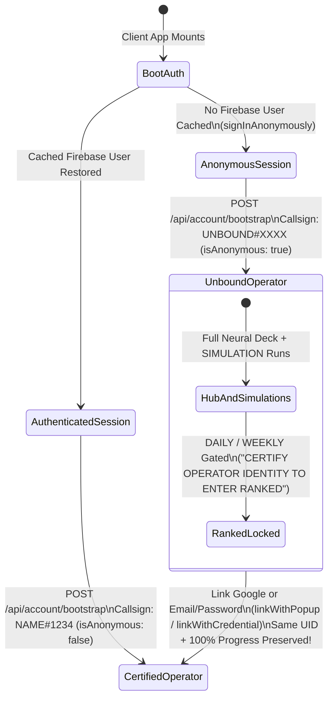
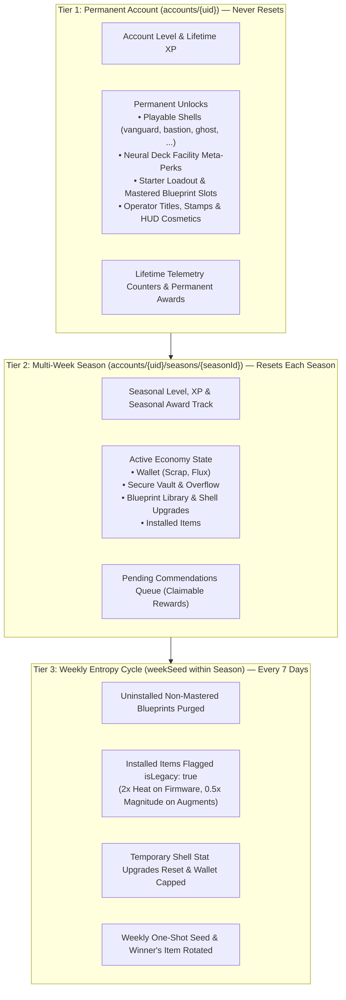

# Player Accounts, Authentication & Three-Tier Progression Specification

> **Status:** Draft Specification (`v3.4` — Hardened Serverless & Slot-Reservation Architecture)  
> **Companion Spec:** [`docs/architecture/PERSISTENCE-AND-HOSTING-SPEC.md`](../architecture/PERSISTENCE-AND-HOSTING-SPEC.md)  
> **Related Specs:** [`docs/design/RUN-ECONOMY.md`](./RUN-ECONOMY.md), [`docs/design/UI-DESIGN-SYSTEM.md`](./UI-DESIGN-SYSTEM.md)

---

## 1. Executive Summary

This specification defines Nirmata Runner's **Player Identity & Authentication Flow**, **Three-Tier Progression Architecture (Permanent Account → Multi-Week Season → Weekly Entropy Cycle)**, **Out-of-Game Unlock Categories**, and **Data-Driven Awards & Commendation System**.

### Core Design Pillars
1. **Zero-Friction Onboarding (Anonymous-First)**: Players drop straight into the Main Menu, Neural Deck Hub, and `SIMULATION` runs via silent Firebase Anonymous Auth—no registration wall required.
2. **In-Place Account Certification**: Binding **Google Sign-In** or **Email/Password (or Email Link)** inside the Taikoku Identity Terminal upgrades the player's existing `uid` in place, preserving 100% of their Vault, Wallet, XP, and Unlocks while unlocking cross-device sync and ranked `DAILY` / `WEEKLY` leaderboards.
3. **Collision-Free Operator Callsigns (`CALLSIGN#TAG`)**: Players choose any display callsign (e.g., `KESTREL`) paired with a server-assigned 4-digit discriminator (`KESTREL#4821`).
4. **Three-Tier Roguelike Meta-Progression**: Balances long-term roguelike account growth (permanent Chassis unlocks, Facility meta-perks, Mastered blueprint slots, Cosmetics) with fresh seasonal competition and weekly Legacy Code entropy.
5. **Claimable Commendation Queue**: Item, blueprint, and currency rewards earned from Account Levels, Seasonal Tracks, Awards, or Weekly Leaderboards land in a `pendingCommendations` inbox so rewards are never silently lost to wallet caps or forced into Vault overflow mid-run.

---

## 2. Authentication & Operator Identity Flow

### 2.1 Anonymous-First Onboarding & Account Binding



1. **Deferred Silent Guest Bootstrap (Bot-Resistant)**:
   - The landing page (`src/app/page.tsx`) renders as a fast static CDN shell (~150ms). If a cached Firebase Auth session already exists on the device, it restores immediately.
   - If `firebaseAuth.currentUser` is `null`, the client waits until the user interacts with the Title Screen (e.g., clicking **ENTER NEURAL DECK** or **DEPLOY**) before invoking `signInAnonymously(auth)`—preventing web crawlers and link-preview bots from creating orphan Auth accounts and Firestore documents.
   - The client displays the thematic `"INITIALIZING NEURAL UPLINK // AUTHENTICATING OPERATOR..."` boot sequence (masking any 3–5s Cloud Run cold start when `minInstances: 0`) while sending `POST /api/account/bootstrap` with `Authorization: Bearer <idToken>`.
   - If `accounts/{uid}` does not exist in Firestore, the server initializes a default `AccountDocument` and active `SeasonProfileDocument` inside a transaction.
   - Anonymous accounts receive a generated designation (`UNBOUND#<4-hex>`, e.g., `UNBOUND#8F2A`), and Firebase Auth is configured with 30-day inactive anonymous account auto-cleanup.
2. **Permanent Account Binding (Upgrading Anonymous UID)**:
   - Inside the Main Menu and Neural Deck Hub header, an **Operator Identity Terminal** modal allows unbound players to link:
     - **Google Sign-In** (`linkWithPopup(currentUser, new GoogleAuthProvider())`)
     - **Email & Password / Passwordless Email Link** (`linkWithCredential` / `sendSignInLinkToEmail`)
   - Because Firebase Auth's `linkWith*` attaches the credential to the **existing `uid`**, zero database migration is required—`accounts/{uid}` and `accounts/{uid}/seasons/{seasonId}` remain attached to the exact same player.
   - During certification, the player selects their custom **Operator Callsign** (see §2.2).
3. **Signing into an Existing Account on a New Device**:
   - If a player clicks **"SIGN IN TO EXISTING OPERATOR ACCOUNT"** (or if `linkWithPopup` returns `auth/credential-already-in-use`), the client signs into the existing permanent account via `signInWithCredential` and loads that account's profile and active run state.
4. **Competitive Mode Gate (`DAILY` & `WEEKLY`)**:
   - [`POST /api/run-mode/launch`](../../src/app/api/run-mode/launch/route.ts) inspects the verified Firebase token (`decodedToken.firebase.sign_in_provider !== 'anonymous'`).
   - If an anonymous user attempts to launch `RunMode.DAILY` or `RunMode.WEEKLY`, the server returns `403 Forbidden` (`ACCOUNT_CERTIFICATION_REQUIRED`), prompting the UI to open the Identity Certification modal.

### 2.2 Operator Callsigns (`CALLSIGN#1234`)
- **Format**:
  - `callsign`: `3–16` characters, uppercase alphanumeric, underscores, and hyphens (`^[A-Z0-9_-]{3,16}$`). Automatically uppercased on input.
  - `discriminator`: Server-generated 4-digit numeric string (`1000`–`9999`, e.g., `4821`).
  - **Display Format**: `${callsign}#${discriminator}` (e.g., `KESTREL#4821`).
- **Uniqueness Check**:
  - When a player sets or updates their `callsign` (`POST /api/account/callsign`), the server generates a random 4-digit `discriminator` and checks that the composite pair `callsign + '#' + discriminator` is not already in use, retrying with a new 4-digit code if needed. Players never hit a "name taken" error unless all 9,000 discriminators for that exact string are exhausted.

---

## 3. Three-Tier Progression Architecture

Progression is partitioned across three time horizons so players always feel permanent forward momentum while competitive economies stay fresh:



---

## 4. Database Schemas (`@shared/account-profile.ts`)

### 4.1 Tier 1: `AccountDocument` (`accounts/{uid}`)

```ts
export const HubFacilityUpgradesSchema = z.object({
  /** Each level adds +6 Vault slots above base VAULT_MAX_SLOTS (30) */
  vaultExpansionLevel: z.number().int().min(0).max(5).default(0),
  /** Each level increases Scrap (+2,500) and Flux (+250) wallet caps */
  walletCapLevel: z.number().int().min(0).max(4).default(0),
  /** Each level reduces in-run Dead-Drop Uplink Flux cost by 15% */
  deadDropDiscountLevel: z.number().int().min(0).max(3).default(0),
  /** Each level increases Death Pity Scrap retention by +5% (base 25% -> max 40%) */
  deathPityBoostLevel: z.number().int().min(0).max(3).default(0),
  /** Each level adds +1 rotating Software slot in the Hub Shop */
  shopExpansionLevel: z.number().int().min(0).max(3).default(0),
  /** Number of Blueprints the player can mark as 'Mastered' to survive Weekly Resets */
  masteredBlueprintSlots: z.number().int().min(0).max(3).default(0),
});

export const LifetimeStatsSchema = z.object({
  totalRunsLaunched: z.number().int().min(0).default(0),
  totalExtractions: z.number().int().min(0).default(0),
  totalDeaths: z.number().int().min(0).default(0),
  deepestFloorReached: z.number().int().min(0).default(0),
  totalEnemiesZeroed: z.number().int().min(0).default(0),
  tier3EnemiesZeroed: z.number().int().min(0).default(0),
  totalScrapExtracted: z.number().int().min(0).default(0),
  totalFluxExtracted: z.number().int().min(0).default(0),
  totalVaultsBreached: z.number().int().min(0).default(0),
  totalTrapsDisarmed: z.number().int().min(0).default(0),
});

export const AccountDocumentSchema = z.object({
  uid: z.string(),
  callsign: z.string(),
  discriminator: z.string(),
  isAnonymous: z.boolean().default(true),
  linkedProviders: z.array(z.string()).default([]),

  // Leveling
  accountXp: z.number().int().min(0).default(0),
  accountLevel: z.number().int().min(1).default(1),

  // Active Run Lock (Single Active Run Invariant)
  activeRunId: z.string().nullable().default(null),
  activeRunMode: z.nativeEnum(RunMode).nullable().default(null),
  activeShellId: z.string().nullable().default(null),

  // Out-of-Game Permanent Unlocks (4 Categories)
  unlockedShells: z.array(z.string()).default(['vanguard-v1', 'bastion-v1', 'ghost-v1']),
  facilityUpgrades: HubFacilityUpgradesSchema.default({}),
  unlockedStarterBlueprints: z.array(z.string()).default([
    'basic-strike',
    'kinetic-link',
    'neural-spike',
    'phase-shift',
    'ghost-pulse',
    'logic-jam',
  ]),
  unlockedCosmetics: z.object({
    titles: z.array(z.string()).default(['INITIATE']),
    stamps: z.array(z.string()).default(['LINK_CERTIFIED']),
    hudThemes: z.array(z.string()).default(['taikoku-default']),
    shellSkins: z.array(z.string()).default([]),
  }).default({}),
  equippedCosmetics: z.object({
    title: z.string().default('INITIATE'),
    stamp: z.string().default('LINK_CERTIFIED'),
    hudTheme: z.string().default('taikoku-default'),
  }).default({}),

  // Telemetry & Permanent Awards
  lifetimeStats: LifetimeStatsSchema.default({}),
  completedPermanentAwards: z.record(z.string(), z.number()).default({}), // awardId -> timestamp

  createdAt: z.number(),
  updatedAt: z.number(),
});
```

### 4.2 Tier 2: `SeasonProfileDocument` (`accounts/{uid}/seasons/{seasonId}`)
Extends the existing [`PlayerProfileSchema`](../../src/shared/profile.ts#L62-L78) with Seasonal XP, Mastered Blueprint pinning, Seasonal Awards, and the **Pending Commendations Queue**:

```ts
export const CommendationGrantSchema = z.object({
  commendationId: z.string(),
  sourceType: z.enum(['ACCOUNT_LEVEL', 'SEASON_LEVEL', 'AWARD', 'LEADERBOARD_PRIZE', 'SYSTEM_GRANT']),
  sourceId: z.string(),         // e.g. "award_breach_25_vaults" or "weekly_winner_2937"
  title: z.string(),            // e.g. "COMMENDATION // VAULT BREACHER TIER I"
  rewards: z.object({
    scrap: z.number().int().min(0).optional(),
    flux: z.number().int().min(0).optional(),
    blueprints: z.array(BlueprintEntrySchema).optional(),
    vaultItems: z.array(VaultItemSchema).optional(),
    permanentUnlockId: z.string().optional(),
  }),
  grantedAt: z.number(),
});

export const SeasonProfileDocumentSchema = PlayerProfileSchema.extend({
  uid: z.string(),
  seasonId: z.string(),
  seasonXp: z.number().int().min(0).default(0),
  seasonLevel: z.number().int().min(1).default(1),

  /** Blueprints pinned into the player's Mastered slots (survive Weekly Reset purge) */
  masteredBlueprintIds: z.array(z.string()).default([]),

  /** Seasonal telemetry counters (reset each Season) */
  seasonalStats: LifetimeStatsSchema.default({}),

  /** Completed seasonal award IDs -> completion timestamp */
  completedSeasonalAwards: z.record(z.string(), z.number()).default({}),

  /** Unclaimed item/currency rewards waiting for player claim in the Neural Deck */
  pendingCommendations: z.array(CommendationGrantSchema).default([]),

  /** True once the season has ended and been snapshotted as read-only history */
  isArchived: z.boolean().default(false),
  updatedAt: z.number(),
});
```

---

## 5. Out-of-Game Unlocks & Engine Integration Hooks

The four unlock categories integrate cleanly with existing Hub and Server Engine entry points without requiring custom hardcoded logic per unlock:

| Unlock Category | Storage Location | Where It Hooks Into the Game |
| :--- | :--- | :--- |
| **1. Playable Shells / Chassis** | `account.unlockedShells` | [`GET /api/shells`](../../src/app/api/shells/route.ts) and [`POST /api/run-mode/launch`](../../src/app/api/run-mode/launch/route.ts) validate that `requestedShellId` is present in `account.unlockedShells`. |
| **2. Neural Deck Facility Meta-Perks** | `account.facilityUpgrades` | Computed via helper `getEffectiveEconomyLimits(account, economyJson)`:<br/>• **Vault Capacity**: `30 + vaultExpansionLevel * 6`<br/>• **Wallet Caps**: `scrapCap + walletCapLevel * 2500`, `fluxCap + walletCapLevel * 250`<br/>• **Dead-Drop Cost**: `Math.ceil(baseCost * (1 - 0.15 * deadDropDiscountLevel))`<br/>• **Death Pity %**: `0.25 + 0.05 * deathPityBoostLevel`<br/>• **Shop Slots**: `baseSlots + shopExpansionLevel` |
| **3. Starter Loadout & Blueprint Mastery** | `account.unlockedStarterBlueprints` & `season.masteredBlueprintIds` | • On new Season creation or Weekly Reset, all `unlockedStarterBlueprints` and up to `facilityUpgrades.masteredBlueprintSlots` pinned blueprints in `masteredBlueprintIds` are preserved in `blueprintLibrary`. |
| **4. Operator Identity & Cosmetics** | `account.unlockedCosmetics` & `account.equippedCosmetics` | • `equippedCosmetics.title` and `stamp` render in [`TaikokuPlacard`](../../src/components/ui/atomic/TaikokuPlacard.tsx) and on Daily/Weekly Leaderboard rows (`LeaderboardEntryDocument`). |

---

## 6. Data-Driven Progression Evaluator & Commendation Queue

### 6.1 Declarative Award & Level Definitions (`src/game/entities/templates/awards.json`)
Awards, milestones, and level tracks are defined in JSON and validated by Zod at build/startup time:

```json
{
  "accountLevelCurve": {
    "baseXp": 500,
    "exponent": 1.35
  },
  "awards": [
    {
      "id": "first_extraction",
      "scope": "permanent",
      "title": "SIGNAL RECOVERED",
      "description": "Successfully extract from a Stability Anchor for the first time.",
      "condition": { "metric": "totalExtractions", "operator": "gte", "target": 1 },
      "rewards": {
        "accountXp": 250,
        "flux": 100,
        "cosmeticTitle": "ANCHOR_RUNNER"
      }
    },
    {
      "id": "season_vault_breacher_1",
      "scope": "seasonal",
      "title": "ZERO-DAY INTRUDER I",
      "description": "Breach 10 locked containers or Zero-Day Vaults in a single Season.",
      "condition": { "metric": "totalVaultsBreached", "operator": "gte", "target": 10 },
      "rewards": {
        "seasonXp": 500,
        "scrap": 500,
        "flux": 150
      }
    }
  ]
}
```

### 6.2 Server-Side Evaluation Flow (`ProgressionEvaluator`)
During the `RUN_ENDED` transaction in [`POST /api/action`](../../src/app/api/action/route.ts#L275):
1. **Update Counters**: Increments `account.lifetimeStats` and `season.seasonalStats` with the run's authoritative stats (`floorNumber`, `scrapExtracted`, `fluxExtracted`, `vaultsBreached`, `trapsDisarmed`, `enemiesZeroed`).
2. **Compute Run XP**:
   $$\text{RunXP} = (\text{floorNumber} \times 50) + (\text{enemiesZeroed} \times 10) + (\text{vaultsBreached} \times 40) + (\text{isExtraction} ? 200 : 25)$$
   Adds $\text{RunXP}$ to both `account.accountXp` and `season.seasonXp`, advancing `accountLevel` and `seasonLevel` as thresholds are crossed.
3. **Evaluate Awards & Level Milestones**:
   - Checks all uncompleted rules in `awards.json` against the updated `lifetimeStats`, `seasonalStats`, and single-run stats.
   - **Immediate Unlocks**: Any earned `unlockedShells`, `unlockedCosmetics`, or `unlockedStarterBlueprints` are appended directly to `AccountDocument`.
   - **Commendation Queue Dispatch**: Any currency (`scrap`, `flux`), `blueprints`, or `vaultItems` rewards are appended to `season.pendingCommendations` as a `CommendationGrant`, and a summary of newly earned awards/levels is returned in the `RUN_ENDED` response payload for the `RunResultsScreen` UI.

### 6.3 Claiming Commendations (`POST /api/account/claim-commendation`)
- When the player clicks **[CLAIM COMMENDATION]** in the Neural Deck Hub:
  - Executes a Firestore transaction on `accounts/{uid}` and `accounts/{uid}/seasons/{seasonId}`.
  - Verifies the player does not have an active run locked (`activeRunId === null`).
  - Deposits `scrap` and `flux` (respecting effective wallet caps—warning the player on the client before claiming if a claim would exceed their cap), adds `blueprints` to `blueprintLibrary`, and places `vaultItems` into `vault` (or `overflow` if full).
  - Removes the claimed `commendationId` from `pendingCommendations`.

---

## 7. API Route Surface Summary

All routes authenticate the caller via `Authorization: Bearer <firebaseIdToken>` (verified by `verifyRequestAuth(req)` in `src/server/auth/verify-request.ts`) rather than trusting a client-supplied `sessionId`.

| Endpoint | Method | Purpose |
| :--- | :--- | :--- |
| `/api/account/bootstrap` | `POST` | Initializes or loads `AccountDocument` + active `SeasonProfileDocument` for the authenticated `uid`; runs lazy Weekly Reset if `weekSeed` advanced; self-heals stale `activeRunId` locks if the backing `active_runs/{runId}` document is missing/terminal; returns active run status (`activeRunId`, `floorNumber`, `runMode`) if an unfinished deployment exists. |
| `/api/account/callsign` | `POST` | Updates the player's `callsign` and assigns a unique 4-digit `discriminator` (`CALLSIGN#1234`). |
| `/api/account/claim-commendation` | `POST` | Claims one or all `pendingCommendations` in an atomic Firestore transaction. |
| `/api/account/upgrade-facility` | `POST` | Spends Flux/milestone tokens to upgrade a permanent or seasonal `facilityUpgrades` tier or pin `masteredBlueprintIds`. |
| `/api/run-mode/launch` | `POST` | Verifies no active run is open, enforces non-anonymous auth for `DAILY`/`WEEKLY`, creates `active_runs/{runId}` checkpoint, sets `account.activeRunId`, and reserves a slot in `SessionManager`. |
| `/api/run-mode/resume` | `POST` | Hydrates the player's `activeRunId` from `SessionManager` RAM (or `active_runs/{runId}` in Firestore via `createHydratedServerEngine`) and returns a `FULL` sync payload so the client resumes mid-run (or self-heals `account.activeRunId = null` if the run document no longer exists). |
| `/api/run-mode/abort` | `POST` | Aborts the player's `activeRunId`, applies run-failure cleanup in a Firestore transaction, and clears `account.activeRunId`. |
| `/api/action` | `POST` | Verifies `session.uid === token.uid`, enforces bidirectional turn fencing, executes the 23-phase turn in RAM (`FloorState.rngState`), awaits milestone/5-turn checkpoints in-request, and runs `ProgressionEvaluator` on `RUN_ENDED`. |
| `/api/economy/*` & `/api/vault/*` | `POST` | Executes Workshop and Vault mutations inside `db.runTransaction` (gated by `activeRunId === null`). |
| `/api/leaderboard/[mode]` | `GET` | Queries top 50 entries from `leaderboards/{periodId}/entries` and returns the authenticated player's own entry + `count()` global rank. |
