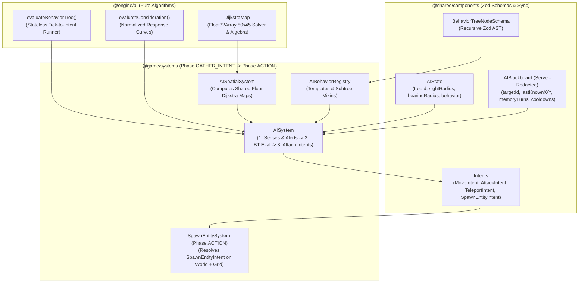
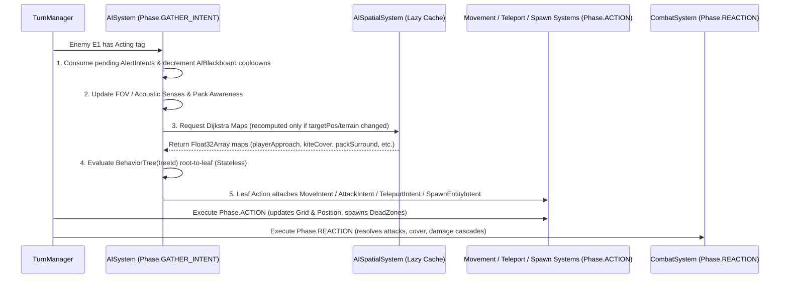

# AI Architecture Specification: Stateless Behavior Trees & Dijkstra Maps

> **Status:** Target Architecture Specification (v3.0 AI Upgrade)  
> **Baseline Audited:** Nirmata Runner v2.5 ([`src/game/systems/ai.ts`](../../src/game/systems/ai.ts), [`src/shared/components/ai-state.ts`](../../src/shared/components/ai-state.ts))  
> **Scope:** Pure Engine AI Primitives (`@engine/ai`), Shared Zod Component & Tree Schemas (`@shared/components/ai-*`), Authoritative AI & Spatial Systems (`@game/systems/`), Entity Templates (`@game/entities/templates/`), and Gamedata Authoring Studio ([`/dev/gamedata`](../../src/app/dev/gamedata/page.tsx))

---

## 1. Executive Summary & Architectural Goals

This document specifies the replacement of Nirmata Runner's monolithic `switch (ai.behaviorType)` enemy dispatcher in [`src/game/systems/ai.ts`](../../src/game/systems/ai.ts) with a composable, data-driven **Stateless Behavior Tree (BT) + Shared Dijkstra Map** architecture, augmented by optional **Utility Motivation Scoring** at the root selector.

### 1.1 Problems Solved by This Upgrade
1. **Eliminates Monolithic Dispatch & Enforces Mandate #5 (Data-Driven Entities)**: Replaces hardcoded `AIBehaviorType` methods (`processNullPointerTurn`, `processFragmenterTurn`, etc.) with declarative JSON Behavior Trees and reusable Subtree Mixins validated by Zod (`BehaviorTreeNodeSchema`). New enemy archetypes and behaviors can be authored in JSON or [`/dev/gamedata`](../../src/app/dev/gamedata/page.tsx) without modifying TypeScript system code.
2. **Fixes Turn-Based ECS Lifecycle & Intent Violations**:
   - Replaces direct `entityFactory.create(world, 'dead-zone', ...)` inside `Phase.GATHER_INTENT` (which bypassed `grid.addEntity()` and caused [`Fragmenter`](../../src/game/entities/templates/fragmenter.json) Dead Zones to deal `0` damage) with a formal `SpawnEntityIntent` resolved during `Phase.ACTION`.
   - Replaces unseeded `Math.random()` calls in [`tile-corruption.ts`](../../src/game/systems/tile-corruption.ts) and tie-breaking with deterministic `rot-js` PRNG seeded from [`FloorState.runSeed`](../../src/shared/components/floor-state.ts).
3. **Remediates Existing Perception & Pathfinding Bugs**:
   - Fixes broken `IDLE → CHASING` transitions on `Fragmenter`, `Logic-Leaker`, and `Seed_Eater` so enemies remember `lastKnownTargetPos` and pursue the player around corners for `memoryTurns`.
   - Fixes omniscient [`Buffer-Overflow`](../../src/game/entities/templates/buffer-overflow.json) followers by gating pack surround pathing on shared pack awareness (`PackAlerted` / leader or member FOV).
   - Fixes `Null-Pointer` ambush targeting so it teleports behind the player relative to the player's last movement vector (`MovedThisTurn` / facing) while respecting [`SecurityLock.faradayBounds`](../../src/shared/components/environment.ts).
4. **Replaces Blind Per-Entity A* with Multi-Objective Spatial Intelligence ([Dijkstra Maps](https://roguebasin.com/index.php/Talk:The_Incredible_Power_of_Dijkstra_Maps))**:
   - Replaces isolated `grid.isWalkable` A* queries with shared, precomputed `80 × 45` `Float32Array` Dijkstra distance and influence grids that account for blocking entities (`BlocksMovement`), environmental hazards (`DeadZone`, `CorruptedNode`), directional cover (`InteractiveSurface`), and destructible obstacles.
5. **Zero Client Delta Bloat (Mandate #4)**:
   - Evaluates Behavior Trees **statelessly per turn** (`Tick-to-Intent` during `Phase.GATHER_INTENT`), avoiding real-time `RUNNING` node cursors.
   - Stores static Behavior Tree ASTs in `AIBehaviorRegistry` (keyed by `treeId`) rather than duplicating JSON trees on every entity instance, and redacts server-only blackboard memory/cooldowns in [`redactWorldForClient`](../../src/shared/serialization.ts) and [`redactDeltaForClient`](../../src/shared/serialization.ts).

---

## 2. Layer Boundaries & Module Layout

In strict compliance with [`AGENTS.md`](../../AGENTS.md) Section 2 (enforced by `eslint-plugin-import-x`):

| Layer | File Path | Responsibility | Allowed Imports |
| :--- | :--- | :--- | :--- |
| **`@engine`** | `src/engine/ai/dijkstra-map.ts`<br>`src/engine/ai/behavior-tree.ts`<br>`src/engine/ai/types.ts` | Pure, zero-dependency `DijkstraMap` (`Float32Array` solver & linear combination algebra) and generic stateless `evaluateBehaviorTree()` / `evaluateUtilityScore()` engine primitives. | `@engine/*` only (**zero** imports from `@shared`, `@game`, `@rendering`, `@server`). |
| **`@shared`** | `src/shared/components/ai-state.ts`<br>`src/shared/components/ai-tree.ts`<br>`src/shared/components/intents.ts`<br>`src/shared/serialization.ts` | Zod schemas for `AIState`, `AIBlackboard`, `BehaviorTreeNodeSchema`, `UtilityConsiderationSchema`, `SpawnEntityIntent`, and client delta redaction rules. | `@engine/*`, `@shared/*`, `zod`. |
| **`@game`** | `src/game/ai/tree-registry.ts`<br>`src/game/ai/spatial-maps.ts`<br>`src/game/ai/bt-evaluator.ts`<br>`src/game/systems/ai.ts`<br>`src/game/systems/spawn-entity.ts`<br>`src/game/entities/templates/ai/*.json` | Authoritative `AISpatialSystem`, `AISystem` (BT condition & action handlers binding ECS components to `@engine/ai`), `SpawnEntitySystem`, and JSON subtree/archetype definitions. | `@engine/*`, `@shared/*`, `@game/*`, `rot-js`. |



---

## 3. Turn Lifecycle Integration (`Phase.GATHER_INTENT` & `Phase.ACTION`)

As documented in [`ENGINE_GUIDELINES.md`](../architecture/ENGINE_GUIDELINES.md), [`TurnManager`](../../src/engine/turn/turn-manager.ts) runs the 4-phase action sequence (`GATHER_INTENT → ACTION → REACTION → CLEANUP`) once for the player, and then **sequentially for each ready enemy** (`energy.current >= 1000`, sorted by `EntityId` ascending).

To keep multi-enemy turns fast while guaranteeing sequential board truth (Enemy B sees the updated tile position of Enemy A), AI execution is split into two cooperative stages inside `Phase.GATHER_INTENT`, followed by intent resolution in `Phase.ACTION`:



### 3.1 Dirty-Flag Caching for Shared Dijkstra Maps
On an `80 × 45` grid (`3,600` tiles), a full `Float32Array` Dijkstra pass takes `< 0.15ms` in V8.
* **Base Player & Objective Maps (`playerApproachMap`, `playerFleeMap`, `rangedCoverMap`, `lootScavengeMap`)** depend only on the player's position, static walkability, and active hazard/cover positions. `AISpatialSystem` caches these maps keyed by `(turnNumber, playerX, playerY, gridTerrainVersion)` so if 12 enemies act on Turn 42, the base maps are computed **once per turn**, not 12 times.
* **Dynamic Entity Avoidance**: When a leaf action steps downhill on a cached Dijkstra map (`MOVE_DIJKSTRA`), the local neighbor selector inspects the 4 cardinal neighbor tiles `(nx, ny)`:
  * Immediate neighbors occupied by another non-target entity with `BlocksMovement` receive a dynamic step penalty (`+8` cost, or `Infinity` if impassable), causing enemies in corridors to naturally fan out and flank around allies rather than bumping into the back of another enemy.
  * If an enemy has `canCrushProps: true` (e.g., `System_Admin`) and the best downhill tile contains a destructible `InteractiveSurface` prop, the step emits `AttackIntent(propId)` to smash through the obstacle.

---

## 4. Engine Layer Specification (`src/engine/ai/`)

### 4.1 Pure Dijkstra Map Solver & Grid Algebra (`src/engine/ai/dijkstra-map.ts`)

A [Dijkstra Map](https://roguebasin.com/index.php/Talk:The_Incredible_Power_of_Dijkstra_Maps) is a flat `Float32Array(width * height)` where goal tiles are initialized to `0` (or negative attraction weights), impassable tiles are `Infinity`, and every walkable tile holds the minimum cumulative traversal cost to the nearest goal.

```typescript
// src/engine/ai/dijkstra-map.ts

export const DIJKSTRA_IMPASSABLE = Infinity;
export const DIJKSTRA_UNSET = 1e9;

export interface DijkstraSeed {
  x: number;
  y: number;
  /** Goal weight (default 0; negative values create stronger attraction sinks). */
  value?: number;
}

export interface DijkstraPassabilityFn {
  /**
   * Returns traversal cost for entering (x, y), or Infinity if impassable.
   * Standard walkable floor = 1.0; DeadZone hazard = 6.0; destructible prop = 3.0.
   */
  (x: number, y: number): number;
}

export class DijkstraMap {
  public readonly width: number;
  public readonly height: number;
  public readonly data: Float32Array;

  constructor(width: number, height: number, initialData?: Float32Array) {
    this.width = width;
    this.height = height;
    this.data = initialData ?? new Float32Array(width * height).fill(DIJKSTRA_UNSET);
  }

  public index(x: number, y: number): number {
    return y * this.width + x;
  }

  public inBounds(x: number, y: number): boolean {
    return x >= 0 && x < this.width && y >= 0 && y < this.height;
  }

  public get(x: number, y: number): number {
    if (!this.inBounds(x, y)) return DIJKSTRA_IMPASSABLE;
    return this.data[this.index(x, y)];
  }

  public set(x: number, y: number, value: number): void {
    if (this.inBounds(x, y)) {
      this.data[this.index(x, y)] = value;
    }
  }

  /**
   * Computes the Dijkstra map from a set of seed coordinates using a fast
   * bucketed / ring-buffer queue (O(V) for uniform costs, O(V log V) for weighted hazards).
   */
  public compute(seeds: DijkstraSeed[], getStepCost: DijkstraPassabilityFn): this {
    this.data.fill(DIJKSTRA_UNSET);
    const queue: number[] = [];

    for (const seed of seeds) {
      if (!this.inBounds(seed.x, seed.y)) continue;
      const idx = this.index(seed.x, seed.y);
      const val = seed.value ?? 0;
      if (val < this.data[idx]) {
        this.data[idx] = val;
        queue.push(idx);
      }
    }

    const dirs = [
      [1, 0],
      [-1, 0],
      [0, 1],
      [0, -1],
    ] as const;

    let head = 0;
    while (head < queue.length) {
      const currIdx = queue[head++];
      const currVal = this.data[currIdx];
      const cx = currIdx % this.width;
      const cy = (currIdx - cx) / this.width;

      for (const [dx, dy] of dirs) {
        const nx = cx + dx;
        const ny = cy + dy;
        if (!this.inBounds(nx, ny)) continue;

        const stepCost = getStepCost(nx, ny);
        if (!Number.isFinite(stepCost)) continue;

        const nIdx = this.index(nx, ny);
        const candidate = currVal + stepCost;
        if (candidate < this.data[nIdx]) {
          this.data[nIdx] = candidate;
          queue.push(nIdx);
        }
      }
    }

    return this;
  }

  /**
   * Produces a flee/kite map by multiplying finite values by a negative coefficient
   * (typically -1.2) and re-running relaxation so agents smoothly navigate around corners
   * and out of dead-ends rather than backing into walls.
   */
  public createFleeMap(
    getStepCost: DijkstraPassabilityFn,
    fleeCoefficient: number = -1.2,
  ): DijkstraMap {
    const inverted = new DijkstraMap(this.width, this.height);
    const seeds: DijkstraSeed[] = [];

    for (let y = 0; y < this.height; y++) {
      for (let x = 0; x < this.width; x++) {
        const v = this.get(x, y);
        if (v < DIJKSTRA_UNSET && Number.isFinite(v)) {
          seeds.push({ x, y, value: v * fleeCoefficient });
        }
      }
    }
    return inverted.compute(seeds, getStepCost);
  }

  /**
   * Linearly combines multiple Dijkstra maps with weights:
   * result[i] = sum_k (maps[k].data[i] * weights[k])
   */
  public static combine(
    width: number,
    height: number,
    layers: Array<{ map: DijkstraMap; weight: number }>,
  ): DijkstraMap {
    const out = new DijkstraMap(width, height);
    const len = width * height;
    for (let i = 0; i < len; i++) {
      let sum = 0;
      let unreachable = false;
      for (const { map, weight } of layers) {
        const v = map.data[i];
        if (v >= DIJKSTRA_UNSET || !Number.isFinite(v)) {
          unreachable = true;
          break;
        }
        sum += v * weight;
      }
      out.data[i] = unreachable ? DIJKSTRA_UNSET : sum;
    }
    return out;
  }

  /**
   * Picks the best orthogonal step (dx, dy) from (fromX, fromY) by rolling downhill.
   * Uses a deterministic tie-breaker function `random()` when multiple neighbors tie.
   */
  public getBestStep(
    fromX: number,
    fromY: number,
    getDynamicPenalty?: (nx: number, ny: number) => number,
    random: () => number = () => 0,
  ): { dx: number; dy: number; targetScore: number } | null {
    const dirs = [
      { dx: 1, dy: 0 },
      { dx: -1, dy: 0 },
      { dx: 0, dy: 1 },
      { dx: 0, dy: -1 },
    ];

    let bestScore = this.get(fromX, fromY);
    let candidates: Array<{ dx: number; dy: number; targetScore: number }> = [];

    for (const { dx, dy } of dirs) {
      const nx = fromX + dx;
      const ny = fromY + dy;
      const base = this.get(nx, ny);
      if (base >= DIJKSTRA_UNSET || !Number.isFinite(base)) continue;

      const penalty = getDynamicPenalty ? getDynamicPenalty(nx, ny) : 0;
      if (!Number.isFinite(penalty)) continue;

      const score = base + penalty;
      if (score < bestScore - 1e-5) {
        bestScore = score;
        candidates = [{ dx, dy, targetScore: score }];
      } else if (Math.abs(score - bestScore) <= 1e-5 && candidates.length > 0) {
        candidates.push({ dx, dy, targetScore: score });
      }
    }

    if (candidates.length === 0) return null;
    if (candidates.length === 1) return candidates[0];
    const idx = Math.floor(random() * candidates.length);
    return candidates[idx];
  }
}
```

### 4.2 Stateless Behavior Tree & Utility Evaluator (`src/engine/ai/behavior-tree.ts`)

Because Nirmata Runner is turn-based, every BT evaluation returns either `BTStatus.SUCCESS` (an action intent was attached, or a wait action was deliberately chosen) or `BTStatus.FAILURE` (branch conditions were not met, fall through to next sibling). There is no `RUNNING` state.

```typescript
// src/engine/ai/types.ts

export enum BTStatus {
  SUCCESS = 'SUCCESS',
  FAILURE = 'FAILURE',
}

export type ResponseCurveType = 'linear' | 'quadratic' | 'logistic' | 'step';

export interface ResponseCurveParams {
  curve: ResponseCurveType;
  /** Slope / exponent (default 1 for linear, 2 for quadratic). */
  slope?: number;
  /** Invert output (1 - y). */
  invert?: boolean;
  /** Min/Max clamping domain for raw input normalization. */
  minInput?: number;
  maxInput?: number;
}

export interface BTEvaluationContext<TNode, TCondition, TAction, TConsideration> {
  /** Evaluates a leaf condition predicate against the ECS world. */
  evaluateCondition(cond: TCondition): boolean;
  /** Executes a leaf action (attaching ECS Intent components) and returns SUCCESS/FAILURE. */
  executeAction(action: TAction): BTStatus;
  /** Resolves a named reusable subtree by ID. */
  resolveSubtree(subtreeId: string): TNode | undefined;
  /** Reads a raw numeric metric for Utility AI considerations. */
  getConsiderationInput(metric: TConsideration): number;
  /** Checks whether a named cooldown timer is ready (0 turns remaining). */
  isCooldownReady(cooldownId: string): boolean;
  /** Starts/resets a named cooldown timer on the entity's blackboard when child succeeds. */
  startCooldown(cooldownId: string, turns: number): void;
  /** Deterministic PRNG in [0, 1) for random selectors/decorators. */
  random(): number;
}
```

#### Response Curve Math (`evaluateCurve`)
Given raw input $x \in [\text{minInput}, \text{maxInput}]$, normalize $t = \text{clamp}\left(\frac{x - \text{minInput}}{\text{maxInput} - \text{minInput}}, 0, 1\right)$:
* `linear`: $y = t$
* `quadratic`: $y = t^{\text{slope}}$ (default $\text{slope} = 2$)
* `logistic`: $y = \frac{1}{1 + e^{-10 \cdot \text{slope} \cdot (t - 0.5)}}$
* `step`: $y = t \ge (\text{slope} ?? 0.5) ? 1 : 0$
* If `invert === true`, return $1 - y$.
* Multiple considerations on a branch are combined via geometric mean $\left(\prod_{i=1}^n y_i\right)^{1/n}$ (following [Dave Mark's IAUS compensation factor](https://shaggydev.com/2023/04/19/utility-ai/)) so branches with 3 considerations are not unfairly penalized against branches with 1 consideration.

---

## 5. Shared Layer Zod Schemas (`src/shared/components/`)

Mirroring [`ConditionNodeSchema`](../../src/shared/components/augment-data.ts) in `augment-data.ts`, the Behavior Tree AST is defined in [`src/shared/components/ai-tree.ts`](../../src/shared/components/ai-tree.ts) so both the server runtime and the [`/dev/gamedata`](../../src/app/dev/gamedata/page.tsx) studio validate trees with a single source of truth.

### 5.1 Condition, Action & Tree Node Catalog (`src/shared/components/ai-tree.ts`)

```typescript
import { z } from 'zod';

/**
 * 1. Leaf Condition Predicates
 */
export const AIConditionSchema = z.discriminatedUnion('check', [
  z.object({ check: z.literal('CAN_SEE_TARGET') }),
  z.object({ check: z.literal('HAS_LAST_KNOWN_TARGET_POS') }),
  z.object({ check: z.literal('IS_ALERTED') }),
  z.object({
    check: z.literal('TARGET_DISTANCE_LTE'),
    distance: z.number().int().min(0),
    metric: z.enum(['manhattan', 'chebyshev']).default('manhattan'),
  }),
  z.object({
    check: z.literal('TARGET_DISTANCE_GTE'),
    distance: z.number().int().min(0),
    metric: z.enum(['manhattan', 'chebyshev']).default('manhattan'),
  }),
  z.object({
    check: z.literal('TARGET_DISTANCE_BETWEEN'),
    min: z.number().int().min(0),
    max: z.number().int().min(0),
    metric: z.enum(['manhattan', 'chebyshev']).default('manhattan'),
  }),
  z.object({
    check: z.literal('SELF_HP_BELOW_PERCENT'),
    percent: z.number().min(0).max(100),
  }),
  z.object({
    check: z.literal('HAS_STATUS_EFFECT'),
    target: z.enum(['self', 'target']).default('self'),
    statusName: z.string(),
  }),
  z.object({
    check: z.literal('IS_PACK_LEADER'),
  }),
  z.object({
    check: z.literal('PACK_MEMBERS_ADJACENT_GTE'),
    count: z.number().int().min(1),
  }),
  z.object({
    check: z.literal('IN_DIRECTIONAL_COVER_FROM_TARGET'),
  }),
  z.object({
    check: z.literal('HAS_VALID_TELEPORT_AMBUSH_TILE'),
    minRange: z.number().int().default(2),
    maxRange: z.number().int().default(8),
  }),
]);

/**
 * 2. Leaf Action Descriptors (Each maps to 1 atomic ECS Intent in Phase.GATHER_INTENT)
 */
export const AIActionSchema = z.discriminatedUnion('action', [
  z.object({
    action: z.literal('WAIT'),
    message: z.string().optional(),
  }),
  z.object({
    action: z.literal('MELEE_BUMP_TARGET'),
  }),
  z.object({
    action: z.literal('RANGED_ATTACK_TARGET'),
    statusEffect: z
      .object({
        name: z.string(),
        duration: z.number().int().min(1),
        magnitude: z.number().default(1),
      })
      .optional(),
    combatMessage: z.string().optional(),
  }),
  z.object({
    action: z.literal('MOVE_DIJKSTRA'),
    mapType: z.enum([
      'approach_target',
      'flee_from_target',
      'kite_to_cover',
      'pack_surround_cardinal',
      'investigate_last_known',
      'scavenge_nearest_loot',
      'patrol_anchors',
    ]),
    optimalRangeMin: z.number().int().optional(),
    optimalRangeMax: z.number().int().optional(),
    avoidHazards: z.boolean().default(true),
    canCrushProps: z.boolean().default(false),
    combatMessage: z.string().optional(),
  }),
  z.object({
    action: z.literal('TELEPORT_AMBUSH_BEHIND_TARGET'),
    minRange: z.number().int().default(2),
    maxRange: z.number().int().default(8),
    searchRadius: z.number().int().default(3),
    combatMessage: z.string().optional(),
  }),
  z.object({
    action: z.literal('SPAWN_ENTITIES_AROUND_SELF'),
    templateName: z.string(),
    pattern: z.enum(['cardinal_4', 'ring_radius_3']),
    count: z.number().int().min(1).default(4),
    deadZoneConfig: z
      .object({
        remainingTurns: z.number().int().min(1),
        damagePerTick: z.number().int().min(1),
      })
      .optional(),
    combatMessage: z.string().optional(),
  }),
]);

/**
 * 3. Utility Consideration Schema (for UTILITY_SELECTOR motivation scoring)
 */
export const UtilityConsiderationSchema = z.object({
  metric: z.enum([
    'self_hp_ratio',
    'target_distance',
    'target_visible',
    'pack_adjacent_count',
    'nearby_loot_value',
    'in_cover',
  ]),
  curve: z.enum(['linear', 'quadratic', 'logistic', 'step']).default('linear'),
  slope: z.number().default(1),
  invert: z.boolean().default(false),
  minInput: z.number().default(0),
  maxInput: z.number().default(1),
});

/**
 * 4. Recursive Behavior Tree AST Schema
 */
export type BehaviorTreeNode =
  | { type: 'SELECTOR'; name?: string; children: BehaviorTreeNode[] }
  | { type: 'SEQUENCE'; name?: string; children: BehaviorTreeNode[] }
  | {
      type: 'UTILITY_SELECTOR';
      name?: string;
      branches: Array<{
        name: string;
        weight?: number;
        considerations: z.infer<typeof UtilityConsiderationSchema>[];
        child: BehaviorTreeNode;
      }>;
    }
  | {
      type: 'DECORATOR_COOLDOWN';
      cooldownId: string;
      turns: number;
      child: BehaviorTreeNode;
    }
  | {
      type: 'DECORATOR_INVERT';
      child: BehaviorTreeNode;
    }
  | {
      type: 'DECORATOR_CHANCE';
      probability: number;
      child: BehaviorTreeNode;
    }
  | {
      type: 'SUBTREE';
      ref: string;
    }
  | {
      type: 'CONDITION';
      condition: z.infer<typeof AIConditionSchema>;
    }
  | {
      type: 'ACTION';
      task: z.infer<typeof AIActionSchema>;
    };

export const BehaviorTreeNodeSchema: z.ZodType<BehaviorTreeNode> = z.lazy(() =>
  z.discriminatedUnion('type', [
    z.object({
      type: z.literal('SELECTOR'),
      name: z.string().optional(),
      children: z.array(BehaviorTreeNodeSchema).min(1),
    }),
    z.object({
      type: z.literal('SEQUENCE'),
      name: z.string().optional(),
      children: z.array(BehaviorTreeNodeSchema).min(1),
    }),
    z.object({
      type: z.literal('UTILITY_SELECTOR'),
      name: z.string().optional(),
      branches: z
        .array(
          z.object({
            name: z.string(),
            weight: z.number().positive().default(1.0),
            considerations: z.array(UtilityConsiderationSchema).min(1),
            child: BehaviorTreeNodeSchema,
          }),
        )
        .min(1),
    }),
    z.object({
      type: z.literal('DECORATOR_COOLDOWN'),
      cooldownId: z.string(),
      turns: z.number().int().min(1),
      child: BehaviorTreeNodeSchema,
    }),
    z.object({
      type: z.literal('DECORATOR_INVERT'),
      child: BehaviorTreeNodeSchema,
    }),
    z.object({
      type: z.literal('DECORATOR_CHANCE'),
      probability: z.number().min(0).max(1),
      child: BehaviorTreeNodeSchema,
    }),
    z.object({
      type: z.literal('SUBTREE'),
      ref: z.string(),
    }),
    z.object({
      type: z.literal('CONDITION'),
      condition: AIConditionSchema,
    }),
    z.object({
      type: z.literal('ACTION'),
      task: AIActionSchema,
    }),
  ]),
);
```

### 5.2 Upgraded `AIState`, `AIBlackboard`, and `SpawnEntityIntent` Schemas

To maintain backward compatibility with existing HUD / inspector code while separating client-visible posture from server-only AI memory:

1. **`AIState` ([`src/shared/components/ai-state.ts`](../../src/shared/components/ai-state.ts))**:
   ```typescript
   export const AIState = defineComponent(
     'aiState',
     z.object({
       /** Client-visible high-level posture for HUD tooltips & shaders. */
       behavior: z.nativeEnum(AIBehavior).default(AIBehavior.IDLE),
       /** Legacy enum retained as fallback/alias for treeId during migration. */
       behaviorType: z.nativeEnum(AIBehaviorType).default(AIBehaviorType.BASIC),
       /** ID of the registered Behavior Tree in AIBehaviorRegistry (defaults to behaviorType). */
       treeId: z.string().optional(),
       /** Optional inline Behavior Tree override for bespoke one-off entities in /dev/gamedata. */
       inlineTree: BehaviorTreeNodeSchema.optional(),
       /** Visual FOV detection radius. */
       sightRadius: z.number().int().positive().default(6),
       /** How many turns the entity continues investigating lastKnownPlayerX/Y after losing LOS. */
       memoryTurns: z.number().int().min(0).default(5),
       /** Server-only cooldown counters (redacted from client deltas). */
       cooldowns: z.record(z.string(), z.number().int().min(0)).default({}),
       /** Server-only remaining memory turns before reverting from CHASING to IDLE. */
       remainingMemoryTurns: z.number().int().min(0).default(0),
     }),
   );
   ```
2. **`SpawnEntityIntent` ([`src/shared/components/intents.ts`](../../src/shared/components/intents.ts))**:
   ```typescript
   export const SpawnEntityIntent = defineComponent(
     'spawnEntityIntent',
     z.object({
       spawnerId: z.number().int(),
       spawns: z.array(
         z.object({
           templateName: z.string(),
           x: z.number().int(),
           y: z.number().int(),
           overrides: z.record(z.string(), z.record(z.string(), z.unknown())).optional(),
         }),
       ),
     }),
   );
   ```
3. **Client Delta Redaction ([`src/shared/serialization.ts`](../../src/shared/serialization.ts))**:
   In `redactWorldForClient` and `redactDeltaForClient`, strip `aiState.cooldowns`, `aiState.remainingMemoryTurns`, and `aiState.inlineTree` so internal AI timers never trigger redundant network delta updates on the client.

---

## 6. Spatial Map Suite (`src/game/ai/spatial-maps.ts`)

`AISpatialSystem` builds and caches **5 canonical Dijkstra layers** for the active `80 × 45` floor:

| Map Name | Seed Tiles (`value = 0`) | Step Cost Function | Tactical Use |
| :--- | :--- | :--- | :--- |
| **`approach_target`** | Player tile `(player.x, player.y)` | Walkable floor = `1.0`; active `DeadZone` = `6.0` (if `avoidHazards: true`); `CorruptedNode` (revealed) = `4.0`; walls/locked vault doors = `Infinity`. | Standard melee pursuit (`Null-Pointer`, `Fragmenter`, `Seed_Eater`, `System_Admin`). |
| **`flee_from_target`** | Derived via `approach_target.createFleeMap(stepCost, -1.2)` | Same as `approach_target`. | Smooth corner-aware retreating when a ranged kiter (`Logic-Leaker`) is pressured at distance `<= 2`. |
| **`kite_to_cover`** | Walkable tiles at Manhattan distance `3..5` from player with clear LOS **and** an orthogonally adjacent `InteractiveSurface` (`providesCover: true`) between tile and player get `value = -3.0`; other LOS tiles at distance `3..5` get `value = 0.0`. | Same as `approach_target`. | Enables `Logic-Leaker` to automatically reposition into ranged firing lanes behind Traxus freight crates or worktables. |
| **`pack_surround_cardinal`** | Unoccupied walkable cardinal tiles `(player.x ± 1, player.y)` and `(player.x, player.y ± 1)` not already targeted by a lower-ID pack member this turn. | Same as `approach_target`. | Coordinated `Buffer-Overflow` 4-side pincer movement without clumping on a single tile. |
| **`investigate_last_known`** | Per-entity `FovAwareness.lastKnownPlayerX/Y` (computed on demand within bounding box `±12` tiles). | Same as `approach_target`. | Hunting the player around corners after line-of-sight is broken until `remainingMemoryTurns` expires. |

---

## 7. Migration of Existing Bestiary to Behavior Trees

All 6 existing enemy archetypes in [`ENEMY-HIERARCHY.md`](./ENEMY-HIERARCHY.md) map cleanly to JSON Behavior Trees in `src/game/entities/templates/ai/` using shared subtrees (`skip-if-disrupted`, `investigate-last-known-pos`).

### 7.1 Shared Subtree Mixins (`src/game/entities/templates/ai/subtrees.json`)
```json
{
  "skip-if-disrupted": {
    "type": "SEQUENCE",
    "name": "stun-or-disrupt-guard",
    "children": [
      {
        "type": "SELECTOR",
        "children": [
          { "type": "CONDITION", "condition": { "check": "HAS_STATUS_EFFECT", "statusName": "DISRUPT" } },
          { "type": "CONDITION", "condition": { "check": "HAS_STATUS_EFFECT", "statusName": "STUN" } }
        ]
      },
      { "type": "ACTION", "task": { "action": "WAIT" } }
    ]
  },
  "investigate-last-known-pos": {
    "type": "SEQUENCE",
    "name": "pursue-memory",
    "children": [
      { "type": "CONDITION", "condition": { "check": "HAS_LAST_KNOWN_TARGET_POS" } },
      {
        "type": "ACTION",
        "task": { "action": "MOVE_DIJKSTRA", "mapType": "investigate_last_known", "avoidHazards": true }
      }
    ]
  }
}
```

### 7.2 Archetype Behavior Tree Definitions

#### 1. `Null-Pointer` (Tier 1 Stalker — `treeId: "null_pointer"`)
* **Fixes Applied**: Teleports behind the player relative to the player's last movement vector (`MovedThisTurn`), validates Faraday shield bounds before teleporting, applies a `2`-turn cooldown to prevent infinite every-turn blink spam, and properly pursues `lastKnownPlayerPos`.
```json
{
  "id": "null_pointer",
  "root": {
    "type": "SELECTOR",
    "children": [
      { "type": "SUBTREE", "ref": "skip-if-disrupted" },
      {
        "type": "SEQUENCE",
        "name": "visible-engagement",
        "children": [
          { "type": "CONDITION", "condition": { "check": "CAN_SEE_TARGET" } },
          {
            "type": "SELECTOR",
            "children": [
              {
                "type": "SEQUENCE",
                "name": "melee-strike",
                "children": [
                  { "type": "CONDITION", "condition": { "check": "TARGET_DISTANCE_LTE", "distance": 1 } },
                  { "type": "ACTION", "task": { "action": "MELEE_BUMP_TARGET" } }
                ]
              },
              {
                "type": "DECORATOR_COOLDOWN",
                "cooldownId": "phase_ambush",
                "turns": 2,
                "child": {
                  "type": "SEQUENCE",
                  "name": "blink-behind-player",
                  "children": [
                    { "type": "CONDITION", "condition": { "check": "HAS_VALID_TELEPORT_AMBUSH_TILE", "minRange": 2, "maxRange": 8 } },
                    {
                      "type": "ACTION",
                      "task": {
                        "action": "TELEPORT_AMBUSH_BEHIND_TARGET",
                        "minRange": 2,
                        "maxRange": 8,
                        "searchRadius": 2,
                        "combatMessage": "A Null-Pointer teleports behind you!"
                      }
                    }
                  ]
                }
              },
              {
                "type": "ACTION",
                "task": { "action": "MOVE_DIJKSTRA", "mapType": "approach_target", "avoidHazards": true }
              }
            ]
          }
        ]
      },
      { "type": "SUBTREE", "ref": "investigate-last-known-pos" },
      { "type": "ACTION", "task": { "action": "WAIT" } }
    ]
  }
}
```

#### 2. `Buffer-Overflow` (Tier 1 Pack Swarmer — `treeId: "buffer_overflow"`)
* **Fixes Applied**: Pack followers now require `CAN_SEE_TARGET` or `IS_ALERTED` (propagated across `packId` when any pack member spots the player) before swarming the player's cardinal tiles.
```json
{
  "id": "buffer_overflow",
  "root": {
    "type": "SELECTOR",
    "children": [
      { "type": "SUBTREE", "ref": "skip-if-disrupted" },
      {
        "type": "SEQUENCE",
        "name": "pack-combat",
        "children": [
          {
            "type": "SELECTOR",
            "children": [
              { "type": "CONDITION", "condition": { "check": "CAN_SEE_TARGET" } },
              { "type": "CONDITION", "condition": { "check": "IS_ALERTED" } }
            ]
          },
          {
            "type": "SELECTOR",
            "children": [
              {
                "type": "SEQUENCE",
                "name": "leader-direct-assault",
                "children": [
                  { "type": "CONDITION", "condition": { "check": "IS_PACK_LEADER" } },
                  {
                    "type": "SELECTOR",
                    "children": [
                      {
                        "type": "SEQUENCE",
                        "children": [
                          { "type": "CONDITION", "condition": { "check": "TARGET_DISTANCE_LTE", "distance": 1 } },
                          { "type": "ACTION", "task": { "action": "MELEE_BUMP_TARGET" } }
                        ]
                      },
                      { "type": "ACTION", "task": { "action": "MOVE_DIJKSTRA", "mapType": "approach_target" } }
                    ]
                  }
                ]
              },
              {
                "type": "ACTION",
                "task": { "action": "MOVE_DIJKSTRA", "mapType": "pack_surround_cardinal", "avoidHazards": false }
              }
            ]
          }
        ]
      },
      { "type": "SUBTREE", "ref": "investigate-last-known-pos" },
      { "type": "ACTION", "task": { "action": "WAIT" } }
    ]
  }
}
```

#### 3. `Fragmenter` (Tier 2 Heavy Area-Denier — `treeId: "fragmenter"`)
* **Fixes Applied**: Uses `SPAWN_ENTITIES_AROUND_SELF` (emitting `SpawnEntityIntent` + `AttackIntent`) so cardinal `dead-zone` entities are properly registered on `grid` during `Phase.ACTION` and deal their `2` tick damage.
```json
{
  "id": "fragmenter",
  "root": {
    "type": "SELECTOR",
    "children": [
      { "type": "SUBTREE", "ref": "skip-if-disrupted" },
      {
        "type": "SEQUENCE",
        "name": "heavy-engagement",
        "children": [
          { "type": "CONDITION", "condition": { "check": "CAN_SEE_TARGET" } },
          {
            "type": "SELECTOR",
            "children": [
              {
                "type": "SEQUENCE",
                "name": "ground-slam-and-dead-zones",
                "children": [
                  { "type": "CONDITION", "condition": { "check": "TARGET_DISTANCE_LTE", "distance": 1 } },
                  {
                    "type": "ACTION",
                    "task": {
                      "action": "SPAWN_ENTITIES_AROUND_SELF",
                      "templateName": "dead-zone",
                      "pattern": "cardinal_4",
                      "deadZoneConfig": { "remainingTurns": 6, "damagePerTick": 2 },
                      "combatMessage": "Fragmenter slams the ground! Dead Zones appear!"
                    }
                  }
                ]
              },
              {
                "type": "ACTION",
                "task": { "action": "MOVE_DIJKSTRA", "mapType": "approach_target", "avoidHazards": false, "canCrushProps": true }
              }
            ]
          }
        ]
      },
      { "type": "SUBTREE", "ref": "investigate-last-known-pos" },
      { "type": "ACTION", "task": { "action": "WAIT" } }
    ]
  }
}
```

#### 4. `Logic-Leaker` (Tier 2 Ranged Cover Kiter — `treeId: "logic_leaker"`)
* **Fixes Applied**: Uses `flee_from_target` Dijkstra map when player closes to `<= 2` tiles (preventing wall-stalling) and `kite_to_cover` to seek directional cover props at range `3..5`.
```json
{
  "id": "logic_leaker",
  "root": {
    "type": "SELECTOR",
    "children": [
      { "type": "SUBTREE", "ref": "skip-if-disrupted" },
      {
        "type": "SEQUENCE",
        "name": "ranged-kiter-combat",
        "children": [
          { "type": "CONDITION", "condition": { "check": "CAN_SEE_TARGET" } },
          {
            "type": "SELECTOR",
            "children": [
              {
                "type": "SEQUENCE",
                "name": "retreat-at-close-range",
                "children": [
                  { "type": "CONDITION", "condition": { "check": "TARGET_DISTANCE_LTE", "distance": 2 } },
                  {
                    "type": "ACTION",
                    "task": {
                      "action": "MOVE_DIJKSTRA",
                      "mapType": "flee_from_target",
                      "avoidHazards": true,
                      "combatMessage": "Logic-Leaker retreats!"
                    }
                  }
                ]
              },
              {
                "type": "SEQUENCE",
                "name": "corrupted-packet-volley",
                "children": [
                  { "type": "CONDITION", "condition": { "check": "TARGET_DISTANCE_BETWEEN", "min": 3, "max": 5 } },
                  {
                    "type": "ACTION",
                    "task": {
                      "action": "RANGED_ATTACK_TARGET",
                      "statusEffect": { "name": "FIRMWARE_LOCK", "duration": 3, "magnitude": 1 },
                      "combatMessage": "Logic-Leaker fires a Corrupted Packet! Firmware locked!"
                    }
                  }
                ]
              },
              {
                "type": "ACTION",
                "task": { "action": "MOVE_DIJKSTRA", "mapType": "kite_to_cover", "optimalRangeMin": 3, "optimalRangeMax": 5 }
              }
            ]
          }
        ]
      },
      { "type": "SUBTREE", "ref": "investigate-last-known-pos" },
      { "type": "ACTION", "task": { "action": "WAIT" } }
    ]
  }
}
```

#### 5. `System_Admin` & `Seed_Eater` (Tier 3 Logic Breakers)
* **`system_admin`**: Evaluates `skip-if-disrupted` (emitting `"System_Admin is disrupted and cannot move!"`), then executes `MOVE_DIJKSTRA` (`mapType: "approach_target"`, `avoidHazards: false`, `canCrushProps: true`), automatically crushing destructible cover props in its path as specified in [`INTERACTIVE-ENVIRONMENTS.md`](./INTERACTIVE-ENVIRONMENTS.md).
* **`seed_eater`**: Evaluates `skip-if-disrupted` → `MELEE_BUMP_TARGET` (if adjacent) → `MOVE_DIJKSTRA` (`approach_target`) → `investigate-last-known-pos`, while `TileCorruptionSystem` (`Phase.POST_TURN`) uses a deterministic `rot-js` PRNG seeded from `FloorState.runSeed + turnNumber` and emits `SpawnEntityIntent` for sub-process spawns.

---

## 8. Authoring & Debugging in `/dev/gamedata` and Dev Terminal

1. **Gamedata Authoring Studio ([`/dev/gamedata`](../../src/app/dev/gamedata/page.tsx))**:
   - In `EntityTemplateEditor`, the `aiState` component card renders a `treeId` dropdown populated from `src/game/entities/templates/ai/*.json` plus an **`[EDIT INLINE TREE]`** toggle.
   - Because `BehaviorTreeNodeSchema` uses the same recursive Zod structure as `ConditionNodeSchema` in [`augment-data.ts`](../../src/shared/components/augment-data.ts), the visual **Recursive AST Node Builder** in `/dev/gamedata` renders both Augment trigger trees and AI Behavior Trees with zero duplicate UI infrastructure.
2. **In-Game Dev Terminal (`Backtick`) & Telemetry Overlay**:
   - Add a `/debug-ai` command to the backtick terminal that renders:
     - Heatmap overlays for any active `DijkstraMap` (`approach_target`, `flee_from_target`, `kite_to_cover`, `pack_surround_cardinal`) directly on the PixiJS tilemap.
     - The last evaluated BT path (`root > visible-engagement > blink-behind-player [SUCCESS]`) on the [`tile-inspector.ts`](../../src/rendering/tile-inspector.ts) hover card when `/show-map` is active in `SIMULATION` mode.

---

## 9. Implementation Plan & Verification Matrix

| Milestone | Files Created / Modified | Verification & Tests |
| :--- | :--- | :--- |
| **M1: Engine Primitives (`@engine/ai`)** | `src/engine/ai/dijkstra-map.ts`, `src/engine/ai/behavior-tree.ts`, `src/engine/ai/types.ts` | Unit tests in `src/engine/ai/__tests__/dijkstra-map.test.ts` (multi-seed relaxation, hazard weights, `createFleeMap` corner escape, `combine` algebra) and `behavior-tree.test.ts` (selectors, sequences, utility curves, cooldowns). |
| **M2: Shared Schemas & Intents (`@shared`)** | `src/shared/components/ai-tree.ts`, `src/shared/components/ai-state.ts`, `src/shared/components/intents.ts` (`SpawnEntityIntent`), `src/shared/serialization.ts` | Schema validation tests in `src/shared/components/__tests__/ai-tree.test.ts` and client redaction tests in `tests/game/reconciliation.test.ts`. |
| **M3: Spatial System & BT Migration (`@game`)** | `src/game/ai/spatial-maps.ts`, `src/game/ai/tree-registry.ts`, `src/game/systems/spawn-entity.ts`, `src/game/systems/ai.ts`, `src/game/systems/tile-corruption.ts` | Update `src/game/systems/ai.test.ts` plus new regression tests for: (1) `Fragmenter` Dead Zone grid registration & tick damage, (2) `Logic-Leaker` corner kiting & cover seeking, (3) `Buffer-Overflow` FOV gating, (4) `Null-Pointer` Faraday-safe directional ambush, and (5) `System_Admin` prop crushing. |
| **M4: Gamedata Studio Integration** | `src/app/dev/gamedata/editors/subeditors/BehaviorTreeEditor.tsx`, `src/app/api/dev/gamedata/schema-introspect.ts` | Component tests verifying `treeId` selection and AST node editing in `/dev/gamedata`. |
