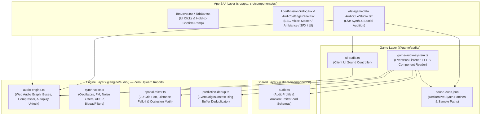
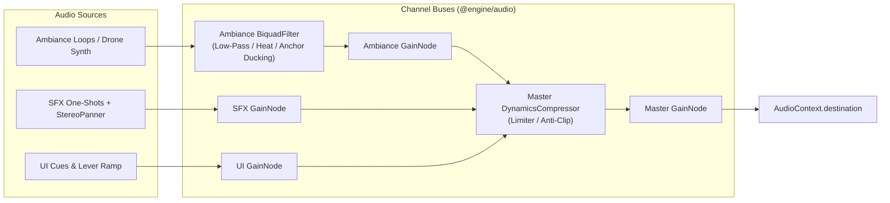
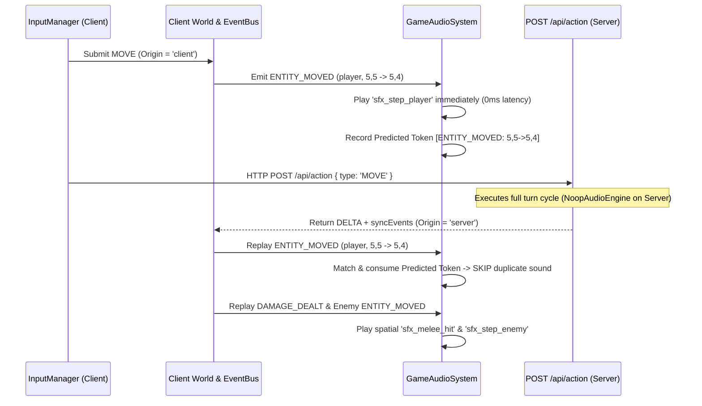
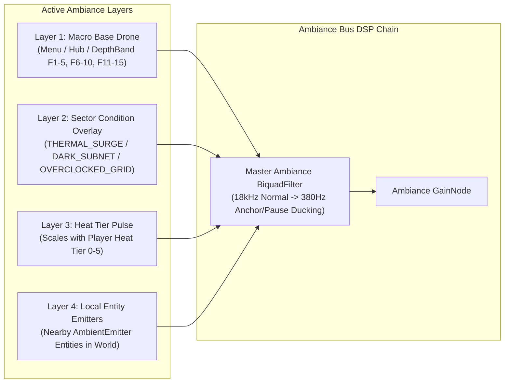

# Nirmata Runner — Audio System Specification (v1.0)

> **Status:** Approved Design Specification (Ready for Implementation)  
> **Target Layers:** `@engine/audio` (`src/engine/audio/`), `@shared/components` (`src/shared/components/audio.ts`), `@game/audio` (`src/game/audio/`), UI & `/dev/gamedata`  
> **Reference Guidelines:** [`ENGINE_GUIDELINES.md`](../architecture/ENGINE_GUIDELINES.md), [`SYSTEM_OVERVIEW.md`](../architecture/SYSTEM_OVERVIEW.md), [`UI-DESIGN-SYSTEM.md`](./UI-DESIGN-SYSTEM.md)

---

## 1. Executive Summary & Confirmed Architectural Decisions

The **Audio System** for *Nirmata Runner* is a **client-only** subsystem that drives continuous multi-layer background ambiance, 2D spatial gameplay sound effects (SFX), and tactile mechanical UI feedback (such as [`.btn-lever`](../../src/components/ui/atomic/BtnLever.tsx) presses and 2-second hold-to-confirm charge ramps) while strictly respecting the engine's non-negotiable ECS and module-boundary mandates.

| Decision Area | Selected Option | Architectural Summary |
| :--- | :--- | :--- |
| **1. ECS & Layer Architecture** | **Approach C (Hybrid)** | Pure, zero-dependency `@engine/audio` core + `@game/audio` `EventBus` boundary adapter (with `EventOriginContext` client-prediction deduplication) + data-driven `AudioProfile` and `AmbientEmitter` ECS components in `@shared/components`. |
| **2. Sound Source Backend** | **Backend 3 (Dual-Mode)** | Unified Web Audio API graph supporting both **procedural oscilloscope synth patches** (`mode: 'synth'`) out-of-the-box and **pre-authored sample files** (`mode: 'sample'` in `public/assets/audio/`) per cue. |
| **3. Spatial Audio** | **2D Grid-Space Stereo & Attenuation** | In-run one-shots and `AmbientEmitter` entities calculate stereo panning (`StereoPannerNode`) and distance attenuation (`GainNode`) relative to the player's [`Position`](../../src/shared/components/position.ts), gated by hearing radius and FOV visibility. |
| **4. Dynamic Ambiance** | **Option 3 (Reactive Multi-Layer)** | Continuous ambiance adapts across `MainMenu`, `Hub`, and `DepthBand` (`Floors 1–5`, `6–10`, `11–15`), with real-time DSP filter/layer modulation for `SectorCondition`, `HeatTier` (`0–5`), and Stability Anchor grayscale desaturation. |
| **5. User Audio Controls** | **ESC Settings Dialog** | `Master`, `Ambiance`, `SFX`, and `UI` volume sliders + `Mute` toggle integrated into the `ESC` Pause / System Menu ([`AbortMissionDialog.tsx`](../../src/components/ui/AbortMissionDialog.tsx) in-run and `ESC` / `[SETTINGS]` modal in `MainMenu` & `Hub`), persisted to `localStorage`. |
| **6. Gamedata Studio** | **`/dev/gamedata` Integration** | Full schema support for `AudioProfile` & `AmbientEmitter` on entity templates, plus a dedicated **Audio Cues & Synth Studio** tab in [`/dev/gamedata`](../../src/app/dev/gamedata/page.tsx) to audition cues, test spatial panning, and edit `sound-cues.json`. |

### 1.1 Hard Architectural Constraints Satisfied

1. **Strict `@engine` Layer Isolation ([`eslint.config.js`](../../eslint.config.js))**:
   - Files in `src/engine/**` (`@engine/*`) are forbidden by ESLint (`import-x/no-restricted-paths`) from importing anything from `@shared`, `@game`, `@rendering`, `@server`, or `@components`.
   - Just as [`TurnManager`](../../src/engine/turn/turn-manager.ts) in `@engine/turn` remains game-agnostic via [`TurnSchedulerAdapter`](../../src/engine/turn/types.ts) implemented by [`GameTurnAdapter`](../../src/game/turn/game-turn-adapter.ts) in `@game/turn`, `@engine/audio` has **zero upward imports** and receives game-specific event and component bindings from `@game/audio`.
2. **No Internal System RPCs ([`ENGINE_GUIDELINES.md`](../architecture/ENGINE_GUIDELINES.md))**:
   - Gameplay systems (`MovementSystem`, `CombatSystem`, `HeatSystem`, `PropInteractionSystem`, etc.) **never** call `audioSystem.play(...)` directly.
   - Per `ENGINE_GUIDELINES.md`, the [`EventBus`](../../src/engine/events/event-bus.ts) is strictly reserved for crossing domain boundaries (`Engine/Game → UI` in [`sync-bridge.ts`](../../src/game/ui/sync-bridge.ts), `Engine/Game → Renderer` in [`render-system.ts`](../../src/rendering/render-system.ts), and `Engine/Game → Audio` in `game-audio-system.ts`).
3. **Client-Only Execution & Server No-Op Guarantee**:
   - Authoritative server ticks ([`POST /api/action`](../../src/app/api/action/route.ts), [`runActionPipeline`](../../src/game/pipeline/action-pipeline.ts), and [`createEngineInstance`](../../src/game/engine-factory.ts) with `isClient: false`) never instantiate browser `AudioContext`, decode audio buffers, or run audio logic.
4. **Out-of-Run UI & Ambiance Lifecycle ([`src/app/page.tsx`](../../src/app/page.tsx))**:
   - Because `GameContext` (`world`, `eventBus`, `turnManager`) only exists during `GameState.Playing` / `Paused` / `GameOver` and is destroyed when returning to `GameState.MainMenu` or `GameState.Hub`, `AudioEngine` persists as a client singleton across the browser session (mirroring [`renderer.ts`](../../src/rendering/renderer.ts)) while `GameAudioSystem` binds and unbinds per run (mirroring [`render-system.ts`](../../src/rendering/render-system.ts)).

---

## 2. Layer Hierarchy & Module Map



### 2.1 File Layout

| Layer | File Path | Responsibility |
| :--- | :--- | :--- |
| **Engine (`@engine/*`)** | `src/engine/audio/types.ts` | Pure interfaces: `SoundCueDef`, `SynthPatchConfig`, `SampleCueConfig`, `AudioBusName`, `SpatialCoords`, `AmbianceModulation`, `AudioSettings`, `IAudioEngine`. |
| **Engine (`@engine/*`)** | `src/engine/audio/audio-engine.ts` | Client-only Web Audio API singleton (`AudioEngine`) + SSR/Server `NoopAudioEngine`. Manages `AudioContext`, `Master` / `Ambiance` / `SFX` / `UI` gain buses, `DynamicsCompressorNode` limiter, sample `AudioBuffer` cache, and per-cue cooldown rate limiting. |
| **Engine (`@engine/*`)** | `src/engine/audio/synth-voice.ts` | Procedural Web Audio synthesizer: builds temporary node graphs (`OscillatorNode`, FM modulator, white/pink/brown noise buffers, `BiquadFilterNode`, `WaveShaperNode`, ADSR `GainNode`) with automatic garbage collection on `onended`. |
| **Engine (`@engine/*`)** | `src/engine/audio/spatial-mixer.ts` | Pure 2D spatial audio calculations: converts listener `(px, py)` and source `(sx, sy)` into `{ gain, pan }` with configurable falloff (`linear` / `inverse`), FOV occlusion damping, and hearing radius cutoff. |
| **Engine (`@engine/*`)** | `src/engine/audio/prediction-dedup.ts` | Generic `PredictionDeduplicator` that records predicted `client` origin keys and suppresses matching `server` reconciliation keys within a configurable TTL window (`2000ms`). |
| **Engine (`@engine/*`)** | `src/engine/audio/index.ts` | Barrel export for `@engine/audio` (re-exported in [`src/engine/index.ts`](../../src/engine/index.ts)). |
| **Shared (`@shared/*`)** | `src/shared/components/audio.ts` | Zod schemas for `AudioProfile` and `AmbientEmitter`, registered in [`COMPONENTS_REGISTRY`](../../src/shared/components/index.ts). |
| **Game (`@game/*`)** | `src/game/audio/sound-cues.json` | Data-driven registry of all game sound cues (`ui_*`, `sfx_*`, `amb_*`), each specifying either a `synth` patch or a `sample` asset path. |
| **Game (`@game/*`)** | `src/game/audio/game-audio-system.ts` | Per-run client bridge (`createGameAudioSystem`) that subscribes to `EventBus<GameEvents>`, queries `World` (`Position`, `AudioProfile`, `AmbientEmitter`, `FloorState`, `Heat`, `Stability`), and dispatches spatial SFX and reactive ambiance updates to `AudioEngine`. |
| **Game (`@game/*`)** | `src/game/audio/ui-audio.ts` | Global UI audio helper (`uiAudio`) for [`BtnLever.tsx`](../../src/components/ui/atomic/BtnLever.tsx) clicks, 2-second hold-to-confirm pitch ramps, tab switches, and boot sequence typewriter ticks. |
| **UI (`@components/*`)** | `src/components/ui/AudioSettingsPanel.tsx` | Taikoku Vector Manifest audio mixer card embedded inside [`AbortMissionDialog.tsx`](../../src/components/ui/AbortMissionDialog.tsx) (in-run `ESC`) and `SystemSettingsModal.tsx` (`MainMenu` / `Hub` `ESC`). |
| **Dev Studio** | `src/app/dev/gamedata/editors/AudioCueStudio.tsx` | Interactive sound cue editor & synth/spatial audition studio in `/dev/gamedata`. |

---

## 3. Data Schemas & Engine Contracts

### 3.1 ECS Component Schemas (`src/shared/components/audio.ts`)

Both components are optional on entity templates in `src/game/entities/templates/*.json` and `src/game/shells/shared/templates/*.json`. If an entity does not have `AudioProfile`, `game-audio-system.ts` falls back to default category cues (e.g., `sfx_step_enemy`, `sfx_melee_hit`).

```typescript
import { z } from 'zod';
import { defineComponent } from '@engine/ecs/types';

/**
 * Customizes one-shot sound cues for an entity (Shells, Enemies, Weapons, Props).
 */
export const AudioProfile = defineComponent(
  'audioProfile',
  z.object({
    stepCue: z.string().optional(),
    attackCue: z.string().optional(),
    hitCue: z.string().optional(),
    deathCue: z.string().optional(),
    interactCue: z.string().optional(),
    pitchMultiplier: z.number().min(0.25).max(4.0).default(1.0),
    volumeMultiplier: z.number().min(0.0).max(2.0).default(1.0),
  }),
);
export type AudioProfileData = z.infer<typeof AudioProfile.schema>;

/**
 * Attaches a continuous spatial audio loop to a world entity (e.g., Stability Anchor,
 * Cooling Vent, Corrupted Node, Null-Pointer, Seed_Eater).
 */
export const AmbientEmitter = defineComponent(
  'ambientEmitter',
  z.object({
    cueId: z.string(),
    radius: z.number().min(1).max(30).default(8),
    baseVolume: z.number().min(0).max(1).default(0.5),
    falloff: z.enum(['linear', 'inverse']).default('linear'),
    /** If true, emitter is muted when its tile is outside the player's active FOV */
    requiresFov: z.boolean().default(false),
    /** If true, emitter automatically stops once Prop.isSearched or CorruptedNode.isDisarmed is true */
    activeOnlyWhenUnsearched: z.boolean().default(false),
  }),
);
export type AmbientEmitterData = z.infer<typeof AmbientEmitter.schema>;
```

### 3.2 Dual-Mode Sound Cue Schema (`src/engine/audio/types.ts`)

Every cue in `src/game/audio/sound-cues.json` is validated against `SoundCueDefSchema` and supports either procedural synthesis (`mode: 'synth'`) or an audio file (`mode: 'sample'`):

```typescript
export type AudioBusName = 'master' | 'ambiance' | 'sfx' | 'ui';

export interface SynthPatchConfig {
  waveform:
    | 'sine'
    | 'square'
    | 'sawtooth'
    | 'triangle'
    | 'noise_white'
    | 'noise_pink'
    | 'noise_brown';
  /** Start frequency in Hz (ignored for pure noise unless filter is used) */
  freqStart: number;
  /** End frequency in Hz for pitch sweeps/chirps */
  freqEnd?: number;
  freqRampType?: 'linear' | 'exponential';
  /** Optional secondary sub/detune oscillator */
  subWaveform?: 'sine' | 'square' | 'sawtooth' | 'triangle';
  subDetuneCents?: number;
  subMix?: number; // 0.0 - 1.0
  /** Optional FM modulation */
  fmFreq?: number;
  fmDepth?: number;
  /** Optional BiquadFilter */
  filterType?: 'lowpass' | 'highpass' | 'bandpass' | 'notch';
  filterCutoffStart?: number;
  filterCutoffEnd?: number;
  filterQ?: number;
  /** Optional Distortion / Bitcrush waveshaper amount (0.0 - 1.0) */
  distortion?: number;
  /** ADSR Envelope in seconds */
  attack: number;
  decay: number;
  sustain: number; // Gain level 0.0 - 1.0
  hold: number;
  release: number;
  /** Continuous LFO for looped ambiance synths */
  lfoFreq?: number;
  lfoFilterDepth?: number;
}

export interface SoundCueDef {
  id: string;
  bus: Exclude<AudioBusName, 'master'>;
  mode: 'synth' | 'sample';
  baseVolume: number;    // 0.0 - 1.0
  cooldownMs: number;    // Minimum ms between triggers of this cue ID (default 30ms)
  pitchVariance: number; // Random +/- pitch variation (e.g. 0.05 = +/- 5%)
  loop?: boolean;
  /** Used when mode === 'synth' */
  synth?: SynthPatchConfig;
  /** Used when mode === 'sample' (e.g. '/assets/audio/sfx/rifle.ogg') */
  samplePath?: string;
}
```

---

## 4. Core Engine Subsystems (`@engine/audio`)

### 4.1 Client-Only Guard & Server Safety
`AudioEngine` in `src/engine/audio/audio-engine.ts` enforces strict environment isolation:
- When `typeof window === 'undefined'`, `typeof window.AudioContext === 'undefined'`, or `isClient === false`, `getAudioEngine()` returns `NoopAudioEngine`.
- `NoopAudioEngine` implements `IAudioEngine` with empty no-op methods, ensuring server API routes (`POST /api/action`, `runActionPipeline`) and headless Vitest unit tests never allocate audio nodes or throw ReferenceErrors.
- On the browser client, `AudioEngine` lazily initializes `window.AudioContext` and attaches a one-time passive unlock listener (`pointerdown`, `keydown`) to resume the context from browser autoplay suspension.

### 4.2 Web Audio Mixing Graph & Anti-Clipping Limiter


When a chain reaction (e.g., Capacitor Bank EMP hitting 5 enemies and 3 Cryo-Vats in the same turn) emits 8 `DAMAGE_DEALT` events in a single `eventBus.flush()`, `@engine/audio` enforces a per-cue debounce window (`cooldownMs: 35`) and routes all buses through a master `DynamicsCompressorNode` limiter so simultaneous hits never distort or clip.

### 4.3 2D Grid Spatial Mixer (`src/engine/audio/spatial-mixer.ts`)
When an in-run sound event occurs at tile `(sourceX, sourceY)` while the player is at `(playerX, playerY)`:

1. **Euclidean Distance**:
   $$d = \sqrt{(\text{sourceX} - \text{playerX})^2 + (\text{sourceY} - \text{playerY})^2}$$
2. **Hearing Cutoff**:
   If $d > R_{\text{max}}$ (default `14` tiles for SFX, or `AmbientEmitter.radius` for emitters), the sound is culled (`gain = 0`).
3. **Distance Attenuation**:
   - `linear`: $\text{gain}_{\text{dist}} = \max\left(0, 1 - \frac{d}{R_{\text{max}}}\right)$
   - `inverse`: $\text{gain}_{\text{dist}} = \frac{1}{1 + 0.35 \cdot d}$
4. **FOV / Wall Occlusion Damping**:
   If the source tile is **not** in `currentFovSet` (an enemy moving in the dark or behind a wall), $\text{gain}$ is multiplied by an occlusion factor (`0.45`) and routed through a `900 Hz` low-pass muffled filter.
5. **Stereo Panning (`StereoPannerNode`)**:
   $$\text{pan} = \text{clamp}\left(\frac{\text{sourceX} - \text{playerX}}{8.0}, -0.85, +0.85\right)$$
   (Clamped to `±0.85` so headphone users never experience harsh 100% single-ear isolation).

### 4.4 Client Prediction Deduplication (`src/engine/audio/prediction-dedup.ts`)
To prevent double-playing predicted player actions (`MOVE`, `USE_FIRMWARE`, `VENT`):
- When `EventOriginContext.current === 'client'`, `GameAudioSystem` plays the cue immediately (`0ms` latency) and calls:
  `dedup.recordPredicted(eventType, `${playerId}:${fingerprint}`)`.
- When [`applyStateDelta`](../../src/shared/reconciliation.ts) replays authoritative server events with `EventOriginContext.current === 'server'`:
  - `GameAudioSystem` checks `dedup.consumeIfPredicted(eventType, `${entityId}:${fingerprint}`)`.
  - If matched (within `2000ms`), the server replay is silently skipped.
  - If the server rejected or corrected the move (fingerprint mismatch), or if `entityId !== playerId` (enemy move/attack), the sound plays normally.



---

## 5. Reactive Multi-Layer Ambiance Architecture (Option 3)

The `ambiance` bus runs a continuous generator/loop stack managed by `AudioEngine.setAmbianceState()` that crossfades (`800ms` equal-power ramp) and modulates DSP parameters in real time:



### 5.1 Macro State & Depth Band Base Tracks
| State / Band | Cue ID | Sonic Character |
| :--- | :--- | :--- |
| **`GameState.MainMenu`** | `amb_main_menu` | Clean `55 Hz` A1 oscilloscope triangle drone with slow harmonic fifth (`82.4 Hz`) and subtle vector scanline shimmer. |
| **`GameState.Hub`** | `amb_hub_deck` | Sterile server-room air circulation (filtered brown noise) + steady `110 Hz` data-link pulse. |
| **Floors 1–5 (`CORRUPTED_DATA`)** | `amb_band_1_corrupted` | Deep industrial sub-bass (`45 Hz`) with intermittent low-pass data-packet clicks. |
| **Floors 6–10 (`STATIC_HORRORS`)** | `amb_band_2_static` | Detuned dual-sawtooth dread drone (`38 Hz` + `38.7 Hz` beating) with high-passed static interference bursts. |
| **Floors 11–15 (`LOGIC_BREAKERS`)** | `amb_band_3_logic` | Aggressive FM sub-harmonic rumble (`32 Hz`) with metallic resonant filter sweeps. |

### 5.2 Real-Time DSP Modulation Rules
1. **Sector Condition Overlays (`FloorState.sectorCondition`)**:
   - `THERMAL_SURGE`: Adds a warm mid-frequency thermal hum (`220 Hz` bandpass noise) to the ambiance mix.
   - `DARK_SUBNET`: Drops the base ambiance low-pass cutoff by `40%` and adds a faint sonar beacon ping.
   - `OVERCLOCKED_GRID`: Increases the LFO pulse rate of the base drone by `1.5x`.
2. **Neural Heat Tier Escalation (`heatTier 0–5`)**:
   - `Tier 0–1`: Clean baseline (`thermalLayerGain = 0`).
   - `Tier 2–3`: Fades in a rising high-pitched capacitor whine (`thermalLayerGain = 0.25 -> 0.5`).
   - `Tier 4–5 (Overclock / Kernel Panic Risk)`: Adds a rhythmic warning pulse and subtle waveshaper grit on the ambiance bus.
3. **Stability Anchor & Pause Ducking (`APPLY_WORLD_FILTER` / `GameState.Paused`)**:
   - Stepping onto a Stability Anchor (which desaturates the PixiJS world to grayscale) or opening the `ESC` Pause Menu smoothly ramps the Ambiance Bus `BiquadFilterNode` cutoff from `18,000 Hz` down to `380 Hz` over `250ms`, creating an atmospheric "time-dilation / system handshake" isolation effect. `REMOVE_WORLD_FILTER` / resuming restores `18,000 Hz`.

---

## 6. UI Audio & Mechanical `BtnLever` Integration

[`src/components/ui/atomic/BtnLever.tsx`](../../src/components/ui/atomic/BtnLever.tsx) is the universal action control across all 15 screens. Wiring `uiAudio` directly into `BtnLever` automatically provides tactile audio across the entire application:

1. **Pointer Enter (Hover)**: Plays `ui_lever_hover` (subtle `2ms` `1,800 Hz` tick, cooldown `40ms`) when not disabled.
2. **Standard Click (`!holdToConfirm`)**:
   - `variant === 'primary'`: Plays `ui_lever_click_primary` (crisp acid-lime mechanical switch snap).
   - `variant === 'cyan'`: Plays `ui_lever_click_cyan` (clean telemetry relay chime).
   - `variant === 'danger'`: Plays `ui_lever_click_danger` (heavy low-mid warning clunk).
3. **2-Second Hold-to-Confirm (`holdToConfirm === true`)**:
   - **`startHold()`**: Starts a continuous synth voice (`ui_lever_hold_ramp`) whose frequency (`180 Hz → 720 Hz`) and filter cutoff (`400 Hz → 4,800 Hz`) smoothly track `holdProgress` (`0% → 100%`).
   - **`triggerComplete()` (`100%`)**: Stops the ramp and fires `ui_lever_hold_confirm` (heavy dual-oscillator hydraulic lock latch + harmonic confirmation tone).
   - **`cancelHold()` (Released early)**: Stops the ramp and fires `ui_lever_hold_cancel` (rapid `120ms` pitch-down power-bleed).

### 6.1 Soundscape & Cue Taxonomy

| Category | Bus | Trigger Source | Canonical Sound Cues |
| :--- | :--- | :--- | :--- |
| **Background Ambiance** | `ambiance` | `GameState`, `FLOOR_TRANSITION`, `SectorCondition` | `amb_main_menu`, `amb_hub_deck`, `amb_band_1_corrupted`, `amb_band_2_static`, `amb_band_3_logic`, `amb_overlay_thermal`, `amb_overlay_dark_subnet`, `amb_emitter_anchor`, `amb_emitter_vent`, `amb_emitter_corrupted`. |
| **UI & Mechanical Levers** | `ui` | [`BtnLever.tsx`](../../src/components/ui/atomic/BtnLever.tsx), `TabBar`, Modals, `BootSequence` | `ui_lever_hover`, `ui_lever_click_primary`, `ui_lever_click_cyan`, `ui_lever_click_danger`, `ui_lever_hold_ramp`, `ui_lever_hold_confirm`, `ui_lever_hold_cancel`, `ui_tab_switch`, `ui_modal_open`, `ui_modal_close`, `ui_boot_typewriter`. |
| **Movement & Navigation** | `sfx` | `ENTITY_MOVED`, `ENEMY_TELEPORTED`, `TARGETING_*` | `sfx_step_player`, `sfx_step_bastion`, `sfx_step_ghost`, `sfx_step_enemy`, `sfx_teleport_shift`, `sfx_targeting_start`, `sfx_targeting_cursor`, `sfx_bump_warning`. |
| **Combat & Hazards** | `sfx` | `DAMAGE_DEALT`, `ENTITY_DIED`, `HEALED`, `AUGMENT_FLASH` | `sfx_melee_hit`, `sfx_ranged_hit`, `sfx_player_damaged`, `sfx_cover_mitigated`, `sfx_cover_broken`, `sfx_volatile_cryo`, `sfx_volatile_emp`, `sfx_enemy_death`, `sfx_augment_proc`, `sfx_heal_nanite`. |
| **Heat, Stability & Props** | `sfx` | `FIRMWARE_ACTIVATED`, `HEAT_CHANGED`, `VENT_COMPLETED`, `PROP_INTERACTED`, `LOCK_UNLOCKED`, `ITEM_PICKED_UP`, `RUN_ENDED` | `sfx_firmware_cast`, `sfx_heat_tier_up`, `sfx_kernel_panic_alarm`, `sfx_vent_purge`, `sfx_item_pickup`, `sfx_currency_pickup`, `sfx_prop_search`, `sfx_lock_keycard`, `sfx_lock_overclock`, `sfx_dead_drop_uplink`, `sfx_anchor_handshake`, `sfx_bsod_fatal`, `sfx_extract_success`. |

---

## 7. ESC System Settings Dialog & Persistence Specification

Audio controls live in an **ESC-accessible Settings Dialog** styled according to the **Taikoku Vector Manifest** ([`UI-DESIGN-SYSTEM.md`](./UI-DESIGN-SYSTEM.md)).

### 7.1 `localStorage` & `gameStore` State
Stored under key `'nirmata_audio_settings'` and mirrored in [`gameStore`](../../src/game/ui/store.ts):
```typescript
export interface AudioSettingsState {
  muted: boolean;
  masterVolume: number;   // 0.0 - 1.0 (default 0.8)
  ambianceVolume: number; // 0.0 - 1.0 (default 0.6)
  sfxVolume: number;      // 0.0 - 1.0 (default 0.85)
  uiVolume: number;       // 0.0 - 1.0 (default 0.75)
}
```

### 7.2 UI Integration Across Game States
1. **In-Run (`GameState.Playing` / `GameState.Paused` — `ESC` Key)**:
   - Pressing `ESC` opens [`AbortMissionDialog.tsx`](../../src/components/ui/AbortMissionDialog.tsx).
   - `AbortMissionDialog.tsx` is expanded into the unified **System Pause & Abort Terminal** (`システム設定 // SYSTEM TELEMETRY & EMERGENCY ABORT`):
     - **Top Section (`AUDIO & TELEMETRY CALIBRATION` `.panel-card`)**: Renders `AudioSettingsPanel.tsx` featuring a `MUTE ALL AUDIO [消音]` `.btn-lever` toggle and 4 `.dotted-spec-row` range sliders (`MASTER GAIN`, `AMBIANCE / DRONE BUS`, `TACTICAL SFX BUS`, `INTERFACE / LEVER BUS`) with tabular percentage readouts (`0%`–`100%`) that audition a subtle calibration tick when adjusted.
     - **Bottom Section (`EMERGENCY ABORT PROTOCOL`)**: Retains all existing casualty warnings, `RESUME MISSION [ESC]`, and the 2-second hold `CONFIRM DESYNC & ABORT` lever.
2. **Out-of-Run (`MainMenu` & `HubLayout` — `ESC` Key or Header Button)**:
   - Pressing `ESC` in `MainMenu` or `HubLayout` (when no other modal like `RitualOverlay` is open) or clicking a compact `[SETTINGS // 音響]` button opens a centered Paradigm C modal (`SystemSettingsModal.tsx`) containing the same `AudioSettingsPanel.tsx`.

---

## 8. `/dev/gamedata` Audio Cues & Synth Studio Integration

The Gamedata Authoring Studio ([`src/app/dev/gamedata/`](../../src/app/dev/gamedata/page.tsx)) is extended in two ways:

1. **Automatic Component Schema Support**:
   - Because `AudioProfile` and `AmbientEmitter` are registered in `COMPONENTS_REGISTRY`, `/api/dev/gamedata/components` automatically exposes their Zod schemas. Designers can attach and edit `audioProfile` and `ambientEmitter` on any entity in `EntityTemplateEditor` or `MixinEditor`.
2. **New `Audio Cues` Section (`AudioCueStudio.tsx`)**:
   - Adds `{ id: 'audioCues', label: 'Audio Cues', apiPath: '/api/dev/gamedata/audio-cues' }` to [`SECTIONS`](../../src/app/dev/gamedata/types.ts).
   - **API Route (`src/app/api/dev/gamedata/audio-cues/route.ts`)**: Reads and writes cue definitions in `src/game/audio/sound-cues.json` (gated by `NODE_ENV !== 'production'`).
   - **Interactive Studio UI**:
     - Edit `mode` (`synth` vs. `sample`), `bus` (`ambiance`, `sfx`, `ui`), `baseVolume`, `cooldownMs`, `pitchVariance`, and all `SynthPatchConfig` sliders (waveform, start/end frequency, ADSR envelope, filter cutoff/Q, FM depth, distortion).
     - **Live Audition Controls**:
       - **[ ▶ PLAY CUE ]**: Plays the currently edited cue immediately through `AudioEngine`.
       - **Spatial Preview Pad**: Interactive 2D distance/pan slider (`X: -10..+10`, `Y: -10..+10`, `FOV Occluded` checkbox) to test how the cue sounds at different tile offsets from the player.
       - **Ambiance State Simulator**: Dropdowns to preview `DepthBand`, `SectorCondition`, `HeatTier (0–5)`, and `Anchor Grayscale Ducking` in real time.

---

## 9. Implementation Plan (Milestones 1–5)

### Milestone 1: `@engine/audio` Core, Synth Graph, Spatial Math & Deduplicator
- Create `src/engine/audio/types.ts`, `spatial-mixer.ts`, `prediction-dedup.ts`, `synth-voice.ts`, `audio-engine.ts`, and `index.ts`.
- Verify zero upward imports (`npm run lint`) and 100% SSR/Server safety (`NoopAudioEngine`).
- Add unit tests in `src/engine/audio/__tests__/` covering spatial attenuation/panning math, FOV occlusion damping, `PredictionDeduplicator` token matching/expiry, per-cue cooldown throttling, and `AudioEngine` bus gain calculations.

### Milestone 2: `@shared/components/audio.ts` & Declarative `sound-cues.json`
- Define `AudioProfile` and `AmbientEmitter` in `src/shared/components/audio.ts` and register them in `COMPONENTS_REGISTRY` (`src/shared/components/index.ts`).
- Author `src/game/audio/sound-cues.json` with complete synth patches for all UI levers, movement, combat, Firmware abilities, Heat/Stability states, interactive props, and reactive ambiance layers.
- Attach `audioProfile` and `ambientEmitter` to key entity templates (`vanguard-v1.json`, `bastion-v1.json`, `ghost-v1.json`, `null-pointer.json`, `system-admin.json`, `seed-eater.json`, `cooling-vent.json`, `reality-stabilizer.json`, `encrypted-safe.json`).

### Milestone 3: `@game/audio` Bridge, Reactive Ambiance & `BtnLever` Integration
- Implement `src/game/audio/game-audio-system.ts` (`createGameAudioSystem`) subscribing to `EventBus<GameEvents>` with `EventOriginContext` deduplication, 2D spatial positioning, and reactive ambiance state updates.
- Implement `src/game/audio/ui-audio.ts` and wire into [`BtnLever.tsx`](../../src/components/ui/atomic/BtnLever.tsx) (hover, variant click, 2-second hold-to-confirm frequency/filter ramp, confirm latch, cancel bleed), `TabBar.tsx`, and `BootSequence.tsx`.
- Wire `GameAudioSystem` lifecycle into [`src/app/page.tsx`](../../src/app/page.tsx) (switching ambiance between `MainMenu`, `Hub`, and `Playing`, and cleaning up run listeners on unmount/return to Hub).

### Milestone 4: ESC Settings Dialog & `localStorage` Persistence
- Extend [`gameStore`](../../src/game/ui/store.ts) with `audioSettings` state and actions synced to `localStorage` (`'nirmata_audio_settings'`) and `AudioEngine`.
- Create `src/components/ui/AudioSettingsPanel.tsx` and `src/components/ui/SystemSettingsModal.tsx`.
- Integrate `AudioSettingsPanel` into [`AbortMissionDialog.tsx`](../../src/components/ui/AbortMissionDialog.tsx) (in-run `ESC`) and wire `SystemSettingsModal` into `MainMenu.tsx` and `HubLayout.tsx` (`ESC` key + header settings button).
- Add unit tests for settings persistence and modal keyboard navigation.

### Milestone 5: `/dev/gamedata` Audio Cue & Synth Studio
- Create `/api/dev/gamedata/audio-cues/route.ts` (environment-gated like existing dev routes).
- Build `src/app/dev/gamedata/editors/AudioCueStudio.tsx` with synth parameter editors, sample path configuration, live `[ ▶ PLAY CUE ]` auditioning, 2D spatial preview, and ambiance state testing.
- Run full test suite (`npm test`), typecheck (`npm run typecheck`), and lint (`npm run lint`).
