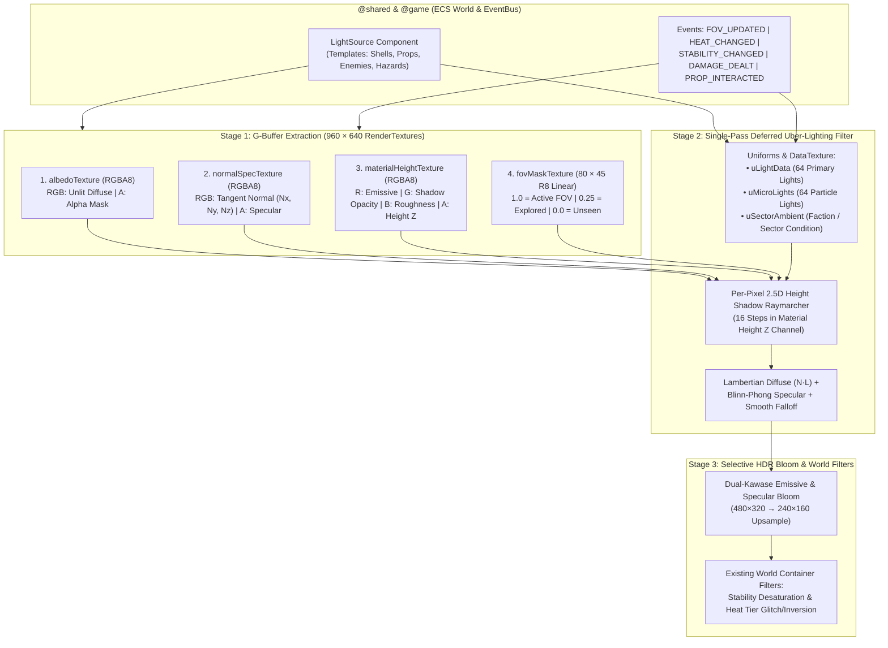

# Per-Pixel / Deferred Lighting & Rendering System — Technical Specification

> **Status:** Canonical Design & Engineering Specification (v1.0)  
> **Target Engine:** Nirmata Runner (Next.js 16, React 19, PixiJS 8 WebGL2, TypeScript, Zod ECS)  
> **Scope:** Client Deferred Lighting Pipeline (`src/rendering/lighting/`), Expanded Lit Particle System (`src/rendering/particles/`), Data-Driven `LightSource` ECS Component (`src/shared/components/light-source.ts`), Multi-Plane Procedural Atlas Generators (`scripts/`), and Gamedata Authoring Studio Integration (`src/app/dev/gamedata/`)

---

## 1. Executive Summary & Architectural Decisions

The **Per-Pixel / Deferred Lighting & Rendering System** upgrades *Nirmata Runner*'s visual pipeline from flat, alpha-dimmed 2D sprites to a **2.5D Normal-Mapped Deferred Shading** architecture that preserves crisp `32 × 32` pixel-art craftsmanship while introducing modern dynamic lighting, per-pixel height-raymarched shadows, selective emissive bloom, and physically lit GPU particles.

### 1.1 Finalized Design Decisions

| Design Dimension | Selected Engine Direction |
| :--- | :--- |
| **1. Surface Relief & Shading** | **Normal-Mapped 3D Pixel Relief**: Multi-pass G-Buffer (`Albedo`, `Normal + Specular`, `Emissive + Shadow + Roughness + Height`) computing per-pixel $\vec{N} \cdot \vec{L}$ diffuse and Blinn-Phong specular glints on 1px rivets, bulkhead bevels, and curved glass vats. |
| **2. Light Attenuation & Gradients** | **Smooth Continuous HD Gradients**: High-bit-depth smooth radial and quadratic attenuation curves across crisp `32 × 32` pixel art without stepped posterization bands. |
| **3. Selective HDR Bloom** | **Dual-Kawase Emissive & Specular Bloom**: Soft glow pass isolating self-illuminating pixels (`Emissive > 0` on laser barriers, CRT waveforms, nanite conduits, neon particles) and high-intensity specular glints before Heat/Stability world filters execute. |
| **4. Dynamic Shadow Casters** | **Walls, Closed Doors, Props, and Characters (`2.5D Height Raymarching`)**: Screen-space raymarching against the per-pixel elevation channel (`Height Z` $\in [0..32\text{px}]$) so walls cast full corridor shadows, tall props/vats cast long silhouettes, low-cover crates cast finite floor shadows (allowing higher lights to shine over cover), and characters/enemies cast pixel-accurate silhouettes. |
| **5. FOV & Fog-of-War Integration** | **Dynamic Lighting Replaces Uniform Alpha Dimming**: Replaces `sprite.alpha = 1.0 / 0.3` in [`tilemap.ts`](../../src/rendering/tilemap.ts) and [`fov.ts`](../../src/rendering/fov.ts) with a bilinearly filtered GPU `fovMaskTexture` (`80 × 45`). Active FOV receives full direct/specular lighting; explored fog-of-war receives cold, desaturated memory ambient lighting while masking out unseen dynamic lights (`ARCH-12 / U1` anti-cheat compliance). |
| **6. Active Light Budget** | **20–50 Primary Scene Lights + 64 Particle Micro-Lights**: Evaluated in a single full-screen WebGL2 Uber-Lighting `Filter` pass at fixed `960 × 640` viewport resolution (`30 × 20` visible tiles) with zero multi-pass draw-call overhead. |
| **7. Animated Light Behaviors** | **5 Built-In Procedural Waveforms**: `STATIC`, `PULSE` (smooth sine breathe), `FLICKER` (broken neon / electrical arc noise), `STROBE` (high-contrast warning flash), and `RADAR_SWEEP` (angular rotating beam). |
| **8. Player Shell Lighting** | **Omnidirectional Dynamic Aura**: Personal Shell light (`VANGUARD-v1`, `BASTION-v1`, `GHOST-v1`) shifts color, radius, and flicker frequency dynamically in response to **Neural Heat** (`0–100%+` $\to$ Thermal Amber `#ff9500` $\to$ Kernel Panic Crimson `#ff0055`) and **Reality Stability** (`< 50%` $\to$ contracting radius + ultraviolet phase pulse). |
| **9. Particle System Upgrade** | **Dual-Mode Lit & Light-Emitting GPU Particles**: Replaces the 15-rect `Pixi.Graphics` loop in [`particle-emitters.ts`](../../src/rendering/filters/particle-emitters.ts) with a pooled, sprite-batched particle system supporting micro-light emission (sparks, plasma bolts, EMP arcs, cryo shards) and normal-mapped vapor illumination (cooling vent steam, cryo mist, debris). |
| **10. Procedural Asset Pipeline** | **Automated Multi-Plane Atlas Generation (`_n.png` & `_m.png`)**: Extends [`scripts/`](../../scripts/) Canvas generators to remove baked drop-shadow ovals from diffuse sprites and automatically output synchronized Normal/Specular (`_n.png`) and Material/Height (`_m.png`) atlases for the base tileset and all corporate faction themes. |
| **11. Authoring & ECS Architecture** | **Shared Zod `LightSource` Component**: Defined in [`src/shared/components/light-source.ts`](../../src/shared/components/light-source.ts) and registered in [`COMPONENTS_REGISTRY`](../../src/shared/components/index.ts) for live authoring and previewing in [`/dev/gamedata`](../../src/app/dev/gamedata/page.tsx). |

---

## 2. Rendering Architecture & Multi-Target G-Buffer Pipeline

In compliance with [`AGENTS.md`](../../AGENTS.md) Section 2, all WebGL shaders, `RenderTexture` targets, and particle pools reside strictly inside `@rendering` (`src/rendering/`), while `@shared` (`src/shared/components/light-source.ts`) holds only the pure Zod data schema.



### 2.1 G-Buffer Channel Specification (`960 × 640`, `SCALE_MODE: 'nearest'`)

All three G-Buffer `RenderTexture` targets match the fixed `960 × 640` canvas resolution (`resolution: 1`, `antialias: false`) defined in [`src/rendering/constants.ts`](../../src/rendering/constants.ts):

| Target | Channel | Encoding (`0..255` $\to$ `0.0..1.0`) | Description & Usage |
| :--- | :---: | :--- | :--- |
| **`albedoTexture`** | `R, G, B` | sRGB Base Color | Pure unlit diffuse surface color (`tileset.png`). Baked drop shadows (`drawDropShadow`) are omitted from diffuse sprites so shadows cast dynamically. |
| | `A` | `0.0` or `1.0` | Crisp pixel coverage mask. |
| **`normalSpecTexture`** | `R` | $N_x = \text{R} \times 2.0 - 1.0$ | Horizontal tangent-space normal ($-1.0$ West / Left $\to +1.0$ East / Right). |
| | `G` | $N_y = \text{G} \times 2.0 - 1.0$ | Vertical tangent-space normal ($-1.0$ North / Up $\to +1.0$ South / Down). |
| | `B` | $N_z = \max(0, \text{B} \times 2.0 - 1.0)$ | Outward surface normal ($+1.0$ pointing straight up toward camera). Flat floor default = `(128, 128, 255)`. |
| | `A` | $S \in [0.0, 1.0]$ | Specular reflectance intensity (`0.05` matte concrete, `0.65` brushed steel, `0.95` glass cryo-vat / hex bolt / visor). |
| **`materialHeightTexture`** | `R` | $E \in [0.0, 1.0]$ | Self-illumination / Emissive mask (`1.0` bypasses shadow attenuation and feeds the Dual-Kawase Bloom pass). |
| | `G` | $O \in [0.0, 1.0]$ | Shadow-caster opacity (`1.0` solid wall/prop/actor, `0.4` semi-translucent glass cryo-vat, `0.0` floor tile or flat ground decal). |
| | `B` | $R_g \in [0.0, 1.0]$ | Surface roughness (`0.1` mirror-sharp specular glint $\to$ `0.9` broad soft metallic sheen). |
| | `A` | $Z = \text{A} \times 32.0\text{px}$ | **Pixel Elevation Height $Z$ above the floor plane** (`0px` floor $\to$ `14px` low-cover crate $\to$ `22px` actor/prop $\to$ `32px` ceiling wall). |

### 2.2 Synchronization with Directional Tilemaps & Sprite Rotations

When [`DIRECTIONAL-TILEMAPS.md`](./DIRECTIONAL-TILEMAPS.md) rotates a symmetric sprite via `sprite.rotation` (`0°`, `90°`, `180°`, `270°`), the tangent-space normal vector $(N_x, N_y)$ stored in `normalSpecTexture` would point in the wrong world direction unless rotated in the vertex/fragment stage.

To guarantee accurate directional lighting on rotated tiles and props:
* Each G-Buffer normal sprite passes its world rotation angle $\theta$ (`sprite.rotation`) into the normal-pass shader, which transforms the sampled normal XY components before writing to `normalSpecTexture`:
  $$\begin{bmatrix} N'_x \\ N'_y \end{bmatrix} = \begin{bmatrix} \cos\theta & -\sin\theta \\ \sin\theta & \cos\theta \end{bmatrix} \begin{bmatrix} N_x \\ N_y \end{bmatrix}$$

### 2.3 Per-Sprite Filter Compatibility (`OutlineFilter` & `GlitchFilter`)

In the current renderer ([`src/rendering/filters/glitch-effects.ts`](../../src/rendering/filters/glitch-effects.ts)), interactive props use `OutlineFilter` (`#00f0ff` safe, `#ff9500` locked, `#ff0055` corrupted) and enemies use `GlitchFilter` and `RGBSplitFilter`.
* **Prop Outlines as Emissive Halo**: In the G-Buffer pipeline, `OutlineFilter` pixels written to `albedoTexture` are simultaneously flagged with `Emissive = 1.0` in `materialHeightTexture` so prop state outlines glow naturally through the HDR bloom pass regardless of room darkness.
* **Enemy Glitch Distortion**: Enemy per-sprite glitch filters execute on the entity sub-layer prior to G-Buffer composition, ensuring that horizontal slice tears displace both the enemy's Albedo and Normal/Emissive channels in lockstep.

---

## 3. Lighting Mathematics, Smooth Gradients & 2.5D Shadow Raymarching

### 3.1 Smooth Radial & Physical Falloff Curve

To achieve smooth, high-bit-depth light gradients over `32 × 32` pixel art without hard cutoff rings or muddy midtones, each light $i$ at world pixel position $(L_{x,i}, L_{y,i}, L_{z,i})$ with radius $R_i$ and falloff exponent $p_i$ uses a windowed smooth attenuation function:

$$d_{2D} = \sqrt{(P_x - L_{x,i})^2 + (P_y - L_{y,i})^2}, \qquad d_{3D} = \sqrt{(P_x - L_{x,i})^2 + (P_y - L_{y,i})^2 + (P_z - L_{z,i})^2}$$

$$A_{\text{window}}(d_{2D}, R_i) = \text{clamp}\left(1.0 - \left(\frac{d_{2D}}{R_i}\right)^2, 0.0, 1.0\right)^2$$

$$A_{\text{smooth}}(d_{2D}, R_i, p_i) = \frac{A_{\text{window}}(d_{2D}, R_i)}{1.0 + p_i \cdot \left(\frac{d_{2D}}{R_i}\right)^2}$$

### 3.2 Normal-Mapped Diffuse & Blinn-Phong Specular BRDF

For each pixel at $(P_x, P_y, P_z)$ with surface normal $\vec{N} = (N_x, N_y, N_z)$, specular strength $S$, and roughness $R_g$:
1. **3D Light Direction Vector**:
   $$\vec{L}_i = \text{normalize}\left(L_{x,i} - P_x,\; L_{y,i} - P_y,\; L_{z,i} - P_z\right)$$
2. **Lambertian Diffuse Term**:
   $$I_{\text{diff}, i} = \max(0.0, \vec{N} \cdot \vec{L}_i)$$
3. **Half-Vector Specular Term** (with orthographic top-down view vector $\vec{V} = (0, 0, 1)$):
   $$\vec{H}_i = \text{normalize}(\vec{L}_i + \vec{V}), \qquad \alpha_{\text{spec}} = \text{mix}(64.0, 4.0, R_g)$$
   $$I_{\text{spec}, i} = S \cdot \left(\max(0.0, \vec{N} \cdot \vec{H}_i)\right)^{\alpha_{\text{spec}}}$$

### 3.3 Per-Pixel 2.5D Height-Field Shadow Raymarching

To cast dynamic shadows from **Walls, Doors, Props, and Characters** without maintaining complex 2D polygon meshes for moving sprites:

```
Light Source L (Lz = 20px)
   ☀️
    \  Ray z(t) passes OVER Low Crate (Z = 14px) ──> Illuminates Enemy Behind Cover!
     \
      \    ┌───────────┐
       \   │ LOW CRATE │ (Z = 14px)
        \  │           │
─────────┴─┴───────────┴──────> Casts short floor shadow (x: crate..shadowTip)
```

For each light $i$ with `castsShadows === true` where $d_{2D} < R_i$:
1. The shader marches $N_{\text{steps}} = 16$ steps from the fragment's screen-space coordinate $\mathbf{P}_{xy}$ toward the light's coordinate $\mathbf{L}_{xy}$ (using interleaved gradient noise jitter $\delta \in [0, 1/16]$ to soften single-pixel aliasing along diagonal rays):
   $$t_k = \frac{k + \delta}{N_{\text{steps}}}, \qquad \mathbf{Q}_k = \text{mix}(\mathbf{P}_{xy}, \mathbf{L}_{xy}, t_k), \qquad z_{\text{ray}}(t_k) = \text{mix}(P_z, L_{z,i}, t_k)$$
2. At each step $\mathbf{Q}_k$, the shader samples `materialHeightTexture` to read the occluder height $Z_{\text{occ}}(\mathbf{Q}_k)$ and shadow opacity $O_{\text{occ}}(\mathbf{Q}_k)$.
3. **Self-Shadow Immunity & Horizon Check**:
   - Samples within the same local pixel footprint ($d_{2D} \cdot t_k < 3.0\text{px}$) are ignored so a sprite's own bevels do not self-occlude its front face.
   - If $Z_{\text{occ}}(\mathbf{Q}_k) > z_{\text{ray}}(t_k) + 1.5\text{px}$, the ray is occluded by a taller object (wall, closed door, tall prop, or character silhouette):
     $$V_{\text{shadow}, i} = \prod_{k=1}^{N_{\text{steps}}} \left(1.0 - O_{\text{occ}}(\mathbf{Q}_k) \cdot \text{smoothstep}(0.0, 3.0, Z_{\text{occ}}(\mathbf{Q}_k) - z_{\text{ray}}(t_k))\right)$$

####Canonical Elevation Heights ($Z$) by Entity Category

| Entity / Terrain Category | Pixel Height $Z$ (`0..32px`) | Shadow Opacity ($O$) | Resulting 2.5D Shadow Behavior |
| :--- | :---: | :---: | :--- |
| **Walkable Floor & Open Door** | `0 px` | `0.0` | Receives all shadows; never blocks rays. |
| **Ground Items & Hazards (`DeadZone`)** | `2–4 px` | `0.2` | Subtle ground relief; illuminated by all lights. |
| **Low-Cover Props (`prop_crate_cover`, `prop_workstation`, `prop_dead_drop`)** | `12–15 px` | `0.95` | Casts finite floor shadows; lights at $L_z \ge 18\text{px}$ shine over cover onto actors behind it. |
| **Playable Shells & Standard Enemies (`player_*`, `null-pointer`, `logic-leaker`)** | `18–20 px` | `0.90` | Casts crisp character-silhouette shadows onto floors and adjacent walls. |
| **Heavy Units & Tall Props (`fragmenter`, `system-admin`, `prop_locker`, `prop_biocabinet`, `prop_safe_locked`, `prop_stabilizer`)** | `22–26 px` | `0.95` | Casts long, dramatic shadows across rooms while catching rim highlights on top bevels. |
| **Translucent Cryo-Vat (`prop_cryo_vat`)** | `24 px` | `0.55` | Casts a semi-translucent tinted shadow while its internal emerald fluid glows with `Emissive = 0.85`. |
| **Structural Walls & Closed/Locked Doors (`wall`, `prop_vault_door_locked`)** | `32 px` | `1.00` | Completely blocks all interior lights ($L_z < 32\text{px}$), preventing light bleed between rooms. |

---

## 4. Field of View (FOV), Fog-of-War & Sector Condition Integration

### 4.1 Replacing Uniform Sprite Alpha Dimming

Previously, [`buildTilemap`](../../src/rendering/tilemap.ts) and [`isEntityVisible`](../../src/rendering/fov.ts) set `sprite.alpha = 1.0` in `fovSet` and `0.3` in `exploredSet` against a black background. Under the deferred lighting pipeline:
1. **Unlit Albedo Alpha Policy**:
   - All tiles in `fovSet ∪ exploredSet` and all remembered props/items render into `albedoTexture` with `sprite.alpha = 1.0`.
   - Unseen enemies and unremembered state changes outside `fovSet` remain strictly culled (`visible = false`), preserving [`ARCH-12 / U1`](../../src/rendering/render-system.ts) anti-cheat guarantees.
2. **Bilinear GPU `fovMaskTexture` (`80 × 45` `R8` Texture)**:
   - Updated whenever `FOV_UPDATED` fires on [`render-system.ts`](../../src/rendering/render-system.ts).
   - Sampled with `SCALE_MODE: 'linear'` in the deferred lighting shader to produce a smooth, feather-edged transition at the boundary of the player's vision radius instead of jagged 32px stair-steps:
     - **Active FOV (`mask = 1.0`)**: Full direct diffuse + specular lighting + ambient sector light + emissive bloom.
     - **Explored Fog-of-War (`mask = 0.25`)**: Direct point lights from unseen entities are multiplied by `smoothstep(0.25, 0.6, mask)` (preventing off-screen patrolling enemies from leaking light into explored rooms), while terrain and remembered props are shaded with a cool, 65%-desaturated **Memory Ambient** tint (`#0b1324`).
     - **Unexplored Void (`mask = 0.0`)**: Output is pure `#000000` (except during `DARK_SUBNET` when unsearched prop beacon pulses ping through the dark).

### 4.2 Faction Themes & Sector Condition Lighting Profiles

Each floor's dominant `FactionTheme` and active `SectorCondition` ([`FloorState`](../../src/shared/components/floor-state.ts)) configure global ambient and post-lighting parameters:

| Theme / Sector Condition | Base Ambient Color & Intensity | Emissive / Bloom Multiplier | Special Lighting Behavior |
| :--- | :--- | :---: | :--- |
| **CyberAcme Mainframe** *(Default)* | `#0c1428` (`Intensity: 0.18`) | `1.0x` | Cool cleanroom shadow fill; crisp cyan/cobalt terminal reflections. |
| **Traxus Heavy Foundry** | `#1c100b` (`Intensity: 0.16`) | `1.15x` | Warm industrial soot ambient; molten floor conduit seams (`#ea580c`) emit continuous floor-level glow ($L_z = 2\text{px}$). |
| **Sekiguchi Gene-Labs** | `#071f22` (`Intensity: 0.20`) | `1.10x` | Sterile teal cleanroom ambient; high specular reflections (`S = 0.75`) on porcelain walls and emerald nanite tubes. |
| **NuCaloric Storage** | `#1a0d1e` (`Intensity: 0.18`) | `1.10x` | High-contrast magenta/slate ambient. |
| **`THERMAL_SURGE`** *(Condition)* | `#2a0f05` (`Intensity: 0.24`) | `1.35x` | Ambient shifts to furnace crimson; all floor seams and vents pulse with a synchronized `0.8 Hz` thermal wave. |
| **`DARK_SUBNET`** *(Blackout)* | `#020308` (`Intensity: 0.04`) | `1.50x` | Pitch-black ambient (`0.04`); player FOV shrinks by 2 tiles, making personal Shell light, enemy neon cores, and unsearched prop beacon pulses the primary navigation aids. |
| **`OVERCLOCKED_GRID`** *(Condition)* | `#120924` (`Intensity: 0.15`) | `1.40x` | Electric ultraviolet ambient; all room lights exhibit subtle high-frequency harmonic jitter. |

---

## 5. Data-Driven `LightSource` ECS Component & Dynamic Overrides

### 5.1 Zod Component Schema (`src/shared/components/light-source.ts`)

Registered in [`COMPONENTS_REGISTRY`](../../src/shared/components/index.ts) as an **Authorable Template Component** so every entity template can define its lighting profile in JSON and edit it in [`/dev/gamedata`](../../src/app/dev/gamedata/page.tsx):

```typescript
import { z } from 'zod';
import { defineComponent } from '../../engine/ecs/types';

export const LightAnimationTypeSchema = z.enum([
  'STATIC',       // Constant steady illumination
  'PULSE',        // Smooth sinusoidal breathing: intensity * (1 + amp * sin(t * speed))
  'FLICKER',      // Pseudo-random multi-octave electrical arc / faulty neon noise
  'STROBE',       // Sharp square/sawtooth warning flash (alternates primary & secondaryColor)
  'RADAR_SWEEP',  // Rotating angular beam modulation around the entity's center
]);

export type LightAnimationType = z.infer<typeof LightAnimationTypeSchema>;

export const LightAnimationSchema = z.object({
  type: LightAnimationTypeSchema.default('STATIC'),
  /** Animation frequency in cycles/radians per second */
  speed: z.number().min(0).max(20).default(2.0),
  /** Modulation depth (0 = no modulation, 1 = full 0..200% swing) */
  amplitude: z.number().min(0).max(1).default(0.2),
  /** Optional alternate hex color blended at waveform troughs/peaks (e.g. STROBE red/orange) */
  secondaryColor: z
    .string()
    .regex(/^#[0-9a-fA-F]{6}$/)
    .optional(),
});

export const LightSource = defineComponent(
  'lightSource',
  z.object({
    /** Whether the light source is currently active */
    enabled: z.boolean().default(true),
    /** Primary RGB hex color string (e.g. '#00f0ff') */
    color: z
      .string()
      .regex(/^#[0-9a-fA-F]{6}$/)
      .default('#00f0ff'),
    /** Peak light intensity multiplier (HDR range 0.0 to 5.0) */
    intensity: z.number().min(0).max(5).default(1.2),
    /** Maximum illumination radius in world pixels (1 tile = 32px; e.g. 128 = 4 tiles) */
    radius: z.number().min(8).max(512).default(128),
    /** 2.5D Z-elevation above the floor in pixels (0..64px) for normal & shadow raymarching */
    height: z.number().min(1).max(64).default(18),
    /** Quadratic falloff steepness exponent */
    falloff: z.number().min(0.5).max(4).default(1.8),
    /** Whether this light performs 2.5D height-field shadow raymarching */
    castsShadows: z.boolean().default(true),
    /** Sub-tile X offset from sprite center in pixels (-16..+16) */
    offsetX: z.number().min(-32).max(32).default(0),
    /** Sub-tile Y offset from sprite center in pixels (-16..+16) */
    offsetY: z.number().min(-32).max(32).default(0),
    /** Procedural animation waveform configuration */
    animation: LightAnimationSchema.default({
      type: 'STATIC',
      speed: 2.0,
      amplitude: 0.0,
    }),
  }),
);

export type LightSourceData = z.infer<typeof LightSource.schema>;
```

### 5.2 Canonical Entity Template Light Presets

| Entity Template | `color` | `intensity` | `radius` | `height` ($L_z$) | `castsShadows` | `animation` |
| :--- | :---: | :---: | :---: | :---: | :---: | :--- |
| **`player.json` (`VANGUARD` / `BASTION` / `GHOST`)** | `#e0f7ff` | `1.5` | `192 px` (6 tiles) | `22 px` | `true` | `STATIC` *(Dynamically overridden by Heat & Stability)* |
| **`anchor.json` (Stability Anchor)** | `#00f0ff` | `2.2` | `224 px` (7 tiles) | `26 px` | `true` | `PULSE` (`speed: 2.5, amplitude: 0.25, secondaryColor: '#a855f7'`) |
| **`staircase.json`** | `#38bdf8` | `1.1` | `112 px` (3.5 tiles) | `12 px` | `true` | `PULSE` (`speed: 1.5, amplitude: 0.15`) |
| **`prop-workstation.json`** | `#00f0ff` | `1.0` | `96 px` (3 tiles) | `16 px` | `true` | `FLICKER` (`speed: 6.0, amplitude: 0.08`) |
| **`prop-biocabinet.json`** | `#10b981` | `1.1` | `104 px` (3.25 tiles) | `20 px` | `true` | `PULSE` (`speed: 1.8, amplitude: 0.12`) |
| **`prop-cryo-vat.json`** | `#34d399` | `1.4` | `128 px` (4 tiles) | `20 px` | `true` | `PULSE` (`speed: 2.2, amplitude: 0.20, secondaryColor: '#059669'`) |
| **`prop-capacitor-bank.json`** | `#00f0ff` | `1.6` | `144 px` (4.5 tiles) | `22 px` | `true` | `FLICKER` (`speed: 14.0, amplitude: 0.45, secondaryColor: '#818cf8'`) |
| **`prop-vault-door.json`** | `#ff9500` | `1.5` | `128 px` (4 tiles) | `24 px` | `true` | `STROBE` (`speed: 3.0, amplitude: 0.35, secondaryColor: '#ef4444'`) |
| **`prop-cooling-vent.json`** | `#00f0ff` | `1.2` | `96 px` (3 tiles) | `8 px` | `false` | `PULSE` (`speed: 3.0, amplitude: 0.20`) |
| **`prop-stabilizer.json`** | `#00f0ff` | `1.8` | `160 px` (5 tiles) | `22 px` | `true` | `PULSE` (`speed: 4.0, amplitude: 0.30, secondaryColor: '#ffffff'`) |
| **`prop-subnet-console.json`** | `#10b981` | `1.2` | `112 px` (3.5 tiles) | `18 px` | `true` | `RADAR_SWEEP` (`speed: 3.5, amplitude: 0.40, secondaryColor: '#00f0ff'`) |
| **`null-pointer.json` / `buffer-overflow.json`** | `#00f0ff` | `1.1` | `88 px` (2.75 tiles) | `18 px` | `false` | `FLICKER` (`speed: 9.0, amplitude: 0.25`) |
| **`fragmenter.json` / `logic-leaker.json`** | `#ff0055` | `1.3` | `112 px` (3.5 tiles) | `20 px` | `true` | `PULSE` (`speed: 4.0, amplitude: 0.20`) |
| **`system-admin.json` / `seed-eater.json`** | `#ffffff` | `1.9` | `160 px` (5 tiles) | `24 px` | `true` | `FLICKER` (`speed: 12.0, amplitude: 0.35, secondaryColor: '#ff0055'`) |
| **`dead-zone.json`** | `#ff0055` | `0.9` | `64 px` (2 tiles) | `6 px` | `false` | `PULSE` (`speed: 5.0, amplitude: 0.30`) |

### 5.3 Dynamic Runtime Light Modulation (`Player` & `Props`)

#### A. Player Shell Omnidirectional Light (Heat, Stability & Vision Firmware)
Each frame, `LightingSystem` modulates the player entity's `LightSource` using live telemetry from [`Heat`](../../src/shared/components/heat.ts), [`Stability`](../../src/shared/components/stability.ts), and active [`FirmwareSlots`](../../src/shared/components/firmware-slots.ts):
1. **Neural Heat Shift (`0%` $\to$ `100%+` Corruption Zone)**:
   - `Heat 0–60%` (Nominal): Crisp Tactical Cyan-White (`#e0f7ff`), steady `STATIC` light.
   - `Heat 61–99%` (Thermal Warning): Smoothly interpolates color toward **Safety Amber (`#ff9500`)** with a `3 Hz` `PULSE` (`amplitude: 0.15`).
   - `Heat >= 100%` (Corruption Zone / Kernel Panic Risk): Shifts to **Electric Crimson/Pink (`#ff0055`)** with erratic `14 Hz` `FLICKER` (`amplitude: 0.45`) and secondary ultraviolet flashes (`#a855f7`), visually warning the player on the dungeon floor itself.
2. **Reality Stability Drain (`100%` $\to$ `0%`)**:
   - Below `50%` Stability, the player's effective light radius contracts by up to `25%` ($\text{radius} \times \text{mix}(0.75, 1.0, \text{stability} / 50)$) and injects a low-frequency phase-distortion pulse.
3. **Vision Firmware (`Extended_Sight.sys` & `GHOST_PULSE.exe`)**:
   - Activating `Extended_Sight.sys` smoothly expands the player's light radius to match `abilityDef.visionRadius * TILE_SIZE` and boosts height $L_z$ from `22px` to `28px` so light reaches further over low cover.
   - Triggering `GHOST_PULSE.exe` spawns a transient expanding radial light wave (`radius: 320px`, duration `650ms`) that sweeps across the room.

#### B. Interactive Prop State Synchronization
When [`resolvePropOutlineState`](../../src/rendering/render-system.ts) updates a prop's state, its `LightSource` adapts automatically:
* **`corrupted` (`revealed && !isDisarmed && !triggered`)**: Overrides color to `#ff0055` (`Electric Pink`) and sets animation to `FLICKER` (`speed: 12.0, amplitude: 0.4`).
* **`locked` (`SecurityLock.isLocked === true`)**: Overrides color to `#ff9500` (`Safety Orange`) with a slow warning `STROBE` / `PULSE`.
* **`searched` (`Prop.isSearched === true`)**: Reduces `intensity` to `15%` of baseline (`0.15x`) and disables shadow casting, leaving only a faint standby diode glow so players can immediately tell at a glance which rooms have already been scavenged.

---

## 6. Expanded Lit GPU Particle & Micro-Light System (`src/rendering/particles/`)

The legacy 15-particle `Pixi.Graphics` implementation in [`src/rendering/filters/particle-emitters.ts`](../../src/rendering/filters/particle-emitters.ts) is replaced by a high-capacity, zero-allocation **Pooled Sprite Particle & Micro-Light System**.

### 6.1 Dual-Mode Particle Shading

| Particle Mode | Visual Examples | G-Buffer Participation | Lighting Participation |
| :--- | :--- | :--- | :--- |
| **Mode A: Self-Luminous & Light-Emitting (`EMISSIVE_LIGHT`)** | Enemy core motes, weapon muzzle flashes, ricochet sparks, `Neural_Spike.exe` bolts, Capacitor EMP arcs, Cryo-Vat shatter crystals | Writes bright color to `albedoTexture` and `Emissive = 1.0` to `materialHeightTexture` (triggers HDR Bloom). | Injects dynamic point lights into the shader's **`uMicroLights[64]`** uniform buffer (clustering nearby particles within `12px` to maximize coverage) so sparks physically glint off floor treads and wall rivets as they fly past. |
| **Mode B: Environmentally Lit Vapor & Debris (`NORMAL_LIT`)** | Cooling Vent frost plumes, Cryo-Spill chemical mist, kinetic breach dust, shell casing debris, ambient sector ash | Writes soft diffuse color to `albedoTexture` and hemispherical puff normals to `normalSpecTexture` (`Height Z = 4..14px`, `Shadow Opacity = 0.15`). | Illuminated dynamically by nearby Shell, Prop, Enemy, and Spark lights—walking through a Cryo-Vat mist cloud lights up the vapor in the color of your Shell's aura. |

### 6.2 Canonical Emitter Presets & Event Triggers

1. **Persistent Entity Emitters**:
   - **Enemy Archetype Auras**:
     - `NULL_POINTER` / `BUFFER_OVERFLOW`: Erratic cyan phase-glitches and rising digital motes (`#00f0ff`, `EMISSIVE_LIGHT`).
     - `FRAGMENTER` / `LOGIC_LEAKER`: Heavy dripping molten/magenta slag sparks with gravity and floor bounce (`#ff0055`, `EMISSIVE_LIGHT`).
     - `SYSTEM_ADMIN` / `SEED_EATER`: Orbiting white-hot singularity particles + dark violet corruption spores (`#ffffff` / `#a855f7`, `EMISSIVE_LIGHT`).
   - **Environmental Prop Emitters**:
     - `prop_cooling_vent_ready`: Continuous drifting cryo-vapor plume (`NORMAL_LIT`) + occasional cyan frost crystals (`EMISSIVE_LIGHT`).
     - `prop_capacitor_bank`: Periodic crackling electric arcs jumping between the left and right ceramic anode towers (`x: 9` to `x: 22`, `y: 5`).
     - `anchor` & `prop_stabilizer`: Upward-spiraling quantum phase motes around the central octahedral core.
2. **Transient Gameplay Event Bursts**:
   - **`DAMAGE_DEALT`**: Directional impact spark shower (`12–20` emissive micro-sparks) + brief high-intensity impact flash (`radius: 96px`, `duration: 120ms`) at the defender's tile.
   - **Volatile Cryo-Vat Destruction (`cryo_spill`)**: Shattering glass shard burst + lingering 3×3 tile low-lying emerald cryo-fog (`NORMAL_LIT` + soft `#10b981` floor glow).
   - **Capacitor Bank EMP Detonation (`emp_arc`)**: Expanding 2-tile Manhattan electric shockwave ring with branching cyan/violet lightning particles and a `2.5` intensity strobe flash.
   - **Player `VENT` / Overclock Bypass**: Radial burst of superheated orange steam (`NORMAL_LIT`) and thermal embers (`EMISSIVE_LIGHT`) venting from the player's Shell.

---

## 7. Procedural Multi-Plane Atlas Pipeline (`_n.png` & `_m.png`)

Because all 53 tiles and sprites in *Nirmata Runner* are generated programmatically via Node Canvas scripts ([`scripts/build-environment-tiles.cjs`](../../scripts/build-environment-tiles.cjs), [`scripts/build-shell-tiles.cjs`](../../scripts/build-shell-tiles.cjs), [`scripts/generate-themed-tilesets.cjs`](../../scripts/generate-themed-tilesets.cjs)), the asset pipeline is extended with a deterministic **Multi-Plane Surface Compiler** (`scripts/lib/surface-compiler.cjs`).

### 7.1 Companion Atlas File Convention

For every diffuse atlas `<name>.png` in [`public/assets/`](../../public/assets/), the build scripts output two pixel-aligned `256 × 256` RGBA8888 companion atlases sharing the exact same frame coordinates in `<name>.json`:

| Base Diffuse Atlas | Normal + Specular Atlas (`_n.png`) | Material + Height Atlas (`_m.png`) |
| :--- | :--- | :--- |
| `public/assets/tileset.png` | `public/assets/tileset_n.png` | `public/assets/tileset_m.png` |
| `public/assets/tileset_traxus_foundry.png` | `public/assets/tileset_traxus_foundry_n.png` | `public/assets/tileset_traxus_foundry_m.png` |
| `public/assets/tileset_sekiguchi_biolabs.png` | `public/assets/tileset_sekiguchi_biolabs_n.png` | `public/assets/tileset_sekiguchi_biolabs_m.png` |
| `public/assets/tileset_dark_subnet.png` | `public/assets/tileset_dark_subnet_n.png` | `public/assets/tileset_dark_subnet_m.png` |

### 7.2 Automated Normal, Specular, Emissive & Height Synthesis Rules

The `SurfaceCompiler` provides both **explicit semantic drawing primitives** (`drawBevelBox`, `drawCylinder`, `drawDome`, `drawEmissivePixel`) and an **automated Sobel + Color-Role analyzer** for existing sprites:
1. **Removal of Baked Drop Shadows**: Calls to `drawDropShadow` in [`build-environment-tiles.cjs`](../../scripts/build-environment-tiles.cjs) are disabled on the diffuse pass so props and actors cast real-time directional shadows instead of fixed dark ovals.
2. **Terrain Geometry Rules**:
   - **`floor` (`0, 0`)**: Base height $Z = 2\text{px}$, normal $(0, 0, 1)$, shadow opacity $O = 0.0$. Recessed conduit channels (`x = 8, 24`, `y = 8, 24`) drop to $Z = 0\text{px}$ with bevel normals along seam edges; diamond-plate treads rise to $Z = 3\text{px}$ with specular $S = 0.75$; molten/nanite/circuit pixels set `Emissive = 1.0`.
   - **`wall` (`32, 0`)**:
     - Top roof cap (`y: 0..7`): Elevation $Z = 32\text{px}$, normal $(0, -0.25, 0.97)$, bevel lip at `y = 0..1` tilted North $(0, -0.7, 0.7)$, front cornice at `y = 7..8` tilted South $(0, 0.7, 0.7)$.
     - Front bulkhead face (`y: 8..23`): Vertical height ramp $Z = 28\text{px} \to 6\text{px}$, forward-tilted normal $(0, 0.80, 0.60)$, with recessed louvers and raised hex rivets ($S = 0.90$).
     - Lower shadow skirt (`y: 24..31`): Height $Z = 4\text{px} \to 1\text{px}$, normal $(0, 0.90, 0.43)$.
   - **`door` (`64, 0`)**: Side jambs (`x: 0..6`, `x: 25..31`) at $Z = 32\text{px}$; central laser barrier beam (`y: 14..18`) sets `Emissive = 1.0`, `Height Z = 16px`, and `Shadow Opacity = 0.0`.
3. **Prop & Actor Silhouette Derivation**:
   - **Cylindrical Vats & Canisters (`prop_cryo_vat`, `prop_biocabinet`)**: Horizontal normal $N_x = (x - x_{\text{center}}) / r_{\text{cyl}}$ smoothly curves across the glass body with $S = 0.95$ and $R_g = 0.12$.
   - **Boxy Lockers, Safes & Crates (`prop_locker`, `prop_safe_locked`, `prop_crate_cover`)**: Automatic 1px edge-bevel normal generation along outer sprite contours and internal panel seams, with safety-orange latches and status LEDs flagged in `Emissive`.
   - **Playable Shells & Enemies**: Spherical/domed chassis normals derived from distance to the sprite silhouette boundary + luminance gradient, with visors, cores, and weapon barrels flagged with `Emissive = 1.0` and `Specular = 0.90`.
4. **Upgraded Multi-View Inspection Sheets (`public/assets/tiles/previews/`)**:
   - Updates the `780 × 410` themed master review sheets and `600 × 300` tile inspection sheets to render 4 diagnostic views: **Unlit Albedo**, **Tangent Normal Map (`_n.png`)**, **Emissive/Height Map (`_m.png`)**, and **Lit Composite Preview** (simulated point light orbiting the 9×9 mock room).

---

## 8. Gamedata Authoring Studio (`/dev/gamedata`) Integration

In alignment with [`docs/design/GAMEDATA-DESIGN-TOOL.md`](./GAMEDATA-DESIGN-TOOL.md), the Gamedata Authoring Studio is extended with dedicated tooling for `lightSource` components:

1. **Interactive `lightSource` Component Card (`EntityTemplateEditor.tsx`)**:
   - Color picker swatch + hex input for `color` and `animation.secondaryColor`.
   - Sliders with numeric readouts for `intensity` (`0.0–5.0`), `radius` (`8–512px` with live tile radius conversion, e.g., `128px = 4.0 tiles`), `height` (`1–64px`), and `falloff` (`0.5–4.0`).
   - Dropdown for `animation.type` (`STATIC`, `PULSE`, `FLICKER`, `STROBE`, `RADAR_SWEEP`) with live waveform preview.
2. **Interactive 3×3 Lit Canvas Preview Widget**:
   - Inside the right-hand Telemetry & Inspector column of `/dev/gamedata`, selecting any entity template renders a live `192 × 192` (`3 × 3` tiles at `2×` zoom) WebGL/Canvas preview showing the entity sprite over the floor tile with its normal map, emissive bloom, 2.5D shadow silhouette, and interactive mouse-drag light orbiting.

---

## 9. Implementation Roadmap & Verification Milestones

```
Phase 1: ECS Schema & Multi-Plane Atlases (_n.png / _m.png)
   │
   ▼
Phase 2: G-Buffer Renderer, 2.5D Shadow Raymarcher & HDR Bloom
   │
   ▼
Phase 3: Dual-Mode Lit GPU Particle & Micro-Light System
   │
   ▼
Phase 4: /dev/gamedata Lit Preview Widget & Regression Suite
```

### Phase 1: ECS `LightSource` Component & Procedural Atlas Pipeline
- [ ] **[LIGHT-01] Create `LightSource` Component Schema (`src/shared/components/light-source.ts`)**
  - Define `LightSource`, `LightAnimationTypeSchema`, and `LightAnimationSchema`; register `LightSource` in [`COMPONENTS_REGISTRY`](../../src/shared/components/index.ts).
  - Populate canonical `lightSource` configurations across player, shell, enemy, prop, anchor, staircase, and hazard JSON templates in `src/game/entities/templates/`.
- [ ] **[LIGHT-02] Build Multi-Plane Surface Compiler & Companion Atlases (`scripts/`)**
  - Create `scripts/lib/surface-compiler.cjs` and update `build-environment-tiles.cjs`, `build-shell-tiles.cjs`, and `generate-themed-tilesets.cjs` to remove baked drop-shadow ovals from diffuse sprites and generate `tileset_n.png` and `tileset_m.png` (plus all 3 themed `_n.png` and `_m.png` atlases).
  - Update [`src/rendering/assets.ts`](../../src/rendering/assets.ts) to load the companion normal and material/height textures alongside each tileset.

### Phase 2: G-Buffer Renderer, 2.5D Shadow Raymarcher & Selective Bloom
- [ ] **[LIGHT-03] Implement G-Buffer & Uber-Lighting Shader (`src/rendering/lighting/`)**
  - Create `src/rendering/lighting/lighting-system.ts`, `gbuffer-pass.ts`, `deferred-light-filter.ts`, and `bloom-filter.ts`.
  - Implement 16-step per-pixel 2.5D height shadow raymarching, Lambertian diffuse + Blinn-Phong specular BRDF, and procedural animation modulators (`STATIC`, `PULSE`, `FLICKER`, `STROBE`, `RADAR_SWEEP`).
- [ ] **[LIGHT-04] Replace Uniform FOV Alpha Dimming & Wire Dynamic Telemetry (`src/rendering/render-system.ts`, `tilemap.ts`, `fov.ts`)**
  - Replace `sprite.alpha = 0.3 / 1.0` in `tilemap.ts` and `render-system.ts` with the bilinearly filtered `80 × 45` `fovMaskTexture` while preserving `ARCH-12 / U1` fog-of-war anti-cheat culling.
  - Wire dynamic player light color/radius/flicker shifts to `HEAT_CHANGED`, `STABILITY_CHANGED`, and active vision Firmware, and sync prop light states (`safe`, `locked`, `corrupted`, `searched`) in `render-system.ts`.

### Phase 3: Expanded Dual-Mode Lit Particle System
- [ ] **[LIGHT-05] Build Pooled Sprite Particle & Micro-Light System (`src/rendering/particles/`)**
  - Replace `src/rendering/filters/particle-emitters.ts` with a pooled sprite particle manager supporting `EMISSIVE_LIGHT` (feeding `uMicroLights[64]`) and `NORMAL_LIT` (writing hemispherical puff normals into the G-Buffer).
  - Implement emitter presets for enemy archetypes, cooling vents, capacitor arcs, combat hit sparks, cryo-vat shatters, EMP shockwaves, and thermal venting.

### Phase 4: Gamedata Studio Integration & Quality Gates
- [ ] **[LIGHT-06] Add `lightSource` Sub-Editor & Live Lit Preview in `/dev/gamedata`**
  - Add specialized `lightSource` controls and a 3×3 interactive normal/shadow preview canvas in `src/app/dev/gamedata/`.
- [ ] **[LIGHT-07] Unit, Shader & Visual Regression Tests (`tests/rendering/`)**
  - Add unit tests for `LightSource` schema validation, atlas companion completeness (`_n.png` / `_m.png`), G-Buffer allocation/disposal, FOV mask encoding, and dynamic Heat/Stability/Prop light state transitions.
