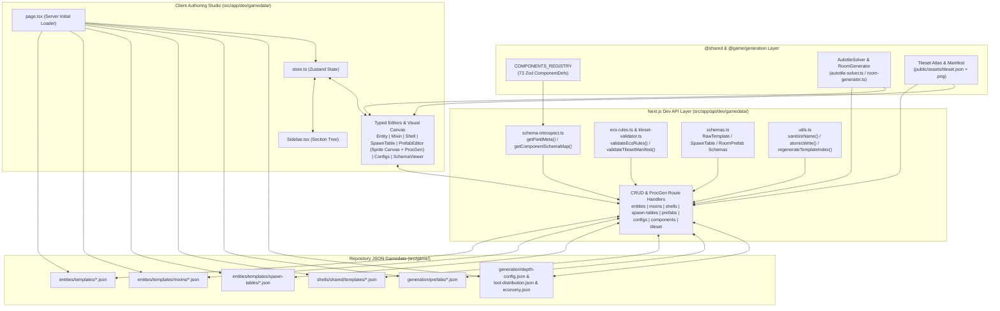
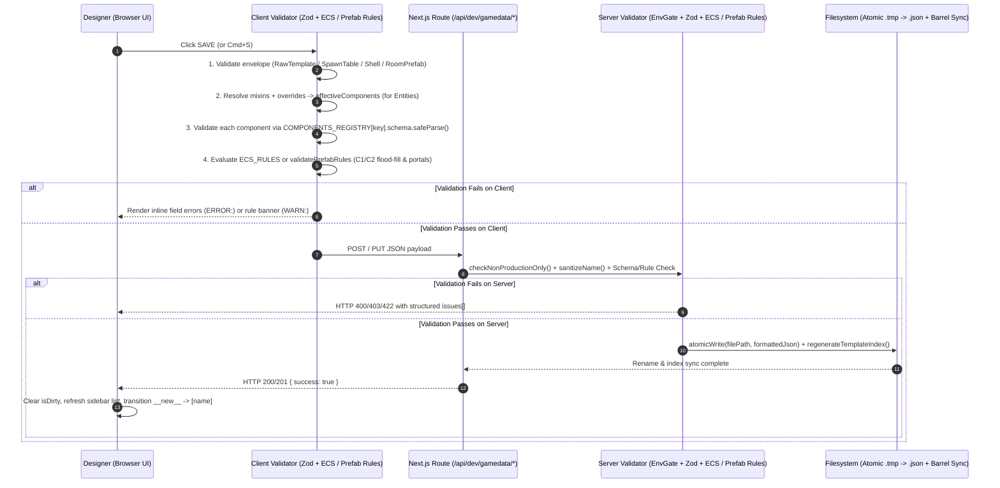

# Gamedata Authoring Studio (`/dev/gamedata`) — Architecture Review & Technical Specification

> **Status:** Comprehensive Audit & Target v2.1 Specification (Unified Gamedata Studio + Prefab Tile Visuals & Procedural Room Generator)  
> **Baseline Audited:** Nirmata Runner v2.4 (Phase 17 implementation vs. Workstreams 1–5 & Directional Tilemaps)  
> **Scope:** Client Authoring Studio ([`src/app/dev/gamedata/`](../../src/app/dev/gamedata/)), REST Persistence, Introspection & Procedural Synthesis Layer ([`src/app/api/dev/gamedata/`](../../src/app/api/dev/gamedata/)), Tileset Atlas Rendering ([`public/assets/tileset.json`](../../public/assets/tileset.json), [`src/game/generation/autotile-solver.ts`](../../src/game/generation/autotile-solver.ts)), and Data-Driven ECS Template Pipelines ([`src/game/entities/`](../../src/game/entities/), [`src/game/shells/`](../../src/game/shells/), [`src/game/generation/`](../../src/game/generation/))  
> **Companion Specifications:** [`UI-DESIGN-SYSTEM.md`](./UI-DESIGN-SYSTEM.md), [`DIRECTIONAL-TILEMAPS.md`](./DIRECTIONAL-TILEMAPS.md), [`INTERACTIVE-ENVIRONMENTS.md`](./INTERACTIVE-ENVIRONMENTS.md), [`TILEMAP_GUIDE.md`](../TILEMAP_GUIDE.md)

---

## 1. Executive Summary & Architectural Role

**Nirmata Runner** mandates a strictly data-driven Entity-Component-System (ECS) architecture (see [`AGENTS.md`](../../AGENTS.md) Mandate #5: *"All entities, mixins, shells, and spawn tables are defined in JSON templates validated by Zod component schemas (`COMPONENTS_REGISTRY`). No hardcoded entity classes."*).

The **Gamedata Authoring Studio** at [`/dev/gamedata`](../../src/app/dev/gamedata/page.tsx) is the developer-facing web IDE built on Next.js App Router, React 19, and Zustand. It bridges the gap between TypeScript Zod component definitions in [`src/shared/components/`](../../src/shared/components/), the 32×32 pixel-art spritesheet atlases in [`public/assets/`](../../public/assets/), the directional autotiling and procedural room generation engines in [`src/game/generation/`](../../src/game/generation/), and the JSON template files on disk by introspecting Zod schemas at runtime, rendering structured form and canvas editors, enforcing cross-component ECS and spatial invariants, and persisting changes atomically to the repository filesystem.



---

## 2. Comprehensive Audit of Current Implementation (v2.4 Baseline)

A line-by-line review of [`src/app/dev/gamedata/`](../../src/app/dev/gamedata/) and [`src/app/api/dev/gamedata/`](../../src/app/api/dev/gamedata/) against the v2.4 codebase revealed **8 critical/high functional bugs**, **7 architectural & security risks**, **2 major UI/UX design-system drifts**, and **6 data-domain & visual authoring gaps** introduced as the game evolved from Phase 17 through Workstream 5 and Directional Tilemaps.

### 2.1 Critical & High Functional Bugs

| ID | Severity | Location | Finding & Root Cause | Impact |
| :--- | :---: | :--- | :--- | :--- |
| **`BUG-GD-01`** | **CRITICAL** | [`page.tsx`](../../src/app/dev/gamedata/page.tsx#L5), [`entities/route.ts`](../../src/app/api/dev/gamedata/entities/route.ts#L6), [`EntityTemplateEditor.tsx`](../../src/app/dev/gamedata/editors/EntityTemplateEditor.tsx#L140) | **Crash on `economy.json` & Optional `components`:** [`economy.json`](../../src/game/entities/templates/economy.json) resides inside `src/game/entities/templates/` despite being a global economy config (`version`, `currencyDrops`, `costs`, `scoring`) with no `components` map. Clicking `economy` in the sidebar passes `templateData.components === undefined` to `Object.entries(templateData.components)` at line 140. Even valid `RawTemplate` files with only `mixins` and `overrides` omit `components`. | Uncaught `TypeError: Cannot convert undefined or null to object` crashes the entire `/dev/gamedata` React tree on click. |
| **`BUG-GD-02`** | **CRITICAL** | [`ecs-rules.ts`](../../src/app/api/dev/gamedata/ecs-rules.ts#L18-L22) | **Outdated `item-requires-pickup-effect` Rule Blocks 95% of Items:** The rule `!('item' in components) \|\| 'pickupEffect' in components` assumes all items use `PickupEffect`. In v2.4 ([`item-pickup.ts`](../../src/game/systems/item-pickup.ts)), Equipment (`equipmentDef`), Software (`softwareDef`), Currency (`currencyItem`), Firmware (`abilityDef`), Augments (`augmentData`), and Keys (`item.type === 'key'`) all use `item` **without** `pickupEffect` (only `health-potion.json` uses `pickupEffect`). | Saving any weapon (`rifle-v1..v3`), armor (`armor-v1..v3`), software (`bleed-v0..v3`, etc.), currency (`scrap`, `flux`), or `item-access-key` fails ECS validation and is blocked. |
| **`BUG-GD-03`** | **CRITICAL** | [`FormField.tsx`](../../src/app/dev/gamedata/editors/shared/FormField.tsx#L67-L86) | **Uneditable JSON `<textarea>` for `array` and `object` Fields:** `FormField` binds `value={JSON.stringify(value, null, 2)}` directly to parent state and only calls `handleChange(JSON.parse(e.target.value))` inside a `try/catch`. Because typing any single character (e.g., `{`, `,`, `"`) produces transiently invalid JSON during keystrokes, `JSON.parse` throws, `handleChange` is skipped, and React immediately overwrites the `<textarea>` with the old `JSON.stringify(value)`. Also, when `value` is `undefined`, `JSON.stringify(undefined)` returns `undefined`. | Users cannot type or edit any `array` or `object` component field (e.g., `lootTable.drops`, `augmentData.trigger`, `augmentData.payloads`, `statusEffects.effects`, `securityLock.faradayBounds`). |
| **`BUG-GD-04`** | **HIGH** | [`EntityTemplateEditor.tsx`](../../src/app/dev/gamedata/editors/EntityTemplateEditor.tsx#L78-L84), [`FormField.tsx`](../../src/app/dev/gamedata/editors/shared/FormField.tsx#L17-L65) | **Phantom Default Values on `+ Add Component`:** Adding a component initializes its state to `{}` without seeding `field.defaultVal` from `FieldMeta`. In `FormField`: (1) `enum` `<select>` has no empty placeholder option, so the browser displays `enumValues[0]` while state remains `undefined`; (2) `number` `<input>` displays `0` (`Number(value ?? 0)`) while state remains `undefined`; (3) `boolean` `<input>` displays `false` (`!!value`) even when `defaultVal === true` (e.g., `health.isAlive`, `securityLock.isLocked`), while state remains `undefined`. | Saving a newly added component without manually toggling every single control writes `{}` to disk, missing required fields seen on screen. |
| **`BUG-GD-05`** | **HIGH** | [`EntityTemplateEditor.tsx`](../../src/app/dev/gamedata/editors/EntityTemplateEditor.tsx#L121), [`MixinEditor.tsx`](../../src/app/dev/gamedata/editors/MixinEditor.tsx), [`SpawnTableEditor.tsx`](../../src/app/dev/gamedata/editors/SpawnTableEditor.tsx), [`ShellEditor.tsx`](../../src/app/dev/gamedata/editors/ShellEditor.tsx), [`PrefabEditor.tsx`](../../src/app/dev/gamedata/editors/PrefabEditor.tsx) | **Clone Flow (D-06) Is Stubbed / Unwired:** `EntityTemplateEditor` renders a `CLONE` button whose `onClick` is `() => console.log('Clone logic here')`. `MixinEditor`, `SpawnTableEditor`, `ShellEditor`, and `PrefabEditor` omit the `CLONE` button entirely. Furthermore, `Sidebar.tsx` does not call `clearCloneSource()` when clicking `+ New`, and `GamedataTool.tsx` uses `key={item.name}` which does not remount if already on `__new__`. | Cloning templates is completely non-functional across all editors. |
| **`BUG-GD-06`** | **HIGH** | [`EntityTemplateEditor.tsx`](../../src/app/dev/gamedata/editors/EntityTemplateEditor.tsx), [`MixinEditor.tsx`](../../src/app/dev/gamedata/editors/MixinEditor.tsx), [`SpawnTableEditor.tsx`](../../src/app/dev/gamedata/editors/SpawnTableEditor.tsx), [`ShellEditor.tsx`](../../src/app/dev/gamedata/editors/ShellEditor.tsx), [`PrefabEditor.tsx`](../../src/app/dev/gamedata/editors/PrefabEditor.tsx) | **Delete Flow (D-08) Missing from All Editors:** Although `DELETE /api/dev/gamedata/[type]/[name]` is implemented in backend route handlers and `.deleteButton` exists in [`editors.module.css`](../../src/app/dev/gamedata/editors/editors.module.css#L64), no editor renders a Delete button or confirmation modal. | Impossible to delete templates, mixins, spawn tables, shells, or prefabs from the UI. |
| **`BUG-GD-07`** | **HIGH** | [`GamedataTool.tsx`](../../src/app/dev/gamedata/GamedataTool.tsx#L50-L100) | **Sidebar List Never Refreshes & Create-to-Edit Transition Missing:** `GamedataTool` never passes `onRefresh` to any editor. When creating a new item (`isNew === true`), `POST` succeeds on disk, but `sectionItems` in Zustand is never updated and `selectedItem` stays `{ section, name: '__new__' }`. | Newly created items do not appear in the sidebar until full page reload; clicking `SAVE` a second time fires another `POST` and fails with HTTP `409 Conflict`. |
| **`BUG-GD-08`** | **HIGH** | [`EntityTemplateEditor.tsx`](../../src/app/dev/gamedata/editors/EntityTemplateEditor.tsx), [`SpawnTableEditor.tsx`](../../src/app/dev/gamedata/editors/SpawnTableEditor.tsx), [`ShellEditor.tsx`](../../src/app/dev/gamedata/editors/ShellEditor.tsx), [`PrefabEditor.tsx`](../../src/app/dev/gamedata/editors/PrefabEditor.tsx) | **Incomplete Schema Coverage & Destructive Edits:** (1) `EntityTemplateEditor` has no UI for `mixins`, `overrides`, `children`, or top-level item fields (`displayName`, `tier`, `software`). Inherited/overridden components (e.g., `health`, `attack`, `defense` on `null-pointer.json`, or `overrides.sprite` on all 13 `prop-*.json` templates) are completely hidden! (2) `SpawnTableEditor` omits `enemiesPerRoom`, `isPack`, `packSize`, `maxPerFloor`, `minDistanceFromPlayer`, has no button to add/remove template rows, appends invalid depth bands missing `enemiesPerRoom`, and ignores HTTP save errors. (3) `ShellEditor` omits `sprite`, `starterLoadout`, and `upgrades`. (4) `PrefabEditor` strips `orientation` from `propSpawns` on save (`PrefabEditor.tsx` lines 253–258) and lacks UI controls for `minFloor`, `maxFloor`, `width`, `height`, `isVaultRoom`, and `portals[]`. | Editing existing enemies, props, spawn tables, shells, or prefabs either hides critical data or strips fields on save. |

---

### 2.2 Schema Introspection, Validation & Security Risks

| ID | Risk Level | Location | Technical Description |
| :--- | :---: | :--- | :--- |
| **`RISK-GD-01`** | **HIGH** | [`schema-introspect.ts`](../../src/app/api/dev/gamedata/schema-introspect.ts#L22-L54) | **Incomplete Zod Type Unwrapping:** `resolveFieldType` only checks `ZodOptional`, `ZodDefault`, `ZodNumber`, `ZodBoolean`, `ZodEnum`, `ZodArray`, and `ZodObject`. It fails to handle: <br>1. `z.nativeEnum()` (`ZodNativeEnum`) used by [`AIState.behavior`](../../src/shared/components/ai-state.ts#L26), [`AIState.behaviorType`](../../src/shared/components/ai-state.ts#L27), and [`PickupEffect.type`](../../src/shared/components/pickup-effect.ts#L14) — misclassified as `'string'` instead of `'enum'`.<br>2. `z.nullable()` (`ZodNullable`) used by [`EquipmentSlots.weapon`](../../src/shared/components/equipment-slots.ts#L10) and `armor` — misclassified as `'string'` instead of `'number'`.<br>3. `z.record()` (`ZodRecord`) used by [`AugmentState`](../../src/shared/components/augment-state.ts#L12) — misclassified as `'string'` instead of `'object'`.<br>4. `z.union()` (`ZodUnion`) used by [`InteractPropIntent`](../../src/shared/components/environment.ts#L131) and `z.lazy()` (`ZodLazy`) used by [`ConditionNodeSchema`](../../src/shared/components/augment-data.ts#L35). |
| **`RISK-GD-02`** | **HIGH** | [`components/route.ts`](../../src/app/api/dev/gamedata/components/route.ts), [`EntityTemplateEditor.tsx`](../../src/app/dev/gamedata/editors/EntityTemplateEditor.tsx#L154-L167) | **Unfiltered Runtime Intent/Tag Components in `+ Add Component`:** `COMPONENTS_REGISTRY` contains **73 components**, of which **27 are transient runtime Intents, Turn Tags, or Hierarchy pointers** (`dying`, `moveIntent`, `attackIntent`, `damageIntent`, `movedThisTurn`, `parent`, `children`, `templateId`, etc.). All 73 appear in the `+ Add Component` dropdown. Attaching `dying` or `damageIntent` to a static template causes immediate entity destruction or phantom damage on spawn. Moreover, selecting an already-attached component resets its values to `{}`. |
| **`RISK-GD-03`** | **HIGH** | [`src/app/api/dev/gamedata/**`](../../src/app/api/dev/gamedata/) | **Zero Server-Side Schema or ECS Validation on `POST` / `PUT`:** Although [`schemas.ts`](../../src/app/api/dev/gamedata/schemas.ts) defines `RawTemplateSchema` and `SpawnTableSchema` and [`ecs-rules.ts`](../../src/app/api/dev/gamedata/ecs-rules.ts) defines `validateEcsRules`, **none of the API route handlers import or execute them**. `PUT /api/dev/gamedata/entities/[name]` and `PUT /api/dev/gamedata/spawn-tables/[name]` write `await req.json()` directly to disk without validating component schemas against `COMPONENTS_REGISTRY` or verifying `body.name === name`. Even on the client, individual component Zod schemas (`comp.schema.safeParse`) are never checked before saving. |
| **`RISK-GD-04`** | **MEDIUM** | [`EntityTemplateEditor.tsx`](../../src/app/dev/gamedata/editors/EntityTemplateEditor.tsx#L55), [`ecs-rules.ts`](../../src/app/api/dev/gamedata/ecs-rules.ts) | **ECS Rules Evaluated Without Mixin/Override Resolution:** `validateEcsRules(templateData.components)` inspects only `templateData.components` in isolation, ignoring components inherited via `templateData.mixins` (`physical`, `combatant`) or patched via `templateData.overrides`. |
| **`RISK-GD-05`** | **HIGH** | [`src/app/api/dev/gamedata/**`](../../src/app/api/dev/gamedata/), [`page.tsx`](../../src/app/dev/gamedata/page.tsx) | **Ungated Production Filesystem Write/Delete Access:** In Workstream 2 (`[SEC-03]`), `/api/admin/*` and `/api/debug/*` were secured with [`checkNonProductionOnly()`](../../src/server/security/env-gate.ts). However, all `/api/dev/gamedata/*` routes remain completely ungated in production, exposing unauthenticated `POST`/`PUT`/`DELETE` filesystem operations if deployed on a writable server. |
| **`RISK-GD-06`** | **HIGH** | [`src/game/entities/index.ts`](../../src/game/entities/index.ts#L1-L148), [`src/game/shells/client/index.ts`](../../src/game/shells/client/index.ts#L1-L9), [`src/game/generation/prefabs/index.ts`](../../src/game/generation/prefabs/index.ts) | **Static Registration Disconnect (New Files Ignored by Game Runtime):** [`src/game/entities/index.ts`](../../src/game/entities/index.ts) uses static `import` statements and manual `registry.register(...)` calls; [`src/game/shells/client/index.ts`](../../src/game/shells/client/index.ts) hardcodes 3 shell imports (`vanguard`, `ghost`, `bastion`); and [`src/game/generation/prefabs/index.ts`](../../src/game/generation/prefabs/index.ts) statically imports 4 prefabs (`server-core`, `freight-bay`, `decon-airlock`, `zero-day-vault`). Creating a new entity template, mixin, shell, or prefab in `/dev/gamedata` writes the `.json` file to disk, **but the game runtime will never load it** without manual TypeScript code changes or an automated barrel/manifest generator. |
| **`RISK-GD-07`** | **MEDIUM** | [`entities/[name]/route.ts`](../../src/app/api/dev/gamedata/entities/%5Bname%5D/route.ts), [`shells/[name]/route.ts`](../../src/app/api/dev/gamedata/shells/%5Bname%5D/route.ts), [`prefabs/[name]/route.ts`](../../src/app/api/dev/gamedata/prefabs/%5Bname%5D/route.ts) | **Filename vs. Internal ID Desynchronization:** `PUT` routes write to `${params.name}.json` without enforcing `body.name === params.name` (or `body.id === params.name` for shells and prefabs), allowing a file `null-pointer.json` to contain `"name": "other-id"`. |

---

### 2.3 UI/UX & Design System Drift

1. **`DRIFT-GD-01` — Broken CSS Custom Properties & Legacy Typography ([`gamedata.module.css`](../../src/app/dev/gamedata/gamedata.module.css), [`editors.module.css`](../../src/app/dev/gamedata/editors/editors.module.css))**:
   - Workstream 4 (`[UI-01]`–`[UI-07]`) replaced the legacy Phase 16 tokens in [`src/app/globals.css`](../../src/app/globals.css) with the **Taikoku Vector Manifest** system (`--c-*` color tokens, `--font-display`, `--font-mono`, `--font-vector`).
   - [`gamedata.module.css`](../../src/app/dev/gamedata/gamedata.module.css) and [`editors.module.css`](../../src/app/dev/gamedata/editors/editors.module.css) still reference **deleted CSS variables** that no longer exist in `:root`:
     - `var(--font-body)` (undefined)
     - `var(--font-size-heading)`, `var(--font-size-body)`, `var(--font-size-label)` (undefined across 14 CSS rules in `editors.module.css`, causing browsers to ignore those `font-size` declarations)
   - Both stylesheets hardcode `font-family: 'Courier New', Courier, monospace`, violating [`docs/design/UI-DESIGN-SYSTEM.md`](../design/UI-DESIGN-SYSTEM.md) Section 2 (*"Legacy `#00ff41` matrix green and `Courier New` / `Arial Narrow` declarations must be removed"*).

2. **`DRIFT-GD-02` — Unimplemented Phase 17 UI Contract ([`17-UI-SPEC.md`](../archive/planning/milestones/v2.0-phases/17-add-design-tool-for-authoring-and-viewing-entities-component-templates-and-gamedata/17-UI-SPEC.md))**:
   - `isDirty` and `setDirty` exist in [`store.ts`](../../src/app/dev/gamedata/store.ts#L20-L21) but `setDirty` is **never called anywhere**. There is no dirty-state amber indicator dot and no unsaved-changes guard when switching items in the sidebar.
   - `Cmd+S / Ctrl+S` save keyboard shortcut and `Escape` modal dismissal are unimplemented.
   - Form `<label>` elements lack `htmlFor` bindings, and sidebar items lack `role="treeitem"`, `aria-expanded`, and `aria-selected`.

---

### 2.4 Data Domain & Visual Authoring Gaps (v2.0 → v2.4 Evolution)

Since Phase 17 was implemented, Nirmata Runner expanded into a hybrid-procedural extraction roguelike with directional tilemaps and interactive environments (Phases 18–22, Workstream 5, and [`DIRECTIONAL-TILEMAPS.md`](./DIRECTIONAL-TILEMAPS.md)). The following capabilities are either missing or only partially scaffolded in `/dev/gamedata`:

1. **Room Prefab Tile Visuals & Procedural Room Synthesis ([`PrefabEditor.tsx`](../../src/app/dev/gamedata/editors/PrefabEditor.tsx), [`src/game/generation/prefabs/`](../../src/game/generation/prefabs/))**:
   - **No Real Tileset Sprite Rendering**: Although `PrefabEditor.tsx` computes `AutotileSolver.resolveWallTile()` and `resolveDoorTile()`, it only renders ASCII / Unicode box-drawing glyphs (`#`, `.`, `═`, `║`, `C↑`, `[T→]`) inside DOM `<div>` cells. It does not load [`public/assets/tileset.json`](../../public/assets/tileset.json) or render the actual 32×32 pixel-art sprites from [`public/assets/tileset.png`](../../public/assets/tileset.png) (`wall_cap_n`, `wall_straight_h`, `wall_corner_outer_nw`, `door_h_closed`, `prop_workstation_n`, `prop_locker_s`, etc.).
   - **No Pseudorandom Room Generator or In-Editor Mutation**: Creating a new room prefab defaults to a blank 12×12 hollow box (`PrefabEditor.tsx` lines 97–124). Designers have no way to procedurally generate pseudorandom room archetypes (Server Cores, Freight Bays, Decon Airlocks, Zero-Day Vaults, Subnet Hubs, Corrupted Quarantine Sectors) with seedable parameters and then interactively edit/paint the generated layout.
   - **Incomplete Prefab Authoring & Validation**: `PrefabEditor.tsx` lacks tools to edit `portals[]`, resize `width`/`height` (10–16), set `minFloor`/`maxFloor`, toggle `isVaultRoom`, pick `guaranteedTemplate` per prop anchor, persist `orientation` on `propSpawns`, or validate C1/C2 reachability and Faraday invariants.
2. **Loot Distribution Tables ([`src/game/generation/loot-distribution.json`](../../src/game/generation/loot-distribution.json))**: Depth-band weighted item drop tables (`depthBands[].loot[]`) have no editor UI.
3. **Floor / Depth Band ProcGen Config ([`src/game/generation/depth-config.json`](../../src/game/generation/depth-config.json))**: BSP room sizing, corridor widths, hex color palettes, and special room probabilities across `CORRUPTED_DATA` (F1–5), `STATIC_HORRORS` (F6–10), and `LOGIC_BREAKERS` (F11–15) are unmanaged.
4. **Global Economy & Scoring Config ([`src/game/entities/templates/economy.json`](../../src/game/entities/templates/economy.json))**: Currency drop tiers, compilation/installation/upgrade costs, wallet caps, death scrap pity, shop rules, scoring weights, and weekly winner items crash the Entity editor instead of having a dedicated config editor.
5. **Tileset & Sprite Atlas Picker ([`public/assets/tileset.json`](../../public/assets/tileset.json))**: No visual sprite picker or 32×32 frame preview for `sprite.key` on entities or `sprite` on shells; authors must memorize string keys from `tileset.json`.
6. **Augment Condition Tree & Payload Builder ([`src/shared/components/augment-data.ts`](../../src/shared/components/augment-data.ts))**: Recursive boolean condition AST (`AND`, `OR`, `NOT`, `ON_ACTIVATION`, `ON_TARGET_HIT`, `ON_OVERCLOCK`, `ON_KILL`, `HEAT_ABOVE`, `HP_BELOW_PERCENT`, `ON_HACK`, `ON_COVER_BROKEN`) and `payloads[]` have no structured UI editor.

---

## 3. Comprehensive Technical Specification (Gamedata Studio v2.1)

This specification defines the complete target architecture, UI/UX contract, real-time tileset rendering pipeline, procedural room synthesis engine, validation engine, and data coverage for the Nirmata Runner Gamedata Authoring Studio.

### 3.1 Information Architecture & Section Taxonomy

The Gamedata Authoring Studio organizes all game data into **7 canonical sections** in the left navigation tree:

| Section ID | Display Label | Source Path(s) | Mode | Description |
| :--- | :--- | :--- | :---: | :--- |
| **`entities`** | `ENTITY TEMPLATES [実体]` | `src/game/entities/templates/*.json` *(excluding `economy.json`)* | Full CRUD + Clone | Enemies, player, weapons, armor, software, firmware, augments, currencies, directional props, hazards, and markers. |
| **`mixins`** | `MIXIN TEMPLATES [合成]` | `src/game/entities/templates/mixins/*.json` | Full CRUD + Clone | Reusable component bundles (`physical`, `combatant`, etc.) inherited by entity templates. |
| **`shells`** | `SHELL ARCHETYPES [義体]` | `src/game/shells/shared/templates/*.json` | Full CRUD + Clone | Playable chassis definitions (`vanguard-v1`, `bastion-v1`, `ghost-v1`) with base stats, ports, sprites, starter loadouts, and upgrade trees. |
| **`spawnTables`** | `SPAWN & LOOT TABLES [出現]` | `src/game/entities/templates/spawn-tables/*.json`, `src/game/generation/loot-distribution.json` | Full CRUD + Clone | Depth-band enemy spawn distributions (`depth-distribution`) and floor loot drop weights (`loot-distribution`). |
| **`prefabs`** | `ROOM PREFABS [区画]` | `src/game/generation/prefabs/*.json` | Full CRUD + Clone + ProcGen | Bespoke & procedurally synthesized tactical chambers (`server-core`, `freight-bay`, `decon-airlock`, `zero-day-vault`, etc.) with real-time 32×32 tileset rendering, directional autotiling, pseudorandom archetype generator, and interactive tile painter. |
| **`configs`** | `SYSTEM CONFIGS [設定]` | `src/game/generation/depth-config.json`, `src/game/entities/templates/economy.json` | Read / Update (`PUT`) | Singleton global configs for floor BSP/palette parameters (`depth-config`) and run economy/scoring (`economy`). |
| **`componentSchemas`** | `SCHEMAS & TILESETS [構造]` | Derived live from `COMPONENTS_REGISTRY` (`@shared/components`) & `public/assets/tileset.json` | Read-Only Inspector & Validator | Live Zod schema documentation, field constraints, reverse template usage lookup, and Themed Tileset frame dictionary validator (`/api/dev/gamedata/tileset`). |

---

### 3.2 Layout & Visual Contract ("Taikoku Vector Manifest" Alignment)

The studio adopts **Paradigm B (Full-Viewport 3-Column Workstation)** from [`docs/design/UI-DESIGN-SYSTEM.md`](../design/UI-DESIGN-SYSTEM.md), replacing all legacy `'Courier New'` and undefined `--font-size-*` tokens with canonical `--c-*` and `--font-*` variables from [`src/app/globals.css`](../../src/app/globals.css).

```
┌────────────────────────────────────────────────────────────────────────────────────────────────────┐
│  [ 開発環境 // GAMEDATA STUDIO ]   ACTIVE: null-pointer.json ● UNSAVED         [CMD+S SAVE] [ESC]  │ ← .taikoku-placard
├────────────────────────┬──────────────────────────────────────────────────┬────────────────────────┤
│  NAVIGATION TREE       │  PRIMARY STRUCTURED EDITOR                       │  TELEMETRY & INSPECTOR │
│  (280px Fixed)         │  (Flex 1, Scrollable)                            │  (340px Collapsible)   │
│                        │                                                  │                        │
│  [🔍 Filter items...]  │  ┌─ HEADER (.panel-header) ───────────────────┐  │  ┌─ VALIDATION STATUS ─┐│
│                        │  │ ENTITY: null-pointer [ENEMY]               │  │  │ ✓ ZOD SCHEMAS PASS  ││
│  ▼ ENTITY TEMPLATES 67 │  │ [SAVE_TEMPLATE] [CLONE_TEMPLATE] [DELETE]  │  │  │ ✓ ECS RULES PASS    ││
│    [+ NEW_TEMPLATE]    │  └────────────────────────────────────────────┘  │  └─────────────────────┘│
│    ▸ Enemies (6)       │  ┌─ IDENTITY & INHERITANCE (.panel-card) ─────┐  │  ┌─ RESOLVED PREVIEW ──┐│
│      • null-pointer ●  │  │ Name: [null-pointer]  Sprite: [🎨 Preview] │  │  │ Effective Merged    ││
│      • fragmenter      │  │ Mixins: [✓ physical] [✓ combatant]         │  │  │ JSON (Mixins +      ││
│    ▸ Weapons/Armor (6) │  └────────────────────────────────────────────┘  │  │ Components +        ││
│    ▸ Software (12)     │  ┌─ INHERITED & OVERRIDDEN (from mixins) ─────┐  │  │ Overrides)          ││
│    ▸ Firmware/Aug (17) │  │ ⚡ health (from combatant)     [OVERRIDDEN] │  │  │                     ││
│    ▸ Props/Env (13)    │  │   current: [6] (base: 10)  max: [6]        │  │  │ {                   ││
│  ▶ MIXIN TEMPLATES   2 │  └────────────────────────────────────────────┘  │  │   "name": "...",    ││
│  ▶ SHELL ARCHETYPES  3 │  ┌─ OWN COMPONENTS (.panel-card) ─────────────┐  │  │   "components": ... ││
│  ▶ SPAWN & LOOT      2 │  │ ■ aiState                         [REMOVE] │  │  │ }                   ││
│  ▶ ROOM PREFABS      6 │  │   behavior: [idle ▼]  sightRadius: [8]     │  │  └─────────────────────┘│
│  ▶ SYSTEM CONFIGS    2 │  └────────────────────────────────────────────┘  │  ┌─ REFERENCES ────────┐│
│  ▶ SCHEMAS & TILES  73 │  [+ ADD AUTHORABLE COMPONENT ▼]                  │  │ Spawned in:         ││
│                        │                                                  │  │ • depth-dist (F1-15)││
└────────────────────────┴──────────────────────────────────────────────────┴────────────────────────┘
```

#### Canonical Token Mapping for `gamedata.module.css` & `editors.module.css`
* **Surfaces**: `var(--c-bg)` (`#040609`) viewport background; `var(--c-surface)` (`#0a0e15`) panels and sidebar; `var(--c-surface-header)` (`#0c121c`) section and component headers; `var(--c-surface-elevated)` (`#111722`) inputs and socket rows.
* **Typography**:
  * Section headings & titles: `font-family: var(--font-display)` (`Space Grotesk`, `Noto Sans JP`), `font-size: 16px` (panel title) / `12px` (section header), `font-weight: 800`, `text-transform: uppercase`, `letter-spacing: 0.08em`.
  * Field labels, inputs, JSON inspector, and schema types: `font-family: var(--font-mono)` (`JetBrains Mono`, `Share Tech Mono`), `font-size: 12px` (inputs) / `11px` (labels).
* **Accents & Semantic States**:
  * Primary CTA / Active Selection: `var(--c-accent)` (`#d8ff00` Acid Chartreuse) or `var(--c-accent-secondary)` (`#00f0ff` Solaris Cyan).
  * Dirty / Override / ECS Warning: `var(--c-warning)` (`#ff6600`) / `var(--c-scrap)` (`#ffaa00`).
  * Destructive Delete / Blocking Validation Error: `var(--c-danger)` (`#ff2a4b` Stamp Crimson).

---

### 3.3 Data Domain & Editor Specifications

#### 3.3.1 Entity TemplateEditor & MixinEditor (`entities`, `mixins`)

1. **Three-Layer Component Resolution Architecture (`Mixins` → `Components` → `Overrides`)**:
   - **Mixin Selector**: Multi-select pill bar allowing authors to toggle registered mixins (e.g., `physical`, `combatant`).
   - **Inherited Component Cards**: Components contributed by selected `mixins` render in a dedicated **"Inherited from Mixins"** group with a badge indicating the source mixin (e.g., `FROM: combatant`).
     - Editing any field on an inherited component writes that field diff into `templateData.overrides[compKey][fieldKey]` (matching [`resolveMixins`](../../src/engine/entity/builder.ts#L70-L82)) and highlights the field with an amber `[OVERRIDE]` badge and a `Reset to Mixin Default` button.
   - **Own Component Cards**: Components defined directly in `templateData.components` render in the **"Own Components"** group.
   - **Top-Level Metadata Preservation**: Preserves and exposes optional top-level template properties used by equipment/software loaders (`displayName`, `tier`, `software: string[]`, `children`) so saving never strips extra template keys.

2. **Categorized & Filtered `+ Add Component` Catalog**:
   - Excludes already-attached components (preventing accidental overwrite of existing component values).
   - Splits `COMPONENTS_REGISTRY` into two explicit groups:
     - **Authorable Template Components (46)** — grouped by domain:
       - *Core & Spatial*: `position`, `blocksMovement`, `sprite`, `actor`, `energy`, `tileOrientation`, `autotileState`, `directionalProp`
       - *Combat & Stats*: `health`, `attack`, `defense`, `hostile`, `aiState`, `fovAwareness`, `statusEffects`, `packMember`, `lootTable`, `progression`, `stability`, `heat`
       - *Items & Economy*: `item`, `pickupEffect`, `currencyItem`, `rarityTier`, `equipmentDef`, `softwareDef`, `abilityDef`, `augmentData`, `augmentState`, `wallet`, `run_inventory`, `run_currency`
       - *Shells & Slots*: `shell`, `portConfig`, `firmwareSlots`, `augmentSlots`, `softwareSlots`, `equipmentSlots`
       - *Environment & ProcGen*: `prop`, `securityLock`, `container`, `interactiveSurface`, `corruptedNode`, `deadZone`, `corruptionState`, `floorState`, `staircaseMarker`, `anchorMarker`
     - **Runtime Intents, Turn Tags & Hierarchy Pointers (27)** — hidden from the template component picker by default (visible only in `ComponentSchemaViewer` under a `[RUNTIME ONLY]` filter badge):
       - *Intents*: `moveIntent`, `attackIntent`, `ventIntent`, `damageIntent`, `descentIntent`, `extractionIntent`, `equipIntent`, `unequipIntent`, `teleportIntent`, `applyStatusEffectIntent`, `healIntent`, `heatIntent`, `burnSoftwareIntent`, `firmwareIntent`, `acting`, `pickupIntent`, `interactPropIntent`
       - *Turn Tags*: `movedThisTurn`, `dying`, `firmwareActivatedThisTurn`, `dealtDamageThisTurn`, `floorTransitioned`, `propInteractedThisTurn`, `shellUpdateTag`
       - *Internal Pointers*: `parent`, `children`, `templateId`

3. **Default Value Seeding on Component Addition**:
   - When `handleAddComponent(compKey)` is invoked, the editor populates initial field values from `FieldMeta`:
     ```typescript
     function buildDefaultComponentData(fields: FieldMeta[]): Record<string, unknown> {
       const initial: Record<string, unknown> = {};
       for (const field of fields) {
         if (field.defaultVal !== undefined) {
           initial[field.key] = structuredClone(field.defaultVal);
         } else if (!field.optional) {
           if (field.type === 'number') initial[field.key] = 0;
           else if (field.type === 'boolean') initial[field.key] = false;
           else if (field.type === 'enum' && field.enumValues?.length) initial[field.key] = field.enumValues[0];
           else if (field.type === 'array') initial[field.key] = [];
           else if (field.type === 'object') initial[field.key] = {};
           else initial[field.key] = '';
         }
       }
       return initial;
     }
     ```

4. **Specialized Sub-Editors for Complex Components**:
   - **`sprite` Component**: Renders a searchable dropdown of frame keys from [`public/assets/tileset.json`](../../public/assets/tileset.json) alongside a crisp `32×32` (scaled `2×` pixelated) `<canvas>` preview cropped from `/assets/tileset.png` via the shared `TilesetAtlasCache` utility (Section 3.3.4.A).
   - **`lootTable` Component**: Renders a structured drop-table editor (`tier: 1|2|3` selector + dynamic rows of `[Template Dropdown] [Chance 0.00–1.00] [Remove]`) instead of raw JSON.
   - **`augmentData` Component**: Renders a recursive **Condition Node Tree Builder** (`AND`/`OR`/`NOT` branch nodes + leaf triggers `ON_ACTIVATION`, `ON_TARGET_HIT`, `ON_OVERCLOCK`, `ON_KILL`, `HEAT_ABOVE`, `HP_BELOW_PERCENT`, `ON_HACK`, `ON_COVER_BROKEN`) and a **Payload List Editor** (`HEAL`, `SHIELD`, `APPLY_STATUS`, `VENT_HEAT`, `DAMAGE_BONUS`).
   - **Draft-Buffered JSON Textarea Fallback**: For any generic `array` or `object` field, `FormField` maintains local string state (`draftText`) and `parseError: string | null`, syncing `draftText` on external prop change while allowing free typing and validating `JSON.parse` on change/blur with inline syntax error feedback.

---

#### 3.3.2 Shell Archetype Editor (`shells`)

Covers the complete [`ShellTemplate`](../../src/game/shells/server/types.ts#L32-L40) contract:
* **Identity**: `id` (slug, read-only after creation), `name` (display name), and `sprite` (dropdown + 32×32 preview from `tileset.json`).
* **Base Stats (`baseStats`)**: Positive integer inputs for `speed`, `stability`, `armor`, `maxHealth`.
* **Base Ports (`basePorts`)**: Non-negative integer inputs for `maxFirmware`, `maxAugment`, `maxSoftware`.
* **Starter Loadout (`starterLoadout`)**: Multi-select tag list populated from registered Firmware (`abilityDef`), Augment (`augmentData`), and Software (`softwareDef`) entity templates.
* **Upgrade Definitions (`upgrades`)**: Structured row builder where each row specifies `level`, `statBonuses` (`speed`, `stability`, `armor`, `maxHealth`), and `portBonuses` (`maxFirmware`, `maxAugment`, `maxSoftware`).

---

#### 3.3.3 Spawn & Loot Table Editor (`spawnTables`)

Supports both **Enemy Spawn Tables** (`depth-distribution.json`) and **Floor Loot Tables** (`loot-distribution.json`):

1. **Enemy Spawn Table Mode (`SpawnTableSchema`)**:
   - **Depth Band Header**: `depthRange.min` / `depthRange.max` (1–15), `enemiesPerRoom.min` / `enemiesPerRoom.max`, and `[Delete Band]` button.
   - **Weighted Template Rows**:
     - `name`: Dropdown of enemy entity templates (filtered by `hostile` component).
     - `weight`: Positive integer weight + **computed effective spawn % badge** (`weight / sum(bandWeights) * 100%`).
     - `isPack`: Checkbox; when checked, reveals `packSize.min` and `packSize.max` number inputs.
     - `maxPerFloor`: Optional integer cap (e.g., `1` for `system-admin` and `seed-eater`).
     - `minDistanceFromPlayer`: Optional integer tile distance (e.g., `10` for `system-admin`).
     - `[+ Add Enemy Row]` and `[Remove Row]` buttons per depth band.
   - **Depth Coverage Validator**: Warns if floors `1–15` have any uncovered gap or invalid range (`min > max`).

2. **Loot Distribution Mode (`LootDistributionSchema`)**:
   - Edits `depthBands[]` with `depthRange: { min, max }` and `loot[]` rows (`template` dropdown of item templates, `weight` integer + computed %, optional `note` string).

---

#### 3.3.4 Interactive Room Prefab Visual Editor & Procedural Room Generator (`prefabs`)

The Room Prefab Workstation ([`src/app/dev/gamedata/editors/PrefabEditor.tsx`](../../src/app/dev/gamedata/editors/PrefabEditor.tsx)) unifies **real-time 32×32 tileset sprite visualization**, **directional autotiling** ([`DIRECTIONAL-TILEMAPS.md`](./DIRECTIONAL-TILEMAPS.md)), **pseudorandom room archetype generation**, and **interactive brush painting/mutation** for [`RoomPrefabTemplate`](../../src/game/generation/prefabs/types.ts) JSON files (`src/game/generation/prefabs/*.json`).

```
┌────────────────────────────────────────────────────────────────────────────────────────────────────┐
│ [ 開発環境 // GAMEDATA STUDIO ]   PREFAB: server-core.json ● UNSAVED            [CMD+S SAVE] [ESC]  │ ← .taikoku-placard
├────────────────────────┬──────────────────────────────────────────────────┬────────────────────────┤
│ PREFAB NAVIGATOR       │ PRIMARY VISUAL WORKSTATION                       │ PROCGEN & TELEMETRY    │
│ (280px Fixed)          │ (Flex 1, Scrollable Viewport Bay)                │ (340px Fixed)          │
│                        │                                                  │                        │
│ [🔍 Filter prefabs...] │ ┌─ WORKSTATION VIEW & THEME BAR ───────────────┐ │ ┌─ PROCGEN DRAWER ─────┐│
│                        │ │ VIEW: [SPRITES] [AUTOTILE GLYPHS] [RAW ASCII]│ │ │ ARCHETYPE: [CORE  ▼] ││
│ ▼ ROOM PREFABS (6)     │ │ THEME: [DEFAULT ▼]  ZOOM: [1x][2x]  GRID:[✓] │ │ │ SEED: [X89-TK2] [🎲] ││
│   • server-core ●      │ └──────────────────────────────────────────────┘ │ │ DIM: [12] W × [12] H ││
│   • freight-bay        │ ┌─ BRUSH TOOLKIT & ORIENTATION ────────────────┐ │ │ SYMMETRY: [BILAT ▼]  ││
│   • decon-airlock      │ │ [PENCIL] [BOX] [FLOOD] [PORTAL] [ERASER]     │ │ │ COMPLEXITY: [===|==] ││
│   • zero-day-vault     │ │ [# WALL] [. FLOOR] [+ DOOR] [V VAULT] [~ HAZ]│ │ │ PROP DENS:  [====|=] ││
│   • subnet-hub         │ │ [DESK] [LOCKER] [SURFACE] [RARE] [ROT: 90°↻] │ │ │ [⚡ GENERATE ROOM]   ││
│   • quarantine-sector  │ └──────────────────────────────────────────────┘ │ │ [🔄 MUTATE CURRENT]  ││
│                        │ ┌─ 2D TILE CANVAS BAY (.tactical-viewport-bay)─┐ │ │ [↔ MIRROR] [⚓ RETAG]││
│ [+ NEW PREFAB]         │ │ ┌ TK-VEC ───────────────────────── FOV 88° ┐ │ └──────────────────────┘│
│                        │ │ │                                          │ │ ┌─ STRUCTURAL AUDIT ───┐│
│ ────────────────────── │ │ │   [ 32x32 SPRITE ATLAS RENDERING ]       │ │ │ ✓ VAL-PRF-01 MATRIX  ││
│ METADATA (.panel-card) │ │ │   [ WITH REAL-TIME AUTOTILING,   ]       │ │ │ ✓ VAL-PRF-02 PORTALS ││
│ ID: [server-core]      │ │ │   [ DIRECTIONAL PROP SPRITES &   ]       │ │ │ ✓ VAL-PRF-03 FLOOD   ││
│ Faction: [CyberAcme ▼] │ │ │   [ FARADAY SHIELD OVERLAYS      ]       │ │ │ ✓ VAL-PRF-04 ANCHORS ││
│ Floors: [1] to [15]    │ │ │                                          │ │ │ ✓ VAL-PRF-05 VAULT   ││
│ Size: [12] W × [12] H  │ │ └ POS: 08, 04 ───────────── SECTOR 02 ─────┘ │ └──────────────────────┘│
│ Vault:[ ] Faraday:[✓]  │ └──────────────────────────────────────────────┘ │ ┌─ ACTIVE TILE INFO ───┐│
│ [CLONE] [DELETE]       │ [UNDO (Cmd+Z)] [REDO] [CLEAR] [INVERT] [RE-TAG]  │ │ (08, 04) prop_desk_e ││
└────────────────────────┴──────────────────────────────────────────────────┴────────────────────────┘
```

---

##### A. Real-Time Tileset Atlas Reader & Multi-Layer Sprite Canvas (`PrefabCanvas`)

1. **Shared Tileset Atlas Loader (`src/app/dev/gamedata/shared/tileset-atlas-cache.ts`)**:
   - Consumes [`public/assets/tileset.json`](../../public/assets/tileset.json) and `/assets/tileset.png` (or themed faction atlases from `/assets/themes/${themeId}/tileset.json` validated by [`ThemedTilesetManifestSchema`](../../src/shared/tileset-types.ts)).
   - Decodes the PNG texture once into an offscreen `HTMLImageElement` / `ImageBitmap` and caches frame rectangle coordinates (`{ x, y, w, h }`) keyed by frame name.
   - Exposes `drawAtlasFrame(ctx, frameKey, dx, dy, tileSize, angleDegrees)` with `ctx.imageSmoothingEnabled = false` (`scaleMode: 'nearest'`), used by both the `PrefabEditor` 2D grid canvas and the 32×32 `SpritePicker` preview in `EntityTemplateEditor` and `ShellEditor`.

2. **Real-Time Directional Autotiling Resolution**:
   - On every layout edit or procedural generation tick, `PrefabEditor` constructs a transient `Grid(width, height)` and invokes [`AutotileSolver.resolveWallTile(grid, x, y)`](../../src/game/generation/autotile-solver.ts#L103-L169) for `#` cells and [`AutotileSolver.resolveDoorTile(grid, x, y)`](../../src/game/generation/autotile-solver.ts#L174-L197) for `+` and `V` cells.
   - Resolves exact 4-bit cardinal and 8-bit inner-corner frame keys defined in [`public/assets/tileset.json`](../../public/assets/tileset.json) and [`tileset-validator.ts`](../../src/app/api/dev/gamedata/tileset-validator.ts):

| Autotile Classification | Bitmask / Condition | Resolved Atlas Frame Key (`tileset.json`) | Glyph Mode Fallback |
| :--- | :--- | :--- | :---: |
| **Isolated Pillar** | `0` (`0000`) | `wall_pillar` / `wall_single` | `▣` |
| **Wall Caps (Terminals)** | `1` (N), `2` (E), `4` (S), `8` (W) | `wall_cap_s`, `wall_cap_w`, `wall_cap_n`, `wall_cap_e` | `C↓`, `C←`, `C↑`, `C→` |
| **Straight Runs** | `5` (N+S), `10` (E+W) | `wall_straight_v`, `wall_straight_h` | `║`, `═` |
| **Outer Corners** | `3` (N+E), `6` (S+E), `9` (N+W), `12` (S+W) | `wall_corner_outer_sw` (`wall_corner_ne`), `wall_corner_outer_nw` (`wall_corner_se`), `wall_corner_outer_se` (`wall_corner_nw`), `wall_corner_outer_ne` (`wall_corner_sw`) | `╚`, `╔`, `╝`, `╗` |
| **T-Junctions** | `7` (N+S+E), `11` (N+E+W), `13` (N+S+W), `14` (S+E+W) | `wall_tjunction_w` (`wall_t_e`), `wall_tjunction_s` (`wall_t_n`), `wall_tjunction_e` (`wall_t_w`), `wall_tjunction_n` (`wall_t_s`) | `╠`, `╩`, `╣`, `╦` |
| **Cross / Inner Corners** | `15` (`1111`) + 8-bit diagonal floor check | `wall_cross`, `wall_corner_inner_nw`, `wall_corner_inner_ne`, `wall_corner_inner_se`, `wall_corner_inner_sw` | `╬` |
| **Standard Doors (`+`)** | N+S walls vs. E+W walls | `door_v_closed` (vertical span) / `door_h_closed` (horizontal span) | `+║` / `+═` |
| **Vault Doors (`V`)** | Perimeter / wall vector | `prop_vault_door_n`, `prop_vault_door_e`, `prop_vault_door_s`, `prop_vault_door_w` | `V↑`, `V→`, `V↓`, `V←` |

3. **Directional Prop & Anchor Sprite Resolution**:
   - Each entry in `propSpawns[]` renders its actual 32×32 sprite from `tileset.json` on top of the floor substrate, selecting the directional variant matching `prop.orientation` (`NORTH` → `_n`, `EAST` → `_e`, `SOUTH` → `_s`, `WEST` → `_w`):
     - `PROP_DESK_CORNER` (or `prop-workstation`): `prop_workstation_n`, `prop_workstation_e`, `prop_workstation_s`, `prop_workstation_w`
     - `PROP_LOCKER_WALL` (or `prop-locker` / `prop-biocabinet`): `prop_locker_n..w` (Traxus/NuCaloric) or `prop_biocabinet_n..w` (Sekiguchi)
     - `SURFACE_TABLE_TOP` (or `prop-crate-cover`): `prop_crate_cover_h` (`NORTH`/`SOUTH`) or `prop_crate_cover_v` (`EAST`/`WEST`)
     - `CONTAINER_RARE` (or `prop-safe`): `prop_safe_locked` (with `prop_cooling_vent`, `prop_dead_drop`, `prop_stabilizer`, `prop_subnet_console`, `prop_cryo_vat`, `prop_capacitor_bank` when selected via `guaranteedTemplate`)
   - **6-Layer Composite Rendering Order**:
     1. **Layer 0 (Void & Grid)**: `#040609` backing + optional 1px `#1c2638` tile grid.
     2. **Layer 1 (Floor Substrate)**: `floor` sprite with optional faction tint overlay (`traxus` steel, `cyberacme` cobalt, `sekiguchi` emerald, `nucaloric` pink).
     3. **Layer 2 (Autotiled Walls & Dead-Zone Hazards)**: Resolved `wall_*` frames for `#`; `floor` + pulsing `#ff0055` diagonal hazard hatch for `~` Dead-Zone tiles.
     4. **Layer 3 (Doors & Perimeter Portals)**: `door_*` and `prop_vault_door_*` sprites, plus exterior Neon Cyan (`#00f0ff`) portal attachment arrows (`▲ NORTH`, `▼ SOUTH`, `▶ EAST`, `◀ WEST`) for coordinates in `portals[]`.
     5. **Layer 4 (Interactive Props & Directional Indicators)**: Cropped 32×32 prop sprite + translucent directional badge (`[T→]`, `[L↓]`, `[C↑]`, `[S←]`) and 180° cover/interaction arc indicator on hover.
     6. **Layer 5 (Faraday Cage Shroud & Cursor Reticle)**: When `faradayShielded === true`, draws a translucent cyan scanline overlay (`rgba(0, 240, 255, 0.12)`) across interior tiles with a `[FARADAY SHIELDED]` badge.

4. **Three Synchronized View Modes**:
   - **`[SPRITE VIEW]` (Default)**: Full 32×32 pixel-art rendering from `tileset.png` with directional autotiling and prop sprites.
   - **`[AUTOTILE GLYPH VIEW]`**: High-contrast box-drawing and directional glyph matrix (`═`, `║`, `╔`, `C↓`, `[T→]`).
   - **`[RAW ASCII VIEW]`**: Raw character matrix (`#`, `.`, `+`, `V`, `~`) matching the serialized `layout: string[]` JSON array.

---

##### B. Pseudorandom Room Archetype Generator & In-Editor Mutation Suite

To eliminate the blank-canvas bottleneck while keeping the human designer in full control, the Prefab Editor includes a **Deterministic Procedural Room Synthesis Engine** (`src/game/generation/prefabs/room-generator.ts`) exposed via the right-hand **ProcGen Drawer** and `POST /api/dev/gamedata/prefabs/generate`.

1. **The 6 Canonical Room Archetypes**:

```
1. SERVER_CORE (CyberAcme)          2. FREIGHT_BAY (Traxus)
┌──────────────────────┐            ┌──────────────────────┐
│######▼########▼######│            │######▼########▼######│
│#...#....##....#...#..│            │#....................#│
│#.T.#.##.##.##.#.T.#..│            │#.S..S..........S..S.#│
│#...#.##.##.##.#...#..│            │#....................#│
│#.....##.##.##.....#..│            │#....[CARGO DOCK]....#│
│#.T.#....##....#.T.#..│            │#.L................L.#│
│######▲########▲######│            │######▲########▲######│
└──────────────────────┘            └──────────────────────┘

3. DECON_AIRLOCK (Sekiguchi)        4. ZERO_DAY_VAULT (All Factions)
┌──────────────────────┐            ┌──────────────────────┐
│######▼###############│            │######################│
│#+#####......#####+###│            │#V#####+##############│
│#...#...~..~...#.....#│            │#.#..................#│
│#...#..[VAT]...#.....#│            │#.#..##############..#│
│#...#...~..~...#.....#│            │#.#..#...[SAFE]...#..#│
│#+#####......#####+###│            │#.#..#...[VENT]...#..#│
│###############▲######│            │#.#..##############..#│
└──────────────────────┘            └──────────────────────┘

5. SUBNET_HUB (Traxus/CyberAcme)    6. CORRUPTED_SECTOR (NuCaloric)
┌──────────────────────┐            ┌──────────────────────┐
│#######▼######▼#######│            │######▼###############│
│#......#......#......#│            │#..###......~~~......#│
│#..T...#..C...#...T..#│            │#..#...~~~..~~~...#..#│
│#......#......#......#│            │#......~~~...##...#..#│
│###+##############+###│            │#..#..........#...#..#│
│#......#......#......#│            │#..####..............#│
│#######▲######▲#######│            │###############▲######│
└──────────────────────┘            └──────────────────────┘
```

| Archetype ID | Default Faction | Structural Geometry & Shape Grammar | Tactical Role & Seeded Prop Profile |
| :--- | :--- | :--- | :--- |
| **`SERVER_CORE`** | `cyberacme` | Parallel 1-tile walkable aisles separated by 2-tile server rack walls (`#`) with top/bottom cross-aisles. | Restricts diagonal dodging; high `PROP_DESK_CORNER` (`prop-workstation`) density at aisle ends. |
| **`FREIGHT_BAY`** | `traxus` | Open cargo hall with symmetric or clustered 2×2 interior pillar/crate islands. | Ranged line-of-sight combat with `SURFACE_TABLE_TOP` (`prop-crate-cover`) low cover and perimeter `PROP_LOCKER_WALL`. |
| **`DECON_AIRLOCK`** | `sekiguchi` | Dual narrow entry vestibules gated by internal doors (`+`) leading into a central containment chamber. | Choke-point control; seeds `prop-biocabinet`, `prop-cryo-vat`, and optional `~` hazard tiles. |
| **`ZERO_DAY_VAULT`** | Any | Double-walled outer shell (`#`) with an internal reinforced vault room gated by an Encrypted Vault Door (`V`). | Auto-enables `isVaultRoom: true` and `faradayShielded: true`; seeds `CONTAINER_RARE` (`prop-safe`), `prop-cooling-vent`, and `prop-dead-drop`. |
| **`SUBNET_HUB`** | `cyberacme` / `traxus` | Cross-corridor or 4-quadrant subdivided chamber connected via internal doorways (`+`). | Flanking loops against pack enemies; seeds central `prop-subnet-console` and corner `prop-capacitor-bank`. |
| **`CORRUPTED_SECTOR`** | `nucaloric` | Asymmetric cellular-automata / drunken-walk eroded cavern with pockets of persistent `~` Dead-Zone tiles. | High-risk pathing puzzle; seeds corrupted workstations/lockers and `prop-reality-stabilizer`. |

2. **Deterministic Generator Configuration Schema (`RoomGeneratorConfigSchema`)**:
   ```typescript
   import { z } from 'zod';

   export const RoomArchetypeSchema = z.enum([
     'SERVER_CORE',
     'FREIGHT_BAY',
     'DECON_AIRLOCK',
     'ZERO_DAY_VAULT',
     'SUBNET_HUB',
     'CORRUPTED_SECTOR',
   ]);
   export type RoomArchetype = z.infer<typeof RoomArchetypeSchema>;

   export const RoomGeneratorConfigSchema = z.object({
     seed: z.string().min(1).default('TK-8890'),
     archetype: RoomArchetypeSchema.default('SERVER_CORE'),
     faction: z.enum(['traxus', 'cyberacme', 'sekiguchi', 'nucaloric']).default('cyberacme'),
     width: z.number().int().min(10).max(16).default(12),
     height: z.number().int().min(10).max(16).default(12),
     symmetry: z.enum(['none', 'horizontal', 'vertical', 'bilateral']).default('bilateral'),
     complexity: z.number().min(0).max(1).default(0.5),
     propDensity: z.number().min(0).max(1).default(0.5),
     hazardDensity: z.number().min(0).max(1).default(0.0),
     portalCount: z.number().int().min(1).max(4).default(2),
     minFloor: z.number().int().min(1).max(15).default(1),
     maxFloor: z.number().int().min(1).max(15).default(15),
   });
   export type RoomGeneratorConfig = z.infer<typeof RoomGeneratorConfigSchema>;
   ```

3. **The 6-Stage Deterministic Synthesis Pipeline (`generateRoomPrefab(config)`)**:
   - **Stage 1 (PRNG & Shell Initialization)**: Seeds a deterministic 32-bit `mulberry32` PRNG from `hashString(config.seed)` and allocates a `width × height` matrix of solid `#` walls.
   - **Stage 2 (Archetype Shape Grammar & Symmetry)**: Executes the selected archetype's carving algorithm scaled by `complexity` and `hazardDensity`, then mirrors interior tiles `(1..width-2, 1..height-2)` according to `symmetry` (`none`, `horizontal`, `vertical`, `bilateral`).
   - **Stage 3 (Flood-Fill Connectivity Repair)**: Runs breadth-first flood fill from the room center across walkable tiles (`.`, `+`, `V`, `~`). Any isolated pocket not connected to the main chamber is either bridged via a 1-tile channel or filled back to `#`, guaranteeing 100% internal reachability.
   - **Stage 4 (Perimeter Portal Synthesis)**: Selects `portalCount` distinct perimeter edges (`north` at `y=0`, `south` at `y=height-1`, `east` at `x=width-1`, `west` at `x=0`), excluding corners `(0,0)`, `(width-1,0)`, `(0,height-1)`, `(width-1,height-1)`. Places `+` (or `V` for single-entry vaults), ensures the orthogonally adjacent interior tile is walkable `.`, and populates `portals[]`.
   - **Stage 5 (Dynamic Anchor Classification & Wall-Normal Orientation Inference)**:
     - Scans interior `.` tiles (excluding tiles within Manhattan distance 1 of any portal or door):
       - `PROP_DESK_CORNER`: Adjacent to two perpendicular `#` walls.
       - `PROP_LOCKER_WALL`: Adjacent to a straight `#` wall segment with an open front tile.
       - `SURFACE_TABLE_TOP`: At least 2 tiles away from walls.
       - `CONTAINER_RARE`: Vault center or deepest alcove.
     - Automatically infers `orientation` (`NORTH` | `EAST` | `SOUTH` | `WEST`) pointing **away from the backing wall** into the open floor so `DirectionalProp.requiresFrontAccess` ([`DIRECTIONAL-TILEMAPS.md`](./DIRECTIONAL-TILEMAPS.md) §4.1) is always valid out of the box.
   - **Stage 6 (Faction Prop Seeding)**: Samples candidate anchors up to `propDensity`, assigns faction-appropriate `guaranteedTemplate` IDs, and returns a complete `RoomPrefabTemplate` ready for immediate canvas editing.

4. **Interactive In-Editor Editing & Post-Generation Mutation Controls**:
   Once a pseudorandom room is generated into `PrefabEditor` state, the designer can further customize it using:
   - **Direct Canvas Brushes**:
     - **Pencil (`P`)**: Click or drag to paint `#`, `.`, `+`, `V`, `~`, or place/rotate directional prop anchors (`R` key cycles `0° ↑` → `90° →` → `180° ↓` → `270° ←`).
     - **Rectangle / Box (`B`)**: Drag to carve or fill rectangular sub-rooms.
     - **Flood Fill (`G`)**: Contiguous region fill.
     - **Portal Tool (`O`)**: Click any non-corner perimeter cell `(x=0, x=width-1, y=0, y=height-1)` to toggle a corridor attachment portal in `portals[]` with auto-inferred outward direction.
     - **Anchor Inspector Popover**: Clicking an existing prop cell opens an inline selector to change its `anchorType`, `orientation`, or `guaranteedTemplate` (`prop-workstation`, `prop-locker`, `prop-biocabinet`, `prop-safe`, `prop-cooling-vent`, `prop-dead-drop`, `prop-stabilizer`, `prop-subnet-console`, `prop-crate-cover`, `prop-cryo-vat`, `prop-capacitor-bank`).
   - **One-Click Mutation Levers**:
     - **`[🎲 REROLL SEED]`**: Generates a fresh random seed string and re-synthesizes the room.
     - **`[🔄 MUTATE INTERIOR]`**: Preserves user-painted perimeter walls and `portals[]` while re-rolling interior partitions and prop placements with the next PRNG state.
     - **`[↔ APPLY SYMMETRY]`**: Mirrors the current manually edited grid horizontally, vertically, or bilaterally.
     - **`[⚓ AUTO-RETAG ANCHORS]`**: Re-runs Stage 5 & Stage 6 anchor detection and wall-normal orientation inference over the designer's hand-edited room layout without overwriting tile geometry.
     - **`[↩ UNDO / REDO]`**: 50-step history stack (`Cmd+Z` / `Cmd+Shift+Z`) across both brush strokes and generator rolls.

---

##### C. Upgraded `RoomPrefabTemplate` Schema & Adversarial Structural Validator

[`src/game/generation/prefabs/types.ts`](../../src/game/generation/prefabs/types.ts) and [`src/app/api/dev/gamedata/schemas.ts`](../../src/app/api/dev/gamedata/schemas.ts) are upgraded with Zod validation and optional per-spawn `orientation` and `archetype` fields (preserving 100% backward compatibility with existing prefab JSON files):

```typescript
import { z } from 'zod';

export const PropAnchorTagSchema = z.enum([
  'PROP_DESK_CORNER',
  'PROP_LOCKER_WALL',
  'SURFACE_TABLE_TOP',
  'CONTAINER_RARE',
]);

export const RoomPortalSchema = z.object({
  x: z.number().int().min(0),
  y: z.number().int().min(0),
  direction: z.enum(['north', 'south', 'east', 'west']),
});

export const PropSpawnDefSchema = z.object({
  x: z.number().int().min(0),
  y: z.number().int().min(0),
  anchorType: PropAnchorTagSchema,
  /** Optional cardinal facing for DirectionalProp entities (defaults to wall-normal or NORTH) */
  orientation: z.enum(['NORTH', 'EAST', 'SOUTH', 'WEST']).optional(),
  guaranteedTemplate: z.string().optional(),
});

export const RoomPrefabTemplateSchema = z.object({
  id: z.string().regex(/^[a-z0-9-]+$/),
  name: z.string().min(1),
  archetype: z
    .enum([
      'SERVER_CORE',
      'FREIGHT_BAY',
      'DECON_AIRLOCK',
      'ZERO_DAY_VAULT',
      'SUBNET_HUB',
      'CORRUPTED_SECTOR',
      'CUSTOM',
    ])
    .optional(),
  faction: z.enum(['traxus', 'cyberacme', 'sekiguchi', 'nucaloric']),
  isVaultRoom: z.boolean().optional(),
  faradayShielded: z.boolean().optional(),
  minFloor: z.number().int().min(1).max(15),
  maxFloor: z.number().int().min(1).max(15),
  width: z.number().int().min(10).max(16),
  height: z.number().int().min(10).max(16),
  layout: z.array(z.string().regex(/^[#.+V~]+$/)),
  portals: z.array(RoomPortalSchema).min(1),
  propSpawns: z.array(PropSpawnDefSchema),
});
```

#### Prefab Structural Validation Rules (`validatePrefabRules`)

Evaluated live in the right-hand **Structural Audit** panel and enforced on `POST` / `PUT /api/dev/gamedata/prefabs`:

| Rule ID | Severity | Invariant Checked | Validation Predicate |
| :--- | :---: | :--- | :--- |
| **`VAL-PRF-01`** | Blocking (`ERROR`) | **Grid Matrix Uniformity** | `layout.length === height`, every `row.length === width`, and `minFloor <= maxFloor`. |
| **`VAL-PRF-02`** | Blocking (`ERROR`) | **C1: Perimeter Portal Alignment** | Every portal in `portals[]` lies on the outer perimeter (`x === 0 \|\| x === width - 1 \|\| y === 0 \|\| y === height - 1`), is not a corner cell, matches its outward `direction`, and is not blocked by a solid `#` wall on both the portal cell and its adjacent interior cell. |
| **`VAL-PRF-03`** | Blocking (`ERROR`) | **C1: 100% Flood-Fill Reachability** | A breadth-first search starting from `portals[0]` reaches all other `portals[]` and 100% of interior walkable tiles (`.`, `+`, `V`, `~`). Zero isolated floor pockets allowed. |
| **`VAL-PRF-04`** | Blocking (`ERROR`) | **Prop Anchor & Front-Access Grounding** | Every entry in `propSpawns[]` sits within `[0, width-1] × [0, height-1]` on a walkable `.` tile (never on `#`), and its front-facing interaction tile (`pos + frontFacingVector`) is not blocked by a `#` wall. |
| **`VAL-PRF-05`** | Blocking (`ERROR`) | **C2: Vault Door & Rare Container Invariant** | If `isVaultRoom === true`, `layout` contains at least one `V` encrypted vault door tile and `propSpawns[]` contains at least one `CONTAINER_RARE` or `guaranteedTemplate: 'prop-safe'`. |
| **`VAL-PRF-06`** | Warning (`WARN`) | **Portal & Chokepoint Ergonomics** | Warns if a non-vault prefab has fewer than 2 portals or if a `propSpawn` sits directly adjacent to a portal entrance (which could impede enemy pack pathing). |

---

#### 3.3.5 System Configuration Editors (`configs` — New)

1. **Relocate `economy.json` Out of Entity Templates**:
   - Move `src/game/entities/templates/economy.json` to `src/game/config/economy.json` (or filter `economy.json` out of `listJsonFiles(ENTITY_DIR)`) so it never collides with entity template scanning.
   - Provide a structured **Economy & Scoring Editor** covering `currencyDrops` (`scrap`, `blueprint`, `flux`), `costs` (`compilation`, `installation`, `shellUpgrade`), `caps`, `pity`, `shop`, `conversion`, `scoring` weights, and `winnersItems`.
2. **Depth & Floor ProcGen Config Editor (`depth-config.json`)**:
   - Edits `maxFloor` and `depthBands[]` (`range`, `label`, `bspConfig`, `palette` with color swatches for `floor`/`wall`/`tint`, and `specialRoomProbability`).

---

#### 3.3.6 Component Schema Registry & Themed Tileset Viewer (`componentSchemas`)

1. **ECS Component Schema Inspector**:
   - Displays all 73 components from `COMPONENTS_REGISTRY` with search filter and category toggle (`ALL` | `AUTHORABLE (46)` | `RUNTIME INTENTS & TAGS (27)`).
   - For each field, displays `key`, `type` (`string` | `number` | `boolean` | `enum` | `array` | `object` | `union`), `nullable` / `optional` badges, `defaultVal`, `constraints` (`min`, `max`, `int`), and `enumValues`.
   - **Reverse Cross-Reference ("Used By")**: Lists all Entity Templates and Mixins that attach or override the selected component, with clickable links that jump directly to that template in `EntityTemplateEditor`.
2. **Themed Tileset Dictionary Inspector (`/api/dev/gamedata/tileset`)**:
   - Integrates [`validateThemeFile(themeId)`](../../src/app/api/dev/gamedata/tileset-validator.ts) to inspect `default`, `traxus`, `cyberacme`, `sekiguchi`, and `nucaloric` tileset manifests.
   - Displays a visual 32×32 sprite sheet grid of all frames in the selected theme, highlighting present vs. missing directional frames (`REQUIRED_WALL_AUTOTILE_FRAMES`, `REQUIRED_DOOR_FRAMES`, `REQUIRED_DIRECTIONAL_PROP_FRAMES`) and previewing all 4 cardinal orientations (`NORTH`, `EAST`, `SOUTH`, `WEST`) side-by-side.

---

### 3.4 Validation Pipeline & ECS Consistency Engine

Validation runs identically on both **Client (pre-save inline feedback)** and **Server (`POST`/`PUT` enforcement)**.



#### 3.4.1 Upgraded `schema-introspect.ts` Specification

[`src/app/api/dev/gamedata/schema-introspect.ts`](../../src/app/api/dev/gamedata/schema-introspect.ts) must unwrap all Zod wrapper types recursively:

```typescript
export interface FieldMeta {
  key: string;
  type: 'string' | 'number' | 'boolean' | 'enum' | 'array' | 'object';
  optional: boolean;
  nullable: boolean;
  defaultVal?: unknown;
  enumValues?: string[];
  constraints?: {
    min?: number;
    max?: number;
    isInt?: boolean;
  };
}
```
* **Unwrapping Loop**: Iteratively unwrap `ZodOptional`, `ZodDefault`, `ZodNullable`, and `ZodLazy` in any nesting order (e.g., `z.number().nullable().default(null)` or `z.boolean().default(false).optional()`).
* **Enum Support**: Handle both `z.ZodEnum` (`options`) and `z.ZodNativeEnum` (`Object.values(enumObj).filter(v => typeof v === 'string')`) so `AIState.behavior`, `AIState.behaviorType`, and `PickupEffect.type` render as `<select>` dropdowns.
* **Record & Union Support**: Classify `z.ZodRecord` as `type: 'object'`, and `z.ZodUnion` according to its primary primitive branch or `'string'`.

#### 3.4.2 Upgraded `ECS_RULES` Specification ([`ecs-rules.ts`](../../src/app/api/dev/gamedata/ecs-rules.ts))

All rules must be evaluated against the **resolved component map** (`resolveMixins(template, registry)`), not raw `template.components`:

| Rule ID | Severity | Condition | Validation Predicate |
| :--- | :---: | :--- | :--- |
| **`enemy-requires-hostile-and-aistate`** | Blocking (`ERROR`) | `'hostile' in comps \|\| 'aiState' in comps` | `'hostile' in comps && 'aiState' in comps` |
| **`enemy-requires-combat-stats`** | Warning (`WARN`) | `'hostile' in comps` | `'health' in comps && 'attack' in comps && 'energy' in comps` |
| **`item-requires-handler-component`** | Blocking (`ERROR`) | `'item' in comps` | `'pickupEffect' in comps \|\| 'currencyItem' in comps \|\| 'equipmentDef' in comps \|\| 'softwareDef' in comps \|\| 'abilityDef' in comps \|\| 'augmentData' in comps \|\| comps.item?.type === 'key'` |
| **`prop-lock-requires-prop`** | Blocking (`ERROR`) | `'securityLock' in comps \|\| 'corruptedNode' in comps \|\| 'directionalProp' in comps` | `'prop' in comps` |
| **`no-runtime-intents-in-templates`** | Blocking (`ERROR`) | Any component in `comps` | No component key belongs to `RUNTIME_INTENT_OR_TAG_KEYS` (`dying`, `moveIntent`, `damageIntent`, etc.) |
| **`valid-sprite-key`** | Warning (`WARN`) | `'sprite' in comps` | `comps.sprite.key` exists in `public/assets/tileset.json` `frames` |

---

### 3.5 Security, Persistence & Dynamic Runtime Registration

1. **Production Environment Gate (`[SEC-03]` Parity)**:
   - Every route handler in `src/app/api/dev/gamedata/**/route.ts` (including `prefabs`, `prefabs/generate`, `tileset`, and `configs`) must invoke [`checkNonProductionOnly()`](../../src/server/security/env-gate.ts) at the top of `GET`, `POST`, `PUT`, and `DELETE`.
   - [`src/app/dev/gamedata/page.tsx`](../../src/app/dev/gamedata/page.tsx) must return `notFound()` (from `next/navigation`) when `process.env.NODE_ENV === 'production'`.

2. **Dynamic Entity, Shell & Prefab Registration (`RISK-GD-06` Resolution)**:
   - Currently, [`src/game/entities/index.ts`](../../src/game/entities/index.ts), [`src/game/shells/client/index.ts`](../../src/game/shells/client/index.ts), and [`src/game/generation/prefabs/index.ts`](../../src/game/generation/prefabs/index.ts) hardcode static JSON imports.
   - **Auto-Generated Registry Manifest on Save/Delete**:
     - Add a server utility `regenerateTemplateIndex()` in `src/app/api/dev/gamedata/utils.ts` that is automatically called after any `POST` or `DELETE` on `/api/dev/gamedata/entities`, `/api/dev/gamedata/mixins`, `/api/dev/gamedata/shells`, or `/api/dev/gamedata/prefabs`.
     - `regenerateTemplateIndex()` scans `src/game/entities/templates/*.json` (excluding `economy.json`), `src/game/entities/templates/mixins/*.json`, `src/game/shells/shared/templates/*.json`, and `src/game/generation/prefabs/*.json`, and atomically updates [`src/game/entities/index.ts`](../../src/game/entities/index.ts), [`src/game/shells/client/index.ts`](../../src/game/shells/client/index.ts), and [`src/game/generation/prefabs/index.ts`](../../src/game/generation/prefabs/index.ts) in deterministic alphabetical order.
     - This preserves 100% browser/Webpack/Vitest static-bundling compatibility while ensuring newly created, cloned, or procedurally generated templates and room prefabs in `/dev/gamedata` are immediately registered in both client and server builds without manual developer code edits.

---

## 4. Prioritized Implementation Roadmap

### Phase 1: P0 Bug Fixes & Data Integrity (Immediate)
- [ ] **Fix `BUG-GD-01`**: Filter `economy.json` out of `ENTITY_DIR` in [`page.tsx`](../../src/app/dev/gamedata/page.tsx) and [`entities/route.ts`](../../src/app/api/dev/gamedata/entities/route.ts), and guard `Object.entries(templateData.components ?? {})` in [`EntityTemplateEditor.tsx`](../../src/app/dev/gamedata/editors/EntityTemplateEditor.tsx).
- [ ] **Fix `BUG-GD-02`**: Update `item-requires-pickup-effect` in [`ecs-rules.ts`](../../src/app/api/dev/gamedata/ecs-rules.ts) to `item-requires-handler-component` (accepting `pickupEffect`, `currencyItem`, `equipmentDef`, `softwareDef`, `abilityDef`, `augmentData`, or `item.type === 'key'`).
- [ ] **Fix `BUG-GD-03` & `BUG-GD-04`**: Refactor [`FormField.tsx`](../../src/app/dev/gamedata/editors/shared/FormField.tsx) to use local draft state for JSON `<textarea>` fields, add explicit empty option handling for `<select>`, and seed `FieldMeta` default values when adding components.
- [ ] **Fix `BUG-GD-05`, `BUG-GD-06`, `BUG-GD-07`**: Wire `CLONE_TEMPLATE`, `DELETE_FILE` (with confirmation modal), and `onRefresh` / post-create selection transitions across all editors (`EntityTemplateEditor`, `MixinEditor`, `SpawnTableEditor`, `ShellEditor`, `PrefabEditor`) and [`GamedataTool.tsx`](../../src/app/dev/gamedata/GamedataTool.tsx).

### Phase 2: Schema Introspection, Server Validation & Security Hardening
- [ ] **Fix `RISK-GD-01` & `RISK-GD-02`**: Upgrade [`schema-introspect.ts`](../../src/app/api/dev/gamedata/schema-introspect.ts) to unwrap `ZodNativeEnum`, `ZodNullable`, `ZodRecord`, `ZodUnion`, and `ZodLazy`; filter the 27 runtime Intent/Tag components out of the authorable component dropdown.
- [ ] **Fix `RISK-GD-03`, `RISK-GD-04`, `RISK-GD-07`**: Enforce Zod schema validation (`RawTemplateSchema`, component `safeParse`, `SpawnTableSchema`, `ShellTemplateSchema`, `RoomPrefabTemplateSchema`), resolved-mixin ECS rule validation, structural prefab validation (`VAL-PRF-01`–`VAL-PRF-06`), and `body.name === params.name` / `body.id === params.name` checks in all `POST`/`PUT` API routes.
- [ ] **Fix `RISK-GD-05`**: Add `checkNonProductionOnly()` to all `/api/dev/gamedata/*` routes and `notFound()` in production on `/dev/gamedata`.
- [ ] **Fix `RISK-GD-06`**: Implement `regenerateTemplateIndex()` on `POST`/`DELETE` so `src/game/entities/index.ts`, `src/game/shells/client/index.ts`, and `src/game/generation/prefabs/index.ts` stay automatically synchronized.

### Phase 3: Taikoku Vector UI Overhaul & Complete Existing Editor Coverage
- [ ] **Fix `DRIFT-GD-01` & `DRIFT-GD-02`**: Migrate [`gamedata.module.css`](../../src/app/dev/gamedata/gamedata.module.css) and [`editors.module.css`](../../src/app/dev/gamedata/editors/editors.module.css) to canonical `--c-*` and `--font-*` tokens, add `.taikoku-placard` header, `isDirty` tracking + unsaved-changes guard, `Cmd+S` shortcut, and right-hand Resolved JSON Inspector panel.
- [ ] **Fix `BUG-GD-08`**:
  - Add `mixins` selector, inherited component viewer, and `overrides` diff editor to `EntityTemplateEditor`.
  - Add `enemiesPerRoom`, `isPack`, `packSize`, `maxPerFloor`, `minDistanceFromPlayer`, template row add/remove, and spawn probability % badges to `SpawnTableEditor`.
  - Add `sprite`, `starterLoadout`, and `upgrades` editors to `ShellEditor`.

### Phase 4: Room Prefab Tile Visuals & Pseudorandom Room Generator (`prefabs`)
- [ ] **Shared Tileset Atlas Cache (`tileset-atlas-cache.ts`)**: Load `public/assets/tileset.json` and `public/assets/tileset.png` (plus themed atlases) and slice 32×32 `ImageBitmap` frames for both the `PrefabEditor` canvas and the entity/shell `SpritePicker`.
- [ ] **Multi-Layer HTML5 Prefab Sprite Canvas**: Upgrade [`PrefabEditor.tsx`](../../src/app/dev/gamedata/editors/PrefabEditor.tsx) with `[SPRITE VIEW]` / `[AUTOTILE GLYPHS]` / `[RAW ASCII]` modes, rendering directional autotiled walls (`AutotileSolver.resolveWallTile`), directional doors (`resolveDoorTile`), directional prop sprites (`prop_workstation_n..w`, `prop_locker_n..w`, `prop_biocabinet_n..w`, `prop_crate_cover_h/v`), exterior portal arrows, and Faraday cage scanline overlays.
- [ ] **Pseudorandom Room Generator Core (`room-generator.ts` & `/api/dev/gamedata/prefabs/generate`)**: Implement the 6-stage deterministic `mulberry32` synthesis pipeline across all 6 room archetypes (`SERVER_CORE`, `FREIGHT_BAY`, `DECON_AIRLOCK`, `ZERO_DAY_VAULT`, `SUBNET_HUB`, `CORRUPTED_SECTOR`) with symmetry, complexity, prop density, hazard density, and automatic wall-normal prop orientation inference.
- [ ] **Interactive Editing, Mutation Levers & Structural Validator**: Add Pencil, Box, Flood, and Portal brushes, `propSpawns.orientation` persistence, one-click mutation operators (`[MUTATE INTERIOR]`, `[APPLY SYMMETRY]`, `[AUTO-RETAG ANCHORS]`, Undo/Redo history), and real-time `VAL-PRF-01`–`VAL-PRF-06` audit badges.

### Phase 5: System Configs, Augment AST Builder & Verification Sweep
- [ ] **System Config Editors (`configs`)**: Add structured editors for **Loot Distribution (`loot-distribution.json`)**, **Depth Config (`depth-config.json`)**, and **Economy & Scoring Config (`economy.json`)**.
- [ ] **Augment Condition Tree & Tileset Inspector**: Add the recursive **Augment Condition Tree / Payload Builder** in `EntityTemplateEditor` and the visual **Themed Tileset Dictionary Inspector** in `ComponentSchemaViewer`.
- [ ] **Verification & Test Suite**: Add unit and integration tests covering `room-generator.ts` (100 seeds × 6 archetypes verifying 100% `VAL-PRF-01`–`VAL-PRF-05` compliance), `tileset-atlas-cache.ts`, `schema-introspect.ts`, `ecs-rules.ts`, and `PrefabEditor.tsx`, ensuring `npm test`, `npm run typecheck`, and `npm run lint` pass with zero errors.
