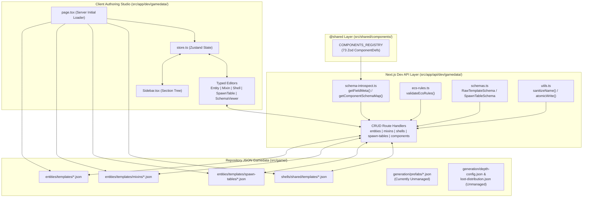
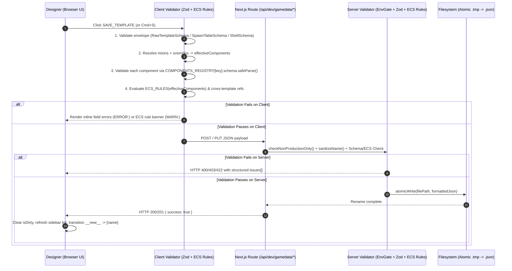

# Gamedata Authoring Studio (`/dev/gamedata`) — Architecture Review & Technical Specification

> **Status:** Comprehensive Audit & Target v2.0 Specification  
> **Baseline Audited:** Nirmata Runner v2.4 (Phase 17 implementation vs. Workstreams 1–5)  
> **Scope:** Client Authoring Studio ([`src/app/dev/gamedata/`](../../src/app/dev/gamedata/)), REST Persistence & Introspection Layer ([`src/app/api/dev/gamedata/`](../../src/app/api/dev/gamedata/)), and Data-Driven ECS Template Pipelines ([`src/game/entities/`](../../src/game/entities/), [`src/game/shells/`](../../src/game/shells/), [`src/game/generation/`](../../src/game/generation/))

---

## 1. Executive Summary & Architectural Role

**Nirmata Runner** mandates a strictly data-driven Entity-Component-System (ECS) architecture (see [`AGENTS.md`](../../AGENTS.md) Mandate #5: *"All entities, mixins, shells, and spawn tables are defined in JSON templates validated by Zod component schemas (`COMPONENTS_REGISTRY`). No hardcoded entity classes."*).

The **Gamedata Authoring Studio** at [`/dev/gamedata`](../../src/app/dev/gamedata/page.tsx) is the developer-facing web IDE built on Next.js App Router, React 19, and Zustand. It bridges the gap between TypeScript Zod component definitions in [`src/shared/components/`](../../src/shared/components/) and the JSON template files on disk by introspecting Zod schemas at runtime, rendering structured form editors, enforcing cross-component ECS consistency rules, and persisting changes atomically to the repository filesystem.



---

## 2. Comprehensive Audit of Current Implementation (v2.4 Baseline)

A line-by-line review of [`src/app/dev/gamedata/`](../../src/app/dev/gamedata/) and [`src/app/api/dev/gamedata/`](../../src/app/api/dev/gamedata/) against the v2.4 codebase revealed **8 critical/high functional bugs**, **7 architectural & security risks**, **2 major UI/UX design-system drifts**, and **6 data-domain coverage gaps** introduced as the game evolved from Phase 17 through Workstream 5.

### 2.1 Critical & High Functional Bugs

| ID | Severity | Location | Finding & Root Cause | Impact |
| :--- | :---: | :--- | :--- | :--- |
| **`BUG-GD-01`** | **CRITICAL** | [`page.tsx`](../../src/app/dev/gamedata/page.tsx#L5), [`entities/route.ts`](../../src/app/api/dev/gamedata/entities/route.ts#L6), [`EntityTemplateEditor.tsx`](../../src/app/dev/gamedata/editors/EntityTemplateEditor.tsx#L140) | **Crash on `economy.json` & Optional `components`:** [`economy.json`](../../src/game/entities/templates/economy.json) resides inside `src/game/entities/templates/` despite being a global economy config (`version`, `currencyDrops`, `costs`, `scoring`) with no `components` map. Clicking `economy` in the sidebar passes `templateData.components === undefined` to `Object.entries(templateData.components)` at line 140. Even valid `RawTemplate` files with only `mixins` and `overrides` omit `components`. | Uncaught `TypeError: Cannot convert undefined or null to object` crashes the entire `/dev/gamedata` React tree on click. |
| **`BUG-GD-02`** | **CRITICAL** | [`ecs-rules.ts`](../../src/app/api/dev/gamedata/ecs-rules.ts#L18-L22) | **Outdated `item-requires-pickup-effect` Rule Blocks 95% of Items:** The rule `!('item' in components) \|\| 'pickupEffect' in components` assumes all items use `PickupEffect`. In v2.4 ([`item-pickup.ts`](../../src/game/systems/item-pickup.ts)), Equipment (`equipmentDef`), Software (`softwareDef`), Currency (`currencyItem`), Firmware (`abilityDef`), Augments (`augmentData`), and Keys (`item.type === 'key'`) all use `item` **without** `pickupEffect` (only `health-potion.json` uses `pickupEffect`). | Saving any weapon (`rifle-v1..v3`), armor (`armor-v1..v3`), software (`bleed-v0..v3`, etc.), currency (`scrap`, `flux`), or `item-access-key` fails ECS validation and is blocked. |
| **`BUG-GD-03`** | **CRITICAL** | [`FormField.tsx`](../../src/app/dev/gamedata/editors/shared/FormField.tsx#L67-L86) | **Uneditable JSON `<textarea>` for `array` and `object` Fields:** `FormField` binds `value={JSON.stringify(value, null, 2)}` directly to parent state and only calls `handleChange(JSON.parse(e.target.value))` inside a `try/catch`. Because typing any single character (e.g., `{`, `,`, `"`) produces transiently invalid JSON during keystrokes, `JSON.parse` throws, `handleChange` is skipped, and React immediately overwrites the `<textarea>` with the old `JSON.stringify(value)`. Also, when `value` is `undefined`, `JSON.stringify(undefined)` returns `undefined`. | Users cannot type or edit any `array` or `object` component field (e.g., `lootTable.drops`, `augmentData.trigger`, `augmentData.payloads`, `statusEffects.effects`, `securityLock.faradayBounds`). |
| **`BUG-GD-04`** | **HIGH** | [`EntityTemplateEditor.tsx`](../../src/app/dev/gamedata/editors/EntityTemplateEditor.tsx#L78-L84), [`FormField.tsx`](../../src/app/dev/gamedata/editors/shared/FormField.tsx#L17-L65) | **Phantom Default Values on `+ Add Component`:** Adding a component initializes its state to `{}` without seeding `field.defaultVal` from `FieldMeta`. In `FormField`: (1) `enum` `<select>` has no empty placeholder option, so the browser displays `enumValues[0]` while state remains `undefined`; (2) `number` `<input>` displays `0` (`Number(value ?? 0)`) while state remains `undefined`; (3) `boolean` `<input>` displays `false` (`!!value`) even when `defaultVal === true` (e.g., `health.isAlive`, `securityLock.isLocked`), while state remains `undefined`. | Saving a newly added component without manually toggling every single control writes `{}` to disk, missing required fields seen on screen. |
| **`BUG-GD-05`** | **HIGH** | [`EntityTemplateEditor.tsx`](../../src/app/dev/gamedata/editors/EntityTemplateEditor.tsx#L121), [`MixinEditor.tsx`](../../src/app/dev/gamedata/editors/MixinEditor.tsx), [`SpawnTableEditor.tsx`](../../src/app/dev/gamedata/editors/SpawnTableEditor.tsx), [`ShellEditor.tsx`](../../src/app/dev/gamedata/editors/ShellEditor.tsx) | **Clone Flow (D-06) Is Stubbed / Unwired:** `EntityTemplateEditor` renders a `CLONE` button whose `onClick` is `() => console.log('Clone logic here')`. `MixinEditor`, `SpawnTableEditor`, and `ShellEditor` omit the `CLONE` button entirely. Furthermore, `Sidebar.tsx` does not call `clearCloneSource()` when clicking `+ New`, and `GamedataTool.tsx` uses `key={item.name}` which does not remount if already on `__new__`. | Cloning templates is completely non-functional across all 4 editors. |
| **`BUG-GD-06`** | **HIGH** | [`EntityTemplateEditor.tsx`](../../src/app/dev/gamedata/editors/EntityTemplateEditor.tsx), [`MixinEditor.tsx`](../../src/app/dev/gamedata/editors/MixinEditor.tsx), [`SpawnTableEditor.tsx`](../../src/app/dev/gamedata/editors/SpawnTableEditor.tsx), [`ShellEditor.tsx`](../../src/app/dev/gamedata/editors/ShellEditor.tsx) | **Delete Flow (D-08) Missing from All Editors:** Although `DELETE /api/dev/gamedata/[type]/[name]` is implemented in all 4 backend route handlers and `.deleteButton` exists in [`editors.module.css`](../../src/app/dev/gamedata/editors/editors.module.css#L64), no editor renders a Delete button or confirmation modal. | Impossible to delete templates, mixins, spawn tables, or shells from the UI. |
| **`BUG-GD-07`** | **HIGH** | [`GamedataTool.tsx`](../../src/app/dev/gamedata/GamedataTool.tsx#L50-L100) | **Sidebar List Never Refreshes & Create-to-Edit Transition Missing:** `GamedataTool` never passes `onRefresh` to any editor. When creating a new item (`isNew === true`), `POST` succeeds on disk, but `sectionItems` in Zustand is never updated and `selectedItem` stays `{ section, name: '__new__' }`. | Newly created items do not appear in the sidebar until full page reload; clicking `SAVE` a second time fires another `POST` and fails with HTTP `409 Conflict`. |
| **`BUG-GD-08`** | **HIGH** | [`EntityTemplateEditor.tsx`](../../src/app/dev/gamedata/editors/EntityTemplateEditor.tsx), [`SpawnTableEditor.tsx`](../../src/app/dev/gamedata/editors/SpawnTableEditor.tsx), [`ShellEditor.tsx`](../../src/app/dev/gamedata/editors/ShellEditor.tsx) | **Incomplete Schema Coverage & Destructive Edits:** (1) `EntityTemplateEditor` has no UI for `mixins`, `overrides`, `children`, or top-level item fields (`displayName`, `tier`, `software`). Inherited/overridden components (e.g., `health`, `attack`, `defense` on `null-pointer.json`, or `overrides.sprite` on all 13 `prop-*.json` templates) are completely hidden! (2) `SpawnTableEditor` omits `enemiesPerRoom`, `isPack`, `packSize`, `maxPerFloor`, `minDistanceFromPlayer`, has no button to add/remove template rows, appends invalid depth bands missing `enemiesPerRoom`, and ignores HTTP save errors. (3) `ShellEditor` omits `sprite`, `starterLoadout`, and `upgrades`. | Editing existing enemies, props, spawn tables, or shells either hides critical data (like enemy HP/attack and prop sprites) or writes incomplete/invalid structures on new creation. |

---

### 2.2 Schema Introspection, Validation & Security Risks

| ID | Risk Level | Location | Technical Description |
| :--- | :---: | :--- | :--- |
| **`RISK-GD-01`** | **HIGH** | [`schema-introspect.ts`](../../src/app/api/dev/gamedata/schema-introspect.ts#L22-L54) | **Incomplete Zod Type Unwrapping:** `resolveFieldType` only checks `ZodOptional`, `ZodDefault`, `ZodNumber`, `ZodBoolean`, `ZodEnum`, `ZodArray`, and `ZodObject`. It fails to handle: <br>1. `z.nativeEnum()` (`ZodNativeEnum`) used by [`AIState.behavior`](../../src/shared/components/ai-state.ts#L26), [`AIState.behaviorType`](../../src/shared/components/ai-state.ts#L27), and [`PickupEffect.type`](../../src/shared/components/pickup-effect.ts#L14) — misclassified as `'string'` instead of `'enum'`.<br>2. `z.nullable()` (`ZodNullable`) used by [`EquipmentSlots.weapon`](../../src/shared/components/equipment-slots.ts#L10) and `armor` — misclassified as `'string'` instead of `'number'`.<br>3. `z.record()` (`ZodRecord`) used by [`AugmentState`](../../src/shared/components/augment-state.ts#L12) — misclassified as `'string'` instead of `'object'`.<br>4. `z.union()` (`ZodUnion`) used by [`InteractPropIntent`](../../src/shared/components/environment.ts#L131) and `z.lazy()` (`ZodLazy`) used by [`ConditionNodeSchema`](../../src/shared/components/augment-data.ts#L35). |
| **`RISK-GD-02`** | **HIGH** | [`components/route.ts`](../../src/app/api/dev/gamedata/components/route.ts), [`EntityTemplateEditor.tsx`](../../src/app/dev/gamedata/editors/EntityTemplateEditor.tsx#L154-L167) | **Unfiltered Runtime Intent/Tag Components in `+ Add Component`:** `COMPONENTS_REGISTRY` contains **73 components**, of which **27 are transient runtime Intents, Turn Tags, or Hierarchy pointers** (`dying`, `moveIntent`, `attackIntent`, `damageIntent`, `movedThisTurn`, `parent`, `children`, `templateId`, etc.). All 73 appear in the `+ Add Component` dropdown. Attaching `dying` or `damageIntent` to a static template causes immediate entity destruction or phantom damage on spawn. Moreover, selecting an already-attached component resets its values to `{}`. |
| **`RISK-GD-03`** | **HIGH** | [`src/app/api/dev/gamedata/**`](../../src/app/api/dev/gamedata/) | **Zero Server-Side Schema or ECS Validation on `POST` / `PUT`:** Although [`schemas.ts`](../../src/app/api/dev/gamedata/schemas.ts) defines `RawTemplateSchema` and `SpawnTableSchema` and [`ecs-rules.ts`](../../src/app/api/dev/gamedata/ecs-rules.ts) defines `validateEcsRules`, **none of the API route handlers import or execute them**. `PUT /api/dev/gamedata/entities/[name]` and `PUT /api/dev/gamedata/spawn-tables/[name]` write `await req.json()` directly to disk without validating component schemas against `COMPONENTS_REGISTRY` or verifying `body.name === name`. Even on the client, individual component Zod schemas (`comp.schema.safeParse`) are never checked before saving. |
| **`RISK-GD-04`** | **MEDIUM** | [`EntityTemplateEditor.tsx`](../../src/app/dev/gamedata/editors/EntityTemplateEditor.tsx#L55), [`ecs-rules.ts`](../../src/app/api/dev/gamedata/ecs-rules.ts) | **ECS Rules Evaluated Without Mixin/Override Resolution:** `validateEcsRules(templateData.components)` inspects only `templateData.components` in isolation, ignoring components inherited via `templateData.mixins` (`physical`, `combatant`) or patched via `templateData.overrides`. |
| **`RISK-GD-05`** | **HIGH** | [`src/app/api/dev/gamedata/**`](../../src/app/api/dev/gamedata/), [`page.tsx`](../../src/app/dev/gamedata/page.tsx) | **Ungated Production Filesystem Write/Delete Access:** In Workstream 2 (`[SEC-03]`), `/api/admin/*` and `/api/debug/*` were secured with [`checkNonProductionOnly()`](../../src/server/security/env-gate.ts). However, all 9 `/api/dev/gamedata/*` routes remain completely ungated in production, exposing unauthenticated `POST`/`PUT`/`DELETE` filesystem operations if deployed on a writable server. |
| **`RISK-GD-06`** | **HIGH** | [`src/game/entities/index.ts`](../../src/game/entities/index.ts#L1-L148), [`src/game/shells/client/index.ts`](../../src/game/shells/client/index.ts#L1-L9) | **Static Registration Disconnect (New Files Ignored by Game Runtime):** [`src/game/entities/index.ts`](../../src/game/entities/index.ts) uses 68 static `import` statements and manual `registry.register(...)` calls. [`src/game/shells/client/index.ts`](../../src/game/shells/client/index.ts) hardcodes 3 shell imports (`vanguard`, `ghost`, `bastion`), and [`src/game/shells/server/index.ts`](../../src/game/shells/server/index.ts) only reads disk once at module startup. Creating a new entity template, mixin, or shell in `/dev/gamedata` writes the `.json` file to disk, **but the game runtime will never load it** without manual TypeScript code changes or an automated barrel/manifest generator. |
| **`RISK-GD-07`** | **MEDIUM** | [`entities/[name]/route.ts`](../../src/app/api/dev/gamedata/entities/%5Bname%5D/route.ts), [`shells/[name]/route.ts`](../../src/app/api/dev/gamedata/shells/%5Bname%5D/route.ts) | **Filename vs. Internal ID Desynchronization:** `PUT` routes write to `${params.name}.json` without enforcing `body.name === params.name` (or `body.id === params.name` for shells), allowing a file `null-pointer.json` to contain `"name": "other-id"`. |

---

### 2.3 UI/UX & Design System Drift

1. **`DRIFT-GD-01` — Broken CSS Custom Properties & Legacy Typography ([`gamedata.module.css`](../../src/app/dev/gamedata/gamedata.module.css), [`editors.module.css`](../../src/app/dev/gamedata/editors/editors.module.css))**:
   - Workstream 4 (`[UI-01]`–`[UI-07]`) replaced the legacy Phase 16 tokens in [`src/app/globals.css`](../../src/app/globals.css) with the **Taikoku Vector Manifest** system (`--c-*` color tokens, `--font-display`, `--font-mono`, `--font-vector`).
   - [`gamedata.module.css`](../../src/app/dev/gamedata/gamedata.module.css) and [`editors.module.css`](../../src/app/dev/gamedata/editors/editors.module.css) still reference **deleted CSS variables** that no longer exist in `:root`:
     - `var(--font-body)` (undefined)
     - `var(--font-size-heading)`, `var(--font-size-body)`, `var(--font-size-label)` (undefined across 14 CSS rules in `editors.module.css`, causing browsers to ignore those `font-size` declarations)
   - Both stylesheets hardcode `font-family: 'Courier New', Courier, monospace`, violating [`docs/design/UI-DESIGN-SYSTEM.md`](../design/UI-DESIGN-SYSTEM.md) Section 2 (*"Legacy `#00ff41` matrix green and `Courier New` / `Arial Narrow` declarations must be removed"*).

2. **`DRIFT-GD-02` — Unimplemented Phase 17 UI Contract ([`17-UI-SPEC.md`](../archive/planning/milestones/v2.0-phases/17-add-design-tool-for-authoring-and-viewing-entities-component-templates-and-gamedata/17-UI-SPEC.md))**:
   - `isDirty` and `setDirty` exist in [`store.ts`](../../src/app/dev/gamedata/store.ts#L20-L21) but `setDirty` is **never called anywhere**. There is no dirty-state amber indicator dot and no unsaved-changes guard when switching items in the sidebar.
   - `Cmd+S / Ctrl+S` save keyboard shortcut and `Escape` modal dismissal are unimplemented.
   - Form `<label>` elements lack `htmlFor` bindings, and sidebar items lack `role="treeitem"`, `aria-expanded`, and `aria-selected`.

---

### 2.4 Data Domain Coverage Gaps (v2.0 → v2.4 Evolution)

Since Phase 17 was implemented, Nirmata Runner expanded into a rich hybrid-procedural extraction roguelike (Phases 18–22 and Workstream 5). The following data-driven JSON domains now power the game but have **zero visibility or authoring support** in `/dev/gamedata`:

1. **Bespoke Room Prefabs ([`src/game/generation/prefabs/*.json`](../../src/game/generation/prefabs/))**: `server-core.json`, `freight-bay.json`, `decon-airlock.json`, `zero-day-vault.json` (`RoomPrefabTemplate`: 2D ASCII `layout`, `portals`, `propSpawns`, `faction`, `isVaultRoom`, `faradayShielded`).
2. **Loot Distribution Tables ([`src/game/generation/loot-distribution.json`](../../src/game/generation/loot-distribution.json))**: Depth-band weighted item drop tables (`depthBands[].loot[]`).
3. **Floor / Depth Band ProcGen Config ([`src/game/generation/depth-config.json`](../../src/game/generation/depth-config.json))**: BSP room sizing, corridor widths, hex color palettes, and special room probabilities across `CORRUPTED_DATA` (F1–5), `STATIC_HORRORS` (F6–10), and `LOGIC_BREAKERS` (F11–15).
4. **Global Economy & Scoring Config ([`src/game/entities/templates/economy.json`](../../src/game/entities/templates/economy.json))**: Currency drop tiers, compilation/installation/upgrade costs, wallet caps, death scrap pity, shop rules, scoring weights, and weekly winner items.
5. **Tileset & Sprite Atlas Keys ([`public/assets/tileset.json`](../../public/assets/tileset.json))**: No visual sprite picker or frame preview for `sprite.key` on entities or `sprite` on shells; authors must memorize string keys from `tileset.json`.
6. **Augment Condition Tree & Payload Builder ([`src/shared/components/augment-data.ts`](../../src/shared/components/augment-data.ts))**: Recursive boolean condition AST (`AND`, `OR`, `NOT`, `ON_ACTIVATION`, `ON_TARGET_HIT`, `ON_OVERCLOCK`, `ON_KILL`, `HEAT_ABOVE`, `HP_BELOW_PERCENT`, `ON_HACK`, `ON_COVER_BROKEN`) and `payloads[]` have no structured UI editor.

---

## 3. Comprehensive Technical Specification (Gamedata Studio v2.0)

This specification defines the complete target architecture, UI/UX contract, validation engine, and data coverage for the Nirmata Runner Gamedata Authoring Studio.

### 3.1 Information Architecture & Section Taxonomy

The Gamedata Authoring Studio organizes all game data into **7 canonical sections** in the left navigation tree:

| Section ID | Display Label | Source Path(s) | Mode | Description |
| :--- | :--- | :--- | :---: | :--- |
| **`entities`** | `ENTITY TEMPLATES [実体]` | `src/game/entities/templates/*.json` *(excluding `economy.json`)* | Full CRUD + Clone | Enemies, player, weapons, armor, software, firmware, augments, currencies, props, hazards, and markers. |
| **`mixins`** | `MIXIN TEMPLATES [合成]` | `src/game/entities/templates/mixins/*.json` | Full CRUD + Clone | Reusable component bundles (`physical`, `combatant`, etc.) inherited by entity templates. |
| **`shells`** | `SHELL ARCHETYPES [義体]` | `src/game/shells/shared/templates/*.json` | Full CRUD + Clone | Playable chassis definitions (`vanguard-v1`, `bastion-v1`, `ghost-v1`) with base stats, ports, sprites, starter loadouts, and upgrade trees. |
| **`spawnTables`** | `SPAWN & LOOT TABLES [出現]` | `src/game/entities/templates/spawn-tables/*.json`, `src/game/generation/loot-distribution.json` | Full CRUD + Clone | Depth-band enemy spawn distributions (`depth-distribution`) and floor loot drop weights (`loot-distribution`). |
| **`prefabs`** | `ROOM PREFABS [区画]` | `src/game/generation/prefabs/*.json` | Full CRUD + Clone | Bespoke tactical chambers and Faraday vaults (`server-core`, `freight-bay`, `decon-airlock`, `zero-day-vault`) with interactive 2D ASCII tile painter. |
| **`configs`** | `SYSTEM CONFIGS [設定]` | `src/game/generation/depth-config.json`, `src/game/entities/templates/economy.json` | Read / Update (`PUT`) | Singleton global configs for floor BSP/palette parameters (`depth-config`) and run economy/scoring (`economy`). |
| **`componentSchemas`** | `COMPONENT SCHEMAS [構造]` | Derived live from `COMPONENTS_REGISTRY` (`@shared/components`) | Read-Only Inspector | Live Zod schema documentation, field constraints, defaults, and reverse template usage lookup. |

---

### 3.2 Layout & Visual Contract ("Taikoku Vector Manifest" Alignment)

The studio adopts **Paradigm B (Full-Viewport 3-Column Workstation)** from [`docs/design/UI-DESIGN-SYSTEM.md`](../design/UI-DESIGN-SYSTEM.md), replacing all legacy `'Courier New'` and undefined `--font-size-*` tokens with canonical `--c-*` and `--font-*` variables from [`src/app/globals.css`](../../src/app/globals.css).

```
┌────────────────────────────────────────────────────────────────────────────────────────────────────┐
│  [ 開発環境 // GAMEDATA STUDIO ]   ACTIVE: null-pointer.json ● UNSAVED         [CMD+S SAVE] [ESC]  │ ← .taikoku-placard
├────────────────────────┬──────────────────────────────────────────────────┬────────────────────────┤
│  NAVIGATION TREE       │  PRIMARY STRUCTURED EDITOR                       │  TELEMETRY & INSPECTOR │
│  (280px Fixed)         │  (Flex 1, Scrollable)                            │  (340px Collapsible)   │
│                        │                                                  │                        │
│  [🔍 Filter items...]  │  ┌─ HEADER (.panel-header) ───────────────────┐  │  ┌─ VALIDATION STATUS ─┐│
│                        │  │ ENTITY: null-pointer [ENEMY]               │  │  │ ✓ ZOD SCHEMAS PASS  ││
│  ▼ ENTITY TEMPLATES 67 │  │ [SAVE_TEMPLATE] [CLONE_TEMPLATE] [DELETE]  │  │  │ ✓ ECS RULES PASS    ││
│    [+ NEW_TEMPLATE]    │  └────────────────────────────────────────────┘  │  └─────────────────────┘│
│    ▸ Enemies (6)       │  ┌─ IDENTITY & INHERITANCE (.panel-card) ─────┐  │  ┌─ RESOLVED PREVIEW ──┐│
│      • null-pointer ●  │  │ Name: [null-pointer]  Sprite: [🎨 Preview] │  │  │ Effective Merged    ││
│      • fragmenter      │  │ Mixins: [✓ physical] [✓ combatant]         │  │  │ JSON (Mixins +      ││
│    ▸ Weapons/Armor (6) │  └────────────────────────────────────────────┘  │  │ Components +        ││
│    ▸ Software (12)     │  ┌─ INHERITED & OVERRIDDEN (from mixins) ─────┐  │  │ Overrides)          ││
│    ▸ Firmware/Aug (17) │  │ ⚡ health (from combatant)     [OVERRIDDEN] │  │  │                     ││
│    ▸ Props/Env (13)    │  │   current: [6] (base: 10)  max: [6]        │  │  │ {                   ││
│  ▶ MIXIN TEMPLATES   2 │  └────────────────────────────────────────────┘  │  │   "name": "...",    ││
│  ▶ SHELL ARCHETYPES  3 │  ┌─ OWN COMPONENTS (.panel-card) ─────────────┐  │  │   "components": ... ││
│  ▶ SPAWN & LOOT      2 │  │ ■ aiState                         [REMOVE] │  │  │ }                   ││
│  ▶ ROOM PREFABS      4 │  │   behavior: [idle ▼]  sightRadius: [8]     │  │  └─────────────────────┘│
│  ▶ SYSTEM CONFIGS    2 │  └────────────────────────────────────────────┘  │  ┌─ REFERENCES ────────┐│
│  ▶ COMPONENT SCHEMAS 73│  [+ ADD AUTHORABLE COMPONENT ▼]                  │  │ Spawned in:         ││
│                        │                                                  │  │ • depth-dist (F1-15)││
└────────────────────────┴──────────────────────────────────────────────────┴────────────────────────┘
```

#### Canonical Token Mapping for `gamedata.module.css` & `editors.module.css`
* **Surfaces**: `var(--c-bg)` (`#040609`) viewport background; `var(--c-surface)` (`#0a0e15`) panels and sidebar; `var(--c-surface-header)` (`#0c121c`) section and component headers; `var(--c-surface-elevated)` (`#111722`) inputs and socket rows.
* **Typography**:
  * Section headings & titles: `font-family: var(--font-display)` (`Space Grotesk`, `Noto Sans JP`), `font-size: 16px` (panel title) / `12px` (section header), `font-weight: 800`, `text-transform: uppercase`, `letter-spacing: 0.08em`.
  * Field labels, inputs, JSON inspector, and schema types: `font-family: var(--font-mono)` (`JetBrains Mono`, `Share Tech Mono`), `font-size: 12px` (inputs) / `11px` (labels).
* **Accents & Semantic States**:
  * Primary CTA / Active Selection: `var(--c-accent)` (`#d8ff00` Acid Chartreuse) or `var(--c-accent-secondary)` (`#00f0ff` Solaris Cyan).
  * Dirty / Override / ECS Warning: `var(--c-warning)` (`#ff6600`) / `var(--c-scrap)` (`#ffaa00`).
  * Destructive Delete / Blocking Validation Error: `var(--c-danger)` (`#ff2a4b` Stamp Crimson).

---

### 3.3 Data Domain & Editor Specifications

#### 3.3.1 Entity TemplateEditor & MixinEditor (`entities`, `mixins`)

1. **Three-Layer Component Resolution Architecture (`Mixins` → `Components` → `Overrides`)**:
   - **Mixin Selector**: Multi-select pill bar allowing authors to toggle registered mixins (e.g., `physical`, `combatant`).
   - **Inherited Component Cards**: Components contributed by selected `mixins` render in a dedicated **"Inherited from Mixins"** group with a badge indicating the source mixin (e.g., `FROM: combatant`).
     - Editing any field on an inherited component writes that field diff into `templateData.overrides[compKey][fieldKey]` (matching [`resolveMixins`](../../src/engine/entity/builder.ts#L70-L82)) and highlights the field with an amber `[OVERRIDE]` badge and a `Reset to Mixin Default` button.
   - **Own Component Cards**: Components defined directly in `templateData.components` render in the **"Own Components"** group.
   - **Top-Level Metadata Preservation**: Preserves and exposes optional top-level template properties used by equipment/software loaders (`displayName`, `tier`, `software: string[]`, `children`) so saving never strips extra template keys.

2. **Categorized & Filtered `+ Add Component` Catalog**:
   - Excludes already-attached components (preventing accidental overwrite of existing component values).
   - Splits `COMPONENTS_REGISTRY` into two explicit groups:
     - **Authorable Template Components (46)** — grouped by domain:
       - *Core & Spatial*: `position`, `blocksMovement`, `sprite`, `actor`, `energy`
       - *Combat & Stats*: `health`, `attack`, `defense`, `hostile`, `aiState`, `fovAwareness`, `statusEffects`, `packMember`, `lootTable`, `progression`, `stability`, `heat`
       - *Items & Economy*: `item`, `pickupEffect`, `currencyItem`, `rarityTier`, `equipmentDef`, `softwareDef`, `abilityDef`, `augmentData`, `augmentState`, `wallet`, `run_inventory`, `run_currency`
       - *Shells & Slots*: `shell`, `portConfig`, `firmwareSlots`, `augmentSlots`, `softwareSlots`, `equipmentSlots`
       - *Environment & ProcGen*: `prop`, `securityLock`, `container`, `interactiveSurface`, `corruptedNode`, `deadZone`, `corruptionState`, `floorState`, `staircaseMarker`, `anchorMarker`
     - **Runtime Intents, Turn Tags & Hierarchy Pointers (27)** — hidden from the template component picker by default (visible only in `ComponentSchemaViewer` under a `[RUNTIME ONLY]` filter badge):
       - *Intents*: `moveIntent`, `attackIntent`, `ventIntent`, `damageIntent`, `descentIntent`, `extractionIntent`, `equipIntent`, `unequipIntent`, `teleportIntent`, `applyStatusEffectIntent`, `healIntent`, `heatIntent`, `burnSoftwareIntent`, `firmwareIntent`, `acting`, `pickupIntent`, `interactPropIntent`
       - *Turn Tags*: `movedThisTurn`, `dying`, `firmwareActivatedThisTurn`, `dealtDamageThisTurn`, `floorTransitioned`, `propInteractedThisTurn`, `shellUpdateTag`
       - *Internal Pointers*: `parent`, `children`, `templateId`

3. **Default Value Seeding on Component Addition**:
   - When `handleAddComponent(compKey)` is invoked, the editor populates initial field values from `FieldMeta`:
     ```typescript
     function buildDefaultComponentData(fields: FieldMeta[]): Record<string, unknown> {
       const initial: Record<string, unknown> = {};
       for (const field of fields) {
         if (field.defaultVal !== undefined) {
           initial[field.key] = structuredClone(field.defaultVal);
         } else if (!field.optional) {
           if (field.type === 'number') initial[field.key] = 0;
           else if (field.type === 'boolean') initial[field.key] = false;
           else if (field.type === 'enum' && field.enumValues?.length) initial[field.key] = field.enumValues[0];
           else if (field.type === 'array') initial[field.key] = [];
           else if (field.type === 'object') initial[field.key] = {};
           else initial[field.key] = '';
         }
       }
       return initial;
     }
     ```

4. **Specialized Sub-Editors for Complex Components**:
   - **`sprite` Component**: Renders a searchable dropdown of frame keys from [`public/assets/tileset.json`](../../public/assets/tileset.json) alongside a crisp `32×32` (scaled `2×` pixelated) `<canvas>` preview cropped from `/assets/tileset.png`.
   - **`lootTable` Component**: Renders a structured drop-table editor (`tier: 1|2|3` selector + dynamic rows of `[Template Dropdown] [Chance 0.00–1.00] [Remove]`) instead of raw JSON.
   - **`augmentData` Component**: Renders a recursive **Condition Node Tree Builder** (`AND`/`OR`/`NOT` branch nodes + leaf triggers `ON_ACTIVATION`, `ON_TARGET_HIT`, `ON_OVERCLOCK`, `ON_KILL`, `HEAT_ABOVE`, `HP_BELOW_PERCENT`, `ON_HACK`, `ON_COVER_BROKEN`) and a **Payload List Editor** (`HEAL`, `SHIELD`, `APPLY_STATUS`, `VENT_HEAT`, `DAMAGE_BONUS`).
   - **Draft-Buffered JSON Textarea Fallback**: For any generic `array` or `object` field, `FormField` maintains local string state (`draftText`) and `parseError: string | null`, syncing `draftText` on external prop change while allowing free typing and validating `JSON.parse` on change/blur with inline syntax error feedback.

---

#### 3.3.2 Shell Archetype Editor (`shells`)

Covers the complete [`ShellTemplate`](../../src/game/shells/server/types.ts#L32-L40) contract:
* **Identity**: `id` (slug, read-only after creation), `name` (display name), and `sprite` (dropdown + 32×32 preview from `tileset.json`).
* **Base Stats (`baseStats`)**: Positive integer inputs for `speed`, `stability`, `armor`, `maxHealth`.
* **Base Ports (`basePorts`)**: Non-negative integer inputs for `maxFirmware`, `maxAugment`, `maxSoftware`.
* **Starter Loadout (`starterLoadout`)**: Multi-select tag list populated from registered Firmware (`abilityDef`), Augment (`augmentData`), and Software (`softwareDef`) entity templates.
* **Upgrade Definitions (`upgrades`)**: Structured row builder where each row specifies `level`, `statBonuses` (`speed`, `stability`, `armor`, `maxHealth`), and `portBonuses` (`maxFirmware`, `maxAugment`, `maxSoftware`).

---

#### 3.3.3 Spawn & Loot Table Editor (`spawnTables`)

Supports both **Enemy Spawn Tables** (`depth-distribution.json`) and **Floor Loot Tables** (`loot-distribution.json`):

1. **Enemy Spawn Table Mode (`SpawnTableSchema`)**:
   - **Depth Band Header**: `depthRange.min` / `depthRange.max` (1–15), `enemiesPerRoom.min` / `enemiesPerRoom.max`, and `[Delete Band]` button.
   - **Weighted Template Rows**:
     - `name`: Dropdown of enemy entity templates (filtered by `hostile` component).
     - `weight`: Positive integer weight + **computed effective spawn % badge** (`weight / sum(bandWeights) * 100%`).
     - `isPack`: Checkbox; when checked, reveals `packSize.min` and `packSize.max` number inputs.
     - `maxPerFloor`: Optional integer cap (e.g., `1` for `system-admin` and `seed-eater`).
     - `minDistanceFromPlayer`: Optional integer tile distance (e.g., `10` for `system-admin`).
     - `[+ Add Enemy Row]` and `[Remove Row]` buttons per depth band.
   - **Depth Coverage Validator**: Warns if floors `1–15` have any uncovered gap or invalid range (`min > max`).

2. **Loot Distribution Mode (`LootDistributionSchema`)**:
   - Edits `depthBands[]` with `depthRange: { min, max }` and `loot[]` rows (`template` dropdown of item templates, `weight` integer + computed %, optional `note` string).

---

#### 3.3.4 Interactive Room Prefab Editor (`prefabs` — New)

Provides visual authoring for [`RoomPrefabTemplate`](../../src/game/generation/prefabs/types.ts) JSON files (`src/game/generation/prefabs/*.json`):
* **Metadata Bar**: `id`, `name`, `faction` (`traxus` | `cyberacme` | `sekiguchi` | `nucaloric`), `minFloor` (1–15), `maxFloor` (1–15), `width` (10–16), `height` (10–16), `isVaultRoom` toggle, and `faradayShielded` toggle.
* **Interactive 2D ASCII Grid Canvas (`width × height`)**:
  * **Brush Palette**:
    * `#` Structural Wall
    * `.` Walkable Floor
    * `+` Standard Door
    * `V` Encrypted Vault Door (`prop-vault-door`)
    * `~` Persistent Dead-Zone Hazard
  * **Overlay Layers**:
    * **Portals Layer (`portals[]`)**: Click perimeter tiles to toggle North/South/East/West corridor attachment portals (`direction` auto-inferred from perimeter edge).
    * **Prop Spawns Layer (`propSpawns[]`)**: Click interior floor tiles to assign `anchorType` (`PROP_DESK_CORNER`, `PROP_LOCKER_WALL`, `SURFACE_TABLE_TOP`, `CONTAINER_RARE`) and optional `guaranteedTemplate` (dropdown of `prop-*` templates).
* **Prefab Structural Validator**:
  * Verifies `layout.length === height` and every row `row.length === width`.
  * Verifies all `portals` and `propSpawns` coordinates lie within `[0, width-1] × [0, height-1]` and do not sit on solid `#` wall tiles.
  * Verifies `isVaultRoom` prefabs contain at least one `V` vault door tile.

---

#### 3.3.5 System Configuration Editors (`configs` — New)

1. **Relocate `economy.json` Out of Entity Templates**:
   - Move `src/game/entities/templates/economy.json` to `src/game/config/economy.json` (or filter `economy.json` out of `listJsonFiles(ENTITY_DIR)`) so it never collides with entity template scanning.
   - Provide a structured **Economy & Scoring Editor** covering `currencyDrops` (`scrap`, `blueprint`, `flux`), `costs` (`compilation`, `installation`, `shellUpgrade`), `caps`, `pity`, `shop`, `conversion`, `scoring` weights, and `winnersItems`.
2. **Depth & Floor ProcGen Config Editor (`depth-config.json`)**:
   - Edits `maxFloor` and `depthBands[]` (`range`, `label`, `bspConfig`, `palette` with color swatches for `floor`/`wall`/`tint`, and `specialRoomProbability`).

---

#### 3.3.6 Component Schema Registry Viewer (`componentSchemas`)

* Displays all 73 components from `COMPONENTS_REGISTRY` with search filter and category toggle (`ALL` | `AUTHORABLE (46)` | `RUNTIME INTENTS & TAGS (27)`).
* For each field, displays:
  * `key`, `type` (`string` | `number` | `boolean` | `enum` | `array` | `object` | `union`), `nullable` / `optional` badges, `defaultVal`, `constraints` (`min`, `max`, `int`), and `enumValues`.
* **Reverse Cross-Reference ("Used By")**: Lists all Entity Templates and Mixins that attach or override the selected component, with clickable links that jump directly to that template in `EntityTemplateEditor`.

---

### 3.4 Validation Pipeline & ECS Consistency Engine

Validation runs identically on both **Client (pre-save inline feedback)** and **Server (`POST`/`PUT` enforcement)**.



#### 3.4.1 Upgraded `schema-introspect.ts` Specification

[`src/app/api/dev/gamedata/schema-introspect.ts`](../../src/app/api/dev/gamedata/schema-introspect.ts) must unwrap all Zod wrapper types recursively:

```typescript
export interface FieldMeta {
  key: string;
  type: 'string' | 'number' | 'boolean' | 'enum' | 'array' | 'object';
  optional: boolean;
  nullable: boolean;
  defaultVal?: unknown;
  enumValues?: string[];
  constraints?: {
    min?: number;
    max?: number;
    isInt?: boolean;
  };
}
```
* **Unwrapping Loop**: Iteratively unwrap `ZodOptional`, `ZodDefault`, `ZodNullable`, and `ZodLazy` in any nesting order (e.g., `z.number().nullable().default(null)` or `z.boolean().default(false).optional()`).
* **Enum Support**: Handle both `z.ZodEnum` (`options`) and `z.ZodNativeEnum` (`Object.values(enumObj).filter(v => typeof v === 'string')`) so `AIState.behavior`, `AIState.behaviorType`, and `PickupEffect.type` render as `<select>` dropdowns.
* **Record & Union Support**: Classify `z.ZodRecord` as `type: 'object'`, and `z.ZodUnion` according to its primary primitive branch or `'string'`.

#### 3.4.2 Upgraded `ECS_RULES` Specification ([`ecs-rules.ts`](../../src/app/api/dev/gamedata/ecs-rules.ts))

All rules must be evaluated against the **resolved component map** (`resolveMixins(template, registry)`), not raw `template.components`:

| Rule ID | Severity | Condition | Validation Predicate |
| :--- | :---: | :--- | :--- |
| **`enemy-requires-hostile-and-aistate`** | Blocking (`ERROR`) | `'hostile' in comps \|\| 'aiState' in comps` | `'hostile' in comps && 'aiState' in comps` |
| **`enemy-requires-combat-stats`** | Warning (`WARN`) | `'hostile' in comps` | `'health' in comps && 'attack' in comps && 'energy' in comps` |
| **`item-requires-handler-component`** | Blocking (`ERROR`) | `'item' in comps` | `'pickupEffect' in comps \|\| 'currencyItem' in comps \|\| 'equipmentDef' in comps \|\| 'softwareDef' in comps \|\| 'abilityDef' in comps \|\| 'augmentData' in comps \|\| comps.item?.type === 'key'` |
| **`prop-lock-requires-prop`** | Blocking (`ERROR`) | `'securityLock' in comps \|\| 'corruptedNode' in comps` | `'prop' in comps` |
| **`no-runtime-intents-in-templates`** | Blocking (`ERROR`) | Any component in `comps` | No component key belongs to `RUNTIME_INTENT_OR_TAG_KEYS` (`dying`, `moveIntent`, `damageIntent`, etc.) |
| **`valid-sprite-key`** | Warning (`WARN`) | `'sprite' in comps` | `comps.sprite.key` exists in `public/assets/tileset.json` `frames` |

---

### 3.5 Security, Persistence & Dynamic Runtime Registration

1. **Production Environment Gate (`[SEC-03]` Parity)**:
   - Every route handler in `src/app/api/dev/gamedata/**/route.ts` must invoke [`checkNonProductionOnly()`](../../src/server/security/env-gate.ts) at the top of `GET`, `POST`, `PUT`, and `DELETE`.
   - [`src/app/dev/gamedata/page.tsx`](../../src/app/dev/gamedata/page.tsx) must return `notFound()` (from `next/navigation`) when `process.env.NODE_ENV === 'production'`.

2. **Dynamic Entity & Shell Registration (`RISK-GD-06` Resolution)**:
   - Currently, [`src/game/entities/index.ts`](../../src/game/entities/index.ts) hardcodes 68 static JSON imports, and [`src/game/shells/client/index.ts`](../../src/game/shells/client/index.ts) hardcodes 3 static shell imports.
   - **Auto-Generated Registry Manifest on Save/Delete**:
     - Add a server utility `regenerateTemplateIndex()` in `src/app/api/dev/gamedata/utils.ts` that is automatically called after any `POST` or `DELETE` on `/api/dev/gamedata/entities`, `/api/dev/gamedata/mixins`, or `/api/dev/gamedata/shells`.
     - `regenerateTemplateIndex()` scans `src/game/entities/templates/*.json` (excluding `economy.json`), `src/game/entities/templates/mixins/*.json`, and `src/game/shells/shared/templates/*.json`, and atomically updates [`src/game/entities/index.ts`](../../src/game/entities/index.ts) and [`src/game/shells/client/index.ts`](../../src/game/shells/client/index.ts) in deterministic alphabetical order.
     - This preserves 100% browser/Webpack/Vitest static-bundling compatibility while ensuring newly created or cloned templates in `/dev/gamedata` are immediately registered in both client and server builds without manual developer code edits.

---

## 4. Prioritized Implementation Roadmap

### Phase 1: P0 Bug Fixes & Data Integrity (Immediate)
- [ ] **Fix `BUG-GD-01`**: Filter `economy.json` out of `ENTITY_DIR` in [`page.tsx`](../../src/app/dev/gamedata/page.tsx) and [`entities/route.ts`](../../src/app/api/dev/gamedata/entities/route.ts), and guard `Object.entries(templateData.components ?? {})` in [`EntityTemplateEditor.tsx`](../../src/app/dev/gamedata/editors/EntityTemplateEditor.tsx).
- [ ] **Fix `BUG-GD-02`**: Update `item-requires-pickup-effect` in [`ecs-rules.ts`](../../src/app/api/dev/gamedata/ecs-rules.ts) to `item-requires-handler-component` (accepting `pickupEffect`, `currencyItem`, `equipmentDef`, `softwareDef`, `abilityDef`, `augmentData`, or `item.type === 'key'`).
- [ ] **Fix `BUG-GD-03` & `BUG-GD-04`**: Refactor [`FormField.tsx`](../../src/app/dev/gamedata/editors/shared/FormField.tsx) to use local draft state for JSON `<textarea>` fields, add explicit empty option handling for `<select>`, and seed `FieldMeta` default values when adding components.
- [ ] **Fix `BUG-GD-05`, `BUG-GD-06`, `BUG-GD-07`**: Wire `CLONE_TEMPLATE`, `DELETE_FILE` (with confirmation modal), and `onRefresh` / post-create selection transitions across all 4 editors and [`GamedataTool.tsx`](../../src/app/dev/gamedata/GamedataTool.tsx).

### Phase 2: Schema Introspection, Server Validation & Security Hardening
- [ ] **Fix `RISK-GD-01` & `RISK-GD-02`**: Upgrade [`schema-introspect.ts`](../../src/app/api/dev/gamedata/schema-introspect.ts) to unwrap `ZodNativeEnum`, `ZodNullable`, `ZodRecord`, `ZodUnion`, and `ZodLazy`; filter the 27 runtime Intent/Tag components out of the authorable component dropdown.
- [ ] **Fix `RISK-GD-03`, `RISK-GD-04`, `RISK-GD-07`**: Enforce Zod schema validation (`RawTemplateSchema`, component `safeParse`, `SpawnTableSchema`, `ShellTemplateSchema`), resolved-mixin ECS rule validation, and `body.name === params.name` checks in all `POST`/`PUT` API routes.
- [ ] **Fix `RISK-GD-05`**: Add `checkNonProductionOnly()` to all `/api/dev/gamedata/*` routes and `notFound()` in production on `/dev/gamedata`.
- [ ] **Fix `RISK-GD-06`**: Implement `regenerateTemplateIndex()` on `POST`/`DELETE` so `src/game/entities/index.ts` and `src/game/shells/client/index.ts` stay automatically synchronized.

### Phase 3: Taikoku Vector UI Overhaul & Complete Existing Editor Coverage
- [ ] **Fix `DRIFT-GD-01` & `DRIFT-GD-02`**: Migrate [`gamedata.module.css`](../../src/app/dev/gamedata/gamedata.module.css) and [`editors.module.css`](../../src/app/dev/gamedata/editors/editors.module.css) to canonical `--c-*` and `--font-*` tokens, add `.taikoku-placard` header, `isDirty` tracking + unsaved-changes guard, `Cmd+S` shortcut, and right-hand Resolved JSON Inspector panel.
- [ ] **Fix `BUG-GD-08`**:
  - Add `mixins` selector, inherited component viewer, and `overrides` diff editor to `EntityTemplateEditor`.
  - Add `enemiesPerRoom`, `isPack`, `packSize`, `maxPerFloor`, `minDistanceFromPlayer`, template row add/remove, and spawn probability % badges to `SpawnTableEditor`.
  - Add `sprite`, `starterLoadout`, and `upgrades` editors to `ShellEditor`.

### Phase 4: Extended v2.4 Data Domains (Prefabs, Configs, Sprite Picker & Augment AST)
- [ ] Add **Room Prefab Visual Editor (`prefabs`)** with 2D ASCII tile painter, portal placement, and prop anchor tagging.
- [ ] Add **Loot Distribution (`loot-distribution.json`)**, **Depth Config (`depth-config.json`)**, and **Economy Config (`economy.json`)** editors.
- [ ] Add **Tileset Sprite Picker & 32×32 Canvas Preview** (`public/assets/tileset.json`) and **Augment Condition Tree / Payload Builder**.
