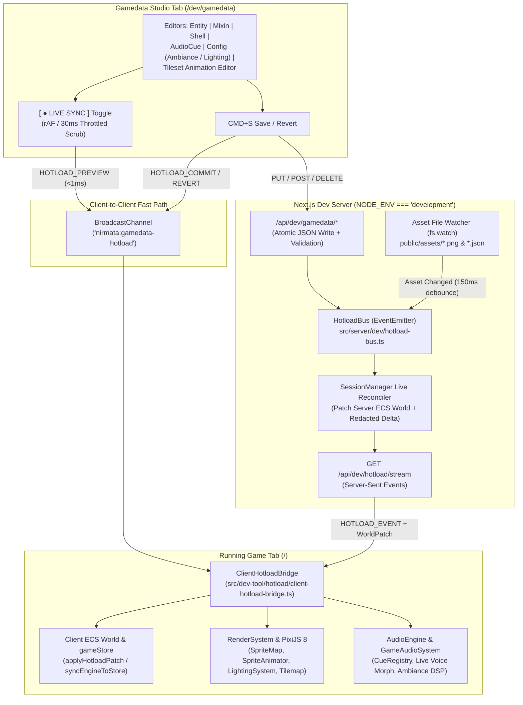

# Gamedata Studio Real-Time Hotload & Live Sync System — Technical Specification

> **Status:** Canonical Design & Engineering Specification (v1.0)  
> **Target Engine:** Nirmata Runner (Next.js 16, React 19, PixiJS 8 WebGL2, Web Audio API, TypeScript, Zustand, Zod ECS)  
> **Scope:** Cross-Tab & Server-Push Hotload Transport (`src/dev-tool/hotload/`, `src/server/dev/`, `src/app/api/dev/hotload/`), Live ECS World & Session Patching (`src/server/session/`, `src/game/setup.ts`), Sprite/Animation/Atlas Hot-Swap (`src/rendering/assets.ts`, `src/rendering/sprite-map.ts`, `src/rendering/sprite-animator.ts`), Real-Time Lighting, FOV/FOW & Environment Profiles (`src/rendering/lighting/`, `src/rendering/fov.ts`, `src/game/config/lighting.json`, `src/game/config/fov.json`), Real-Time Audio & Synth Voice Modulation (`src/engine/audio/`, `src/game/audio/`), and Dev Session Auto-Resume (`src/app/page.tsx`, `src/dev-tool/studio/`)  
> **Companion Specifications:** [`GAMEDATA-DESIGN-TOOL.md`](./GAMEDATA-DESIGN-TOOL.md), [`SPRITE-ANIMATIONS.md`](./SPRITE-ANIMATIONS.md), [`DEFERRED-LIGHTING-RENDERING.md`](./DEFERRED-LIGHTING-RENDERING.md), [`AUDIO-SYSTEM.md`](./AUDIO-SYSTEM.md), [`APPLICATION_SEPARATION_SPEC.md`](../architecture/APPLICATION_SEPARATION_SPEC.md)

---

## 1. Executive Summary & Architectural Goals

Iterating on visual, audio, lighting, and entity feel in **Nirmata Runner** previously required a high-friction loop: editing a template or config in **Gamedata Studio** (`/dev/gamedata`), saving to disk, reloading the game tab (`/`), navigating through the Main Menu and Neural Deck Hub, selecting a Shell and loadout, and launching a new run just to observe a sprite swap, light radius tweak, or synth filter adjustment.

The **Gamedata Studio Real-Time Hotload & Live Sync System** eliminates this reload loop entirely. Developers can run `/dev/gamedata` alongside an active game session at `/` and see changes reflected **immediately inside the running game**—both on **`Cmd+S` Save** (persisting to disk and reconciling server/client ECS state) and via an optional **`[ ● LIVE SYNC ]` Scrub Mode** (streaming slider, color picker, sprite, and synth adjustments at 60Hz before committing to disk).

### 1.1 Finalized Design Decisions

| Design Dimension | Selected Engine & Tooling Direction |
| :--- | :--- |
| **1. Trigger & Sync Modes** | **Hotload on Save (`Cmd+S`) + Optional Live Scrub (`LIVE_SYNC`)**: Saving commits atomically to disk, updates server sessions, and hot-patches the running game. Enabling `LIVE_SYNC` streams transient preview mutations in real time while dragging sliders/pickers, with `Revert` restoring the last saved disk state. |
| **2. Transport Topology** | **Dual-Path IPC (`BroadcastChannel` + Server-Sent Events)**:<br>• `BroadcastChannel('nirmata:gamedata-hotload')` delivers zero-latency (<1ms) browser-to-browser preview and commit messages between `/dev/gamedata` and `/`.<br>• `GET /api/dev/hotload/stream` (SSE) broadcasts server-side template/session patches and filesystem asset watcher notifications (`public/assets/*.png`, `*.json`). |
| **3. Sprite & Animation Hotloading** | **Three-Tier Visual Hot-Swap**:<br>1. **Entity & Shell Sprites**: Live-swaps `sprite.key`, `directionalSprites`, `defaultDirection`, `animationSet`, `speedMultiplier`, and `initialState` on spawned entities.<br>2. **Tileset Animation Clips**: Adds Studio authoring for `manifest.animations` (`frames[]`, `fps`, `loop`, `frameDurationsMs`, `nextState`, `desyncPhase`) with instant `SpriteAnimator` table reload.<br>3. **Atlas Texture & Companion Reload**: Watches `public/assets/*.png` and `*.json`, evicting and re-uploading diffuse (`tileset*.png`), Normal+Specular (`_n.png`), and Material+Height (`_m.png`) GPU textures in place without page reload or VRAM leaks. |
| **4. Lighting, FOV/FOW & Environment Hotloading** | **Entity Emitters + `lighting.json` & `fov.json` System Configs + Live Environment Overrides**:<br>1. Live-patches `LightSource` components on entities, mixins, and shells.<br>2. Extracts hardcoded `FACTION_AMBIENT_PROFILES`, `SECTOR_CONDITION_VISUAL_PROFILES`, and Dual-Kawase HDR Bloom settings into a new `lighting` System Config (`src/game/config/lighting.json`) editable in Studio.<br>3. Extracts hardcoded Field of View (`FOV_RADIUS`, edge gate smoothsteps, bilinear vs. nearest mask filtering) and Fog of War (`desaturation`, memory tint `#RRGGBB`, brightness scale, emissive retention, unexplored void color, searched/remembered prop alphas) into a new **`fov` System Config** (`src/game/config/fov.json`) editable in Studio and live-read in game.<br>4. Provides live **Environment Override Controls** in Studio and `DevTerminal` (`/theme`, `/condition`) to preview any Faction Theme or Sector Condition on the current floor without regenerating the map. |
| **5. Audio & Synth Hotloading** | **Live Cue Registry + Active Looping Voice Morphing**:<br>1. Hot-updates `cue-registry.ts` and `AmbianceConfig` in the running game.<br>2. Morphs or micro-crossfades currently playing floor/menu **Ambiance Drones** and spatial **`AmbientEmitter`** voices in real time as synth parameters (`freqStart`, `filterCutoffStart`, `filterQ`, `lfoFreq`, `subMix`, `distortion`, `baseVolume`) or ducking curves are adjusted. |
| **6. Live ECS World Reconciliation** | **Smart Component Diff & Runtime-State Preservation**: Updates both the authoritative server session (`SessionManager`) and client `World` for all live entities matching a modified Entity Template, Mixin, or Shell Archetype—updating presentation and stat definitions while preserving runtime state (`Position`, damage taken offset on `Health.current`, active `cooldowns`, `Prop.isSearched`). |
| **7. Zero-HMR Interruption & Dev Auto-Resume** | **HMR Isolation + Active Session Auto-Resume**:<br>1. Prevents gamedata JSON saves from triggering destructive barrel rewrites or tearing down the active WebGL/ECS context.<br>2. If the browser tab at `/` is manually refreshed in `development` mode while a server session is active, automatically rejoins the live run and floor (`GameState.Playing`) instead of resetting to Main Menu $\to$ Hub $\to$ Shell Select. |

---

## 2. System Architecture & Transport Pipeline

In strict compliance with [`AGENTS.md`](../../AGENTS.md) Layer Quarantine rules:
- All hotload client bridges live in `src/dev-tool/hotload/` and are dynamically imported **only** when `process.env.NODE_ENV === 'development'`.
- All hotload server endpoints (`/api/dev/hotload/*`) and filesystem watchers (`src/server/dev/`) are gated behind [`checkNonProductionOnly()`](../../src/server/security/env-gate.ts) and return HTTP `404` in production builds.
- `@rendering`, `@client`, and `@engine` expose clean, narrow runtime refresh hooks (e.g., `reloadAtlasTextures()`, `setLightingConfig()`, `updateActiveVoicePatch()`) without importing `@dev-tool/*`.



### 2.1 Hotload Message Envelope Taxonomy (`src/dev-tool/hotload/types.ts`)

All messages transmitted over `BroadcastChannel('nirmata:gamedata-hotload')` and `GET /api/dev/hotload/stream` conform to a discriminated union schema:

```ts
export type HotloadDomain =
  | 'entity'
  | 'mixin'
  | 'shell'
  | 'audioCue'
  | 'config:ambiance'
  | 'config:lighting'
  | 'config:fov'
  | 'config:economy'
  | 'config:depth'
  | 'config:loot'
  | 'tileset:animations'
  | 'assets:atlas'
  | 'env:override';

export type HotloadMode = 'PREVIEW' | 'COMMIT' | 'REVERT';

export interface HotloadEnvelope<T = unknown> {
  id: string;
  timestamp: number;
  mode: HotloadMode;
  domain: HotloadDomain;
  targetId: string; // e.g., 'scrap-crawler', 'vanguard-v1', 'sfx_melee_hit', 'default'
  payload: T;
  /** Included when server SessionManager reconciled active sessions on COMMIT */
  sessionPatches?: Record<
    string,
    {
      updatedEntities: Array<{
        entityId: number;
        componentsSet: Record<string, unknown>;
        componentsRemoved: string[];
      }>;
    }
  >;
}
```

### 2.2 Live Scrub (`PREVIEW`) vs. Disk Save (`COMMIT`) Lifecycle

1. **Entering an Item in Studio**:
   - When an editor loads an item (`entity`, `mixin`, `shell`, `audioCue`, `config`, or `tileset:animations`), Studio snapshots the clean `baselinePayload` in memory.
2. **While Editing with `[ ● LIVE SYNC ]` Enabled**:
   - Any field mutation in the active editor schedules a coalesced `requestAnimationFrame` (capped at `33ms` / `30Hz` for heavy ECS diffs, `16ms` / `60Hz` for lighting/audio/sprite parameters) that posts a `mode: 'PREVIEW'` envelope over `BroadcastChannel`.
   - For **client-side presentation domains** (`sprite`, `lightSource`, `config:lighting`, `config:ambiance`, `audioCue`, `tileset:animations`, `env:override`), the running game tab applies the preview directly in client memory with **zero server round-trip**.
   - If the edited field affects server-authoritative gameplay stats (`health`, `attack`, `aiState`, `abilityDef`), preview mode optionally dispatches `POST /api/dev/hotload/preview` (debounced at `150ms`) to patch the active dev session in memory without writing to disk.
3. **On `Cmd+S` Save (`COMMIT`)**:
   - The Studio editor sends its `PUT`/`POST` request to `/api/dev/gamedata/...`.
   - The API route validates the payload against Zod & ECS rules, writes atomically to disk, invokes `HotloadBus.publishCommit()`, updates `baselinePayload` to the saved state, and broadcasts `mode: 'COMMIT'` to both `BroadcastChannel` and SSE subscribers.
4. **On `REVERT` or Unsaved Item Switch**:
   - If the developer clicks **REVERT** or navigates away from a dirty item while `LIVE_SYNC` was active, Studio broadcasts `mode: 'REVERT'` carrying the `baselinePayload`, immediately restoring the running game to the committed disk state.

---

## 3. Eliminating Next.js HMR Disruption & Dev Session Auto-Resume (`HOTLOAD-02`)

### 3.1 Preventing Unwanted Fast Refresh / Page Resets on Gamedata Writes

Currently, saving gamedata files inside `src/game/` can cause Next.js (`next dev`) to trigger module re-evaluation or full Fast Refresh because:
1. `src/game/entities/index.ts`, `src/game/shells/client/index.ts`, and `src/game/generation/prefabs/index.ts` are rewritten by `regenerateTemplateIndex()` on create/delete.
2. Client and server modules statically import JSON files from `src/game/entities/templates/*.json`, `src/game/shells/shared/templates/*.json`, `src/game/audio/sound-cues.json`, and `src/game/config/ambiance.json`.

To ensure saving in Gamedata Studio never tears down the running game:
1. **Idempotent Barrel Generation (`src/app/api/dev/gamedata/utils.ts`)**:
   - `regenerateTemplateIndex()` and `regenerateShellTemplateIndex()` will read the existing barrel file first and **only write to disk if the generated TypeScript source string actually changed** (i.e., when a file is created or deleted, never on `PUT`).
2. **Dev Runtime Singleton Preservation (`src/app/page.tsx` & `src/game/active-context.ts`)**:
   - In development mode, `GamePage` stores references to the initialized PixiJS `Application`, `GameContext`, `RenderSystem`, and `GameAudioSystem` on `globalThis.__NIRMATA_DEV_RUNTIME__`.
   - When Next.js Fast Refresh re-evaluates modules after a `.json` file write in `src/game/`, `GamePage` detects the live runtime instance and **re-attaches** rather than destroying and recreating the WebGL canvas or resetting `gameStore` to `MainMenu`.

### 3.2 Dev Session Auto-Resume & Quick-Launch (`DevQuickResume`)

Even when a developer intentionally presses `Cmd+R` to reload the browser tab at `/` (or opens `/` for the first time during a tuning session), they should never be forced to click through `MainMenu` $\to$ `HubLayout` $\to$ `Shell Select` $\to$ `Initialize`:

1. **`GET /api/session` Resumption Endpoint (`src/app/api/session/route.ts`)**:
   - Add a `GET /api/session?sessionId=<id>` handler.
   - If `sessionManager.getSession(sessionId)` exists (or if `sessionId` is omitted in `development` mode, falls back to the most recently accessed active session in `sessionManager`), it returns:
     ```json
     {
       "active": true,
       "sessionId": "run-...",
       "shellId": "vanguard-v1",
       "runMode": "simulation",
       "initialState": { "type": "FULL", "world": "...", "grid": "...", "playerId": 1, "turnNumber": 14 }
     }
     ```
2. **Automatic In-Run Rejoin on Reload (`src/app/page.tsx`)**:
   - On mount in `development` mode (unless `?menu=1` is passed in the URL), `GamePage` checks `localStorage.getItem('nimrata_sessionId')` and queries `GET /api/session`.
   - If an active session is found on the server, `GamePage` hydrates `gameStore.setLaunchConfig(...)` and transitions directly to `GameState.Playing`, restoring the exact floor, player position, health, inventory, lighting, and FOV in `<200ms`.
3. **One-Click "Quick Launch / Switch Shell" Bar in Gamedata Studio & Game HUD**:
   - The Gamedata Studio header displays a live connection indicator:
     - `● GAME CONNECTED (Floor 2 // vanguard-v1)` with a dropdown to **Hot-Swap Active Player Shell** (`vanguard-v1`, `bastion-v1`, `ghost-v1`, or any custom shell) in the running session on the fly!
     - If no session is active (`○ NO ACTIVE RUN`), a **`[ ▶ QUICK LAUNCH DEV RUN ]`** button spawns a fresh Floor 1 session with the currently selected Shell and opens/focuses the game tab.

---

## 4. Domain 1: Sprites, Animations & Atlas Texture Hotloading (`HOTLOAD-03`)

### 4.1 Entity, Mixin & Shell Sprite Component Hot-Swap

When `sprite` (`key`, `animationSet`, `speedMultiplier`, `initialState`, `desyncPhase`, `paused`) is modified on an Entity Template or Mixin, or when `sprite`, `directionalSprites`, or `defaultDirection` is modified on a Shell Template:

1. **Entity & Mixin Resolution**:
   - All entities in `world` whose `TemplateId.id` matches the edited template (or whose template inherits from the edited mixin) have their `SpriteComponent` patched via `world.patchComponent(entityId, SpriteComponent, newSpriteData)`.
2. **Player Shell Directional Sprite Resolution**:
   - If the active player entity's `Shell.archetypeId` matches the edited Shell Template:
     - `Shell.directionalSprites` and `Shell.defaultDirection` are patched on the player entity.
     - The player's current facing direction (tracked by `ShellDirectionSystem` or derived from current `SpriteComponent.key`) is re-resolved against the updated `directionalSprites` map, and `SpriteComponent.key` is patched on the player entity.
3. **Renderer & Animator Synchronization (`src/rendering/sprite-map.ts`, `src/rendering/sprite-animator.ts`)**:
   - `RenderSystem.applyHotloadSpriteUpdate(entityId)` executes:
     ```ts
     const spriteComp = world.getComponent(entityId, SpriteComponent);
     if (!spriteComp) return;
     // 1. Update base texture & key tracking in sprite-map
     const sprite = createEntitySprite(entityId, spriteComp.key, layers.entityLayer);
     // 2. Re-register with SpriteAnimator (resets frame state if key/animationSet changed,
     //    and applies updated speedMultiplier, paused, desyncPhase, and initialState)
     spriteAnimator.registerEntity(entityId, spriteComp);
     if (spriteComp.initialState) {
       spriteAnimator.setAmbientState(entityId, spriteComp.initialState);
     }
     // 3. Re-sync attached prop/behavior particle emitters & prop outlines
     particleSystem.cleanupEmitter(sprite);
     attachEntityParticles(entityId, sprite, spriteComp.key);
     syncPropOutline(entityId, sprite);
     ```

### 4.2 Tileset Animation Clip Authoring in Gamedata Studio

Currently, `SpritePicker.tsx` previews animation states (`idle`, `move`, `attack`, `hit`, `interact`, `locked`, `searched`, `corrupted`, `death`) from `public/assets/tileset.json`, but developers cannot edit animation clips (`frames[]`, `fps`, `loop`, `frameDurationsMs`, `nextState`, `desyncPhase`) from the Studio UI.

1. **API Endpoints (`src/app/api/dev/gamedata/tileset/animations/route.ts`)**:
   - `GET /api/dev/gamedata/tileset/animations?theme=default`: Returns the `animations` dictionary and available `frames` keys from the target tileset manifest (`public/assets/tileset*.json`).
   - `PUT /api/dev/gamedata/tileset/animations`:
     - Validates payload `{ themeId, animSetKey, entry: AnimationManifestEntry }` against `AnimationManifestEntrySchema` (`src/shared/tileset-types.ts`) and verifies all referenced frame keys exist in `manifest.frames`.
     - Atomically writes the updated `animations` block to `public/assets/tileset*.json` (updating all themes sharing the manifest or the specific theme manifest).
     - Emits a `tileset:animations` commit event on `HotloadBus`.
2. **Interactive Animation Clip Editor in `SpritePicker.tsx`**:
   - Adds an **`[ ✎ EDIT CLIPS ]`** expandable workstation drawer directly inside `SpritePicker` (and in `EntityTemplateEditor` / `ShellEditor`):
     - **State Selector**: Add/remove state clips (`idle`, `move`, `attack`, `hit`, `interact`, `locked`, `open`, `searched`, `corrupted`, `death`).
     - **Frame Sequence Builder**: Visual filmstrip where frames can be added from the atlas picker, reordered, or removed, with per-frame `frameDurationsMs` inputs.
     - **Playback Controls**: `fps` slider (`1–30`), `loop` mode selector (`loop`, `pingpong`, `once`), `nextState` dropdown, and `desyncPhase` checkbox.
3. **Instant Client Animation Table Reload (`src/rendering/sprite-animator.ts`)**:
   - Add `spriteAnimator.hotUpdateAnimations(themeId: string, animations: Record<string, AnimationManifestEntry>)`:
     - Updates the in-memory manifest `animations` map on the active PixiJS asset (`Assets.get(atlasKey).data.animations`) and `customManifest`.
     - Resets `lastRenderedFrameKey = ''` on all active `EntityAnimRuntimeState` records so `spriteAnimator.tick()` immediately evaluates the updated clip frames, FPS, and loop mode on the next render tick.

### 4.3 Atlas Texture & Companion Map (`_n.png` / `_m.png`) Hot-Reload

When pixel art or procedural tile scripts (`npm run build:tiles` or external editors) modify `public/assets/*.png` or `public/assets/*.json`:

1. **Server Asset Watcher (`src/server/dev/asset-watcher.ts`)**:
   - Watches `public/assets/` in `development` mode with a `150ms` debounce window (so multi-file writes from `build:tiles` coalesce into a single event).
   - Emits `HotloadEnvelope` with `domain: 'assets:atlas'` and `{ themeId, filesChanged, version: Date.now() }`.
2. **Zero-Leak GPU Texture Reload (`src/rendering/assets.ts` & `src/rendering/sprite-map.ts`)**:
   - Add `hotReloadThemeAssets(themeId: string, version: number)` in `src/rendering/assets.ts`:
     1. Fetches the updated manifest JSON (`assets/tileset.json?v=${version}`) and diffuse PNG (`assets/tileset.png?v=${version}`) via `fetch` + `createImageBitmap`.
     2. Updates the PixiJS base `ImageSource` and re-slices frame `Texture` rectangles in place (or replaces the `Spritesheet` textures in `Assets.cache` and calls `.destroy(true)` on superseded GPU texture sources so `WebGLProbe` VRAM counters remain flat).
     3. Reloads un-premultiplied companion Normal+Specular (`_n.png?v=${version}`) and Material+Height (`_m.png?v=${version}`) textures via `loadUnpremultipliedCompanionTexture()`, replacing `companionTextures` and clearing `companionFrameCache` in `sprite-map.ts`.
     4. Calls `refreshEntitySpriteTextures()`, invalidates `lastTilemapKey = ''` in `RenderSystem` so `buildTilemap()` rebuilds visible floor/wall/door autotiles, and invalidates `tilesetAtlasCache` in Gamedata Studio so Studio previews also refresh automatically.

---

## 5. Domain 2: Real-Time Lighting, FOV/FOW Configs & Environment Overrides (`HOTLOAD-04`)

### 5.1 Entity, Mixin & Shell `LightSource` Hot-Patching

When editing a `LightSource` component (`enabled`, `color`, `intensity`, `radius`, `height`, `falloff`, `castsShadows`, `offsetX`, `offsetY`, `animation`) in `EntityTemplateEditor`, `MixinEditor`, or `ShellEditor`:
- **Live Scrub (`PREVIEW`)**:
  - `LightSourceSubEditor` emits `HOTLOAD_PREVIEW` as sliders or color pickers move.
  - `RenderSystem` applies the preview light data to all matching entities in the client `World` (or player entity if editing the active Shell).
  - Because `LightingSystem.update()` and `syncDynamicEntityLights()` run every frame on the PixiJS ticker, the 2.5D height-raymarched shadows, Lambertian normal diffuse, Blinn-Phong specular glints, and procedural light waveforms (`PULSE`, `FLICKER`, `STROBE`, `RADAR_SWEEP`) update at **60fps** while dragging the slider.
- **On Save (`COMMIT`)**:
  - Persists to the entity/mixin/shell JSON template and updates the authoritative server session's `World` `LightSource` component.

### 5.2 Data-Driven Global Lighting Config (`src/game/config/lighting.json`)

Previously, global lighting parameters—`FACTION_AMBIENT_PROFILES`, `SECTOR_CONDITION_VISUAL_PROFILES`, and Dual-Kawase HDR Bloom thresholds/intensities—were hardcoded constants in [`src/rendering/lighting/types.ts`](../../src/rendering/lighting/types.ts) and [`src/rendering/lighting/bloom-filter.ts`](../../src/rendering/lighting/bloom-filter.ts).

We promote these into a first-class System Config (`lighting`) in Gamedata Studio:

1. **Schema & Config Registry (`src/shared/lighting-config.ts` & `src/game/config/lighting.json`)**:
   ```ts
   export const FactionAmbientProfileSchema = z.object({
     colorHex: z.string().regex(/^#[0-9a-fA-F]{6}$/),
     intensity: z.number().min(0).max(2.0),
     bloomMultiplier: z.number().min(0).max(4.0),
   });

   export const SectorConditionVisualProfileSchema = z.object({
     ambientScale: z.number().min(0).max(3.0),
     bloomMultiplier: z.number().min(0).max(4.0),
     floorPulseHz: z.number().min(0).max(10.0),
     floorPulseHex: z.string().regex(/^#[0-9a-fA-F]{6}$/),
     tintHex: z.string().regex(/^#[0-9a-fA-F]{6}$/),
     shadowTintHex: z.string().regex(/^#[0-9a-fA-F]{6}$/),
     fogHex: z.string().regex(/^#[0-9a-fA-F]{6}$/).optional(),
     propBeaconIntervalSec: z.number().min(0.1).max(30).optional(),
     jitter: z.number().min(0).max(2.0).optional(),
   });

   export const GlobalBloomConfigSchema = z.object({
     enabled: z.boolean().default(true),
     baseIntensity: z.number().min(0).max(3.0).default(0.72),
     threshold: z.number().min(0).max(2.0).default(0.88),
     exploredMemoryAmbientScale: z.number().min(0.1).max(3.0).default(1.0),
   });

   export const LightingConfigSchema = z.object({
     version: z.string().default('1.0.0'),
     bloom: GlobalBloomConfigSchema,
     factionThemes: z.record(z.string(), FactionAmbientProfileSchema),
     sectorConditions: z.record(z.string(), SectorConditionVisualProfileSchema),
   });
   ```
2. **Studio UI (`ConfigEditor.tsx` — `name === 'lighting'`)**:
   - Renders structured editors for:
     - **Global HDR Bloom & Fog Memory**: Sliders for `baseIntensity`, luminance `threshold`, and `exploredMemoryAmbientScale`.
     - **Faction Ambient Profiles** (`cyberacme`, `traxus_foundry`, `sekiguchi_biolabs`, `dark_subnet`, `nucaloric`): Color picker for `colorHex`, sliders for `intensity` (`0.0–1.0`) and `bloomMultiplier` (`0.0–3.0`).
     - **Sector Condition Visual Profiles** (`NOMINAL`, `THERMAL_SURGE`, `DARK_SUBNET`, `OVERCLOCKED_GRID`): Sliders for `ambientScale`, `bloomMultiplier`, `floorPulseHz`, `jitter`, and color pickers for `tintHex`, `shadowTintHex`, and `floorPulseHex`.
3. **Runtime Binding (`src/rendering/lighting/lighting-system.ts` & `bloom-filter.ts`)**:
   - `resolveFactionAmbientProfile()` and `resolveSectorConditionProfile()` read dynamically from `getLightingConfig()`.
   - `SelectiveBloomFilter` exposes `setThreshold(threshold: number)` alongside `setIntensity(intensity: number)`.
   - When `config:lighting` is hotloaded or live-scrubbed, `setLightingConfig(payload)` updates the active config in memory and `LightingSystem.update()` uploads the new uniforms on the very next WebGL frame.

### 5.3 Data-Driven FOV & Fog-of-War System Config (`src/game/config/fov.json`)

Previously, Field of View (FOV) and Fog of War (FOW / Explored Memory Shroud) parameters were scattered across hardcoded constants and shader literals in [`src/rendering/constants.ts`](../../src/rendering/constants.ts) (`FOV_RADIUS = 8`), [`src/rendering/render-system.ts`](../../src/rendering/render-system.ts) (`effectiveRadius`, `DARK_SUBNET` penalty `-2`, searched prop alpha `0.6`), [`src/rendering/lighting/gbuffer-pass.ts`](../../src/rendering/lighting/gbuffer-pass.ts) (`updateFovMask`: explored byte `64 / 255 = 0.25`, `scaleMode: 'linear'`), and [`src/rendering/lighting/deferred-light-filter.ts`](../../src/rendering/lighting/deferred-light-filter.ts) (`lightFovGate = smoothstep(0.25, 0.60, fovMask)`, explored desaturation `0.65`, memory tint `vec3(0.09, 0.13, 0.21)`, emissive retention `0.06`, and blend edges).

We unify all FOV and FOW visual and geometric parameters into a dedicated **`fov` System Config** (`src/game/config/fov.json`), editable in Gamedata Studio (`System Configs -> fov`) and hotloaded in real time into the running game:

1. **Schema & Config Registry (`src/shared/fov-config.ts` & `src/game/config/fov.json`)**:
   ```ts
   export const ActiveFovSettingsSchema = z.object({
     /** Base player sight radius in tiles (replaces hardcoded FOV_RADIUS = 8). */
     baseRadius: z.number().int().min(2).max(24).default(8),
     /** Minimum sight radius in tiles after sector condition penalties. */
     minRadius: z.number().int().min(1).max(12).default(2),
     /** Radius reduction in tiles when FloorState.sectorCondition === 'DARK_SUBNET'. */
     darkSubnetRadiusPenalty: z.number().int().min(0).max(10).default(2),
     /** Texture filtering on the 80x45 fovMaskTexture: 'linear' (smooth gradient shroud) or 'nearest' (crisp tile steps). */
     filterMode: z.enum(['linear', 'nearest']).default('linear'),
     /** Lower smoothstep threshold on fovMask where direct/specular point lights begin illuminating active FOV. */
     activeLightGateMin: z.number().min(0.0).max(1.0).default(0.25),
     /** Upper smoothstep threshold on fovMask where direct/specular point lights reach 100% intensity. */
     activeLightGateMax: z.number().min(0.05).max(1.0).default(0.60),
     /** Lower smoothstep threshold blending from Explored FOW colour into fully lit Active FOV colour. */
     activeBlendMin: z.number().min(0.0).max(1.0).default(0.25),
     /** Upper smoothstep threshold completing the blend into Active FOV colour. */
     activeBlendMax: z.number().min(0.05).max(1.0).default(0.72),
   });

   export const FogOfWarSettingsSchema = z.object({
     /** Normalized mask value (0.05..0.90) written to fovMaskTexture for explored out-of-FOV tiles (default 0.25 -> R=64). */
     exploredMaskValue: z.number().min(0.05).max(0.90).default(0.25),
     /** Color desaturation factor for explored FOW tiles (0.0 = original color, 0.65 = cold desaturated default, 1.0 = pure monochrome). */
     desaturation: z.number().min(0.0).max(1.0).default(0.65),
     /** Cold memory silhouette RGB tint hex applied to explored FOW tiles (default '#172136' -> vec3(0.09, 0.13, 0.21)). */
     tintHex: z.string().regex(/^#[0-9a-fA-F]{6}$/).default('#172136'),
     /** Master brightness multiplier on explored FOW memory tiles. */
     brightnessMultiplier: z.number().min(0.0).max(4.0).default(1.0),
     /** Minimum clamped memory ambient scale in dark sectors. */
     minMemoryScale: z.number().min(0.0).max(2.0).default(0.35),
     /** Maximum clamped memory ambient scale in bright sectors. */
     maxMemoryScale: z.number().min(0.05).max(3.0).default(1.0),
     /** Self-illumination retention factor for emissive pixels (neon, terminals) inside explored FOW. */
     emissiveRetention: z.number().min(0.0).max(1.0).default(0.06),
     /** Outer smoothstep threshold where Unexplored Void begins transitioning into Explored FOW. */
     voidRevealMin: z.number().min(0.0).max(0.5).default(0.01),
     /** Inner smoothstep threshold where Explored FOW reaches full memory opacity. */
     voidRevealMax: z.number().min(0.01).max(0.8).default(0.18),
     /** Background shroud color hex for unexplored void tiles (default '#000000'). */
     voidColorHex: z.string().regex(/^#[0-9a-fA-F]{6}$/).default('#000000'),
   });

   export const FovEntityVisibilitySettingsSchema = z.object({
     /** Sprite alpha for remembered props and ground items inside explored FOW (0.1..1.0). */
     rememberedPropAlpha: z.number().min(0.05).max(1.0).default(1.0),
     /** Alpha multiplier applied to props once searched (default 0.6). */
     searchedPropAlphaMultiplier: z.number().min(0.1).max(1.0).default(0.6),
     /** Fallback tile/prop alpha for explored FOW when deferred lighting is disabled (default 0.35). */
     unlitFallbackFowAlpha: z.number().min(0.05).max(1.0).default(0.35),
   });

   export const FovConfigSchema = z.object({
     version: z.string().default('1.0.0'),
     fov: ActiveFovSettingsSchema,
     fow: FogOfWarSettingsSchema,
     entities: FovEntityVisibilitySettingsSchema,
   });
   export type FovConfig = z.infer<typeof FovConfigSchema>;
   ```
2. **Studio UI (`ConfigEditor.tsx` — `name === 'fov'`)**:
   - Registered in `CONFIG_PATHS` (`/api/dev/gamedata/configs/fov`) and listed in the Gamedata Studio `System Configs` sidebar section.
   - Renders 3 structured control panels plus an interactive **3-Zone Shroud Gradient Visualizer** (`Unexplored Void` $\to$ `Explored FOW Memory` $\to$ `Active FOV`):
     - **Panel 1 — Active Field of View (FOV) Geometry & Edge Falloff**:
       - Sliders for `baseRadius` (`2–24` tiles), `minRadius`, and `darkSubnetRadiusPenalty`.
       - Toggle for `filterMode` (`LINEAR (Smooth Bilinear Gradient)` vs. `NEAREST (Crisp Tile Boundary)`).
       - Dual-handle range / numeric sliders for `activeLightGateMin` / `activeLightGateMax` and `activeBlendMin` / `activeBlendMax`.
     - **Panel 2 — Fog of War (Explored Memory Shroud) & Unexplored Void**:
       - Sliders for `exploredMaskValue`, `desaturation` (`0–100%`), `brightnessMultiplier`, `minMemoryScale`, `maxMemoryScale`, `emissiveRetention`, and `voidRevealMin` / `voidRevealMax`.
       - Color pickers for `tintHex` (Memory Shroud Tint, default `#172136`) and `voidColorHex` (Unexplored Void Color, default `#000000`).
     - **Panel 3 — Entity & Prop Visibility in FOW**:
       - Sliders for `rememberedPropAlpha`, `searchedPropAlphaMultiplier`, and `unlitFallbackFowAlpha`.
3. **Runtime Engine & Shader Integration (`src/rendering/render-system.ts`, `gbuffer-pass.ts`, `deferred-light-filter.ts`, `fov.ts`, `tilemap.ts`)**:
   - `getFovConfig()` / `setFovConfig(config)` in `src/game/config/fov.ts` holds the active configuration.
   - In `RenderSystem.renderSystem()`:
     - Reads `fovConfig.fov.baseRadius`, `minRadius`, and `darkSubnetRadiusPenalty` instead of hardcoded `FOV_RADIUS = 8`.
     - Reads `fovConfig.entities.searchedPropAlphaMultiplier`, `rememberedPropAlpha`, and `unlitFallbackFowAlpha` (when `devFlags.disableDeferredLighting` is active).
   - In `GBufferPass.updateFovMask()`:
     - Writes `Math.round(fovConfig.fow.exploredMaskValue * 255)` for explored tiles and updates `fovMaskSource.scaleMode = fovConfig.fov.filterMode`.
   - In `DeferredLightFilter` (`DEFERRED_LIGHT_FRAG`):
     - Replaces hardcoded shader constants with uniforms uploaded from `getFovConfig()`:
       - `uFovLightGate` (`vec2`: `activeLightGateMin`, `activeLightGateMax`)
       - `uFovActiveBlend` (`vec2`: `activeBlendMin`, `activeBlendMax`)
       - `uFowRevealEdge` (`vec2`: `voidRevealMin`, `voidRevealMax`)
       - `uFowParams` (`vec4`: `desaturation`, `brightnessMultiplier`, `minMemoryScale`, `maxMemoryScale`)
       - `uFowEmissiveRetention` (`float`)
       - `uFowTint` (`vec3` normalized from `tintHex`)
       - `uVoidColor` (`vec3` normalized from `voidColorHex`)
   - When `config:fov` is hotloaded or live-scrubbed via `LIVE_SYNC`:
     - `ClientHotloadBridge` calls `setFovConfig(payload)` and invalidates `lastFovKey = ''` and `lastTilemapKey = ''` on `RenderSystem`, recomputing FOV shadowcasting, updating `fovMaskTexture`, and uploading the new FOW shader uniforms at 60fps.

### 5.4 Live Environment Override Controls (Force Faction Theme & Sector Condition)

To test how a sprite, light, FOV/FOW shroud, or audio cue looks and sounds across different corporate sectors and environmental hazards without regenerating floors:
1. **Studio Environment Override Bar**:
   - Available in the Studio header and inside the `lighting`, `fov`, and `ambiance` System Config editors:
     - **Faction Theme Override**: `[ FOLLOW FLOOR | cyberacme | traxus_foundry | sekiguchi_biolabs | dark_subnet | nucaloric ]`
     - **Sector Condition Override**: `[ FOLLOW FLOOR | NOMINAL | THERMAL_SURGE | DARK_SUBNET | OVERCLOCKED_GRID ]`
     - **Player Heat / Stability Preview Sliders**: Temporarily simulate Player Heat (`0–100%`) and Stability (`0–100%`) in the running game to preview personal Shell aura color shifts and Heat/Stability post-processing filters.
2. **In-Game `DevTerminal` Commands**:
   - `/theme [cyberacme|traxus|sekiguchi|dark_subnet|nucaloric|reset]`
   - `/condition [nominal|thermal_surge|dark_subnet|overclocked_grid|reset]`
3. **Execution**:
   - Dispatches `env:override` to the running game (and optionally patches `FloorState` on the active session).
   - `RenderSystem` immediately calls `syncEnvironmentTheme()` (loading the themed atlas + `_n`/`_m` companion maps and rebuilding the tilemap) and `GameAudioSystem` calls `updateAmbianceForFloor(currentFloor)` so both visuals and reactive audio switch instantaneously.

---

## 6. Domain 3: Real-Time Audio Cues, Synth Voices & Ambiance DSP (`HOTLOAD-05`)

### 6.1 `AudioCueStudio` (`sound-cues.json`) Hotload & Live Voice Morphing

When a developer edits a sound cue in `AudioCueStudio` (`src/dev-tool/studio/editors/AudioCueStudio.tsx`):

1. **API & Registry Update**:
   - `POST /api/dev/gamedata/audio-cues` and `PUT /api/dev/gamedata/audio-cues/[name]` call `registerSoundCue(body)` on the server and broadcast `domain: 'audioCue'` via `HotloadBus`.
   - On the client (`/`), `ClientHotloadBridge` calls `registerSoundCue(payload)` in `src/game/audio/cue-registry.ts`.
   - If `payload.mode === 'sample'` and `samplePath` was modified, `AudioEngine.evictSampleBuffer(samplePath)` clears the decoded `AudioBuffer` cache so the next playback loads the updated audio file.
2. **Real-Time Looping Synth Voice Morphing (`src/engine/audio/synth-voice.ts` & `audio-engine.ts`)**:
   - Previously, `ActiveVoice` only exposed `stop()` and `updateSpatial()`. If an ambiance drone (`amb_band_1_corrupted`, `amb_hub_deck`) or spatial prop loop (`amb_prop_server_hum`) was already playing in the game tab, changing its oscillator frequency, filter cutoff, Q, LFO depth, or volume in `AudioCueStudio` had no effect on the currently playing voice.
   - We extend `ActiveVoice` in `src/engine/audio/synth-voice.ts` with `updatePatch(newPatch: SynthPatchConfig, newBaseVolume: number)`:
     - **In-Place Web Audio Node Parameter Ramping** (when oscillator topology `waveform` and `subWaveform` are unchanged):
       - Smoothly ramps (`setTargetAtTime(..., now, 0.02)`) primary oscillator `frequency`, sub-oscillator `frequency` / `detune` / `subGain`, FM `fmOsc.frequency` / `fmGain`, BiquadFilter `type` / `frequency` / `Q`, LFO `frequency` / `lfoGain`, waveshaper `distortion` curve, and `voiceGain` sustain level without clicking or phase reset!
     - **Micro-Crossfade Respawn** (when `waveform`, `subWaveform`, or `mode: 'synth' <-> 'sample'` changes):
       - Crossfades the old looping voice out over `120ms` while spawning the new voice so there is zero audio dropout.
   - `AudioEngine.hotUpdateCue(cue: SoundCueDef)` inspects:
     - `activeAmbianceVoice` (if `currentAmbianceCueId === cue.id`)
     - `activeCueVoices.get(cue.id)` (all active looping spatial `AmbientEmitter` voices using `cue.id`)
     - And applies `updatePatch()` (or micro-crossfade) to every live voice immediately!

### 6.2 `ambiance.json` System Config Hotload & Live DSP Update

When `ambiance` (`src/game/config/ambiance.json`) is saved or live-scrubbed in `ConfigEditor`:
1. Client updates `setAmbianceConfig(payload)` (`src/game/config/ambiance.ts`).
2. If the game is in `GameState.Playing` or `GameState.Paused`:
   - `gameAudioSystem.updateAmbianceForFloor(currentFloor)` re-evaluates `resolveAmbianceForFloor(currentFloor, sectorCondition)`.
   - If the active depth band or sector condition's `cueId` changed, `audioEngine.playAmbianceCue()` crossfades to the new track using `ducking.crossfadeDurationSec`.
   - If `baseVolume`, `cutoffMultiplier`, `resonanceQ`, `stabilityAnchorCutoffHz`, `pauseMenuCutoffHz`, or `duckingRampDurationSec` changed, `audioEngine.setAmbianceState()` immediately ramps the `ambianceFilter` (`BiquadFilterNode`) frequency and Q in the running game.
3. If the game is in `GameState.MainMenu` or `GameState.Hub`:
   - Re-resolves `scenes.mainMenu.cueId` or `scenes.hub.cueId` and updates the playing menu/hub drone.

### 6.3 Entity `AudioProfile` & `AmbientEmitter` Hot-Patching

When an Entity Template or Mixin's `audioProfile` or `ambientEmitter` component is updated:
1. Live entities in `world` receive the updated `AudioProfile` and/or `AmbientEmitter` component data.
2. `GameAudioSystem` exposes a `refreshHotloadedAudio()` method that:
   - Re-syncs `audioProfileCache` from `world.query(AudioProfile)` so footsteps, attacks, hits, prop interactions, and death cues immediately use the new cue IDs, `volumeMultiplier`, and `pitchMultiplier`.
   - Re-evaluates `updateAmbientEmitters()` across `world.query(AmbientEmitter, Position)`:
     - Stops emitter voices whose `AmbientEmitter` component was removed or whose reduced `radius` places the player out of range.
     - Starts new emitter voices for entities now in range.
     - If an active emitter's `cueId` changed, crossfades to the new cue; if `baseVolume`, `radius`, or `falloff` changed, calls `audioEngine.updateVoiceSpatial()` in place.

---

## 7. Domain 4: Live ECS World & Server Session Reconciliation (`HOTLOAD-06`)

When an Entity Template (`src/game/entities/templates/*.json`), Mixin (`src/game/entities/templates/mixins/*.json`), or Shell Template (`src/game/shells/shared/templates/*.json`) is saved in Gamedata Studio, we reconcile both the **authoritative server registries & active sessions** (`SessionManager`) and the **client `World`**.

### 7.1 Server Registry & `EntityFactory` Refresh

1. **`EntityRegistry.upsert()` & `upsertMixin()` (`src/engine/entity/registry.ts`)**:
   - Add `upsert(template: RawTemplate): void` and `upsertMixin(name: string, template: RawTemplate): void` to `EntityRegistry` (alongside existing `register()`), updating both `templates` and `normalizedIndex` without throwing on existing keys.
   - Maintain a server-side singleton or per-session reference to `entityRegistry` on `WorldState` in `SessionManager` (`session.entityRegistry`) so every active session's `EntityFactory` immediately uses updated templates and mixins for any subsequent spawns (e.g., enemy summons, loot drops, or descending to the next floor).
2. **Spawn Tables, Loot Distribution, Depth Config, Prefabs, and AI Behavior Trees**:
   - Saving `spawn-tables`, `loot-distribution`, `depth-config`, or `prefabs` updates their in-memory server registries so the next floor descent (`/descend` or staircase/anchor) uses the new procgen tables without restarting `next dev`.
   - Saving an AI Behavior Tree (`ai-trees/[treeId]`) updates `tree-registry.ts` in memory on the server so `AISystem` evaluates the new behavior tree on the very next enemy turn!

### 7.2 Smart Component Diff & Runtime-State Preservation Policy

When patching **already-spawned entities** on the current floor in `session.world` (server) and `context.world` (client), blindly overwriting all components would reset an enemy's grid position or heal a damaged boss back to full HP. Instead, the `HotloadWorldReconciler` (`src/server/dev/hotload-reconciler.ts`) enforces a deterministic component merge policy:

| Component Category | Component Keys | Hotload Reconciliation Policy |
| :--- | :--- | :--- |
| **1. Identity & Spatial State** | `position`, `tileOrientation`, `templateId`, `parent`, `children`, `floorState`, `dying`, `actor` | **Preserve Runtime Instance State**: Never overwrite entity coordinates, orientation, hierarchy links, or condemnation tags on live entities. |
| **2. Presentation & Sensory** | `sprite`, `lightSource`, `audioProfile`, `ambientEmitter` | **Full Hot-Swap**: Replace component data with newly resolved template/mixin values (or remove component if deleted from template). Immediately triggers renderer & audio refresh hooks. |
| **3. Interactive Environment** | `prop`, `interactiveSurface`, `directionalProp`, `securityLock`, `corruptedNode`, `blocksMovement`, `fovAwareness` | **Definition Merge + Runtime Flag Preservation**: Update static properties (`name`, `description`, `providesCover`, `coverMitigation`, `hazardOnDestroy`, `interactCue`) while preserving runtime interaction flags (`prop.isSearched`, `securityLock.isLocked`, `corruptedNode.isDisarmed`, `corruptedNode.triggered`, `corruptedNode.revealed`). If `blocksMovement` changes on a live entity, update `grid.setWalkable(pos.x, pos.y, !blocks)`. |
| **4. Vitals & Combat Stats** | `health`, `energy`, `attack`, `defense`, `heat`, `stability` | **Proportional / Offset Merge**:<br>• `health`: Set `max = newHealth.max`. Adjust `current = Math.max(1, Math.min(newHealth.max, newHealth.max - damageTaken))` where `damageTaken = oldHealth.max - oldHealth.current`. Preserve `isAlive`.<br>• `energy`: Set `speed = newEnergy.speed`, preserve `current` energy accumulator.<br>• `attack` & `defense`: Patch all stat fields (`power`, `range`, `damageType`, `armor`).<br>• `heat` & `stability`: Update `maxSafe`, `baseDissipation`, `ventPercentage`, `max`; clamp `current`. |
| **5. AI Behavior State** | `aiState`, `packMember` | **Tree & Sensor Hot-Swap**: Update `behaviorType`, `treeId`, `inlineTree`, `sightRange` while preserving runtime `state` (`IDLE`/`ALERTED`/`COMBAT`), `targetId`, `lastKnownTargetPos`, and active ability `cooldowns`. |
| **6. Items, Abilities & Augments** | `item`, `rarityTier`, `equipmentDef`, `softwareDef`, `abilityDef`, `augmentData` | **Definition Hot-Swap**: Update all static definition fields and AST nodes (`trigger`, `payloads`, `damage`, `range`, `cooldown`, `cost`, `visionRadius`) on ground items AND items currently equipped in player slots (`FirmwareSlots`, `AugmentSlots`, `SoftwareSlots`, `EquipmentSlots`, `RunInventory`), while preserving `abilityDef.currentCooldown` and `abilityDef.isActive`. |

### 7.3 Active Player Shell Hot-Swapping & Live Stat/Visual Patching

1. **Editing the Active Shell in `ShellEditor`**:
   - When `PUT /api/dev/gamedata/shells/[name]` saves a Shell Template (or when live-scrubbing in `ShellEditor`):
   - `globalShellRegistry.upsertTemplate(sanitizedBody)` updates the template and any derived `ShellRecord`s.
   - In every active session where the player entity's `Shell.archetypeId === name`:
     - Recomputes effective stats and port capacities (`applyShellUpgradesToRecord`).
     - Patches the player entity's `Shell`, `Health` (preserving damage taken), `Defense`, `Energy`, `PortConfig`, `Heat`, `SpriteComponent` (resolved for current facing direction), and `LightSource`.
     - Emits a client sync patch so the HUD (`HUDOverlay`), player sprite, and player light aura update immediately.
2. **Switching the Player's Active Shell Mid-Run (Dev Quick-Swap)**:
   - Via the Studio header dropdown or `DevTerminal` command `/shell <shellId>` (e.g., `/shell ghost-v1`):
   - Sends `DEBUG_COMMAND: 'SET_SHELL'` (or `POST /api/dev/hotload/switch-shell`) which swaps the player entity's `Shell` archetype, base stats, directional sprites, `LightSource`, and optionally starter firmware/augments in place on the current floor without restarting the run!

---

## 8. Gamedata Studio UX & HUD Telemetry Integration

### 8.1 Studio Header Hotload Controls (`src/dev-tool/studio/GamedataTool.tsx`)

The top Studio placard is enhanced with three compact, Taikoku-styled controls:
1. **Game Connection Pill**:
   - Shows `● GAME LINKED [F1 // vanguard-v1]` in cyan (`--c-accent-secondary`) when a running game tab is connected via `BroadcastChannel` / SSE, or `○ GAME OFFLINE [ ▶ LAUNCH ]` when no game tab is open.
2. **`[ ● LIVE SYNC: ON / OFF ]` Toggle Button**:
   - Toggles real-time scrub streaming (`PREVIEW` mode). When `ON`, an amber/cyan pulse indicator confirms that slider and picker adjustments are streaming live to the game viewport.
3. **`[ ↺ REVERT ]` Button**:
   - Enabled whenever `isDirty === true`; restores the active editor to the last saved disk state and broadcasts `HOTLOAD_REVERT` to the running game.

### 8.2 In-Game Hotload Toast & `DevTerminal` Commands

1. **Subtle Non-Blocking HUD Telemetry Pill**:
   - When the running game receives a `COMMIT` hotload event (or switches `LIVE_SYNC` preview), a small non-blocking telemetry badge flashes in the top-right corner of the viewport (e.g., `[HOTLOAD] shell // vanguard-v1 (12ms)`) and logs an entry to the `EventTimelinePanel` (`DEBUG` category) without stealing keyboard focus or pausing input.
2. **New `DevTerminal` Commands (`src/dev-tool/terminal/DevTerminal.tsx`)**:
   - `/shell <archetypeId>` — Hot-swaps the player's active Shell archetype in the current run (`vanguard-v1`, `bastion-v1`, `ghost-v1`, etc.).
   - `/theme <factionTheme|reset>` — Forces the active floor's visual & lighting faction theme (`cyberacme`, `traxus`, `sekiguchi`, `dark_subnet`, `nucaloric`, or `reset`).
   - `/condition <sectorCondition|reset>` — Forces the active floor's sector condition (`nominal`, `thermal_surge`, `dark_subnet`, `overclocked_grid`, or `reset`).
   - `/spawn <templateName> [dx] [dy]` — Spawns an entity from `EntityRegistry` adjacent to the player (default `dx=1, dy=0`) so newly authored or modified enemies, props, or items can be inspected immediately in-game.
   - `/hotload [status|reload-assets]` — Displays hotload connection status or forces a full atlas texture & gamedata reload.

---

## 9. Implementation Workstreams & Phased Milestones

| Milestone ID | Workstream | Primary Files Touched | Key Deliverables |
| :--- | :--- | :--- | :--- |
| **`HOTLOAD-01`** | **Transport Bus, SSE Stream & Studio Controls** | `src/dev-tool/hotload/types.ts`<br>`src/dev-tool/hotload/client-hotload-bridge.ts`<br>`src/server/dev/hotload-bus.ts`<br>`src/app/api/dev/hotload/stream/route.ts`<br>`src/dev-tool/studio/GamedataTool.tsx`<br>`src/dev-tool/studio/store.ts` | `HotloadEnvelope` schema, `BroadcastChannel` + SSE dual transport, Studio `[ ● LIVE SYNC ]` & `[ ↺ REVERT ]` controls, game connection heartbeat pill, and non-blocking in-game hotload badge. |
| **`HOTLOAD-02`** | **HMR Isolation & Dev Session Auto-Resume** | `src/app/api/dev/gamedata/utils.ts`<br>`src/app/api/session/route.ts`<br>`src/app/page.tsx`<br>`src/game/active-context.ts` | Content-diff guard on `regenerateTemplateIndex()`, dev WebGL/Engine singleton preservation across Fast Refresh, `GET /api/session` resumption endpoint, and automatic in-run floor rejoin on browser reload in dev mode. |
| **`HOTLOAD-03`** | **Sprites, Animations & Atlas Texture Hot-Swap** | `src/rendering/assets.ts`<br>`src/rendering/sprite-map.ts`<br>`src/rendering/sprite-animator.ts`<br>`src/rendering/render-system.ts`<br>`src/server/dev/asset-watcher.ts`<br>`src/app/api/dev/gamedata/tileset/animations/route.ts`<br>`src/dev-tool/studio/shared/SpritePicker.tsx` | Live entity/shell sprite & animation state hot-swap, `SpritePicker` Animation Clip Editor (`frames`, `fps`, `loop`, `frameDurationsMs`), `fs.watch` on `public/assets/`, and zero-leak GPU texture reload for diffuse, `_n.png`, and `_m.png` atlases. |
| **`HOTLOAD-04`** | **Real-Time Lighting, `lighting.json`, `fov.json` & Env Overrides** | `src/shared/lighting-config.ts`<br>`src/shared/fov-config.ts`<br>`src/game/config/lighting.json`<br>`src/game/config/fov.json`<br>`src/game/config/fov.ts`<br>`src/rendering/lighting/types.ts`<br>`src/rendering/lighting/lighting-system.ts`<br>`src/rendering/lighting/deferred-light-filter.ts`<br>`src/rendering/lighting/gbuffer-pass.ts`<br>`src/rendering/lighting/bloom-filter.ts`<br>`src/rendering/render-system.ts`<br>`src/dev-tool/studio/editors/ConfigEditor.tsx`<br>`src/app/api/dev/gamedata/configs/[name]/route.ts` | Live `LightSource` scrubbing, new `lighting` and `fov` System Configs in Studio (`factionThemes`, `sectorConditions`, `bloom`, active `fov` radius/filterMode/gates, explored `fow` desaturation/tint/brightness/void/emissive, entity FOW alphas), dynamic uniform upload in `LightingSystem`, `DeferredLightFilter`, `GBufferPass` & `SelectiveBloomFilter`, and live Faction Theme / Sector Condition override controls. |
| **`HOTLOAD-05`** | **Real-Time Audio Cues, Synth Morphing & Ambiance DSP** | `src/engine/audio/synth-voice.ts`<br>`src/engine/audio/audio-engine.ts`<br>`src/game/audio/cue-registry.ts`<br>`src/game/audio/game-audio-system.ts`<br>`src/dev-tool/studio/editors/AudioCueStudio.tsx`<br>`src/app/api/dev/gamedata/audio-cues/**` | `ActiveVoice.updatePatch()` for click-free real-time oscillator/filter/LFO morphing on active looping voices, live `sound-cues.json` & `ambiance.json` sync, sample cache eviction, and `AudioProfile` / `AmbientEmitter` live entity refresh. |
| **`HOTLOAD-06`** | **Live ECS World & Server Session Reconciliation + Dev Commands** | `src/engine/entity/registry.ts`<br>`src/server/dev/hotload-reconciler.ts`<br>`src/server/session/session-manager.ts`<br>`src/server/debug/server-debug-handler.ts`<br>`src/dev-tool/terminal/DevTerminal.tsx` | `EntityRegistry.upsert()`, smart component diff & runtime-state preservation on live server/client entities, `ai-trees` / `spawn-tables` / `prefabs` live registry refresh, and `/shell`, `/theme`, `/condition`, `/spawn`, `/hotload` terminal commands. |

---

## 10. Verification & Acceptance Criteria

1. **Zero-Reload Sprite & Animation Iteration**:
   - With a game running at `/` and Studio open at `/dev/gamedata`, changing the player Shell's `sprite` / `directionalSprites` or an enemy's `sprite.key` / `animationSet` / `speedMultiplier` updates the visible sprite in the running game within `<50ms` of `Cmd+S` (and continuously at `60fps` when `LIVE_SYNC` is enabled).
   - Editing an animation clip's `frames` or `fps` in Studio immediately updates `SpriteAnimator` playback on all visible entities.
   - Modifying `public/assets/tileset.png`, `tileset_n.png`, or `tileset_m.png` on disk triggers `hotReloadThemeAssets()`, updating diffuse, normal, and material textures in WebGL without increasing leaked texture count in `TK-PERF-900`.
2. **Zero-Reload Lighting & FOV/FOW Iteration**:
   - Dragging `intensity`, `radius`, `height`, `falloff`, or `color` in `LightSourceSubEditor` with `LIVE_SYNC` enabled smoothly animates the entity's or player Shell's 2.5D raymarched light in the running game at 60fps.
   - Editing Faction Ambient Profiles, Sector Condition Visual Profiles, or HDR Bloom in `System Configs -> lighting` immediately updates room lighting and bloom in the running game.
   - Editing FOV radius (`baseRadius`, `darkSubnetRadiusPenalty`), mask filtering (`linear` vs. `nearest`), active light gates, or Fog-of-War shroud parameters (`desaturation`, `tintHex`, `brightnessMultiplier`, `emissiveRetention`, `voidColorHex`, `searchedPropAlphaMultiplier`) in `System Configs -> fov` immediately recomputes FOV and updates the FOW shader shroud in the running game at 60fps.
   - Switching the Faction Theme or Sector Condition override (`/theme traxus`, `/condition thermal_surge`, or via Studio override bar) switches tilesets, companion normal/material maps, lighting uniforms, and audio ambiance instantaneously on the current floor.
3. **Zero-Reload Audio Iteration**:
   - Dragging synth sliders (`freqStart`, `filterCutoffStart`, `filterQ`, `lfoFilterDepth`, `distortion`, `baseVolume`) in `AudioCueStudio` while an ambiance drone or prop `AmbientEmitter` is playing in the game tab morphs the playing Web Audio voice in real time without audio clicks or page reloads.
   - Saving `ambiance` config updates active floor filter cutoff, resonance Q, and track selection immediately.
4. **Live ECS & Session Integrity**:
   - Saving stat or AI changes on an enemy template patches all live instances of that enemy on the current floor while preserving their grid positions, damage taken (`health.max - health.current`), and active cooldowns.
   - Refreshing the browser tab at `/` in `development` mode automatically rejoins the active server session in `GameState.Playing` on the current floor.
5. **Production Quarantine**:
   - `npm run build`, `npm run typecheck`, `npm run lint`, and `npm test` pass cleanly.
   - All `/api/dev/hotload/*` endpoints return `404` when `NODE_ENV === 'production'`, and zero code from `src/dev-tool/hotload/` is bundled into production client chunks.
