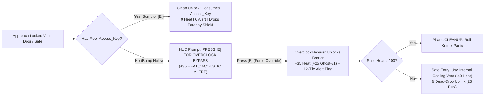

# Interactive Environments & Hybrid ProcGen System

The **Interactive Environments System** establishes the physical combat and scavenging spaces for *Nirmata Runner*, expanding the turn-based extraction loop with dynamically generated floor layouts that combine bespoke, pre-authored tactical chambers with algorithmically generated room structures and interactive prop nodes. Operating within the game's server-authoritative Entity-Component-System (ECS) engine and rendered via a **PixiJS 8** WebGL graphics layer with a **Next.js / React 19** interface overlay, this system provides procedural floor variety while ensuring tactical depth for scavenging software modules, physical equipment, and core currencies.

---

## 1. System Overview & Architectural Objectives

The architecture integrates client-side rendering with server-authoritative simulation across three core layers:

* **Client Render & Overlay Layer**: Built with React UI overlays ([`InventoryOverlay.tsx`](../../src/components/ui/inventory/InventoryOverlay.tsx), [`MessageLog.tsx`](../../src/components/ui/MessageLog.tsx), and `ContainerOverlay.tsx`) for item management and container interactions, backed by a PixiJS 8 WebGL canvas ([`src/rendering/`](../../src/rendering/)) rendering high-contrast 32×32 pixel sprites, particle emitters, scanlines, and state-driven outline shaders.
* **Network & State Replication Protocol**: Synchronizes state via authoritative Next.js REST endpoints ([`POST /api/action`](../../src/app/api/action/route.ts)), validating player movement and interaction intents ([`ActionRequestSchema`](../../src/shared/types.ts)) on the server and returning component-level ECS deltas ([`createECSWorldDelta`](../../src/shared/ecs-delta.ts)), grid diffs (`json-diff-ts`), and [`GameplayEvents`](../../src/shared/events/types.ts) for client reconciliation ([`reconciliation.ts`](../../src/shared/reconciliation.ts)).
* **Server-Authoritative ECS Engine**: Houses floor generation in [`src/game/generation/`](../../src/game/generation/) ([`dungeon-generator.ts`](../../src/game/generation/dungeon-generator.ts), [`entity-placement.ts`](../../src/game/generation/entity-placement.ts)) and turn-based gameplay systems in [`src/game/systems/`](../../src/game/systems/). During floor initialization and transitions ([`FloorManagerSystem`](../../src/game/systems/floor-manager.ts)), the generator constructs the layout, rolls floor-wide Sector Conditions, and seeds interactive props; during the turn cycle, `PropInteractionSystem` validates adjacency, bump-to-loot safeguards, and action economy costs within the deterministic 6-phase loop.

### Key Architectural Objectives
* **Hybrid Procedural Architecture**: Combine a capped allocation of pre-authored room prefabs (`maxBespokeRoomsPerFloor`) with Binary Space Partitioning (BSP) procedural rooms and A* corridors on the standard `80 × 45` tile grid ([`DEFAULT_GRID_WIDTH`](../../src/shared/constants.ts) × [`DEFAULT_GRID_HEIGHT`](../../src/shared/constants.ts)).
* **Server-Authoritative Interaction**: Validate all prop state transitions, search actions, vault breaches, dead-drop transmissions, loot rolls, and item transfers on the server engine (`isClient: false`) to maintain competitive integrity across **Weekly One-Shot (`WEEKLY`)** and **Daily Challenge (`DAILY`)** modes.
* **Turn-Based Scarcity Integration**: Bind environmental interactions directly to the turn-based action economy. Every physical search, terminal hack, or vault breach costs **1 Action Turn**, advancing the turn tick and consuming **Reality Stability** (`0.01` base bleed per turn, scaled by $1.1^{\text{floor}-1}$) while allowing patrolling enemies to close distance.
* **Aesthetic Alignment with "Vibrant Decay"**: Ground all room geometries, visual shaders, corporate forensics logs, and interactive node feedback in the high-contrast **"Oversaturated Dread"** aesthetic, pairing crisp monochrome typography (`#000000` / `#FFFFFF`) with **Neon Cyan (`#00F0FF`)** for secure nodes, **Safety Orange (`#FF9500`)** for encrypted/locked security barriers, and **Electric Pink (`#FF0055`)** for corrupted or thermal-risk props.

---

## 2. Hybrid Generation Pipeline: Macro-ProcGen & Micro-Handmade Rooms

To maintain structural variety while avoiding the open, unstructured voids common in pure random generation, the level construction pipeline ([`generateDungeon`](../../src/game/generation/dungeon-generator.ts) & [`placeEntities`](../../src/game/generation/entity-placement.ts)) employs a hybrid layout algorithm. Floor generation is deterministically seeded using the run key string `${runSeed}_floor_${currentFloor}`, ensuring 100% reproducible layouts across competitive seeds.

Level generation executes as a four-stage pipeline during run launch ([`engine-factory.ts`](../../src/game/engine-factory.ts)) and floor descent ([`floor-manager.ts`](../../src/game/systems/floor-manager.ts)):

1. **BSP Partitioning, Sector Condition Roll & Grid Allocation**: Initializes the `80 × 45` tile [`Grid`](../../src/engine/grid/grid.ts), rolls the floor's faction theme and optional **Sector Condition** (on Floors 6–15), and partitions sub-regions based on the active floor's depth band ([`depth-config.json`](../../src/game/generation/depth-config.json)).
2. **Bespoke Room Selection & Stamping**: Selects up to `maxBespokeRoomsPerFloor` pre-authored room prefabs matching the floor's depth band and faction theme, stamping them into qualifying BSP leaf partitions.
3. **Algorithmic Room Carving & Dynamic Tagging**: Generates procedural rectangular or composite rooms for the remaining BSP leaf nodes and dynamically evaluates wall contours to tag prop anchor points.
4. **Corridor Stitching & Prop Seeding**: Connects bespoke portal coordinates and procedural room centers via A* / L-corridors, injects flanking loops, validates flood-fill connectivity ([`validateConnectivity`](../../src/engine/generation/flood-fill.ts)), and spawns interactive prop entities across tagged anchor points.

### 2.1 Bespoke Room Allocation (`maxBespokeRoomsPerFloor`)

To prevent over-saturation of repetitive pre-authored layouts, floor configurations enforce an upper bound on hand-crafted room prefabs per generated floor:

$$\text{Bespoke Room Limit} = \min(\text{maxBespokeRoomsPerFloor}, \text{Eligible BSP Leaf Nodes})$$

| Depth Band | Floor Range | `maxBespokeRoomsPerFloor` | Structural Focus |
| :--- | :---: | :---: | :--- |
| **`CORRUPTED_DATA`** | Floors `1–5` | `1` | Baseline storage hubs, tutorial sightlines, and low-risk scavenging chambers. |
| **`STATIC_HORRORS`** | Floors `6–10` | `2` | Faction combat spaces, cover-heavy choke points, and locked high-tier data vaults. |
| **`LOGIC_BREAKERS`** | Floors `11–15` | `3` | High-risk core vaults, hazard chambers, and mini-boss arenas (`System_Admin` / `Seed_Eater`). |

#### Bespoke Prefab Schema (`src/game/generation/prefabs/`)
Bespoke prefabs are authored as JSON templates validated by Zod:

```typescript
export interface RoomPrefabTemplate {
  id: string;
  name: string;
  faction: 'traxus' | 'cyberacme' | 'sekiguchi' | 'nucaloric';
  isVaultRoom?: boolean;
  /** When true, interior tiles block Phase_Shift.sh teleportation and wall-penetrating FOV while SecurityLock.isLocked is true */
  faradayShielded?: boolean;
  minFloor: number;
  maxFloor: number;
  width: number;  // 10 to 16 tiles
  height: number; // 10 to 16 tiles
  /** ASCII rows: '#' = wall, '.' = floor, '+' = door, 'V' = encrypted vault door, '~' = dead-zone hazard */
  layout: string[];
  /** Explicit corridor attachment portals on the room perimeter */
  portals: Array<{ x: number; y: number; direction: 'north' | 'south' | 'east' | 'west' }>;
  /** Authored prop spawn coordinates */
  propSpawns: Array<{ x: number; y: number; anchorType: PropAnchorTag; guaranteedTemplate?: string }>;
}
```

### 2.2 Algorithmic Room Generation & Dynamic Anchor Tagging

All BSP leaf nodes beyond `maxBespokeRoomsPerFloor` are constructed algorithmically:

1. **Bounding Box Allocation**: Subdivides remaining BSP leaves into room footprints (`5 × 5` to `18 × 18` tiles depending on [`depth-config.json`](../../src/game/generation/depth-config.json)).
2. **Tile & Interior Obstacle Generation**: Carves walkable floor tiles (`terrain: 'floor'`, `walkable: true`, `transparent: true`) enclosed by structural walls. Based on the active faction template, internal pillars (`walkable: false`, `transparent: false`) or low-cover barrier props (`walkable: false`, `transparent: true`) are placed.
3. **Dynamic Prop Anchor Tagging**: Because procedural rooms lack pre-authored coordinates, the generator scans each room's interior perimeter (excluding tiles within 1 tile of a `door` portal to prevent pathing blockages) to classify valid anchor points:
   * **`PROP_DESK_CORNER`**: Floor tiles orthogonally adjacent to two perpendicular wall faces (interior corners); ideal for server terminals and workstations.
   * **`PROP_LOCKER_WALL`**: Floor tiles adjacent to a straight wall segment with an unobstructed orthogonal front tile; ideal for security lockers and bio-cabinets.
   * **`SURFACE_TABLE_TOP`**: Interior tiles at least 2 tiles away from walls; used for low-cover worktables and loose surface pickups.
   * **`CONTAINER_RARE`**: Central tiles in large rooms (`area >= 100` tiles), Challenge Rooms (`isChallengeRoom`), or Treasure Rooms (`isTreasureRoom`); used for encrypted safes, Reality Stabilizer Nodes, or tactical cooling vents.

### 2.3 Corridor Stitching, Flanking Loops & Hazards

Once bespoke and algorithmic rooms are positioned on the grid, the generator connects room portals:

* **Minimum Spanning Network**: Connects primary room centers and prefab portals to guarantee 100% reachability from `playerSpawnRoom`.
* **Cycle Insertion Rate (`15%–25%`)**: Re-adds a percentage of secondary graph edges to create flanking loops, preventing single-corridor stalemates against [`Fragmenter`](../../src/game/entities/templates/fragmenter.json) or [`System_Admin`](../../src/game/entities/templates/system-admin.json) units.
* **Corridor Hazard Injection**: On deep floors (`Floors 11–15`), secondary loop corridors have a `30%` chance to seed persistent [`DeadZone`](../../src/shared/components/dead-zone.ts) tiles (`damagePerTick: 2`), forcing players to weigh short, hazardous flanking routes against longer, safer detours.

### 2.4 Faction Environmental Theme Matrix

Each generated floor selects a dominant corporate faction theme (seeded deterministically from `floorSeed`), governing visual tile tinting, corporate forensics logs, prop distribution weights, and primary loot tables:

| Faction Theme | Visual Aesthetic & Color Profile | Dominant Prop Types | Primary Loot Profile |
| :--- | :--- | :--- | :--- |
| **Traxus Freight** | Heavy industrial steel, hazard striping, safety orange / dark teal accents | Reinforced Cargo Lockers, Freight Crates, Weapon Racks | Physical Weapons (`rifle-v1..v3`), Armor (`armor-v1..v3`), Raw Scrap |
| **CyberAcme Mainframe** | Cleanroom white tiles, cobalt LED arrays, fiber-optic floor conduits | Server Racks, Terminal Workstations, Subnet Consoles | Software Modules (`Bleed.exe`, `Auto-Loader.msi`, `Vampire.exe`), Neural Blueprints |
| **Sekiguchi Gene-Labs** | Mint-green sterile panels, glass bio-containment vats | Bio-Containment Cabinets, Cryo-Vats, Reality Stabilizers | Nanite Repair Syringes (`health-potion`), Flux Canisters (`5–50`), Augment Blueprints |
| **NuCaloric Storage** | High-contrast pink/white composite plates, automated supply vends | Supply Vending Units, Refrigerated Lockers, Cooling Vents | Utility Software, Flux Canisters, Raw Scrap, Thermal Dissipation |

### 2.5 Deterministic Sector Conditions (Floor-Wide Environmental Modifiers)

On Floors `6–15`, each floor has a **`25%` chance** (rolled deterministically from `floorSeed` and stored on [`FloorState`](../../src/shared/components/floor-state.ts)) to activate a floor-wide **Sector Condition**. When active, a HUD telemetry banner announces the condition upon floor entry (`SECTOR_STATUS // {CONDITION}`), pairing a systemic environmental hazard with a high-upside scavenging reward:

| Sector Condition | Roll Weight (`Floors 6–15`) | Systemic Hazard | Scavenging / Tactical Upside |
| :--- | :---: | :--- | :--- |
| **`NOMINAL`** | `75%` | Standard baseline floor rules. | Standard baseline prop spawns and yields. |
| **`THERMAL_SURGE`** | `10%` | Passive Shell Heat dissipation in [`HeatSystem`](../../src/game/systems/heat.ts) is **halved (`0.5x`)**. | Encrypted Workstations cost **`0` Heat** to access, and `+1` extra **Thermal Cooling Vent** (`-40` Heat) spawns on the floor. |
| **`DARK_SUBNET`** *(Blackout)* | `8%` | Base player FOV radius drops by **`2` tiles** (`6` instead of `8`). | All unsearched Interactive Props emit a beacon pulse visible through fog-of-war, and `CorruptedNode` acoustic alert radius is **halved (`5` tiles)**. |
| **`OVERCLOCKED_GRID`** | `7%` | Per-turn Reality Stability bleed in [`StabilitySystem`](../../src/game/systems/stability.ts) runs **`1.25x` faster**. | All Container Scrap and Flux yields are boosted by **`+50%`**, and **`2` Reality Stabilizer Nodes** (`+10%` Stability each) spawn instead of `1`. |

---

## 3. Room Categories, High-Tier Vaults & Tactical Encounter Design

The environment generator pairs room geometry with enemy AI behaviors ([`AISystem`](../../src/game/systems/ai.ts)), security barriers, and cover mechanics to create distinct tactical puzzles.

### 3.1 Bespoke Handcrafted Prefabs
* **The Server Core (CyberAcme)**: Parallel rows of server racks forming narrow 1-tile aisles. Restricts diagonal movement and line-of-sight, creating high-risk choke points where [`Buffer-Overflow`](../../src/game/entities/templates/buffer-overflow.json) packs attempt to surround the player's 4 cardinal tiles to trigger their `8`-damage simultaneous detonation ([`pack-coordinator.ts`](../../src/game/systems/pack-coordinator.ts)).
* **The Freight Bay (Traxus)**: Open industrial hall with central cargo containers providing **Directional Low Cover** (`25%` incoming ranged damage reduction). Long sightlines favor [`Logic-Leaker`](../../src/game/entities/templates/logic-leaker.json) ranged kiters, which fire corrupted packets from range `3–5` (`5` neural damage + `3`-turn `FIRMWARE_LOCK`) while retreating behind cover crates.
* **The Decontamination Airlock (Sekiguchi)**: Dual narrow entry airlocks leading into a central bio-chamber lined with volatile Cryo-Vats. Paired with [`Fragmenter`](../../src/game/entities/templates/fragmenter.json) heavy units whose melee slams spawn 6-turn [`DeadZone`](../../src/shared/components/dead-zone.ts) hazards across cardinal tiles, threatening to seal the airlock exits.
* **The Zero-Day Vault (All Factions, Floors 6–15)**: A reinforced high-security treasure chamber sealed behind an **Encrypted Vault Blast Door** (`SecurityLock` component). Contains:
  1. **Encrypted Core Safe**: Guaranteed `v2`–`v3` gear/software + `1` Locked Blueprint + `30–50` Flux.
  2. **Thermal Cooling Vent**: Purges `40` Heat safely after an Overclock Bypass.
  3. **Telemetry Dead-Drop Uplink** *(Floors 6–14)*: Single-use terminal allowing the player to spend `25` Flux to permanently extract 1 prized item or Blueprint mid-run.

### 3.2 Locked High-Tier Vault Rooms, Dual-Path Breaching & Faraday Shielding

On Floors `6–15`, bespoke Vault Rooms and rare `CONTAINER_RARE` Encrypted Safes spawn with a `SecurityLock` barrier. Players have two strategic paths to breach a locked vault door or encrypted safe:



1. **Path A: Cryptographic Keycard (`Access_Key`)**:
   * Whenever a floor generates a `SecurityLock` entity, [`entity-placement.ts`](../../src/game/generation/entity-placement.ts) guarantees that one Tier 2/3 Elite enemy (`Fragmenter`, `Logic-Leaker`, or `Seed_Eater`) or a secondary Subnet Console on the same floor carries a floor-scoped `Access_Key` (`FloorState.accessKeysHeld`).
   * Interacting with a locked vault door or safe while holding an `Access_Key` consumes `1` key and unlocks it cleanly with **zero Neural Heat** and **zero acoustic noise**.
2. **Path B: Intentional Overclock Bypass ("Brute-Force Neural Surge")**:
   * If the player wants to save turns and Reality Stability rather than hunting down the key-holder across the floor, they can press `KeyE` to execute an **Overclock Bypass** (`forceOverride: true`).
   * **Thermal & Tactical Cost**: Injects **`+35` Neural Heat** (`+25` Heat for [`GHOST-v1`](../../src/game/shells/shared/templates/ghost-v1.json)) directly into the Shell and emits a **12-tile Acoustic Alert** that wakes nearby enemies and draws patrols toward the vault entrance.
   * **Build Synergy**: Turning Neural Heat capacity into a universal dungeon lockpick rewards players who manage their heat bar, pre-vent before breaching, or equip Overclock-synergy Augments (`Thermal_Bypass.arc`, `Displacement_Venting.arc`).
3. **Faraday Cage Shielding (Teleport & Vision Exploit Guard)**:
   * While a Vault Room's `SecurityLock.isLocked === true`, all interior tiles of the vault prefab carry a **Faraday Shield** state (`blocksTeleport: true` and opaque to wall-penetrating FOV from [`Extended_Sight.sys`](../../src/game/entities/templates/extended-sight.json) or [`GHOST_PULSE.exe`](../../src/game/entities/templates/ghost-pulse.json)).
   * This prevents [`Phase_Shift.sh`](../../src/game/entities/templates/phase-shift.json) from bypassing the `SecurityLock` or accidentally soft-locking a player inside an unopened vault when afflicted by `FIRMWARE_LOCK`. Unlocking the Vault Door immediately deactivates the Faraday Shield across the room's interior tiles.

### 3.3 Directional Cover & Destructible Obstacles
* **Low-Cover Props (`InteractiveSurface`)**: Worktables, freight crates, and low server consoles block normal walking ([`BlocksMovement`](../../src/shared/components/blocks-movement.ts)) while remaining transparent to line-of-sight (`transparent: true`) and allowing [`Phase_Shift.sh`](../../src/game/entities/templates/phase-shift.json) to teleport over them.
* **Cover Damage Mitigation**: When a ranged attack (`Logic-Leaker` packet or ranged Firmware) resolves in [`CombatSystem`](../../src/game/systems/combat.ts), if the target is orthogonally adjacent to a cover prop positioned between the attacker and defender, incoming damage is reduced by **`25%`** (**`35%`** for the heavy [`BASTION-v1`](../../src/game/shells/shared/templates/bastion-v1.json) Shell).
* **Destructible Props & Breaching**: Cover props carry a structural [`Health`](../../src/shared/components/health.ts) pool (`10–20 HP`). Heavy melee slams (`Fragmenter`), dash impacts (`KINETIC_LINK.exe`), or area explosions destroy cover entities via the [`Dying`](../../src/shared/components/dying.ts) protocol (`reason: 'environmental_destruction'`). [`System_Admin`](../../src/game/entities/templates/system-admin.json) units automatically crush destructible props in their path so they cannot be permanently body-blocked.

---

## 4. Interactive Prop Taxonomy, Safeguards & Action Economy

To prevent scavenging from feeling like repetitive "loot-box clicking," interactive props are divided into three functional classes: **Scavenge Containers**, **Tactical World Terminals**, and **Volatile Hazards**.

### 4.1 Functional Prop Classes

#### A. Scavenge Containers (Lockers, Workstations, Bio-Cabinets, Encrypted Safes)
* **Workstations & Encrypted Terminals (CyberAcme)**:
  * **Yield**: Software modules (`v0`–`v3`), locked [`Neural Blueprints`](../../src/game/entities/templates/blueprint-locked.json), and Raw Scrap.
  * **Thermal Cost**: Accessing an encrypted workstation injects **`+10` Neural Heat** (`+5` Heat for [`GHOST-v1`](../../src/game/shells/shared/templates/ghost-v1.json); `0` Heat during `THERMAL_SURGE`).
* **Security Lockers & Heavy Crates (Traxus)**:
  * **Yield**: Physical weapons (`rifle-v1..v3`), armor (`armor-v1..v3`), high-density Raw Scrap (`15–50`), and Augment Blueprints.
* **Bio-Dispensers & Supply Vends (Sekiguchi / NuCaloric)**:
  * **Yield**: Nanite repair consumables (triggering immediate [`HealIntent`](../../src/shared/components/intents.ts) on use), Flux canisters (`5–50`), and utility Software.
* **Encrypted Core Safes (`CONTAINER_RARE`)**:
  * **Yield**: High-tier Software/Equipment (`v2`–`v3`), `30–50` Flux, and guaranteed Blueprint rolls. Protected by `SecurityLock` (requires `Access_Key` or `+35` Heat Overclock Bypass).

#### B. Tactical World Terminals (Non-Loot Utility Nodes)
* **Telemetry Dead-Drop Uplinks (`dead_drop_uplink`, Floors 6–14 Vaults)**:
  * **Single-Item Mid-Run Insurance**: Spending **`25` Flux** and **1 Action Turn** (`DEAD_DROP_ITEM` action) transmits **1 selected unsecured item or Blueprint** from the player's [`RunInventory`](../../src/shared/components/run-inventory.ts) directly into their persistent Profile Vault (`securedViaDeadDrop`). Even if the player later dies on a deeper floor before reaching a Floor 10/15 Stability Anchor, any dead-dropped item is permanently retained.
* **Reality Stabilizer Nodes (`reality_stabilizer`, Floors 6–15 Challenge Rooms)**:
  * **Offsetting the Scavenging Turn Tax**: Single-use quantum anchor capacitors (`1` per floor on Floors 6–15; `2` during `OVERCLOCKED_GRID`). Interacting costs **1 Action Turn** and restores **`+10%` Reality Stability** (`Stability.current = Math.min(100, Stability.current + 10)`), rewarding players who fight through dangerous Challenge Rooms with extra time on the floor clock.
* **Thermal Cooling Vents (`cooling_vent`)**:
  * **Safe Heat Purge**: Single-use industrial heat sinks. Interacting costs **1 Action Turn** and immediately purges **`40` Neural Heat** *without* stripping the player's Armor (unlike manual `VENT`, which zeroes Armor for 1 turn).
* **Subnet Recon Consoles (`subnet_console`)**:
  * **Floor Telemetry**: Spending **1 Action Turn** and **`+15` Neural Heat** pulses the floor's local network, revealing the room layout, the [`StaircaseMarker`](../../src/shared/components/staircase-marker.ts) / [`AnchorMarker`](../../src/shared/components/anchor-marker.ts) position, and identifying all Corrupted Nodes and Vault rooms on the current floor.
* **Blast Bulkhead Switches (`bulkhead_switch`)**:
  * **Door Control**: Toggles adjacent pneumatic `door` tiles between open (`walkable: true, transparent: true`) and sealed (`walkable: false, transparent: false, hp: 30`), allowing tactical players to delay a pursuing `System_Admin` or funnel a `Buffer-Overflow` pack.

#### C. Volatile Environmental Props & Cascade Chain Reactions
* **Cryo-Containment Vats (`volatile_vat`, Sekiguchi)**: Fragile (`10 HP`) glass vats. When destroyed by ranged fire or melee, they shatter into a `3 × 3` chemical hazard (`cryo_spill`) that applies `MOVEMENT_SLOW` (`2` turns, magnitude `50`) and deals `4` damage to all entities in the blast footprint.
* **Overcharged Capacitor Banks (`capacitor_bank`, CyberAcme)**: Destroying the capacitor releases an EMP arc (`emp_arc`) across a `2`-tile Manhattan radius, dealing `10` neural damage and applying `DISRUPT` (`2` turns) to affected enemies—offering a tactical tool to stun an otherwise invulnerable `System_Admin`.
* **Cascade Chain Reaction Rule**: When any volatile `InteractiveSurface` (`hazardOnDestroy !== 'none'`) is destroyed during `Phase.REACTION`, its blast deals `15` structural damage to any other destructible `InteractiveSurface` or armed `CorruptedNode` within Manhattan distance `<= 2` (guarded by a `visited` entity set to prevent cyclic recursion). This allows players to kite a [`Buffer-Overflow`](../../src/game/entities/templates/buffer-overflow.json) swarm or [`Fragmenter`](../../src/game/entities/templates/fragmenter.json) into a lab and detonate an entire row of vats and capacitors with a single ranged [`Neural_Spike.exe`](../../src/game/entities/templates/neural-spike.json) shot.

### 4.2 Bump-to-Loot Safeguard Protocol & Turn Economy

Because [`InputManager`](../../src/game/input/input-manager.ts) buffers rapid movement keystrokes, walking into props uses a **Two-Tier Bump Safeguard** in [`MovementSystem`](../../src/game/systems/movement.ts) so players enjoy frictionless scavenging on safe containers without ever accidentally walking into a trap or triggering an unwanted Overclock:

| Target Prop State | Bump Behavior (`MoveIntent` into Prop Tile) | Explicit `[E]` Key Behavior (`INTERACT_PROP`) |
| :--- | :--- | :--- |
| **Clean & Safe Prop**<br>(`#00F0FF` — Not corrupted, unlocked, and `Heat + cost <= 100`) | **Auto-Interacts**: `MovementSystem` converts `MoveIntent` into `InteractPropIntent(forceOverride: false)` in the same turn tick. | **Interacts Normally**: Executes `InteractPropIntent` on the adjacent prop. |
| **Corrupted Prop Node**<br>(`#FF0055` — Active `CorruptedNode` trap) | **Halts & Warns (`0` Turn Cost)**: Cancels movement, flushes the input buffer (`clearQueue()`), and emits: `[WARNING] CORRUPTED NODE — PRESS [E] TO FORCE ACCESS`. | **Forces Access**: Executes `InteractPropIntent(forceOverride: true)`, looting the prop and triggering the trap payload. |
| **Locked Vault / Overclock Risk**<br>(`#FF9500` — `SecurityLock` without Key, or `Heat + cost > 100`) | **Halts & Warns (`0` Turn Cost)**: Cancels movement, flushes input buffer, and emits: `[WARNING] OVERCLOCK BYPASS REQUIRED (+35 HEAT) — PRESS [E] TO BREACH`. | **Executes Overclock Bypass**: Injects `+35` Heat (`+25` Ghost-v1), unlocks the barrier, and triggers the 12-tile acoustic ping. |

#### Streamlined Loot Resolution (Anti-Friction Rule)
* **Instant Transfer (Currency & Open-Slot Items)**: When `PropInteractionSystem` resolves a search on a surface pickup or a container whose items fit directly into open [`RunInventory`](../../src/shared/components/run-inventory.ts) slots (or consist purely of `scrap`, `flux`, `blueprint`, or `Access_Key`), items transfer immediately during `Phase.ACTION` with floating HUD feedback (`+20 SCRAP // +1 ACCESS_KEY`) and **no modal popup**.
* **Full Container Modal (`ContainerOverlay.tsx`)**: If a searched container holds weapons, armor, or software that cannot auto-stack because the player's [`RunInventory`](../../src/shared/components/run-inventory.ts) is full, the client opens `ContainerOverlay.tsx`. Swapping items between the open container and backpack slots resolves atomically without costing extra movement turns.

### 4.3 Corrupted Prop Nodes & Firmware Counterplay

A depth-scaled percentage of generated props (`10%` on Floors 1–5, `18%` on Floors 6–10, `25%` on Floors 11–15) spawn with a `CorruptedNode` component—or become corrupted dynamically when hit by a [`Seed_Eater`](../../src/game/entities/templates/seed-eater.json)'s expanding [`TileCorruptionSystem`](../../src/game/systems/tile-corruption.ts) wave:

* **Trap Payloads (Triggered on forced `[E]` interaction)**:
  * **`hud_glitch`**: Applies `HUD_GLITCH` (`2` turns) via `ApplyStatusEffectIntent`, scrambling HUD telemetry.
  * **`acoustic_alert`**: Emits a 10-tile acoustic ping (`5` tiles during `DARK_SUBNET`), waking dormant room enemies and causing the nearest [`Null-Pointer`](../../src/game/entities/templates/null-pointer.json) within range `8` to execute an immediate `TeleportIntent` behind the player.
  * **`thermal_dump`**: Injects **`+20` Neural Heat** directly into the player's Shell before [`KernelPanicSystem`](../../src/game/systems/kernel-panic.ts) runs.
* **Firmware Counterplay**:
  * **Recon Identification ([`Extended_Sight.sys`](../../src/game/entities/templates/extended-sight.json) / [`GHOST_PULSE.exe`](../../src/game/entities/templates/ghost-pulse.json))**: Scanning a room with active vision Firmware sets `CorruptedNode.revealed = true`, displaying the exact `trapType` and hidden loot tier on the hover tooltip.
  * **EMP Disarm ([`LOGIC_JAM.exe`](../../src/game/entities/templates/logic-jam.json))**: Targeting a Corrupted Node with `LOGIC_JAM.exe` (`20` Heat) sets `CorruptedNode.isDisarmed = true`, neutralizing the trap, converting the prop to a clean `#00F0FF` state, awarding `+50` Leaderboard Score, and triggering `ON_HACK` Augment synergies.

### 4.4 Environmental Augment Triggers & New Augment Templates

To weave environmental interactions directly into combat builds, [`ConditionNodeSchema`](../../src/shared/components/augment-data.ts) and [`createTriggerContext`](../../src/game/systems/augment-util.ts) are extended with two environmental trigger conditions evaluated during `Phase.REACTION`:

* **`ON_HACK`**: Evaluates to `true` when the player has the transient `PropInteractedThisTurn` tag from searching a container, hacking a terminal/subnet console, activating a Reality Stabilizer, disarming a `CorruptedNode` with `LOGIC_JAM.exe`, or breaching a `SecurityLock`.
* **`ON_COVER_BROKEN`**: Evaluates to `true` when any entity with `InteractiveSurface` enters the [`Dying`](../../src/shared/components/dying.ts) state (`reason: 'environmental_destruction'`) with `killerId === playerId` during the current turn.

#### Environmental Augment Templates (`src/game/entities/templates/`)
| Template | Name | Trigger Tree | Payload | Cooldown / Max per Turn | Tactical Role |
| :--- | :--- | :--- | :--- | :---: | :--- |
| `scavenger-siphon.json` | `Scavenger_Siphon.arc` | `ON_HACK` | `SHIELD`: Grants `6` Shield (`1` turn) + `VENT_HEAT`: Vents `10` Heat. | `1` turn CD / `1` per turn | Enables aggressive mid-combat looting and terminal hacking to absorb incoming fire. |
| `kinetic-breacher.json` | `Kinetic_Breacher.arc` | `ON_COVER_BROKEN` | `DAMAGE_BONUS`: Grants `+30%` attack damage (`2` turns). | `2` turns CD / `1` per turn | Rewards [`VANGUARD-v1`](../../src/game/shells/shared/templates/vanguard-v1.json) players for smashing through crates and triggering Cryo-Vat chain reactions. |
| `thermal-bypass.json` | `Thermal_Bypass.arc` | `AND(ON_HACK, ON_OVERCLOCK)` | `VENT_HEAT`: Instantly vents `25` Heat + `HEAL`: Restores `4` HP. | `3` turns CD / `1` per turn | Turns `+35` Heat Vault Overclock Bypasses and high-heat terminal hacks into a self-sustaining recovery loop. |

### 4.5 Zero-Friction "Corporate Forensics" Micro-Logs ([`MessageLog.tsx`](../../src/components/ui/MessageLog.tsx))

To capture *Marathon*'s signature terminal storytelling without interrupting turn-based pacing with blocking text modals, accessing any CyberAcme Workstation, Subnet Console, or Zero-Day Vault emits a faction-keyed **1-line Corporate Forensics snippet** directly into [`MessageLog.tsx`](../../src/components/ui/MessageLog.tsx) via `MESSAGE_EMITTED` (`type: 'info'`):

* **Traxus Freight**: `[TRAXUS_MANIFEST_09]: "Bulkhead 12 sealed by automated edict. Cargo mass increased by 400% during transit."`
* **CyberAcme Mainframe**: `[CYBERACME_SYS_404]: "Warning: Recursive process 'Seed_Eater' has overwritten backup sector indices."`
* **Sekiguchi Gene-Labs**: `[SEKIGUCHI_LAB_88]: "Cryo-batch 9 exhibits spontaneous neural compiling. Do not unseal containment."`
* **NuCaloric Storage**: `[NUCALORIC_VEND_14]: "Caloric ration synthesis halted. All biomass diverted to sub-level 15 anchor."`

---

## 5. Server-Authoritative ECS Architecture, Scoring & Zod Schemas

In compliance with [`AGENTS.md`](../../AGENTS.md) Mandate #3 and #5, all environmental components are defined using [`defineComponent`](../../src/engine/ecs/types.ts) with **Zod** schemas in `src/shared/components/`, registered in [`COMPONENTS_REGISTRY`](../../src/shared/components/index.ts), and mutated exclusively via `world.patchComponent()` or `world.addComponent()`.

### 5.1 Zod Component Definitions (`src/shared/components/environment.ts`)

```typescript
import { z } from 'zod';
import { defineComponent } from '@engine/ecs/types';

export const FactionThemeSchema = z.enum([
  'traxus',
  'cyberacme',
  'sekiguchi',
  'nucaloric',
  'system',
]);

export const SectorConditionSchema = z.enum([
  'NOMINAL',
  'THERMAL_SURGE',
  'DARK_SUBNET',
  'OVERCLOCKED_GRID',
]);
export type SectorCondition = z.infer<typeof SectorConditionSchema>;

export const Prop = defineComponent(
  'prop',
  z.object({
    propId: z.string(),
    faction: FactionThemeSchema,
    propClass: z.enum([
      'workstation',
      'locker',
      'cabinet',
      'surface_table',
      'encrypted_safe',
      'vault_door',
      'dead_drop_uplink',
      'reality_stabilizer',
      'cooling_vent',
      'subnet_console',
      'bulkhead_switch',
      'volatile_vat',
      'capacitor_bank',
    ]),
    isSearched: z.boolean().default(false),
    heatCostOnAccess: z.number().default(0),
    ventAmount: z.number().default(0),
    stabilityRestoreAmount: z.number().default(0),
    deadDropFluxCost: z.number().int().min(0).default(25),
    loreSnippetId: z.string().optional(),
  }),
);
export type PropData = z.infer<typeof Prop.schema>;

export const SecurityLock = defineComponent(
  'securityLock',
  z.object({
    isLocked: z.boolean().default(true),
    keyIdRequired: z.string().default('access_key'),
    overclockHeatCost: z.number().int().min(0).default(35),
    alertRadiusOnBypass: z.number().int().min(0).default(12),
    /** Optional bounding box of interior room tiles protected by Faraday shielding while locked */
    faradayBounds: z
      .object({
        x: z.number().int(),
        y: z.number().int(),
        width: z.number().int(),
        height: z.number().int(),
      })
      .optional(),
  }),
);
export type SecurityLockData = z.infer<typeof SecurityLock.schema>;

export const Container = defineComponent(
  'container',
  z.object({
    containerId: z.string(),
    capacity: z.number().int().min(1).max(8).default(4),
    /** Child entity IDs of spawned items stored inside this container (also tracked via Children component) */
    itemEntityIds: z.array(z.number().int()).default([]),
    scrapYield: z.number().int().min(0).default(0),
    fluxYield: z.number().int().min(0).default(0),
    grantsAccessKey: z.boolean().default(false),
    blueprintId: z.string().optional(),
    blueprintType: z.enum(['firmware', 'augment']).optional(),
  }),
);
export type ContainerData = z.infer<typeof Container.schema>;

export const InteractiveSurface = defineComponent(
  'interactiveSurface',
  z.object({
    surfaceId: z.string(),
    providesCover: z.boolean().default(true),
    coverDamageReduction: z.number().min(0).max(1).default(0.25),
    destructible: z.boolean().default(true),
    hazardOnDestroy: z.enum(['none', 'cryo_spill', 'emp_arc', 'thermal_burst']).default('none'),
    cascadeRadius: z.number().int().min(0).default(2),
  }),
);
export type InteractiveSurfaceData = z.infer<typeof InteractiveSurface.schema>;

export const CorruptedNode = defineComponent(
  'corruptedNode',
  z.object({
    corruptionLevel: z.number().int().min(1).max(3).default(1),
    trapType: z.enum(['hud_glitch', 'acoustic_alert', 'thermal_dump']),
    isDisarmed: z.boolean().default(false),
    triggered: z.boolean().default(false),
    revealed: z.boolean().default(false),
  }),
);
export type CorruptedNodeData = z.infer<typeof CorruptedNode.schema>;

export const InteractPropIntent = defineComponent(
  'interactPropIntent',
  z.object({
    targetPropId: z.number().int(),
    /** True when explicitly triggered via [E] key to bypass CorruptedNode or Overclock safeguards */
    forceOverride: z.boolean().default(false),
    /** Optional inventory item entity ID or blueprint ID when transmitting via a Dead-Drop Uplink */
    deadDropSelectionId: z.union([z.number().int(), z.string()]).optional(),
  }),
);
export type InteractPropIntentData = z.infer<typeof InteractPropIntent.schema>;

export const PropInteractedThisTurn = defineComponent(
  'propInteractedThisTurn',
  z.object({
    propEntityId: z.number().int(),
    propClass: z.string(),
    wasOverclockBypass: z.boolean().default(false),
    wasCorruptedTrap: z.boolean().default(false),
  }),
);
export type PropInteractedThisTurnData = z.infer<typeof PropInteractedThisTurn.schema>;
```

> [!IMPORTANT]
> Container item entities are linked to the container entity via the standard [`Children`](../../src/shared/components/children.ts) component (`childComponentKey: 'children'`). When a floor transitions in [`FloorManagerSystem`](../../src/game/systems/floor-manager.ts) and marks uncollected container entities with [`Dying`](../../src/shared/components/dying.ts), [`GravediggerSystem`](../../src/game/systems/gravedigger.ts) automatically destroys any unlooted child item entities, preventing orphaned entity memory leaks.

### 5.2 Deterministic Phase Pipeline & System Execution Order

Environmental generation and turn resolution strictly adhere to the 6-phase engine lifecycle ([`src/engine/ecs/types.ts`](../../src/engine/ecs/types.ts)):

| Lifecycle Stage / Phase | System / Module | Authoritative Responsibility |
| :--- | :--- | :--- |
| **Floor Init / Transition** *(Out-of-Turn)* | [`dungeon-generator.ts`](../../src/game/generation/dungeon-generator.ts) & [`entity-placement.ts`](../../src/game/generation/entity-placement.ts) | Executes on run launch or `DescentIntent` resolution in [`FloorManagerSystem`](../../src/game/systems/floor-manager.ts). Rolls `SectorCondition`, stamps up to `maxBespokeRoomsPerFloor` prefabs (including Faraday-shielded Vault chambers on Floors 6–15), carves BSP rooms, tags prop anchors, seeds props, and places a guaranteed `Access_Key` whenever a `SecurityLock` spawns. |
| **`Phase.PRE_TURN`** | [`StabilitySystem`](../../src/game/systems/stability.ts) & [`HeatSystem`](../../src/game/systems/heat.ts) | Applies per-turn Reality Stability bleed ($0.01 \times 1.1^{\text{floor}-1}$, scaled by `1.25x` during `OVERCLOCKED_GRID`) and passive Shell Heat dissipation (`0.5x` during `THERMAL_SURGE`). |
| **`Phase.GATHER_INTENT`** | [`GameTurnAdapter`](../../src/game/turn/game-turn-adapter.ts) / [`route.ts`](../../src/app/api/action/route.ts) | Translates explicit `[E]` (`INTERACT_PROP`) actions into `InteractPropIntent(forceOverride: true)` on the player entity. |
| **`Phase.ACTION` (Step 1)** | [`MovementSystem`](../../src/game/systems/movement.ts) | Evaluates bump collisions against unsearched `Prop` entities. If the prop is clean, unlocked, and safe (`Heat + cost <= 100`), converts `MoveIntent` into `InteractPropIntent(forceOverride: false)`. If gated by `CorruptedNode`, `SecurityLock` (without key), or Overclock risk, halts movement (`0` turn cost) and emits a safeguard prompt. |
| **`Phase.ACTION` (Step 2)** | `PropInteractionSystem` (`src/game/systems/prop-interaction.ts`) | Validates orthogonal adjacency (`manhattanDistance === 1`). Processes `SecurityLock` (consumes `Access_Key` or injects `+35` Overclock Bypass Heat and drops Faraday shielding), restores `+10%` Stability on `reality_stabilizer`, processes `25` Flux Dead-Drop transmissions, emits 1-line Corporate Forensics logs, transfers items via [`InventoryUtil`](../../src/shared/utils/inventory-util.ts), attaches `PropInteractedThisTurn`, and fires `CorruptedNode` trap intents. |
| **`Phase.REACTION`** | [`CombatSystem`](../../src/game/systems/combat.ts), [`AugmentSystem`](../../src/game/systems/augment.ts), [`StatusEffectSystem`](../../src/game/systems/status-effects.ts), [`AISystem`](../../src/game/systems/ai.ts) | Resolves directional cover mitigation (`25%` / `35%`), processes volatile prop hazards (`cryo_spill`, `emp_arc`) with `visited`-guarded cascade chain reactions across nearby volatile props, evaluates `ON_HACK` and `ON_COVER_BROKEN` Augment triggers, and executes `Null-Pointer` / patrol acoustic alert reactions. |
| **`Phase.CLEANUP`** | [`KernelPanicSystem`](../../src/game/systems/kernel-panic.ts) & [`GravediggerSystem`](../../src/game/systems/gravedigger.ts) | Evaluates Overclock tiers if a Vault Overclock Bypass, terminal hack, or `thermal_dump` trap pushed `Heat > 100`. [`GravediggerSystem`](../../src/game/systems/gravedigger.ts) destroys shattered cover props and consumed item entities marked with [`Dying`](../../src/shared/components/dying.ts). |
| **`Phase.POST_TURN`** | [`TileCorruptionSystem`](../../src/game/systems/tile-corruption.ts) & [`TagCleanupSystem`](../../src/game/systems/tag-cleanup.ts) | `Seed_Eater` corruption waves mutate floor tiles and corrupt untouched props in range; `TagCleanupSystem` strips transient `InteractPropIntent` and `PropInteractedThisTurn` tags. |

### 5.3 Floor Prop Budget & Depth-Scaled Loot Tables

To maintain run pacing and prevent inventory bloat, each floor enforces a total **Prop Spawn Budget** alongside depth-scaled loot distributions (extending [`loot-distribution.json`](../../src/game/generation/loot-distribution.json)):

| Depth Band | Floor Prop Budget | Special Utility Spawns | Currency Yields (`Scrap` / `Flux`) | Software & Gear Rarity Weights | Blueprint Drop Odds | Corrupted Prop Rate |
| :--- | :---: | :--- | :--- | :--- | :--- | :---: |
| **Floors 1–5** (`CORRUPTED_DATA`) | `6–8` props | `0%` Vaults (Tutorial Band) | Scrap: `5–15`<br>Flux: `0–5` | `v0` (`60%`), `v1` (`40%`), `v2` (`0%`), `v3` (`0%`) | Common: `10%`<br>Rare: `0%` | `10%` |
| **Floors 6–10** (`STATIC_HORRORS`) | `8–10` props | `50%` Vault/Safe (`+Dead-Drop`)<br>`1` Reality Stabilizer (`+10%`) | Scrap: `15–35`<br>Flux: `5–20` | `v0` (`15%`), `v1` (`55%`), `v2` (`25%`), `v3` (`5%`) | Common: `25%`<br>Rare: `10%` | `18%` |
| **Floors 11–15** (`LOGIC_BREAKERS`) | `10–12` props | `100%` Vault + Safe (`+Dead-Drop`)<br>`1` Reality Stabilizer (`+10%`) | Scrap: `30–50`<br>Flux: `20–50` | `v0` (`0%`), `v1` (`20%`), `v2` (`50%`), `v3` (`30%`) | Common: `40%`<br>Rare: `25%` | `25%` |

### 5.4 Competitive Leaderboard Scoring Integration ([`src/game/scoring.ts`](../../src/game/scoring.ts))

To reward environmental mastery in **Daily (`DAILY`)** and **Weekly One-Shot (`WEEKLY`)** leaderboard modes, [`economy.json`](../../src/game/entities/templates/economy.json) (`scoring`) and [`calculateScore`](../../src/game/scoring.ts) incorporate two environmental bonus multipliers tracked on [`Progression`](../../src/shared/components/progression.ts) / `RunStats`:

* **Vaults / Safes Breached (`vaultsBreached`)**: **`+150` Score** per `SecurityLock` unlocked (via `Access_Key` or Overclock Bypass).
* **Corrupted Nodes Disarmed / Survived (`trapsDisarmed`)**: **`+50` Score** per `CorruptedNode` neutralized with `LOGIC_JAM.exe` or survived via forced override.

$$\text{Total Score} = 100 \cdot \text{Floor} + 1 \cdot \text{Scrap} + 500 \cdot \text{Software} + 10 \cdot \text{Flux} + 150 \cdot \text{VaultsBreached} + 50 \cdot \text{TrapsDisarmed}$$

---

## 6. Visual Identity, Atlas Frame Keys & Shader Architecture

The Interactive Environments System adheres to *Nirmata Runner*'s **"Vibrant Decay"** aesthetic ([`DESIGN-BRIEF.md`](./DESIGN-BRIEF.md)) and 32×32 pixel atlas standards ([`TILEMAP_GUIDE.md`](../TILEMAP_GUIDE.md)):

* **`#000000` (Pure Black)**: Base grid void background and UI modal backings.
* **`#FFFFFF` (Pure White)**: Typography headers, primary UI borders, and active status text.
* **`#00F0FF` (Neon Cyan)**: Secure unsearched props, Reality Stabilizer Nodes, active cooling vents, and clean terminal accents.
* **`#FF9500` (Safety Orange)**: Encrypted Vault Blast Doors, locked Core Safes (`SecurityLock`), Dead-Drop Uplinks, and Overclock Bypass warnings.
* **`#FF0055` (Electric Pink)**: Corrupted prop nodes, thermal hazard warnings, and volatile vats.

### 6.1 Required Spritesheet Frame Keys (`public/assets/tileset.json`)
Dynamic prop entities map to atlas frames via [`Sprite`](../../src/shared/components/sprite.ts) (`{ key: string }`):

| Frame Key | Prop Class | Visual State |
| :--- | :--- | :--- |
| `prop_workstation_active` / `prop_workstation_searched` | CyberAcme Workstation | Lit cyan dual-CRT desk / darkened monitors |
| `prop_locker_closed` / `prop_locker_open` | Traxus Security Locker | Sealed industrial locker / open empty cabinet |
| `prop_biocabinet_full` / `prop_biocabinet_empty` | Sekiguchi Bio-Dispenser | Glowing mint containment cabinet / drained glass |
| `prop_safe_locked` / `prop_safe_open` | Encrypted Core Safe | Heavy orange-trimmed security safe / breached vault door |
| `prop_vault_door_locked` / `prop_vault_door_open` | Encrypted Vault Blast Door | Reinforced bulkhead with `#FF9500` laser seal / retracted hatch |
| `prop_dead_drop_ready` / `prop_dead_drop_spent` | Telemetry Dead-Drop Uplink | High-gain orbital transmitter dish / powered-down dish |
| `prop_stabilizer_active` / `prop_stabilizer_spent` | Reality Stabilizer Node | Crystalline cyan phase-anchor spire / depleted housing |
| `prop_cooling_vent_ready` / `prop_cooling_vent_spent` | Thermal Cooling Vent | Pulsing cyan heat-sink louver / dark vented grate |
| `prop_crate_cover` | Directional Low Cover | Stamped industrial cargo crate (`walkable: false, transparent: true`) |
| `prop_cryo_vat` / `prop_capacitor_bank` | Volatile Hazard Props | Pressurized bio-cylinder / high-voltage coil array |

### 6.2 Render States & PixiJS Shaders ([`src/rendering/`](../../src/rendering/))
* **Unsearched Clean Props**: Rendered on `layers.itemLayer` with a `1px` **Neon Cyan (`#00F0FF`)** outline highlight when within player FOV (or through fog-of-war beacons during `DARK_SUBNET`).
* **Locked Vaults & Encrypted Safes (`SecurityLock.isLocked === true`)**: Rendered with a pulsing **Safety Orange (`#FF9500`)** outline and lock glyph indicator; Faraday-shielded vault interiors render as masked void until unlocked.
* **Corrupted Props (`CorruptedNode` active & `!isDisarmed`)**: Rendered with sprite ghosting, chromatic aberration, and an **Electric Pink (`#FF0055`)** outline jittering along the Y-axis (`glitch-effects.ts`).
* **Searched / Depleted Props (`Prop.isSearched === true`)**: Outline shader disables, sprite tint dims by `40%` (`0x999999`), and `Sprite.key` transitions to the open/spent frame.

---

## 7. Implementation Roadmap & Technical Milestones

1. **Milestone 1: ECS Zod Components, Augment Triggers & Scoring Schemas (Pending)**
   * Define `Prop`, `SecurityLock`, `Container`, `InteractiveSurface`, `CorruptedNode`, `InteractPropIntent`, `PropInteractedThisTurn`, and `SectorConditionSchema` using [`defineComponent`](../../src/engine/ecs/types.ts) in `src/shared/components/environment.ts`.
   * Extend [`ConditionNodeSchema`](../../src/shared/components/augment-data.ts) with `ON_HACK` and `ON_COVER_BROKEN`, add `vaultsBreached` / `trapsDisarmed` to [`scoring.ts`](../../src/game/scoring.ts) and [`economy.json`](../../src/game/entities/templates/economy.json), register all new components in [`COMPONENTS_REGISTRY`](../../src/shared/components/index.ts), and add `InteractPropActionSchema` to [`src/shared/types.ts`](../../src/shared/types.ts).
2. **Milestone 2: Hybrid ProcGen, Sector Conditions, Faraday Vaults & Dynamic Anchor Tagging (Pending)**
   * Implement `maxBespokeRoomsPerFloor` prefab stamping (including Faraday-shielded Locked Vault rooms on Floors 6–15), deterministic `SectorCondition` rolls, and dynamic prop anchor tagging (`PROP_DESK_CORNER`, `PROP_LOCKER_WALL`, `SURFACE_TABLE_TOP`, `CONTAINER_RARE`) in [`dungeon-generator.ts`](../../src/game/generation/dungeon-generator.ts) and [`entity-placement.ts`](../../src/game/generation/entity-placement.ts).
   * Ensure guaranteed `Access_Key` placement whenever a `SecurityLock` spawns and `1–2` Reality Stabilizer Nodes per floor on Floors 6–15.
3. **Milestone 3: Bump-to-Loot Safeguards, `PropInteractionSystem`, Dead-Drop & Forensics Logs (Pending)**
   * Wire the Two-Tier Bump Safeguard in [`MovementSystem`](../../src/game/systems/movement.ts) (auto-interacting with clean `#00F0FF` props while halting and flushing the input buffer on `#FF0055` Corrupted Nodes or `#FF9500` Overclock Bypasses).
   * Implement `PropInteractionSystem` in `Phase.ACTION` handling adjacency validation, `SecurityLock` Keycard vs. `+35` Heat Overclock Bypass, `+10%` Reality Stabilizer nodes, `25` Flux Dead-Drop single-item extraction, 1-line Corporate Forensics logs, quick-loot auto-transfer, and `ContainerOverlay.tsx` modal resolution.
4. **Milestone 4: Directional Cover, Volatile Cascade Reactions, Environmental Augments & Traps (Pending)**
   * Wire `InteractiveSurface` cover damage mitigation (`25%` / `35%`) and volatile prop destruction hazards (with `visited`-guarded cascade chain reactions within radius `2`) into [`CombatSystem`](../../src/game/systems/combat.ts).
   * Author `scavenger-siphon.json`, `kinetic-breacher.json`, and `thermal-bypass.json` and wire `ON_HACK` / `ON_COVER_BROKEN` in [`augment-util.ts`](../../src/game/systems/augment-util.ts).
   * Implement `CorruptedNode` trap triggers and Firmware counterplay (`Extended_Sight.sys` reveal, `LOGIC_JAM.exe` disarm).
5. **Milestone 5: Atlas Sprites & PixiJS Shader States (Pending)**
   * Add prop frame keys to [`public/assets/tileset.json`](../../public/assets/tileset.json) and wire `#00F0FF` / `#FF9500` / `#FF0055` outline and searched-state dimming filters in [`RenderSystem`](../../src/rendering/render-system.ts).
