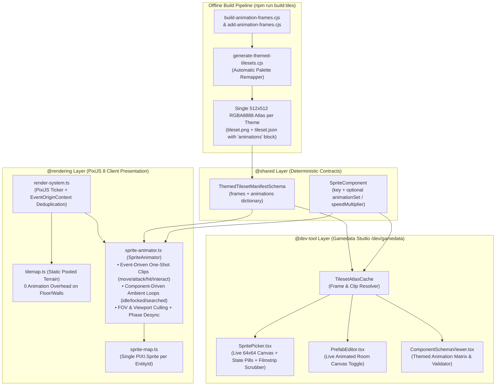
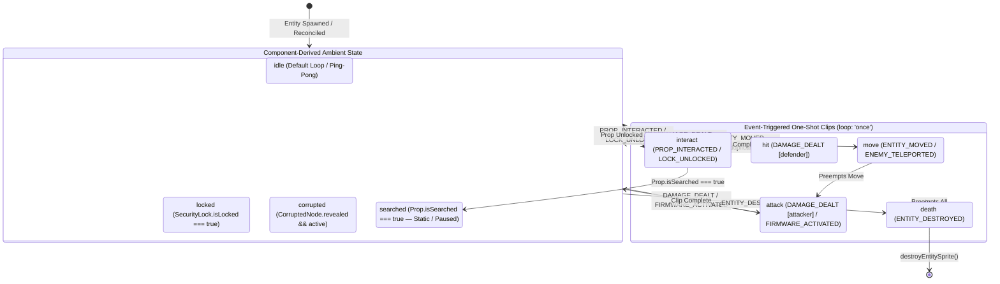

# Technical Specification: Sprite Animation System & DevTool Preview Architecture

> **Status:** Target Architecture Specification & Implementation Plan (`v2.8` Visual Presentation & Authoring Upgrade)  
> **Baseline Audited:** Nirmata Runner v2.7 (Post-Interactive Environments, Directional Tilemaps & AI Behavior Trees v3.0)  
> **Scope:** Shared Manifest & Component Schemas (`@shared`), PixiJS 8 WebGL Animation Runtime (`@rendering`), Single-Atlas Build Pipeline (`scripts/`, `public/assets/`), and Gamedata Authoring Studio (`@dev-tool` / `/dev/gamedata`)  
> **Companion Specifications:** [`TILEMAP_GUIDE.md`](../TILEMAP_GUIDE.md), [`DIRECTIONAL-TILEMAPS.md`](./DIRECTIONAL-TILEMAPS.md), [`INTERACTIVE-ENVIRONMENTS.md`](./INTERACTIVE-ENVIRONMENTS.md), [`GAMEDATA-DESIGN-TOOL.md`](./GAMEDATA-DESIGN-TOOL.md), [`UI-DESIGN-SYSTEM.md`](./UI-DESIGN-SYSTEM.md)

---

## 1. Executive Summary & Architectural Objectives

This specification defines a lightweight, data-driven **Sprite Animation System** for *Nirmata Runner* that brings character chassis (Player Shells and Hostile Enemies), interactive environmental props, world fixtures (Stability Anchors and Staircases), ground loot, and tile-space hazards to life while preserving the strict architectural invariants defined in [`AGENTS.md`](../../AGENTS.md).



### 1.1 Key Architectural Objectives

1. **100% Simulation Decoupling (`@rendering` Mandate #1)**:
   - Animation playback timers (`elapsedMs`), active frame indices (`frameIndex`), and transient visual state transitions (`idle → attack → idle`) live **exclusively in `@rendering`** (`src/rendering/sprite-animator.ts`).
   - The authoritative server (`@server`) never ticks animations, never stores real-time frame counters in the ECS [`World`](../../src/engine/ecs/world.ts), and **never emits network delta payloads (`createECSWorldDelta`) for sprite frame changes**.
2. **Minimal Spritesheets Loaded in Gameplay (Zero Extra VRAM / Single WebGL Texture Unit)**:
   - Rather than loading separate spritesheets per character or per prop, animation frames are packed directly into the unused cells of the existing `512 × 512` `RGBA8888` master and themed atlases ([`public/assets/tileset.png`](../../public/assets/tileset.png)).
   - Using **Frame-0 Base Reuse** (where `Frame 0` of any animation is the existing canonical static tile) and **Ping-Pong Frame Cycling** (`[f0, f1, f2] → f0, f1, f2, f1`), the entire game's character, prop, and item animations fit inside the **existing 1 MB GPU texture allocation** with **zero additional HTTP requests** and **single-pass PixiJS WebGL batching**.
3. **Static Tilemap Coexistence & 100% Backward Compatibility**:
   - [`src/rendering/tilemap.ts`](../../src/rendering/tilemap.ts) continues to render floors, directional autotiled walls, and static doors as pooled static `PIXI.Sprite` instances with **zero per-frame animation overhead**.
   - Every existing entity template (`"sprite": { "key": "enemy_null_pointer" }`) works with **zero mandatory JSON edits**: if a matching entry exists in `tileset.json#animations`, it animates automatically; otherwise, it renders as a static 1-frame texture.
4. **Anti-Cheat Fog-of-War Gating (`U1` Invariant)**:
   - Sprites outside the camera viewport or outside the player's active Field of View (`currentFovSet`) are **frozen at Frame 0** of their client-remembered state (`rememberedProps`) and skipped by the animation ticker. This eliminates off-screen CPU work and guarantees that unseen state changes never leak through fog-of-war animations.
5. **First-Class Gamedata Studio (`/dev/gamedata`) Preview & Validation**:
   - Designers can preview animations in real time, scrub individual frames, switch animation states (`IDLE`, `MOVE`, `ATTACK`, `HIT`, `INTERACT`, `SEARCHED`), toggle live room prefab animations, and validate animation manifests across all corporate faction themes directly inside [`/dev/gamedata`](../../src/app/dev/gamedata/page.tsx).

---

## 2. Layer Boundaries & Compliance Matrix

In strict accordance with [`AGENTS.md`](../../AGENTS.md) and [`eslint.config.js`](../../eslint.config.js) (`import-x/no-restricted-paths`):

| Layer | Target Files | Responsibility | Boundary Invariants |
| :--- | :--- | :--- | :--- |
| **`@engine`** | *No changes required* | Pure ECS `World`, `Grid`, `EventBus`, `TurnManager`. | **Zero** upward imports or rendering awareness. |
| **`@shared`** | [`src/shared/tileset-types.ts`](../../src/shared/tileset-types.ts)<br>[`src/shared/components/sprite.ts`](../../src/shared/components/sprite.ts) | Zod schemas for `AnimationClipDefSchema`, `EntityAnimationSetSchema`, `ThemedTilesetManifestSchema`, and optional `SpriteComponent` overrides. | Imports only `@engine/*`, `@shared/*`, and `zod`. |
| **`@rendering`** | `src/rendering/sprite-animator.ts` *(new)*<br>[`src/rendering/sprite-map.ts`](../../src/rendering/sprite-map.ts)<br>[`src/rendering/render-system.ts`](../../src/rendering/render-system.ts)<br>[`src/rendering/assets.ts`](../../src/rendering/assets.ts) | Client-only `SpriteAnimator` state machine, sub-texture lookup, viewport/FOV culling, `EventOriginContext` deduplication, and theme texture unloading. | **Never** mutates ECS components or dispatches gameplay intents. |
| **`@dev-tool`** | [`src/dev-tool/studio/shared/tileset-atlas-cache.ts`](../../src/dev-tool/studio/shared/tileset-atlas-cache.ts)<br>[`src/dev-tool/studio/shared/SpritePicker.tsx`](../../src/dev-tool/studio/shared/SpritePicker.tsx)<br>[`src/dev-tool/studio/editors/PrefabEditor.tsx`](../../src/dev-tool/studio/editors/PrefabEditor.tsx)<br>[`src/dev-tool/studio/editors/ComponentSchemaViewer.tsx`](../../src/dev-tool/studio/editors/ComponentSchemaViewer.tsx)<br>[`src/app/api/dev/gamedata/tileset-validator.ts`](../../src/app/api/dev/gamedata/tileset-validator.ts) | Live canvas animation preview, state selector pills, frame filmstrip scrubber, animated prefab canvas toggle, and manifest validator. | Strictly quarantined from production client/server bundles. |

---

## 3. Minimal Spritesheet & Memory Optimization Strategy

### 3.1 Atlas Occupancy Audit & GPU Memory Math

A `512 × 512` `RGBA8888` texture occupies exactly **1.00 MB of uncompressed GPU VRAM** ($512 \times 512 \times 4 = 1,048,576\text{ bytes}$) and ~35–45 KB over the network as an indexed/lossless PNG. It provides a $16 \times 16$ grid of **256 cells** at `32 × 32` pixels (`TILE_SIZE = 32`).

An audit of [`public/assets/tileset.json`](../../public/assets/tileset.json) and [`scripts/add-directional-tiles.cjs`](../../scripts/add-directional-tiles.cjs) shows current cell usage across the `512 × 512` canvas:

```
┌───────────────────────────┬───────────────────────────┐ (0,0)
│ QUADRANTS A (Rows 0–7)    │ QUADRANT B (Rows 0–7)     │
│ x: 0..255, y: 0..255      │ x: 256..511, y: 0..255    │
│ • Base Terrain, Shells,   │                           │
│   Enemies, Items, Props   │   [ 64 FREE 32x32 CELLS ] │
│ • 48 used / 16 free cells │                           │
├───────────────────────────┴───────────────────────────┤ (0,256)
│ ROWS 8–11 (y: 256..383, x: 0..511)                    │
│ • Directional Wall Autotiles, Doors, Directional Props│
│ • 42 used / 22 free cells                             │
├───────────────────────────────────────────────────────┤ (0,384)
│ ROWS 12–15 (y: 384..511, x: 0..511)                   │
│                                                       │
│              [ 64 FREE 32x32 CELLS ]                  │
│     Reserved for Character & Prop Animation Strips    │
└───────────────────────────────────────────────────────┘ (512,512)
```

* **Total Currently Occupied Cells**: $48 + 42 = 90$ cells ($35.1\%$).
* **Total Unused Cells in Existing `512 × 512` Texture**: **$166$ free `32×32` cells ($64.9\%$)** at **0 bytes of additional VRAM**.

### 3.2 Frame-0 Base Reuse & Ping-Pong Compression

To maximize animation richness while consuming the fewest possible atlas cells:

1. **Frame-0 Canonical Reuse**:
   - The first frame (`frames[0]`) of every entity's `idle` or `locked` animation references its **existing static frame key** in `tileset.json` (e.g., `"player_vanguard"`, `"enemy_null_pointer"`, `"prop_workstation_n"`, `"anchor"`).
   - Consequently, a **2-frame loop** (e.g., terminal cursor blink, subnet radar sweep, staircase chevron chase) requires only **1 new `32×32` cell** in the atlas.
2. **Ping-Pong Loop Compression (`loop: 'pingpong'`)**:
   - A 3-frame sequence `[base, f1, f2]` configured with `loop: 'pingpong'` steps through `base → f1 → f2 → f1 → base...` (an effective **4-step smooth oscillation**) while storing only **2 new `32×32` cells** in the atlas.
3. **Asymmetrical Hold Timing (`frameDurationsMs`)**:
   - Instead of duplicating identical frames in the PNG to pause an animation (such as a periodic specular glint on `item_flux` or an occasional eye/visor flicker on `player_ghost`), `AnimationClipDef` supports per-frame hold durations in milliseconds (e.g., `frames: ["item_flux", "item_flux_glint_1", "item_flux_glint_2"]`, `frameDurationsMs: [900, 90, 90]`).

### 3.3 Directional Prop Animation Strategies (Strategy A vs. Strategy B)

Consistent with [`DIRECTIONAL-TILEMAPS.md`](./DIRECTIONAL-TILEMAPS.md) Section 2.2, directional props use whichever strategy minimizes atlas footprint without sacrificing perspective lighting:

* **Strategy A — Explicit Directional Delta Frames (3/4 Perspective Asymmetrical Props)**:
  - Props with 3/4 elevation (e.g., `prop_workstation_n`, `_e`, `_s`, `_w`) allocate 1 additional frame per visible screen orientation (`prop_workstation_n_1`, `_e_1`, `_s_1`, `_w_1`) or share a common back-of-monitor pulse frame where appropriate.
* **Strategy B — Transform-Rotated Shared Animation Strip (Symmetric Top-Down Fixtures)**:
  - Rotationally symmetric fixtures (e.g., `prop_cooling_vent` turbine blades, directional floor vents, or symmetric barriers) define a **single canonical animation strip** (`["prop_cooling_vent_ready", "prop_cooling_vent_spin_1", "prop_cooling_vent_spin_2"]`) and rely on [`applySpriteTransform`](../../src/rendering/render-system.ts#L75-L96) (`TileOrientation.angleDegrees`) for cardinal rotation—cutting atlas cell usage by **75%**.

### 3.4 Single-Texture WebGL Batching & Theme Lifecycle (`src/rendering/assets.ts`)

1. **Zero Extra Network Requests or Draw Calls**:
   - Because all static tiles, directional walls, character sprites, and animation frames reside on the same `TextureSource` (`tileset.png` or `tileset_<theme>.png`), PixiJS 8's batch renderer draws static and animated sprites in the **same WebGL draw batch**.
   - Advancing an animation frame is a zero-allocation pointer assignment (`sprite.texture = clip.textures[frameIdx]`) referencing pre-sliced sub-textures created once when `Assets.load()` parses `tileset.json`.
2. **Strict Active Theme Memory Bound**:
   - In [`src/rendering/assets.ts`](../../src/rendering/assets.ts), switching floor themes via `loadThemedAssets(themeId)` will unload any previously loaded non-default theme alias (`Assets.unload(previousAlias)`) when transitioning between sectors (`traxus_foundry` → `sekiguchi_biolabs` → `dark_subnet`), ensuring at most **1 active theme spritesheet** is resident alongside the base fallback.
3. **Automated Theme Palette Remapping (`scripts/generate-themed-tilesets.cjs`)**:
   - Because [`scripts/generate-themed-tilesets.cjs`](../../scripts/generate-themed-tilesets.cjs) iterates over all non-terrain sprite coordinates in `public/assets/tileset.json` and runs `recolorSprite()` to generate `tileset_traxus_foundry.png`, `tileset_sekiguchi_biolabs.png`, and `tileset_dark_subnet.png`, all newly added animation frames in `tileset.json` are **automatically palette-remapped** into every corporate faction theme and carry the `"animations"` manifest block into each themed JSON file.

---

## 4. Shared Schemas & Data Contracts (`@shared`)

### 4.1 Extended Tileset Manifest Schema (`src/shared/tileset-types.ts`)

[`src/shared/tileset-types.ts`](../../src/shared/tileset-types.ts) is extended with strict Zod schemas for animation clips and state maps while remaining 100% backward-compatible with manifests that omit `animations`:

```typescript
// src/shared/tileset-types.ts
import { z } from 'zod';

export const AnimationLoopModeSchema = z.enum(['loop', 'pingpong', 'once']);
export type AnimationLoopMode = z.infer<typeof AnimationLoopModeSchema>;

export const AnimationStateKeySchema = z.enum([
  'idle',
  'move',
  'attack',
  'hit',
  'interact',
  'locked',
  'open',
  'searched',
  'corrupted',
  'death',
]);
export type AnimationStateKey = z.infer<typeof AnimationStateKeySchema>;

export const AnimationClipDefSchema = z.object({
  /** Ordered list of frame keys that must exist in `manifest.frames`. */
  frames: z.array(z.string()).min(1),
  /** Playback rate in frames per second (used when `frameDurationsMs` is omitted). */
  fps: z.number().positive().default(6),
  /** Playback loop mode: 'loop' (0..N-1), 'pingpong' (0..N-1..1), or 'once' (0..N-1 then hold/transition). */
  loop: AnimationLoopModeSchema.default('loop'),
  /** Optional explicit per-frame durations in milliseconds (must match `frames.length` if provided). */
  frameDurationsMs: z.array(z.number().int().positive()).optional(),
  /** Optional target state to transition into after a 'once' clip completes (defaults to ambient state). */
  nextState: AnimationStateKeySchema.optional(),
  /** When true (default for looping clips), desynchronizes initial phase by EntityId hash. */
  desyncPhase: z.boolean().default(true).optional(),
});
export type AnimationClipDef = z.infer<typeof AnimationClipDefSchema>;

/**
 * Multi-state animation mapping for an entity or prop archetype (e.g. { idle: Clip, move: Clip, attack: Clip }).
 */
export const EntityAnimationSetSchema = z.partialRecord(
  AnimationStateKeySchema,
  AnimationClipDefSchema,
);
export type EntityAnimationSet = z.infer<typeof EntityAnimationSetSchema>;

/**
 * An entry in `manifest.animations` can be either:
 * 1. A direct `AnimationClipDef` (shorthand for `{ idle: clip }`), OR
 * 2. An `EntityAnimationSet` mapping state keys (`idle`, `move`, `attack`, `hit`, `interact`, `searched`, etc.) to clips.
 */
export const AnimationManifestEntrySchema = z.union([
  AnimationClipDefSchema,
  EntityAnimationSetSchema,
]);
export type AnimationManifestEntry = z.infer<typeof AnimationManifestEntrySchema>;

export const ThemedTilesetManifestSchema = z.object({
  frames: z.record(z.string(), FrameDefSchema),
  /** Optional dictionary of animation clips or multi-state animation sets keyed by base sprite key or set ID. */
  animations: z.record(z.string(), AnimationManifestEntrySchema).optional(),
  meta: z.object({
    themeId: z
      .enum([
        'default',
        'traxus',
        'cyberacme',
        'sekiguchi',
        'nucaloric',
        'dark_subnet',
        'traxus_foundry',
        'sekiguchi_biolabs',
      ])
      .default('default'),
    themeName: z.string().default('Default'),
    image: z.string(),
    format: z.string().default('RGBA8888'),
    size: z.object({ w: z.number().int(), h: z.number().int() }),
    scale: z.number().default(1),
    tileSize: z.number().int().default(32),
  }),
});
```

#### Example `tileset.json` `"animations"` Block
```json
{
  "frames": {
    "player_vanguard": { "frame": { "x": 64, "y": 224, "w": 32, "h": 32 }, "sourceSize": { "w": 32, "h": 32 }, "spriteSourceSize": { "x": 0, "y": 0, "w": 32, "h": 32 } },
    "player_vanguard_idle_1": { "frame": { "x": 0, "y": 384, "w": 32, "h": 32 }, "sourceSize": { "w": 32, "h": 32 }, "spriteSourceSize": { "x": 0, "y": 0, "w": 32, "h": 32 } },
    "player_vanguard_attack_1": { "frame": { "x": 32, "y": 384, "w": 32, "h": 32 }, "sourceSize": { "w": 32, "h": 32 }, "spriteSourceSize": { "x": 0, "y": 0, "w": 32, "h": 32 } }
  },
  "animations": {
    "player_vanguard": {
      "idle": {
        "frames": ["player_vanguard", "player_vanguard_idle_1"],
        "frameDurationsMs": [550, 250],
        "loop": "loop",
        "desyncPhase": false
      },
      "move": {
        "frames": ["player_vanguard_idle_1", "player_vanguard"],
        "fps": 12,
        "loop": "once"
      },
      "attack": {
        "frames": ["player_vanguard_attack_1", "player_vanguard"],
        "frameDurationsMs": [110, 60],
        "loop": "once"
      }
    },
    "anchor": {
      "frames": ["anchor", "anchor_pulse_1", "anchor_pulse_2"],
      "fps": 4,
      "loop": "pingpong"
    }
  }
}
```

### 4.2 Backward-Compatible `SpriteComponent` Schema (`src/shared/components/sprite.ts`)

[`SpriteComponent`](../../src/shared/components/sprite.ts) keeps `key` as the only required property so all 80+ existing templates, tests, and snapshots remain 100% valid without modification, while allowing optional per-template animation tuning:

```typescript
// src/shared/components/sprite.ts
import { z } from 'zod';
import { defineComponent } from '../../engine/ecs/types';
import { AnimationStateKeySchema } from '../tileset-types';

export const SpriteComponent = defineComponent(
  'sprite',
  z.object({
    /** Canonical base frame key in `tileset.json#frames` (also used as default lookup key in `tileset.json#animations`). */
    key: z.string(),
    /** Optional explicit key in `tileset.json#animations` if different from `key`. */
    animationSet: z.string().optional(),
    /** Optional initial animation state override (defaults to component-derived ambient state, typically 'idle'). */
    initialState: AnimationStateKeySchema.optional(),
    /** Optional playback speed multiplier (e.g. 1.25 for hasted/elite variants). */
    speedMultiplier: z.number().positive().default(1).optional(),
    /** When true, locks the sprite to Frame 0 of its current state. */
    paused: z.boolean().default(false).optional(),
    /** Whether to desynchronize loop phase using EntityId hash (defaults to true for non-player entities). */
    desyncPhase: z.boolean().optional(),
  }),
);

export type SpriteComponentData = z.infer<typeof SpriteComponent.schema>;
```

---

## 5. Client Rendering & Animation Runtime (`@rendering`)

### 5.1 Why a Centralized `SpriteAnimator` Over `PIXI.AnimatedSprite`

In [`src/rendering/sprite-map.ts`](../../src/rendering/sprite-map.ts), each entity is represented by a single `PIXI.Sprite` tracked in `entitySprites: Map<EntityId, Sprite>`. Furthermore, [`glitch-effects.ts`](../../src/rendering/filters/glitch-effects.ts), [`particle-emitters.ts`](../../src/rendering/filters/particle-emitters.ts), and [`heat-visual-effects.ts`](../../src/rendering/filters/heat-visual-effects.ts) track active WebGL filters and emitters in `Map<Sprite, Filter[]>` and `WeakMap<Sprite, ...>`.

Instead of replacing `PIXI.Sprite` with `PIXI.AnimatedSprite` (which attaches individual `Ticker` listeners per instance and allocates new arrays on state changes), `src/rendering/sprite-animator.ts` manages frame stepping centrally on the existing `PIXI.Sprite` instances:

1. **Zero Filter or Reference Breakage**: The `PIXI.Sprite` instance for an `EntityId` never changes when transitioning between `idle`, `move`, `attack`, `hit`, or `searched`. Only `sprite.texture` is updated when the discrete frame index advances.
2. **Sparse Texture Writes**: At 60 Hz (`deltaMs ≈ 16.6ms`), a 4 FPS idle animation only changes frames once every 15 ticks (`250ms`). `SpriteAnimator` checks `if (nextFrameKey !== state.lastRenderedFrameKey)` and skips `sprite.texture = ...` on the other 14 ticks.
3. **O(Visible) Culling**: Only entities that are currently visible inside the camera viewport and inside active FOV (`sprite.visible && currentFovSet.has(posKey)`) are ticked.

### 5.2 Animation State Machine & Priority Resolution

Each tracked entity has a lightweight runtime record in `SpriteAnimator`:

```typescript
export interface EntityAnimRuntimeState {
  entityId: EntityId;
  baseSpriteKey: string;
  animationSetKey: string;
  /** Ambient looping state derived from ECS components ('idle' | 'locked' | 'searched' | 'corrupted' | 'open'). */
  ambientState: AnimationStateKey;
  /** Optional one-shot override state ('move' | 'attack' | 'hit' | 'interact' | 'death'). */
  transientState: AnimationStateKey | null;
  elapsedMs: number;
  lastRenderedFrameKey: string;
  speedMultiplier: number;
  paused: boolean;
  phaseOffsetMs: number;
}
```



#### Event-to-State Wiring in [`src/rendering/render-system.ts`](../../src/rendering/render-system.ts)
| Event / Condition | Target Entity | Triggered State | Prediction & Anti-Cheat Handling |
| :--- | :--- | :--- | :--- |
| **`ENTITY_MOVED`** / **`ENEMY_TELEPORTED`** | `payload.entityId` | `'move'` (`once`) | Uses existing `lastPredictedPlayerMove` + `EventOriginContext.current` check in `handleEntityMoved` so server reconciliation never double-triggers the player's step animation. |
| **`DAMAGE_DEALT`** | `payload.attackerId` | `'attack'` (`once`) | Plays weapon fire / melee strike frames synchronously with `queueAttackAnimationWithDefender`. |
| **`DAMAGE_DEALT`** | `payload.defenderId` | `'hit'` (`once`) | Plays recoil/flinch frames synchronously with `applyDamageDistortion`. |
| **`FIRMWARE_ACTIVATED`** | `payload.entityId` | `'attack'` (`once`) | Triggers neural cast / overdrive frame sequence on the activating operative. |
| **`PROP_INTERACTED`** / **`LOCK_UNLOCKED`** | `payload.propId` | `'interact'` (`once`) | Plays transitional open/access frame sequence, then resolves to `'searched'` or `'open'`. |
| **`ENTITY_DESTROYED`** | `payload.entityId` | `'death'` (`once`) | Steps through `'death'` frames (if defined) during `queueTypedDeathAnimation` before `destroyEntitySprite`. |
| **Ambient Resolution** | All active entities | `'idle'` / `'locked'` / `'searched'` / `'corrupted'` | Computed from read-only `Prop`, `SecurityLock`, and `CorruptedNode` components. When `Prop.isSearched === true`, the clip resolves to the static searched frame and stops ticking. |

### 5.3 Ping-Pong & Custom Frame Duration Math

Given a clip with $N = \text{frames.length}$:
1. If $N \le 1$, return `frames[0]` immediately (0 timer math).
2. Construct the effective playback sequence `seq`:
   - `'loop'` or `'once'`: `seq = [0, 1, ..., N - 1]` (length $M = N$).
   - `'pingpong'` ($N > 2$): `seq = [0, 1, ..., N - 1, N - 2, ..., 1]` (length $M = 2N - 2$).
   - `'pingpong'` ($N === 2$): `seq = [0, 1]` (length $M = 2$).
3. Each step $k \in [0, M-1]$ has duration:
   $$d_k = \text{frameDurationsMs}?.[seq[k]] ?? \left(\frac{1000}{\text{fps}}\right)$$
   and total cycle duration $T = \sum_{k=0}^{M-1} d_k$.
4. For `'once'` clips, if $\text{elapsedMs} \ge T$, clear `transientState = null` (or transition to `clip.nextState`) and return the ambient state's frame.
5. For looping clips (`'loop'` / `'pingpong'`), compute phase-shifted cycle time:
   $$t = (\text{elapsedMs} + \text{phaseOffsetMs}) \bmod T$$
   and select the step $k$ where $\sum_{j=0}^{k-1} d_j \le t < \sum_{j=0}^{k} d_j$.
6. **Deterministic Phase Offset Formula**:
   $$\text{phaseOffsetMs} = \text{desyncPhase} ? \left(\left(\text{entityId} \times 2654435761\right) \ggg 0\right) \bmod T : 0$$
   This guarantees that multiple `Null-Pointer` enemies, `Cooling Vents`, or `Workstations` in the same room cycle out-of-phase organically while remaining 100% deterministic in unit tests.

### 5.4 Fog-of-War Freezing & Reduced Motion (`U1` & `U11` Compliance)

1. **Explored Fog-of-War Freeze**:
   - In `renderSystem()`, every entity's tile coordinate `${pos.x},${pos.y}` is checked against `currentFovSet`.
   - If `!currentFovSet.has(tileKey)` (the entity is a remembered prop or ground item in explored fog-of-war at `alpha = 0.3`), `SpriteAnimator` locks the sprite to `Frame 0` of its remembered state (`rememberedProps.get(entityId)`) and does not advance its animation clock.
2. **`prefers-reduced-motion` Support**:
   - If `window.matchMedia('(prefers-reduced-motion: reduce)').matches` is `true`, ambient looping animations (`idle`, `locked`, `corrupted`) hold `Frame 0` while explicit player/combat feedback clips (`move`, `attack`, `interact`) remain readable.

---

## 6. Canonical Animation Catalog & Atlas Layout (`public/assets/tileset.png`)

All new animation frames are packed into **Rows 12–15 (`y = 384..511`)** of the `512 × 512` master atlas (`64` cells available), keeping **Quadrant B (`64` cells)** and **Rows 9–11 (`22` cells)** free for future expansions.

| Category | Base Key(s) | States Defined | Frame Sequence (Frame 0 = Existing Base Tile) | Extra Atlas Cells | Visual Description |
| :--- | :--- | :--- | :--- | :---: | :--- |
| **Player Shells** | `player`<br>`player_vanguard`<br>`player_bastion`<br>`player_ghost` | `idle`, `move`, `attack` | `idle`: `[base, *_idle_1]` (`[550ms, 250ms]`)<br>`move`: `[base, *_move_1]` (`12 fps`, `once`)<br>`attack`: `[base, *_atk_1]` (`12 fps`, `once`) | 8 cells<br>*(2 per shell)* | Subtle chassis reactor breath & visor telemetry scan; kinetic weapon flash / stance shift on move & attack. |
| **Enemies (T1–T3)** | `enemy_null_pointer`<br>`enemy_buffer_overflow`<br>`enemy_fragmenter`<br>`enemy_logic_leaker`<br>`enemy_seed_eater`<br>`enemy_system_admin` | `idle`, `attack`, `hit` | `idle`: `[base, *_idle_1, *_idle_2]` (`pingpong`, `5 fps`)<br>`attack`: `[base, *_atk_1]` (`10 fps`, `once`)<br>`hit`: `[base, *_atk_1]` (`12 fps`, `once`) | 12 cells<br>*(2 per enemy)* | Glitch stalker phase jitter, Buffer-Overflow core pulse, Fragmenter piston heave, Logic-Leaker acid drip, Seed-Eater mandible twitch, System-Admin sentinel scan. |
| **Workstations** | `prop_workstation`<br>`prop_workstation_n/e/s/w` | `idle`, `searched` | `idle`: `[base, *_anim_1]` (`[400ms, 400ms]`, `loop`)<br>`searched`: `[base]` (paused, dimmed) | 4 cells | Scrolling cyan terminal code lines & blinking prompt on monitor face; dark/static when searched. |
| **Cooling Vent** | `prop_cooling_vent`<br>`prop_cooling_vent_ready` | `idle`, `searched` | `idle`: `[base, prop_cooling_vent_spin_1, prop_cooling_vent_spin_2]` (`8 fps`, `loop`)<br>`searched`: `[base]` (paused) | 2 cells | Rotating exhaust turbine blades + rising cryo-mist pixel; stops spinning once vented. |
| **Reality Stabilizer** | `prop_stabilizer`<br>`prop_stabilizer_active` | `idle`, `searched` | `idle`: `[base, prop_stabilizer_pulse_1, prop_stabilizer_pulse_2]` (`5 fps`, `pingpong`) | 2 cells | Harmonic gyroscopic ring oscillation & core luminance pulse. |
| **Cryo-Vat & Capacitor** | `prop_cryo_vat`<br>`prop_capacitor_bank` | `idle` | `idle`: `[base, *_anim_1, *_anim_2]` (`5 fps`, `pingpong` / `loop`) | 4 cells<br>*(2 each)* | Rising bioluminescent bubbles inside cryo-fluid; high-voltage electric arc jumping between capacitor coils. |
| **Dead-Drop & Console** | `prop_dead_drop`<br>`prop_subnet_console` | `idle`, `searched` | `idle`: `[base, *_anim_1]` (`[500ms, 250ms]`, `loop`) | 2 cells<br>*(1 each)* | Uplink beacon strobe & radar sweep line. |
| **Safes & Lockers** | `prop_safe_locked`<br>`prop_locker_n/e/s/w`<br>`prop_biocabinet_n/e/s/w` | `locked`, `idle`, `searched` | `locked`/`idle`: `[base, *_blink_1]` (`[700ms, 200ms]`)<br>`searched`: static | 3 cells | Periodic security diode blink; static when opened/searched. |
| **World Fixtures** | `anchor`<br>`staircase` | `idle` | `anchor`: `[anchor, anchor_pulse_1, anchor_pulse_2]` (`4 fps`, `pingpong`)<br>`staircase`: `[staircase, staircase_pulse_1]` (`3 fps`, `loop`) | 3 cells | Reality Anchor tether ring pulse; Staircase descent chevron beacon chase. |
| **Key Loot Items** | `item_flux`<br>`item_potion`<br>`item_blueprint`<br>`item_access_key` | `idle` | `idle`: `[base, *_glint_1]` (`frameDurationsMs: [900, 150]`, `loop`) | 4 cells | Periodic high-contrast specular glint across crystalline flux, nanite vial, blueprint datapad, and keycard. |

* **Total New 32×32 Atlas Cells**: **44 cells** (Rows 12–14 of `public/assets/tileset.png`), leaving **122 cells still free** in the single `512 × 512` texture!

---

## 7. Gamedata Studio (`/dev/gamedata`) Preview & Authoring Specification (`@dev-tool`)

Just as static entity tiles and directional props can be inspected and painted in [`/dev/gamedata`](../../src/app/dev/gamedata/page.tsx), the DevTool Studio is upgraded across four touchpoints so authors can preview, scrub, and validate sprite animations everywhere sprites are referenced.

### 7.1 `TilesetAtlasCache` Animation Support (`src/dev-tool/studio/shared/tileset-atlas-cache.ts`)

[`TilesetAtlasCache`](../../src/dev-tool/studio/shared/tileset-atlas-cache.ts) is extended to parse `manifest.animations` and expose frame resolution helpers:

```typescript
export interface ResolvedAnimationClip {
  state: AnimationStateKey;
  frames: string[];
  fps: number;
  loop: AnimationLoopMode;
  frameDurationsMs?: number[];
  totalDurationMs: number;
}

export class TilesetAtlasCache {
  // Existing methods preserved: loadAtlas, getFrameKeys, getFrameRect, drawAtlasFrame...

  /** Returns all animation state keys ('idle', 'move', 'attack', etc.) available for a sprite key. */
  public getAnimationStates(spriteKey: string, themeId?: string): AnimationStateKey[];

  /** Resolves a normalized clip definition for `(spriteKey, state, themeId)`, or null if static. */
  public getAnimationClip(
    spriteKey: string,
    state?: AnimationStateKey,
    themeId?: string,
  ): ResolvedAnimationClip | null;

  /** Computes the active frame key and frame index at `elapsedMs` for a clip. */
  public resolveAnimatedFrameAtTime(
    spriteKey: string,
    state: AnimationStateKey,
    elapsedMs: number,
    themeId?: string,
  ): { frameKey: string; frameIndex: number; totalFrames: number };
}
```

### 7.2 Upgraded `SpritePicker` with Live Animation Preview & Filmstrip Scrubber (`src/dev-tool/studio/shared/SpritePicker.tsx`)

Used in [`EntityTemplateEditor.tsx`](../../src/dev-tool/studio/editors/EntityTemplateEditor.tsx) (for `sprite.key` and `overrides.sprite.key`) and [`ShellEditor.tsx`](../../src/dev-tool/studio/editors/ShellEditor.tsx) (for `shell.sprite`), [`SpritePicker.tsx`](../../src/dev-tool/studio/shared/SpritePicker.tsx) is upgraded with an interactive animation workstation bar whenever the selected sprite key has animation clips:

```
┌──────────────────────────────────────────────────────────────────────────────────┐
│  ┌──────────┐  [ enemy_null_pointer                           ] [▼ PICK]         │
│  │  64x64   │  STATE: [IDLE ●] [ATTACK] [HIT]   [⏸ PAUSE] [0.5x][1x ●][2x]       │
│  │  LIVE    │  ┌──────┐ ┌──────┐ ┌──────┐                                        │
│  │  CANVAS  │  │ #0 ● │ │  #1  │ │  #2  │  PINGPONG • 5 FPS (200ms/f)            │
│  └──────────┘  └──────┘ └──────┘ └──────┘  Click any frame cell to scrub         │
└──────────────────────────────────────────────────────────────────────────────────┘
```

1. **Live 64×64 Pixel-Art Canvas**:
   - Runs a clean `requestAnimationFrame` loop while mounted and playing (`isPlaying === true`), rendering the active state's frames at `scaleMode: 'nearest'` (`ctx.imageSmoothingEnabled = false`).
   - Falls back to a single static draw call (0 `requestAnimationFrame` overhead) when a static tile key is selected.
2. **State Selector Pills**:
   - Dynamically renders pills for every state defined on the selected sprite (`IDLE`, `MOVE`, `ATTACK`, `HIT`, `INTERACT`, `LOCKED`, `SEARCHED`).
   - Clicking a `'once'` state pill (e.g., `ATTACK` or `HIT`) immediately replays the one-shot clip and optionally loops it in preview mode.
3. **Interactive Frame Filmstrip & Scrubber**:
   - Renders each 32×32 frame in `clip.frames` side-by-side with a highlight border around the currently active frame index (`#0`, `#1`, `#2`) and its duration (`200ms`).
   - Clicking any frame thumbnail pauses playback and scrubs the main 64×64 preview canvas directly to that frame for pixel-level inspection.
4. **Dropdown Filter & Badges**:
   - Inside the `[▼ PICK]` dropdown menu, animated keys display a cyan `[ANIM • 3f]` badge, and a filter bar (`[ALL] [ANIMATED] [STATIC]`) lets authors quickly filter animated vs. static assets.

### 7.3 `PrefabEditor` Live Animated Room Preview (`src/dev-tool/studio/editors/PrefabEditor.tsx`)

In [`PrefabEditor.tsx`](../../src/dev-tool/studio/editors/PrefabEditor.tsx), the Workstation View Bar gains an **`[▶ ANIMATE PREVIEW]`** toggle when `viewMode === 'SPRITE'`:
- When active, a `requestAnimationFrame` ticker drives `tilesetAtlasCache.resolveAnimatedFrameAtTime()` for all placed props (`prop_workstation_*`, `prop_cooling_vent`, `prop_stabilizer`, `prop_cryo_vat`, `prop_capacitor_bank`, `prop_dead_drop`, `prop_subnet_console`, `prop_safe_locked`, `prop_locker_*`) with deterministic per-coordinate phase offsets (`x * 31 + y * 17`).
- Authors can watch an entire generated room prefab (e.g., `server-core`, `decon-airlock`, `zero-day-vault`) animate in real time while painting tiles or rotating props with `[R]`.

### 7.4 `ComponentSchemaViewer` — Themed Tileset Animation Matrix & Validator (`src/dev-tool/studio/editors/ComponentSchemaViewer.tsx`)

1. **Themed Animation Matrix Panel**:
   - In [`ComponentSchemaViewer.tsx`](../../src/dev-tool/studio/editors/ComponentSchemaViewer.tsx) under the **`THEMED TILESET DICTIONARY`** tab, adds an **"Animated Sprites & State Matrix"** section above the directional frame grid.
   - Displays every animated archetype in the selected theme (`default`, `traxus`, `cyberacme`, `sekiguchi`, `nucaloric`), showing a live animated preview alongside its individual frame strip and loop metadata.
2. **Manifest Validation Rules (`src/app/api/dev/gamedata/tileset-validator.ts`)**:
   - Extends [`validateTilesetManifest`](../../src/app/api/dev/gamedata/tileset-validator.ts) to verify:
     - **Rule `VAL-ANIM-01` (Frame Reference Integrity)**: Every frame key listed in `animations[key].frames` (or `animations[key][state].frames`) exists in `manifest.frames`.
     - **Rule `VAL-ANIM-02` (Atlas Bounds Check)**: Every referenced frame's `{ x, y, w, h }` lies strictly within `0 <= x + w <= meta.size.w` and `0 <= y + h <= meta.size.h`.
     - **Rule `VAL-ANIM-03` (Duration Array Alignment)**: If `frameDurationsMs` is specified on a clip, `frameDurationsMs.length === frames.length`.

---

## 8. Phased Implementation Plan & Verification Gates

### Milestone 1: `[ANIM-01]` Shared Schemas & Tileset Validator (`@shared`, `@dev-tool`)
* **Files**:
  - [`src/shared/tileset-types.ts`](../../src/shared/tileset-types.ts)
  - [`src/shared/components/sprite.ts`](../../src/shared/components/sprite.ts)
  - [`src/app/api/dev/gamedata/tileset-validator.ts`](../../src/app/api/dev/gamedata/tileset-validator.ts)
* **Deliverables**:
  - Define `AnimationLoopModeSchema`, `AnimationStateKeySchema`, `AnimationClipDefSchema`, `EntityAnimationSetSchema`, and `AnimationManifestEntrySchema` in `src/shared/tileset-types.ts`.
  - Add optional `animationSet`, `initialState`, `speedMultiplier`, `paused`, and `desyncPhase` fields to `SpriteComponent` in `src/shared/components/sprite.ts`.
  - Extend `validateTilesetManifest()` in `tileset-validator.ts` with `VAL-ANIM-01`–`VAL-ANIM-03` checks and return `totalAnimations` and `animatedKeys` in `TilesetValidationResult`.
* **Verification**:
  - Unit tests in `src/shared/__tests__/tileset-animation-schema.test.ts` testing valid/invalid animation clips, multi-state sets, backward compatibility with existing `SpriteComponent` payloads, and `validateTilesetManifest` error reporting.

### Milestone 2: `[ANIM-02]` Single-Atlas Animation Frame Generation & Themed Packing (`scripts/`, `public/assets/`)
* **Files**:
  - `scripts/build-animation-frames.cjs` *(new)*
  - `scripts/add-animation-frames.cjs` *(new)*
  - [`scripts/generate-themed-tilesets.cjs`](../../scripts/generate-themed-tilesets.cjs)
  - [`package.json`](../../package.json) (`"build:tiles"` pipeline)
  - [`public/assets/tileset.png`](../../public/assets/tileset.png), [`public/assets/tileset.json`](../../public/assets/tileset.json), and themed `tileset_*.png` / `tileset_*.json`
* **Deliverables**:
  - Author procedural pixel-art frame generator `scripts/build-animation-frames.cjs` rendering the 44 animation delta tiles (Rows 12–14, `y = 384..480` of the existing `512 × 512` atlas) for all 4 Shells, 6 Enemies, 13 Interactive Props, Anchors, Staircases, and key Loot items.
  - Composite frames into `public/assets/tileset.png` and populate the `"animations"` dictionary in `public/assets/tileset.json` via `scripts/add-animation-frames.cjs`.
  - Update `scripts/generate-themed-tilesets.cjs` to propagate and palette-remap all animation frames and the `"animations"` manifest block across `traxus_foundry`, `sekiguchi_biolabs`, and `dark_subnet`.
* **Verification**:
  - Run `npm run build:tiles` and verify in `tests/rendering/tilemap-build.test.ts` that `tileset.png` remains `512 × 512` (1 MB VRAM), all animation frame keys resolve to valid `32×32` sub-rectangles, and `validateThemeFile('default')` passes with 0 errors.

### Milestone 3: `[ANIM-03]` Client `SpriteAnimator` Runtime & `RenderSystem` Integration (`@rendering`)
* **Files**:
  - `src/rendering/sprite-animator.ts` *(new)*
  - [`src/rendering/sprite-map.ts`](../../src/rendering/sprite-map.ts)
  - [`src/rendering/render-system.ts`](../../src/rendering/render-system.ts)
  - [`src/rendering/assets.ts`](../../src/rendering/assets.ts)
* **Deliverables**:
  - Implement `SpriteAnimator` in `src/rendering/sprite-animator.ts` supporting `'loop'`, `'pingpong'`, and `'once'` modes, per-frame `frameDurationsMs`, deterministic `EntityId` phase desynchronization, and sparse `sprite.texture` updates.
  - Wire `ENTITY_MOVED` (with `EventOriginContext` client prediction deduplication), `ENEMY_TELEPORTED`, `DAMAGE_DEALT` (`attack` on attacker, `hit` on defender), `FIRMWARE_ACTIVATED`, `PROP_INTERACTED`, `LOCK_UNLOCKED`, and `ENTITY_DESTROYED` in `render-system.ts` to trigger transient animation states.
  - Wire ambient state resolution (`idle`, `locked`, `searched`, `corrupted`) and FOV/viewport culling (`currentFovSet.has(tileKey)`) so searched props and fog-of-war entities pause ticking cleanly.
  - Update `loadThemedAssets` in `src/rendering/assets.ts` to unload non-active theme atlases on theme switch.
* **Verification**:
  - Unit and integration tests in `tests/rendering/sprite-animator.test.ts` verifying frame progression, ping-pong oscillation, one-shot `attack`/`hit`/`move` state preemption and return-to-idle, `EventOriginContext` deduplication, `Prop.isSearched` pausing, and fog-of-war freeze invariants.

### Milestone 4: `[ANIM-04]` Gamedata Studio (`/dev/gamedata`) Live Previews & Scrubber (`@dev-tool`)
* **Files**:
  - [`src/dev-tool/studio/shared/tileset-atlas-cache.ts`](../../src/dev-tool/studio/shared/tileset-atlas-cache.ts)
  - [`src/dev-tool/studio/shared/SpritePicker.tsx`](../../src/dev-tool/studio/shared/SpritePicker.tsx)
  - [`src/dev-tool/studio/editors/PrefabEditor.tsx`](../../src/dev-tool/studio/editors/PrefabEditor.tsx)
  - [`src/dev-tool/studio/editors/ComponentSchemaViewer.tsx`](../../src/dev-tool/studio/editors/ComponentSchemaViewer.tsx)
* **Deliverables**:
  - Extend `TilesetAtlasCache` with `getAnimationStates`, `getAnimationClip`, and `resolveAnimatedFrameAtTime`.
  - Upgrade `SpritePicker.tsx` with live 64×64 animated canvas preview, `[▶/⏸]` transport toggle, state selector pills (`IDLE`, `MOVE`, `ATTACK`, `HIT`, `INTERACT`), playback speed controls (`0.5x`, `1x`, `2x`), clickable frame filmstrip scrubber, and `[ALL | ANIMATED | STATIC]` dropdown filtering.
  - Add `[▶ ANIMATE PREVIEW]` toggle to `PrefabEditor.tsx` so room prefabs animate directional props in real time on the 2D sprite canvas.
  - Add the **Animated Sprites & State Matrix** inspector to `ComponentSchemaViewer.tsx` (`THEMED TILESET DICTIONARY` tab).
* **Verification**:
  - Component tests in `src/dev-tool/studio/__tests__/sprite-picker-anim.test.tsx` verifying state pill switching, frame scrubbing, play/pause toggling, and dropdown filtering.
  - Full project quality gates: `npm test`, `npm run typecheck`, `npm run lint`, and `npm run build`.
