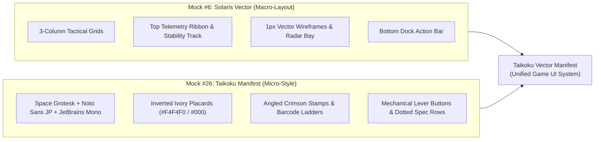

# UI/UX Design Specification & Visual Style Guide: "Taikoku Vector Manifest"

> **Status:** Approved Design Specification (Ready for Implementation)  
> **Reference Prototype:** [`docs/mocks/mashup-6-26.html`](../mocks/mashup-6-26.html) | **Generator:** [`docs/mocks/generate-mashup.cjs`](../mocks/generate-mashup.cjs)  
> **Aesthetic Lineage:** **Mock #6 (Solaris Vector)** Macro-Layouts × **Mock #26 (Taikoku Industrial Manifest)** Typography & Constructivist Packaging

---

## 1. Executive Summary & Aesthetic Thesis

The **Taikoku Vector Manifest** design system is the authoritative visual identity and layout architecture for *Nirmata Runner*. It replaces the legacy green-phosphor terminal styling with a high-contrast synthesis of two distinct paradigms:

1. **Macro-Layout Architecture from Mock #6 (*Solaris Vector*)**:
   - **High-Density 3-Column Tactical Workstations**: Structured, ergonomic multi-column grids for both the In-Game Tactical HUD and the Out-of-Game Neural Deck Hub.
   - **1px Oscilloscope Vector Telemetry**: Luminous cyan (`#00f0ff`) and acid chartreuse (`#d8ff00`) wireframe schematics, radar range rings, coordinate crosshairs, and segmented capacity meters over a deep carbon-void substrate (`#040609`).
   - **Strict Geometric Centering**: Gateway, transition, and post-mission screens (`MainMenu`, `BootSequence`, `BSODScreen`, `RunResultsScreen`) are geometrically and optically centered in the viewport (`margin: auto` within a flex-centered viewport container), while modal overlays center cleanly over the active workspace.

2. **Micro-Stylistic DNA & Typography from Mock #26 (*Taikoku Industrial Manifest*)**:
   - **Swiss-Japanese Constructivist Packaging**: Inspired by Fern Hook (*Antireal*), Bungie's *Marathon* visual direction, and *The Designers Republic*.
   - **Inverted Stark Ivory Placards**: High-impact chalk-white (`#f4f4f0`) header banners with `3px solid #000000` borders, bold black typography, and bilingual Japanese Kanji + English technical titles (`対空重工業 // TAIKOKU VECTOR`).
   - **Inspection Stamps & Freight Markings**: Angled crimson validation seals (`[ 検査済 // CERTIFIED ]`, `[ 永久死亡 // PERMADEATH ]`), vertical SVG barcode ladders (`TK-88902-C`), dotted leader specification rows, and heavy mechanical dock lever buttons with 5px neon indicator bars.



---

## 2. Foundational Design Tokens (`src/app/globals.css`)

All UI components, CSS Modules, and canvas overlays must reference these canonical CSS custom properties defined on `:root` in [`src/app/globals.css`](../../src/app/globals.css). **Legacy `#00ff41` matrix green and `Courier New` / `Arial Narrow` declarations must be removed.**

### 2.1 Color Palette Tokens

| Token | Hex / Value | Role & Usage |
| :--- | :--- | :--- |
| `--c-bg` | `#040609` | Primary viewport void background and deep canvas backing. |
| `--c-surface` | `#0a0e15` | Standard panel card surface (`.panel-card`), sidebar columns, and HUD docks. |
| `--c-surface-elevated` | `#111722` | Interactive button bases, socket rows, and hoverable table/list cells. |
| `--c-surface-header` | `#0c121c` | Panel title headers (`.panel-header`), hub tab bars, and secondary sub-surfaces. |
| `--c-surface-ivory` | `#f4f4f0` | Stark inverted constructivist placards (`.taikoku-placard`) and Run Results Bill of Lading (`.manifest-bill`). |
| `--c-border` | `#1c2638` | Primary 1px structural border for cards, grids, and dividers. |
| `--c-border-bright` | `#36445d` | Elevated border for interactive controls, active slots, and input fields. |
| `--c-border-ivory` | `#f4f4f0` | High-contrast 2px–3px outer framing for primary constructs, HUD viewport bay, and modals. |
| `--c-accent` | `#d8ff00` | **Taikoku Acid Chartreuse** — Primary brand accent, active tabs, primary lever indicators, runner `@` glyph, and Tier-1 highlights. |
| `--c-accent-secondary` | `#00f0ff` | **Solaris Laser Cyan** — Secondary accent, 1px vector wireframes, HP bar fill, Meta Flux currency, and stable anchor states. |
| `--c-danger` | `#ff2a4b` | **Inspection Stamp Crimson** — Hostile entities, critical warnings, permadeath stamps, destructive actions, and HP loss. |
| `--c-warning` | `#ff6600` | **Thermal Hazard Orange** — Core Heat injection, thermal warnings, and overload states. |
| `--c-scrap` | `#ffaa00` | **Industrial Amber** — Run Scrap (`CR`) currency, Weekly One-Shot highlights, and caution badges. |
| `--c-text` | `#ffffff` | Primary high-contrast body and heading text on dark surfaces. |
| `--c-text-ivory` | `#f4f4f0` | Secondary high-contrast white for display labels. |
| `--c-text-dim` | `#79889e` | Technical labels, secondary descriptions, and inactive tab text. |
| `--c-text-muted` | `#4a5668` | Disabled controls, timestamps, empty slot placeholders, and hash suffixes. |

### 2.2 Canonical CSS Variables Block

```css
:root {
  /* Surfaces */
  --c-bg: #040609;
  --c-surface: #0a0e15;
  --c-surface-elevated: #111722;
  --c-surface-header: #0c121c;
  --c-surface-ivory: #f4f4f0;

  /* Borders */
  --c-border: #1c2638;
  --c-border-bright: #36445d;
  --c-border-ivory: #f4f4f0;

  /* Semantic & Accent Colors */
  --c-accent: #d8ff00;           /* Taikoku Acid Chartreuse */
  --c-accent-secondary: #00f0ff; /* Solaris Vector Cyan */
  --c-danger: #ff2a4b;           /* Taikoku Stamp Crimson */
  --c-warning: #ff6600;          /* Industrial Thermal Orange */
  --c-scrap: #ffaa00;            /* Scrap / Caution Amber */

  /* Text Hierarchy */
  --c-text: #ffffff;
  --c-text-ivory: #f4f4f0;
  --c-text-dim: #79889e;
  --c-text-muted: #4a5668;

  /* Typography */
  --font-display: 'Space Grotesk', 'Noto Sans JP', sans-serif;
  --font-mono: 'JetBrains Mono', 'Share Tech Mono', monospace;
  --font-vector: 'Share Tech Mono', monospace;

  /* Spacing & Transitions */
  --space-xs: 4px;
  --space-sm: 8px;
  --space-md: 12px;
  --space-lg: 16px;
  --space-xl: 24px;
  --transition-fast: 150ms ease;
}
```

---

## 3. Typography & Bilingual Signaling System

### 3.1 Font Loading (`src/app/layout.tsx`)
Load the following Google Fonts in [`src/app/layout.tsx`](../../src/app/layout.tsx) (via `next/font/google` or preconnected `<link>` tags):
- **`Space Grotesk`**: Weights `400`, `600`, `700` — Primary UI display font, headers, buttons, and spec labels.
- **`Noto Sans JP`**: Weights `400`, `700`, `900` — Constructivist Japanese Kanji/Katakana placards and bilingual suffixes.
- **`JetBrains Mono`**: Weights `400`, `600`, `700`, `800` — Tabular numerals, telemetry logs, memory addresses, seed strings, and currency counters.
- **`Share Tech Mono`**: Weight `400` — Viewport coordinate overlays and oscilloscope vector annotations.

### 3.2 Typographic Scale & Rules
1. **Uppercase Tracking**: All section headers, panel titles, meta-chip labels, and button labels must use `text-transform: uppercase` with explicit tracking (`letter-spacing: 0.05em` to `0.15em`).
2. **Tabular Numerals**: Every numeric readout (HP, Heat, Stability %, Turn counter, Scrap, Flux, Leaderboard scores, Cooldowns) **must** use `font-family: var(--font-mono)` and `font-weight: 700` or `800` so digits never jitter during live state updates.
3. **Bilingual Label Pairing**:
   - **Placard Headers**: Lead with a bold 4-character Kanji compound (`18px`, `font-weight: 900`, `letter-spacing: 0.12em`) followed by the English technical title (`16px`, `font-weight: 900`, `letter-spacing: 0.08em`).
   - **Primary Action Levers & Hub Tabs**: Append the concise Japanese bracketed tag after the English label (e.g., `SHELL [機体]`, `LOADOUT [装備]`, `AUTHORIZE LAUNCH // 発進承認`).

### 3.3 Canonical Bilingual Glossary

Use these standardized bilingual pairings across all screens:

| Screen / Context | Kanji Prefix / Tag | English Title / Label | Stamp / Badge Text |
| :--- | :--- | :--- | :--- |
| **Brand / Corporate Header** | `対空重工業` | `NIRMATA RUNNER // TAIKOKU VECTOR MANIFEST` | `合格 // LINK CERTIFIED` |
| **Hub: Shell Tab** | `機体診断` | `SHELL CHASSIS DIAGNOSTICS & HARDWARE MOD DOCK` | `認証完了 // DOCK ACTIVE` |
| **Hub: Loadout Tab** | `装備換装` | `LOADOUT CONFIGURATION & FIRMWARE SOCKET MATRIX` | `承認待 // SOCKET MATRIX` |
| **Hub: Workshop Tab** | `工作端末` | `BLUEPRINT COMPILATION & HARDWARE WORKSHOP` | `製作可能 // FABRICATION` |
| **Hub: Vault Tab** | `物資保管庫` | `PERSISTENT SECURE VAULT // 48-CONTAINER CARGO MATRIX` | `封印済 // SEALED` |
| **Hub: Initialize Tab** | `出撃認可` | `DEPLOYMENT PROTOCOL // MISSION PROFILE & RUN MUTATORS` | `出撃可能 // CLEAR TO LAUNCH` |
| **Hub: Leaderboards** | `戦績順位` | `GLOBAL NEURAL RECON LEADERBOARD // CERTIFIED OPERATORS` | `認証済 // VERIFIED RUNS` |
| **Modal: Deployment Ritual** | `出撃前点検` | `PRE-FLIGHT HARDWARE VERIFICATION & LAUNCH RITUAL` | `出荷前検査 // PRE-FLIGHT` |
| **Modal: Tactical Inventory** | `戦術インベントリ` | `TACTICAL BACKPACK & ACTIVE EQUIPMENT SLOTS` | `SLOTS // 4x5 GRID` |
| **Modal: Stability Anchor** | `現実固定装置` | `STABILITY ANCHOR TERMINAL // EXTRACTION PROTOCOL` | `アンカー展開 // LOCK` |
| **Modal: Staircase Airlock** | `隔壁降下` | `AIRLOCK DESCENT // TRANSIT TO NEXT SUB-LEVEL` | `昇降機降下 // DESCENT` |
| **End: BSOD Fatal Crash** | `非常事態` | `*** FATAL_EXCEPTION: REALITY_COLLAPSE ***` | `STOP 0x0000007E` |
| **End: Extraction Success** | `離脱成功` | `MISSION COMPLETED // EXTRACTION SUCCESSFUL` | `承認済 // SECURED` |
| **End: Operator KIA** | `接続切断` | `NEURAL LINK SEVERED // OPERATOR KIA` | `全損 // CATASTROPHIC LOSS` |

---

## 4. Atomic Component Library & CSS Blueprints

Every screen in the application is assembled from **7 core atomic primitives**. Future screens must compose these exact primitives rather than inventing ad-hoc card or button styles.

### 4.1 Inverted Stark Placard Header (`.taikoku-placard`)
Used as the top banner of Hub screens, Main Menu construct, and Modal boxes.

```html
<div class="taikoku-placard">
  <div class="placard-title">
    <span class="placard-kanji">機体診断</span>
    <span>SHELL CHASSIS DIAGNOSTICS & HARDWARE MOD DOCK</span>
  </div>
  <div class="placard-meta">
    <span class="taikoku-stamp">認証完了 // DOCK ACTIVE</span>
    <span>NEURAL DECK // HUB PROTOCOL</span>
  </div>
</div>
```

```css
.taikoku-placard {
  background: var(--c-surface-ivory);
  color: #000000;
  border: 3px solid #000000;
  padding: 6px 14px;
  display: flex;
  align-items: center;
  justify-content: space-between;
  margin-bottom: 12px;
  box-shadow: 0 4px 14px rgba(0, 0, 0, 0.6);
}
.placard-title {
  font-size: 16px;
  font-weight: 900;
  letter-spacing: 0.08em;
  display: flex;
  align-items: center;
  gap: 10px;
  text-transform: uppercase;
}
.placard-kanji {
  font-size: 18px;
  letter-spacing: 0.12em;
}
.placard-meta {
  font-family: var(--font-mono);
  font-size: 11px;
  font-weight: 700;
  display: flex;
  align-items: center;
  gap: 16px;
}
```

### 4.2 Angled Inspection Stamp (`.taikoku-stamp`)
Simulates physical quality-control and hazard ink stamps on manifests.

```css
.taikoku-stamp {
  border: 2px solid var(--c-danger);
  color: var(--c-danger);
  padding: 3px 8px;
  font-family: var(--font-display);
  font-size: 10px;
  font-weight: 900;
  letter-spacing: 0.1em;
  transform: rotate(-2.5deg);
  white-space: nowrap;
  text-transform: uppercase;
  box-shadow: 0 0 8px rgba(255, 42, 75, 0.25);
  display: inline-block;
}
.taikoku-stamp.cyan {
  border-color: var(--c-accent-secondary);
  color: var(--c-accent-secondary);
  box-shadow: 0 0 8px rgba(0, 240, 255, 0.25);
}
.taikoku-stamp.secured {
  border-color: #008800;
  color: #008800;
  box-shadow: none;
}
```

### 4.3 L-Bracket Framed Panel Card (`.panel-card`)
The universal container for all columns, sub-sections, and diagnostic blocks. Features dual-color L-brackets on opposite corners (`--c-accent` top-left, `--c-accent-secondary` bottom-right).

```html
<section class="panel-card">
  <div class="panel-header">
    <span class="panel-heading-text">CHASSIS SPECIFICATIONS</span>
    <span class="panel-badge">FLUX SINK</span>
  </div>
  <div class="panel-body">
    <!-- Content -->
  </div>
</section>
```

```css
.panel-card {
  background: var(--c-surface);
  border: 1px solid var(--c-border);
  border-radius: 2px;
  position: relative;
  box-shadow: 0 4px 16px rgba(0, 0, 0, 0.5);
  padding: 1rem;
}
.panel-card::before,
.panel-card::after {
  content: "";
  position: absolute;
  width: 6px;
  height: 6px;
  pointer-events: none;
}
.panel-card::before {
  top: -1px;
  left: -1px;
  border-top: 2px solid var(--c-accent);
  border-left: 2px solid var(--c-accent);
}
.panel-card::after {
  bottom: -1px;
  right: -1px;
  border-bottom: 2px solid var(--c-accent-secondary);
  border-right: 2px solid var(--c-accent-secondary);
}
.panel-header {
  margin: -1rem -1rem 1rem -1rem;
  padding: 8px 12px;
  background: var(--c-surface-header);
  border-bottom: 1px solid var(--c-border);
  display: flex;
  align-items: center;
  justify-content: space-between;
}
.panel-heading-text {
  font-size: 12px;
  font-weight: 800;
  letter-spacing: 0.08em;
  color: var(--c-text);
  text-transform: uppercase;
}
.panel-badge {
  font-family: var(--font-mono);
  font-size: 9px;
  color: var(--c-accent);
  background: rgba(216, 255, 0, 0.1);
  border: 1px solid rgba(216, 255, 0, 0.3);
  padding: 1px 5px;
  text-transform: uppercase;
}
```

### 4.4 Heavy Mechanical Lever Button (`.btn-lever`)
Used for all primary, secondary, and destructive actions. Features a 5px vertical neon bar on the left edge that turns black and expands to 8px when the button fills on hover.

```css
.btn-lever {
  background: var(--c-surface-elevated);
  border: 1px solid #28364d;
  color: var(--c-text);
  font-family: var(--font-display);
  font-size: 11px;
  font-weight: 800;
  padding: 8px 14px 8px 20px;
  position: relative;
  cursor: pointer;
  display: inline-flex;
  align-items: center;
  justify-content: space-between;
  gap: 10px;
  transition: all var(--transition-fast);
  text-transform: uppercase;
  letter-spacing: 0.05em;
}
.btn-lever::before {
  content: '';
  position: absolute;
  left: 0;
  top: 0;
  bottom: 0;
  width: 5px;
  background: var(--c-accent);
  transition: width var(--transition-fast), background var(--transition-fast);
}
.btn-lever:hover:not(:disabled) {
  background: var(--c-accent);
  color: #000000;
  border-color: var(--c-accent);
  box-shadow: 0 0 14px rgba(216, 255, 0, 0.4);
}
.btn-lever:hover:not(:disabled)::before {
  background: #000000;
  width: 8px;
}

/* Variants: .cyan (Secondary / Info) and .danger (Destructive / Abort) */
.btn-lever.cyan::before { background: var(--c-accent-secondary); }
.btn-lever.cyan:hover:not(:disabled) {
  background: var(--c-accent-secondary);
  color: #000000;
  border-color: var(--c-accent-secondary);
  box-shadow: 0 0 14px rgba(0, 240, 255, 0.4);
}
.btn-lever.danger::before { background: var(--c-danger); }
.btn-lever.danger:hover:not(:disabled) {
  background: var(--c-danger);
  color: #ffffff;
  border-color: var(--c-danger);
  box-shadow: 0 0 14px rgba(255, 42, 75, 0.5);
}
.btn-lever:disabled {
  opacity: 0.4;
  cursor: not-allowed;
}
```

### 4.5 Dotted Leader Specification Row (`.dotted-spec-row`)
Used for all key-value stat lists, telemetry readouts, and item attributes.

```html
<div class="dotted-spec-row">
  <span class="spec-label">BASE SPEED</span>
  <span class="spec-val">120 T/SEC</span>
</div>
```

```css
.dotted-spec-row {
  display: flex;
  justify-content: space-between;
  align-items: baseline;
  font-size: 11px;
  padding: 4px 0;
  border-bottom: 1px dotted rgba(255, 255, 255, 0.12);
  font-family: var(--font-display);
}
.spec-label {
  color: var(--c-text-dim);
  font-weight: 600;
  text-transform: uppercase;
}
.spec-val {
  font-family: var(--font-mono);
  font-weight: 700;
  color: var(--c-text);
}
```

### 4.6 Socket / List Entry Row (`.socket-row` & `.blueprint-entry`)
Used for equipment slots, upgrade modules, and blueprint lists with a 4px left status indicator border.

```css
.socket-row {
  background: #0d121c;
  border: 1px solid #202b3c;
  border-left: 4px solid var(--c-accent);
  padding: 10px;
  display: flex;
  align-items: center;
  justify-content: space-between;
  gap: 12px;
  transition: all var(--transition-fast);
}
.socket-row.empty {
  border-left-color: #334155;
  opacity: 0.7;
}
.socket-row.cyan {
  border-left-color: var(--c-accent-secondary);
}
```

### 4.7 Viewport Registration Marks (`.corner-mark`) & Barcode Ladder (`.barcode-ladder`)
Used inside canvas viewports, schematic boxes, and construct sidebars.

```css
.corner-mark {
  position: absolute;
  color: var(--c-accent);
  font-family: var(--font-mono);
  font-size: 12px;
  font-weight: 900;
  pointer-events: none;
  z-index: 10;
}
.corner-mark.tl { top: 6px; left: 8px; }
.corner-mark.tr { top: 6px; right: 8px; }
.corner-mark.bl { bottom: 6px; left: 8px; }
.corner-mark.br { bottom: 6px; right: 8px; }
```

---

## 5. Macro-Layout Paradigms & Viewport Centering Mandates

Every screen in *Nirmata Runner* belongs to one of **three strict layout paradigms**:

### Paradigm A: Centered Construct Screens (`.view-screen-centered`)
* **Applies to**: `MainMenu`, `BootSequence`, `BSODScreen`, `RunResultsScreen`.
* **Centering Mandate**: These screens **must never be top-aligned or left-aligned**. The outer wrapper must fill the viewport (`min-height: 100vh`, `width: 100%`) as a flex column (`display: flex; flex-direction: column; justify-content: center; align-items: center; padding: 2.5rem 1rem;`), and the inner construct card (`.menu-construct`, `.boot-terminal-box`, `.bsod-frame`, `.manifest-bill`) **must** set `margin: auto; width: 100%;` with its designated `max-width` (`680px`–`960px`). This guarantees exact geometric and optical centering across ultrawide, 4K, and 1080p displays while allowing vertical scroll on small viewports.

### Paradigm B: Full-Viewport 3-Column Workstation (`.view-screen`)
* **Applies to**: All **Neural Deck Hub Tabs** (`Shell`, `Loadout`, `Workshop`, `Vault`, `Initialize`, `Leaderboards`) and the **In-Game Tactical HUD**.
* **Layout Structure**:
  - **Hub Suite**: Centered `max-width: 1400px; margin: 0 auto; padding: 1rem;` container featuring:
    1. Top `.taikoku-placard` header banner.
    2. Full-width `.hub-tabs-row` + `.hub-wallet-bar`.
    3. `.three-col-grid` (`display: grid; grid-template-columns: 320px minmax(0, 1fr) 340px; gap: 14px;`).
  - **In-Game Tactical HUD**: Full-screen `hud-construct` (`display: grid; grid-template-rows: 54px minmax(0, 1fr) 68px; gap: 10px; height: 100vh; padding: 10px;`):
    1. **Top Row (`54px`)**: `.hud-ribbon` (Run telemetry meta-chips + Reality Stability progress bar).
    2. **Middle Row (`1fr`)**: `.hud-main-grid` (`grid-template-columns: 280px minmax(0, 1fr) 300px; gap: 10px;` — Left Chassis Diagnostics, Center PixiJS Tactical Viewport Bay, Right Hostiles Radar & Combat Telemetry).
    3. **Bottom Row (`68px`)**: `.hud-bottom-bar` (Ability lever slots `[1]`–`[4]` + Inventory/Anchor/Stairs/Menu dock buttons).

### Paradigm C: Centered Modal Backdrops (`.modal-backdrop-view`)
* **Applies to**: `InventoryOverlay`, `AnchorOverlay`, `StaircaseOverlay`, `RitualOverlay`.
* **Centering Mandate**: Fixed full-window overlay (`position: fixed; inset: 0; width: 100vw; height: 100vh; background: rgba(3, 5, 8, 0.88); backdrop-filter: blur(6px); display: flex; align-items: center; justify-content: center; z-index: 1500; padding: 1.5rem;`). The inner `.modal-box` (`border: 3px solid #f4f4f0; background: #0a0e16;`) must have `margin: auto;` so it floats dead-center over the active HUD or Hub screen.

---

## 6. Screen-by-Screen Specification & React Component Mapping

This section maps each of the 15 screens in [`docs/mocks/mashup-6-26.html`](../mocks/mashup-6-26.html) to the existing React components in [`src/components/ui/`](../../src/components/ui/).

### 6.1 Screen 01: Title Menu / Neural Gateway
* **Target Component**: [`src/components/ui/MainMenu.tsx`](../../src/components/ui/MainMenu.tsx)
* **Layout Paradigm**: Paradigm A (`.view-screen-centered` → `.menu-construct`, `max-width: 960px`, `border: 3px solid #f4f4f0`).
* **Structure**:
  1. **Top Banner**: `.taikoku-placard` (`対空重工業 // NIRMATA RUNNER // TAIKOKU VECTOR MANIFEST`, stamp: `合格 // LINK CERTIFIED`, `BUILD: v1.0.4-TK-VEC`).
  2. **3-Column Internal Grid (`.menu-main-grid`: `280px 1fr 220px`)**:
     - **Left Ladder (`.menu-left-ladder`)**: Specification header (`SPECIFICATION TK-8890`), vertical SVG `.barcode-ladder` (`#d8ff00` bars + `TK-88902-C`), and vertical Japanese status text (`writing-mode: vertical-rl`: `神経リンク同期完了 // NEURAL LINK READY`).
     - **Center Hero (`.menu-center-hero`)**: Subtitle (`PERSISTENT SUITE // TURN-BASED EXTRACTION ROGUELIKE`), `38px` display title (`NIRMATA_RUNNER` with `_RUNNER` in `--c-accent`), an animated `<canvas>` rendering the counter-rotating wireframe diamond & hexagon, and the `.menu-action-stack` of `.btn-lever` actions (`[01] ENTER NEURAL DECK [神経デッキ接続]`, `[02] DIRECT DEPLOY`, `[03] RECON LEADERBOARDS`).
     - **Right Telemetry (`.menu-right-telemetry`)**: `.dotted-spec-row` readouts for `KERNEL`, `ACTIVE SEED`, `FLUX BALANCE`, `SCRAP WALLET`, `CHASSIS SYNC`, and a bottom dashed crimson security notice box.

### 6.2 Hub Suite Chrome: Navigation & Wallet Bar
* **Target Components**: [`src/components/ui/hub/HubLayout.tsx`](../../src/components/ui/hub/HubLayout.tsx), [`src/components/ui/hub/TabBar.tsx`](../../src/components/ui/hub/TabBar.tsx)
* **Structure**:
  - **Dynamic Top Placard**: Renders the active tab's bilingual `.taikoku-placard` (from Section 3.3).
  - **`.hub-tabs-row`**: 6 equal-width `.hub-tab-btn` buttons (`SHELL [機体]`, `LOADOUT [装備]`, `WORKSHOP [工房]`, `VAULT [保管庫]`, `INITIALIZE [出撃]`, `LEADERBOARDS [順位]`). Active tab fills with `--c-accent` (`#d8ff00`) and `#000` font weight `900`.
  - **`.hub-wallet-bar`**: Right-aligned monospace counters beneath the tab bar showing `META FLUX` (`--c-accent-secondary`) and `RUN SCRAP` (`--c-scrap`).

### 6.3 Screen 02: Hub — Shell Chassis Diagnostics
* **Target Components**: [`ShellTab.tsx`](../../src/components/ui/hub/ShellTab.tsx), [`ShellCarousel.tsx`](../../src/components/ui/hub/ShellCarousel.tsx), [`ShellStatCard.tsx`](../../src/components/ui/hub/ShellStatCard.tsx), [`ShellUpgradePanel.tsx`](../../src/components/ui/hub/ShellUpgradePanel.tsx)
* **Layout**: `.three-col-grid` (`320px 1fr 340px`):
  - **Col 1 (`CHASSIS SPECIFICATIONS`)**: 3 `.shell-pill-btn` selectors (`VANGUARD`, `BASTION`, `GHOST`) + bilingual archetype subtitle (`Skirmisher [突撃型]`, `Heavy Enforcer [重装型]`, `Recon Infiltrator [潜入型]`) + `.dotted-spec-row` list for `BASE SPEED`, `ARMOR RATING`, `MAX HEALTH`, `HEAT DISSIPATION`, and `STABILITY RETENTION`.
  - **Col 2 (`1PX VECTOR WIREFRAME HOLOGRAM`)**: `.shell-wireframe-view` housing an interactive 3D wireframe `<canvas>` rendering a rotating 3D polyhedral chassis mesh with `--c-accent-secondary` (`#00f0ff`) edges and `--c-accent` (`#d8ff00`) vertex nodes, plus `PAUSE / ROTATE` and `RESET CAM` `.tool-btn` controls.
  - **Col 3 (`HARDWARE UPGRADE DOCK`)**: Moved here from the old Workshop tab so all Shell customization lives in one unified view (while keeping `ShellUpgradePanel` accessible). Displays `.socket-row` upgrade modules (`LOCOMOTION COILS`, `TITANIUM COMPOSITE PLATING`, `REALITY TETHER STABILIZER`, `SUBROUTINE BUS EXPANSION`) with `.btn-lever` Flux purchase buttons.

### 6.4 Screen 03: Hub — Loadout & Socket Matrix
* **Target Components**: [`LoadoutTab.tsx`](../../src/components/ui/hub/LoadoutTab.tsx), [`LoadoutSlotPanel.tsx`](../../src/components/ui/hub/LoadoutSlotPanel.tsx), [`SlotBox.tsx`](../../src/components/ui/hub/SlotBox.tsx), [`StashItemList.tsx`](../../src/components/ui/hub/StashItemList.tsx)
* **Layout**: `.three-col-grid` (`320px 1fr 340px`):
  - **Col 1 (`INSTALLED HARDWARE`)**: Grouped by `FIRMWARE SLOTS` (`--c-accent` left border), `AUGMENT SLOTS` (`--c-accent-secondary` left border), and `SOFTWARE SLOTS` (`--c-scrap` left border). Each slot uses `.socket-row` with an `UNEQUIP` `.tool-btn` (and supports drag-and-drop).
  - **Col 2 (`CIRCUIT TELEMETRY // SCHEMATIC PREVIEW`)**: Detailed inspection placard for the currently selected/hovered module, framed with `+` `.corner-mark` ticks, `.taikoku-stamp` rarity badge, description, and `.dotted-spec-row` metrics (`COOLDOWN CYCLES`, `THERMAL INJECTION`, `MEMORY CONSUMPTION`).
  - **Col 3 (`RESERVE HARDWARE STASH`)**: Filterable list of unequipped Vault items using `.blueprint-entry` cards with `.btn-lever` `EQUIP` buttons.

### 6.5 Screen 04: Hub — Workshop & Blueprint Compilation
* **Target Components**: [`WorkshopTab.tsx`](../../src/components/ui/hub/WorkshopTab.tsx), [`BlueprintPanel.tsx`](../../src/components/ui/hub/BlueprintPanel.tsx), [`SoftwareShop.tsx`](../../src/components/ui/hub/SoftwareShop.tsx)
* **Layout**: `.three-col-grid` (`320px 1fr 340px`):
  - **Col 1 (`BLUEPRINT REPOSITORY`)**: List of unlocked and locked blueprints (`Phase_Shift.sh`, `Nanite_Repair_Core.arc`, etc.). Compiled entries show a cyan left border and `OK` tag; available entries show an acid-lime left border and a `.btn-lever` `COMPILE` button with Flux cost.
  - **Col 2 (`QUANTUM COMPILATION CHAMBER`)**: Synthesis terminal with animated linear-gradient progress bar (`#00f0ff` → `#d8ff00`) and software shop subroutines (`SoftwareShop`).
  - **Col 3 (`SCRAP RECYCLING & SALVAGE`)**: Conversion metrics (`.dotted-spec-row`) andScrap-to-Flux / item salvage controls.

### 6.6 Screen 05: Hub — Persistent Vault & Stash
* **Target Components**: [`VaultTab.tsx`](../../src/components/ui/hub/VaultTab.tsx), [`VaultGrid.tsx`](../../src/components/ui/hub/VaultGrid.tsx), [`VaultOverflowBanner.tsx`](../../src/components/ui/hub/VaultOverflowBanner.tsx), [`ItemCard.tsx`](../../src/components/ui/hub/ItemCard.tsx)
* **Structure**:
  - **Overflow Alert Banner (`.vault-overflow-banner`)**: When `hasOverflow` is true, renders a pulsing `#ff2a4b` banner (`⚠️ 警告: VAULT OVERFLOW DETECTED // N RECOVERED ITEMS UNRESOLVED`) with a `RESOLVE OVERFLOW` action.
  - **2-Column Asymmetric Split (`2fr 1fr` via `.three-col-grid` with `grid-column: 1 / 3` on the grid)**:
    - **Left (`CARGO BAYS [A-01 THROUGH F-08]`)**: 8-column grid (`.vault-grid-container`) of square `.vault-slot` cells labeled with sector coordinates (`A-01`, `A-02`...) and item category tags (`FIRM`, `AUG`, `WEAP`, `SOFT`).
    - **Right (`MANIFEST INSPECTOR`)**: Selected item breakdown with serial number, description, `.dotted-spec-row` stats, `TRANSFER TO LOADOUT` (`.btn-lever`), and `SALVAGE FOR SCRAP` (`.btn-lever.danger`).

### 6.7 Screen 06: Hub — Initialize / Deployment Protocol
* **Target Components**: [`InitializeTab.tsx`](../../src/components/ui/hub/InitializeTab.tsx), [`RunModeCard.tsx`](../../src/components/ui/hub/RunModeCard.tsx)
* **Structure**:
  - **Top 3-Card Row (`.run-mode-grid`)**:
    1. `STANDARD SIMULATION` (`TRAINING` badge, `1.0x SCRAP`).
    2. `DAILY CHALLENGE` (`DAILY SEED` badge, active daily mutator readout).
    3. `WEEKLY ONE-SHOT` (`#ffaa00` title, crimson `.taikoku-stamp` `永久死亡 // PERMADEATH`, `4.0x SCRAP & FLUX`).
  - **Bottom Commitment Bar (`.panel-card`)**: Displays selected protocol summary, seed, active shell, and a large `.btn-lever` (`COMMIT TO DEPLOYMENT RITUAL [発進確認] →`) that opens `RitualOverlay`.

### 6.8 Screen 07: Hub — Global Leaderboards
* **Target Component**: [`LeaderboardPanel.tsx`](../../src/components/ui/hub/LeaderboardPanel.tsx)
* **Structure**: Accessible both as the 6th Hub tab (`LEADERBOARDS [順位]`) and within `InitializeTab`. Renders `.leaderboard-table` with monospace columns: `RANK` (`#01` in `--c-accent`, `#02` in `--c-accent-secondary`, `#03` in `--c-scrap`), `RUNNER CALLSIGN`, `SHELL`, `DEPTH`, `TURNS`, `SCRAP EXTRACTED`, `SCORE`, and `VERIFIED HASH`.

### 6.9 Screen 08: Modal — Pre-Flight Deployment Ritual
* **Target Component**: [`RitualOverlay.tsx`](../../src/components/ui/hub/RitualOverlay.tsx)
* **Layout Paradigm**: Paradigm C (`.modal-backdrop-view` → `.modal-box`, `max-width: 740px`, `margin: auto`).
* **Structure**:
  - `.taikoku-placard` header (`出撃前点検 // PRE-FLIGHT HARDWARE VERIFICATION & LAUNCH RITUAL`) with `✕ ABORT` button.
  - `.dotted-spec-row` verification list (`SELECTED SHELL CHASSIS`, `EQUIPPED FIRMWARE`, `EQUIPPED AUGMENT`, `OPERATION MODE`).
  - Dashed crimson `HAZARD INDEMNITY NOTICE` box warning of hardware zeroing on death.
  - Full-width `.btn-lever` (`AUTHORIZE LAUNCH // 発進承認 — ENGAGE NEURAL LINK →`).

### 6.10 Screen 09: Boot Sequence
* **Target Component**: [`BootSequence.tsx`](../../src/components/ui/hub/BootSequence.tsx)
* **Layout Paradigm**: Paradigm A (`.view-screen-centered` → `.boot-terminal-box.panel-card`, `max-width: 680px`, `margin: auto`, `border: 3px solid var(--c-accent)`).
* **Structure**:
  - Header: `TAIKOKU KERNEL BOOT SEQUENCE // VEC-OS 1.0.4`.
  - Sequential typewriter monospace lines (`[0.012s] TAIKOKU KERNEL BOOT INITIALIZED...`, `[0.084s] QUANTUM BUS SYNC...`, `[0.210s] SEED ROTATION: #... VERIFIED`, `[0.450s] CHASSIS SYNC...`, `[0.720s] NEURAL LINK ENGAGED. ENTERING SUB-STRUCTURE.`).
  - Footer with `SKIP BOOT [出撃]` `.btn-lever`.

### 6.11 Screen 10: In-Game Tactical HUD (Playing)
* **Target Components**: [`HUDOverlay.tsx`](../../src/components/ui/HUDOverlay.tsx), [`PlayerHUD.tsx`](../../src/components/ui/PlayerHUD.tsx), [`FloorIndicator.tsx`](../../src/components/ui/FloorIndicator.tsx), [`StabilityBar.tsx`](../../src/components/ui/StabilityBar.tsx), [`HeatBar.tsx`](../../src/components/ui/HeatBar.tsx), [`NearbyEntities.tsx`](../../src/components/ui/NearbyEntities.tsx), [`MessageLog.tsx`](../../src/components/ui/MessageLog.tsx), [`AbilityBar.tsx`](../../src/components/ui/AbilityBar.tsx)
* **Layout Paradigm**: Paradigm B (`.hud-construct` 3-row × 3-column workstation grid):
  1. **Top HUD Telemetry Ribbon (`.hud-ribbon`, `54px` height)**:
     - Left `.hud-meta-chips`: `PROTOCOL` (Run Mode), `DEPTH // SEED` (`FLOOR 07 // #W-4028`), `CHRONO // TURN` (`T-0142`), and `SCRAP RECOVERED` (`1,420 CR`).
     - Right `.stability-gauge-wrap`: `REALITY STABILITY` label + percentage (`88.4% [STABLE]`) and segmented/gradient `.stability-track` (`linear-gradient(90deg, #00f0ff, #d8ff00)`).
  2. **Left Column: Chassis Diagnostics (`.hud-col-left`, `280px` width)**:
     - `.panel-header`: `CHASSIS DIAGNOSTICS` + Shell badge (`VANGUARD-v1`).
     - Runner identity block: `44×44px` `--c-accent` bordered `@` avatar + `RUNNER // OPERATOR` & sync status.
     - `HEALTH CAPACITY` meter (`.meter-fill-hp` in `#00f0ff`) & `CORE HEAT DISSIPATION` meter (`.meter-fill-heat` in `linear-gradient(90deg, #ffaa00, #ff2a4b)` with Heat Tier label).
     - `SOCKETED FIRMWARE` `.dotted-spec-row` list showing active cooldowns/readiness.
  3. **Center Column: Tactical Viewport Bay (`.tactical-viewport-bay`, `1fr` width)**:
     - Framed by `2px solid #f4f4f0` border with 4 `.corner-mark` overlays (`┌ TK-VEC ┐`, `┌ FOV 88° ┐`, `└ POS: X/Y ┘`, `└ SECTOR NN ┘`) and top `.viewport-status-tag` (`1PX OSCILLOSCOPE TACTICAL SCANNER // REAL-TIME`).
     - **PixiJS Canvas Mounting**: In [`src/app/page.tsx`](../../src/app/page.tsx) and [`HUDOverlay.tsx`](../../src/components/ui/HUDOverlay.tsx), the PixiJS WebGL `<canvas>` renders inside (or directly behind) this central bay so the dungeon camera is framed cleanly by the left/right/top/bottom HUD panels without any UI panel overlapping the playable center viewport.
     - Bottom `.viewport-controls-hint` bar (`[WASD / ARROWS] Move`, `[SPACE] Wait`, `[I] Inventory`, `[E] Anchor`).
  4. **Right Column: Hostiles Radar & Combat Telemetry (`.hud-col-right`, `300px` width)**:
     - Top section (`NEARBY HOSTILES`): [`NearbyEntities.tsx`](../../src/components/ui/NearbyEntities.tsx) cards showing enemy glyph (`m`, `b`, `F`), name in `--c-danger`, tile distance in `--c-accent`, HP bar, and AI behavior tag.
     - Bottom section (`COMBAT TELEMETRY`): [`MessageLog.tsx`](../../src/components/ui/MessageLog.tsx) scrolling `.telemetry-feed` with `[HH:MM:SS]`, color-coded `[TAG]` (`[COMBAT]`, `[HEAT]`, `[KERNEL]`, `[RADAR]`), and message text.
  5. **Bottom Row: Dock Levers Bar (`.hud-bottom-bar`, `68px` height)**:
     - Left `.ability-slots-group`: [`AbilityBar.tsx`](../../src/components/ui/AbilityBar.tsx) rendered as `.ability-lever` buttons (`[1] PHASE_SHIFT.sh`, `[2] DISPLACEMENT_VENT.arc`, `[3] KINETIC_LINK.exe`, etc.) displaying heat cost and cooldown turns.
     - Right utility levers: `INVENTORY [I]` (`.btn-lever`), and contextual interaction indicators.

### 6.12 Screen 11: In-Game Modal — Tactical Inventory & Equipment
* **Target Components**: [`InventoryOverlay.tsx`](../../src/components/ui/inventory/InventoryOverlay.tsx), [`EquipmentPanel.tsx`](../../src/components/ui/inventory/EquipmentPanel.tsx), [`BackpackGrid.tsx`](../../src/components/ui/inventory/BackpackGrid.tsx), [`InRunItemTooltip.tsx`](../../src/components/ui/inventory/InRunItemTooltip.tsx)
* **Layout Paradigm**: Paradigm C (`.modal-backdrop-view` → `.modal-box`, `max-width: 880px`, `margin: auto`).
* **Structure**:
  - `.taikoku-placard` header (`戦術インベントリ // TACTICAL BACKPACK & ACTIVE EQUIPMENT SLOTS`) + `✕ CLOSE [ESC]` button.
  - 2-Column Split (`320px 1fr`):
    - **Left (`EQUIPPED HARDWARE`)**: `.socket-row` list for `PRIMARY WEAPON`, `ARMOR PLATING`, `FIRMWARE` ports, `AUGMENT` ports, and `SOFTWARE` slots.
    - **Right (`TACTICAL BACKPACK [4x5 GRID]`)**: 5-column grid of `.vault-slot` cells + bottom selected-item action bar (`USE / BURN`, `EQUIP`, `DROP` in `.btn-lever.danger`).

### 6.13 Screen 12: In-Game Modal — Stability Anchor Extraction Terminal
* **Target Component**: [`AnchorOverlay.tsx`](../../src/components/ui/AnchorOverlay.tsx)
* **Layout Paradigm**: Paradigm C (`.modal-backdrop-view` → `.modal-box`, `max-width: 680px`, `margin: auto`).
* **Structure**:
  - `.taikoku-placard` header (`現実固定装置 // STABILITY ANCHOR TERMINAL // EXTRACTION PROTOCOL`).
  - Briefing copy + `.dotted-spec-row` telemetry (`CURRENT FLOOR DEPTH`, `UNSECURED SCRAP RECOVERED`, `REALITY STABILITY INDEX`, and unsecured item manifest).
  - Dual `.btn-lever` decision row:
    - Primary (`.btn-lever`): `INITIATE EXTRACTION [離脱承認] — 100% REWARDS`
    - Secondary (`.btn-lever.cyan`): `PAY TETHER (XX CR) & DESCEND [降下] — NEXT FLOOR (+40% STABILITY)`

### 6.14 Screen 13: In-Game Modal — Staircase Airlock Descent
* **Target Component**: [`StaircaseOverlay.tsx`](../../src/components/ui/StaircaseOverlay.tsx)
* **Layout Paradigm**: Paradigm C (`.modal-backdrop-view` → `.modal-box`, `max-width: 600px`, `margin: auto`).
* **Structure**:
  - `.taikoku-placard` header (`隔壁降下 // AIRLOCK DESCENT // TRANSIT TO SUB-LEVEL NN`).
  - `.dotted-spec-row` summary (`CURRENT FLOOR`, `DESTINATION SUB-LEVEL`, `STABILITY DRAIN`, `THREAT ESCALATION`).
  - Full-width `.btn-lever.cyan` (`AUTHORIZE AIRLOCK DESCENT // 昇降機降下`).

### 6.15 Screen 14: End-of-Run — Fatal BSOD Exception Screen
* **Target Component**: [`BSODScreen.tsx`](../../src/components/ui/BSODScreen.tsx)
* **Layout Paradigm**: Paradigm A (`.view-screen-centered` → `.bsod-frame`, `max-width: 900px`, `margin: auto`, `background: #001238`, `border: 4px solid #00f0ff`, `box-shadow: 0 0 60px rgba(0, 240, 255, 0.4)`).
* **Structure**:
  - Header row with `*** FATAL_EXCEPTION: REALITY_COLLAPSE ***` (or specific `bsodReason`) and cyan `.taikoku-stamp` (`STOP 0x0000007E`).
  - Technical exception narrative + dashed dark-blue call stack dump (`ecs_delta.sys`, `combat_system.sys`, `gravedigger.sys`).
  - Auto-advance timer (with `prefers-reduced-motion` support) plus an explicit right-aligned `.btn-lever.cyan` (`PROCEED TO POST-MORTEM AUTOPSY [検視]`) so players can advance immediately.

### 6.16 Screen 15: End-of-Run — Post-Mission Bill of Lading (`RunResultsScreen`)
* **Target Component**: [`RunResultsScreen.tsx`](../../src/components/ui/RunResultsScreen.tsx)
* **Layout Paradigm**: Paradigm A (`.view-screen-centered` → `.manifest-bill`, `max-width: 920px`, `margin: auto`, `background: #f4f4f0`, `color: #000`, `border: 4px solid #000`).
* **Structure**:
  - **Constructivist Bill of Lading Header**: Subtitle `TAIKOKU HEAVY DYNAMICS // BILL OF LADING & POST-MISSION RECORD`, `26px` title (`MISSION COMPLETED // EXTRACTION SUCCESSFUL` in `#000` on extraction, or `NEURAL LINK SEVERED // OPERATOR KIA` in `--c-danger` on death), paired with `.taikoku-stamp` (`承認済 // SECURED` vs. `全損 // CATASTROPHIC LOSS`) and lot number (`LOT: TK-RUN-XXXX`).
  - **4-Column Telemetry Ledger Grid**: White card (`border: 2px solid #000`) displaying `FLOORS CLEARED`, `THREATS NEUTRALIZED`, `TURNS ELAPSED`, and `FINAL SCORE`.
  - **Recovered Cargo Manifest Box**: `.dotted-spec-row` ledger on white background showing `RUN SCRAP SECURED TO VAULT`, `META FLUX REWARD`, and `ITEMS / BLUEPRINTS RECOVERED`.
  - **Footer Action**: Right-aligned `.btn-lever` (`RETURN TO NEURAL DECK [デッキ帰還]`).

---

## 7. Style Guide for All Future UI & Screens

When designing or implementing **any new screen, modal, or HUD widget** in future milestones (e.g., *Interactive Container Looting Modal*, *Corporate Forensics Log Reader*, *Runner Codex / Bestiary*, *Audio & Shader Settings Modal*, *Replay Telemetry Viewer*), agents and designers must adhere to these **8 Golden Rules**:

### Rule 1: Pick One of the 3 Layout Paradigms
Never float unframed elements at arbitrary screen coordinates. Every view must be:
- **Paradigm A (`.view-screen-centered` + `margin: auto`)** if it is a standalone state transition, title, or full-screen report.
- **Paradigm B (`.view-screen` 3-column grid)** if it is a persistent Hub workspace or active HUD.
- **Paradigm C (`.modal-backdrop-view` + `.modal-box` + `margin: auto`)** if it is an in-run or hub interrupt dialog (such as looting a crate or configuring settings).

### Rule 2: Every Major View Starts with a `.taikoku-placard`
Every Hub tab, modal dialog, and standalone construct must open with the stark inverted `#f4f4f0` `.taikoku-placard` containing:
1. A 4-character Japanese Kanji compound (`.placard-kanji`).
2. An uppercase English technical title.
3. An angled `.taikoku-stamp` status seal and monospace serial/protocol code on the right (or an `✕ CLOSE [ESC]` `.tool-btn` for modals).

### Rule 3: Frame All Content Blocks as `.panel-card`
Group related controls or telemetry inside `.panel-card` containers with a `.panel-header` (`--c-surface-header` `#0c121c`), an uppercase `.panel-heading-text`, and a monospace `.panel-badge` on the right. Keep the top-left `--c-accent` and bottom-right `--c-accent-secondary` 6px corner brackets intact.

### Rule 4: Format All Key-Value Data with `.dotted-spec-row`
Never use plain bullet points or unaligned text for stats, costs, or attributes. Always use `.dotted-spec-row` with `.spec-label` (`--font-display`, `--c-text-dim`) on the left and `.spec-val` (`--font-mono`, `font-weight: 700`) on the right.

### Rule 5: Strict Button Hierarchy
- **Primary / Commit Action**: `.btn-lever` (Acid Chartreuse `#d8ff00` left bar & hover fill).
- **Secondary / Navigation / Info Action**: `.btn-lever.cyan` (Solaris Cyan `#00f0ff` left bar & hover fill).
- **Destructive / Discard / Abort Action**: `.btn-lever.danger` (Crimson `#ff2a4b` left bar & hover fill).
- **Compact Utility / Filter / Close Toggle**: `.tool-btn` (`10px` monospace, `#111620` background, `1px solid #2a3547`).

### Rule 6: Strict Corner Radius & Border Discipline
- **Border Radius**: Maximum `2px` (`border-radius: 2px` or `0px`). Never use rounded pills (`border-radius: 999px`) or soft `8px+` cards.
- **Border Weights**: Use `1px solid var(--c-border)` for interior panels, `2px solid #233044` for structural ribbons, and `3px solid #f4f4f0` (or `#000`) for outer construct and modal frames.

### Rule 7: Color Semantics Are Non-Negotiable
- **Acid Chartreuse (`#d8ff00`)**: Runner identity (`@`), active selection, primary levers,Firmware slots.
- **Laser Cyan (`#00f0ff`)**: Health (`HP`), Reality Stability, Meta Flux (`FLX`), Augment slots, 1px vector wireframes.
- **Industrial Amber (`#ffaa00`)**: Run Scrap (`CR`), Weekly One-Shot mode, Software slots, moderate caution.
- **Thermal Orange (`#ff6600`)**: Neural Heat buildup and overclock triggers.
- **Stamp Crimson (`#ff2a4b`)**: Hostile entities, HP damage, permadeath warnings, vault overflow, destructive buttons.

### Rule 8: Accessibility & Motion Safeguards
- Maintain WCAG AA/AAA contrast ratios: `#f4f4f0` on `#000000` (19:1), `#ffffff` on `#0a0e15` (18.5:1), `#d8ff00` on `#0a0e15` (16.2:1), and `#000000` on `#d8ff00` (16.2:1).
- Respect `@media (prefers-reduced-motion: reduce)` for CRT scanlines, pulsing overflow banners, and canvas rotation animations.
- Preserve all `aria-label`, `role="dialog"`, `aria-modal="true"`, and keyboard shortcut handlers (`Escape`, `I`, `E`, `Space`, `WASD`).

---

## 8. Implementation Hand-Off Checklist for Engineering Agent

When implementing this design across the Next.js / React codebase, follow this sequence to keep all unit and component tests passing:

1. **Step 1 — Fonts & Global Tokens ([`src/app/layout.tsx`](../../src/app/layout.tsx), [`src/app/globals.css`](../../src/app/globals.css))**:
   - Load `Space Grotesk`, `Noto Sans JP`, `JetBrains Mono`, and `Share Tech Mono`.
   - Replace `:root` tokens in `globals.css` with the Taikoku Vector Manifest token palette and atomic utility classes (`.taikoku-placard`, `.taikoku-stamp`, `.panel-card`, `.btn-lever`, `.dotted-spec-row`, `.view-screen-centered`, `.modal-backdrop-view`).
2. **Step 2 — Gateway, Transitions & End-of-Run Screens**:
   - Refactor [`MainMenu.tsx`](../../src/components/ui/MainMenu.tsx) (including the rotating wireframe canvas and barcode ladder), [`BootSequence.tsx`](../../src/components/ui/hub/BootSequence.tsx), [`BSODScreen.tsx`](../../src/components/ui/BSODScreen.tsx), and [`RunResultsScreen.tsx`](../../src/components/ui/RunResultsScreen.tsx) using `.view-screen-centered` and `margin: auto`.
3. **Step 3 — Neural Deck Hub Suite ([`src/components/ui/hub/`](../../src/components/ui/hub/))**:
   - Update [`HubLayout.tsx`](../../src/components/ui/hub/HubLayout.tsx) and [`TabBar.tsx`](../../src/components/ui/hub/TabBar.tsx) with bilingual tabs, dynamic `.taikoku-placard` headers, and the `.hub-wallet-bar`.
   - Convert [`ShellTab.tsx`](../../src/components/ui/hub/ShellTab.tsx) (adding the 3D rotating vector wireframe canvas and integrating `ShellUpgradePanel`), [`LoadoutTab.tsx`](../../src/components/ui/hub/LoadoutTab.tsx), [`WorkshopTab.tsx`](../../src/components/ui/hub/WorkshopTab.tsx), [`VaultTab.tsx`](../../src/components/ui/hub/VaultTab.tsx), [`InitializeTab.tsx`](../../src/components/ui/hub/InitializeTab.tsx), and [`LeaderboardPanel.tsx`](../../src/components/ui/hub/LeaderboardPanel.tsx) to the 3-column Solaris layout with Taikoku styling.
4. **Step 4 — In-Game Tactical HUD & PixiJS Viewport Bay ([`src/components/ui/`](../../src/components/ui/), [`src/app/page.tsx`](../../src/app/page.tsx))**:
   - Refactor [`HUDOverlay.tsx`](../../src/components/ui/HUDOverlay.tsx), [`PlayerHUD.tsx`](../../src/components/ui/PlayerHUD.tsx), [`FloorIndicator.tsx`](../../src/components/ui/FloorIndicator.tsx), [`StabilityBar.tsx`](../../src/components/ui/StabilityBar.tsx), [`HeatBar.tsx`](../../src/components/ui/HeatBar.tsx), [`NearbyEntities.tsx`](../../src/components/ui/NearbyEntities.tsx), [`MessageLog.tsx`](../../src/components/ui/MessageLog.tsx), and [`AbilityBar.tsx`](../../src/components/ui/AbilityBar.tsx) into the `.hud-construct` 3-row × 3-column workstation framing the central PixiJS `<canvas>` bay.
5. **Step 5 — Tactical & Ritual Modals**:
   - Refactor [`RitualOverlay.tsx`](../../src/components/ui/hub/RitualOverlay.tsx), [`InventoryOverlay.tsx`](../../src/components/ui/inventory/InventoryOverlay.tsx), [`AnchorOverlay.tsx`](../../src/components/ui/AnchorOverlay.tsx), and [`StaircaseOverlay.tsx`](../../src/components/ui/StaircaseOverlay.tsx) using `.modal-backdrop-view` and `.modal-box`.
6. **Step 6 — Verification**:
   - Run `npm test`, `npm run typecheck`, and `npm run lint` (never use the `Makefile`). Verify existing UI unit tests in [`src/components/ui/__tests__/`](../../src/components/ui/__tests__/) pass with any updated class or text selectors.
