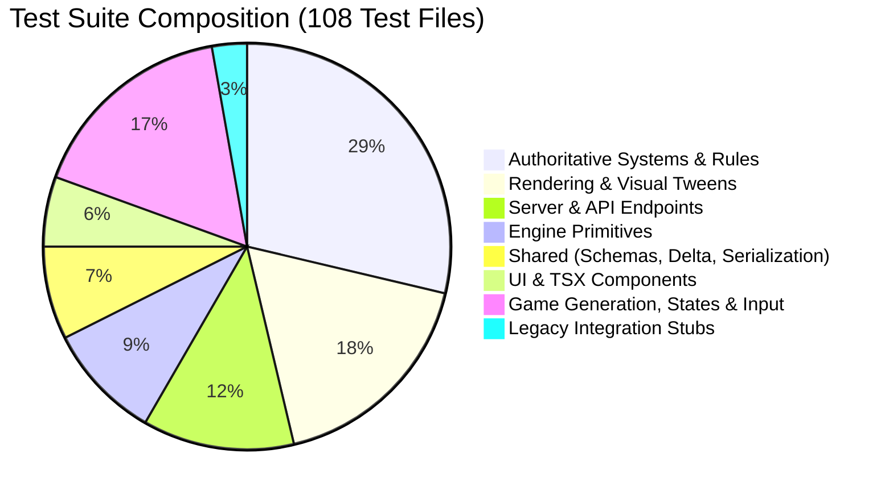

# Full Codebase Test Suite Review: Server Authority, Engine Integrity, and High-Value Test Strategy

**Date:** 2026-10-28  
**Scope:** Server Layer (`src/server`, `src/app/api`, `src/app/persistence`), Engine Layer (`src/engine`), Shared Layer (`src/shared`), Authoritative Game Systems (`src/game/systems`), UI & Zustand Bridge (`src/game/ui`, `src/components/ui`), and Rendering Subsystems (`src/rendering`, `tests/rendering`).

---

## 1. Executive Summary

A comprehensive, ground-truth audit of the Nirmata Runner test suite was conducted following the initial review on 2026-10-27 ([`docs/archive/reports/2026-10-27-test-coverage-review.md`](file:///Users/chadmowery/personal/dev/dungeon-runner/nirmata-run/docs/archive/reports/2026-10-27-test-coverage-review.md)) and the architecture remediations merged in commit `3266693a`.

The test suite currently contains **108 test files** with **596 passing tests** executing in ~7.5 seconds under Vitest.

### Progress Since 2026-10-27
Commit `3266693a` successfully resolved several foundational architecture and test deficits:
1. **Client Prediction vs. Server Authority**: Introduced [`tests/engine/turn-manager-client.test.ts`](file:///Users/chadmowery/personal/dev/dungeon-runner/nirmata-run/tests/engine/turn-manager-client.test.ts) (verifying client mode skips enemy turns and energy drains) and [`tests/game/input-buffer.test.ts`](file:///Users/chadmowery/personal/dev/dungeon-runner/nirmata-run/tests/game/input-buffer.test.ts) (verifying the 3-slot bounded FIFO queue in [`InputManager`](file:///Users/chadmowery/personal/dev/dungeon-runner/nirmata-run/src/game/input/input-manager.ts#L35)).
2. **True ECS State Delta Replication**: Implemented [`createECSWorldDelta`](file:///Users/chadmowery/personal/dev/dungeon-runner/nirmata-run/src/shared/ecs-delta.ts#L22) and [`World.applyDelta`](file:///Users/chadmowery/personal/dev/dungeon-runner/nirmata-run/src/engine/ecs/world.ts#L264), thoroughly validated in [`tests/shared/ecs-delta.test.ts`](file:///Users/chadmowery/personal/dev/dungeon-runner/nirmata-run/tests/shared/ecs-delta.test.ts).
3. **Session & Attempt Security**: Introduced [`tests/api/session-security.test.ts`](file:///Users/chadmowery/personal/dev/dungeon-runner/nirmata-run/tests/api/session-security.test.ts) ensuring competitive runs (Weekly/Daily) cannot bypass attempt restrictions via practice `/api/session` calls.
4. **Authoritative Leaderboard Persistence & Scoring**: Added [`tests/api/leaderboard-persistence.test.ts`](file:///Users/chadmowery/personal/dev/dungeon-runner/nirmata-run/tests/api/leaderboard-persistence.test.ts) and [`src/game/scoring.test.ts`](file:///Users/chadmowery/personal/dev/dungeon-runner/nirmata-run/src/game/scoring.test.ts), and wired server-authoritative submission directly on `RUN_ENDED` in [`src/app/api/action/route.ts`](file:///Users/chadmowery/personal/dev/dungeon-runner/nirmata-run/src/app/api/action/route.ts#L216).
5. **Visual Reconciliation Stability**: Added [`tests/rendering/event-dedup.test.ts`](file:///Users/chadmowery/personal/dev/dungeon-runner/nirmata-run/tests/rendering/event-dedup.test.ts) and [`tests/rendering/sprite-reconciliation.test.ts`](file:///Users/chadmowery/personal/dev/dungeon-runner/nirmata-run/tests/rendering/sprite-reconciliation.test.ts) to guard against duplicate tweens and ghost sprites during delta reconciliation.



### The Strategic Shift: High-Value Testing Over Raw Coverage
In accordance with your core directive:
> *"Engine and server tests are critical, tsx tests are low priority (except things that touch Zustand perhaps). Be sure to focus on high value tests--this may require reworking or removing old tests that are not needed or low value (we are not testing just to test or just for coverage)."*

Our audit identifies that the project is carrying **significant dead weight and misleading tests** (including zero-assertion TSX files, mock-heavy cosmetic assertions, and dead-pipeline tests), while **critical server authority and authoritative game loops remain untested**.

---

## 2. Key Quantitative Findings & Risk Matrix

| Layer / Subsystem | Total Source Files | Dedicated Test Files | Estimated Logic Coverage | High-Value Test Status & Primary Concerns |
| :--- | :---: | :---: | :---: | :--- |
| **Server & API** (`src/server`, `src/app/api`, `src/app/persistence`) | 38 | 13 | ~32% | **Critical Gaps**: `SessionManager` unbounded memory leak; `/api/leaderboard/submit` still accepts arbitrary unverified client stats; 24 of 34 API routes untested. |
| **Engine Core** (`src/engine`) | 20 | 10 | ~88% | **Strong**: TurnManager, Grid, BSP, EventBus well-tested. **Gap**: `World.destroyEntity` child recursion stack overflow crash risk. |
| **Shared** (`src/shared`) | 63 | 8 | ~38% | **Mixed**: `ecs-delta.ts` is rock-solid. `pipeline.ts` is dead runtime code using deprecated `json-diff-ts`. Inverted `@shared -> @game` imports remain. `economy-util.ts` has 0 tests. |
| **Authoritative Game Systems** (`src/game/systems`) | 32 | 19 | ~60% | **Critical Gaps**: `GravediggerSystem` (Death Protocol), `FloorManagerSystem` (descent & gear preservation), and `StabilitySystem` have **zero unit tests**. |
| **UI & Zustand Bridge** (`src/game/ui`, `src/components/ui`) | 9 | 8 | ~50% | **High Value**: Zustand HUD subscribers (`PlayerHUD`, `MessageLog`) are solid. **Dead Weight**: 2 TSX stubs have 0 assertions; `sync-bridge.ts` has 0 tests. |
| **Rendering** (`src/rendering`, `tests/rendering`) | 24 | 19 | ~75% | **Over-tested Cosmetic Details**: Several tests mock PixiJS to assert static call orders; misplaced non-rendering reconciliation tests. |

---

## 3. Detailed Findings by Layer

### 3.1 Server Layer (`src/server`, `src/app/api`, `src/app/persistence`)

#### A. Session Lifecycle & Memory Management (R-02)
- **Source**: [`src/server/session/session-manager.ts`](file:///Users/chadmowery/personal/dev/dungeon-runner/nirmata-run/src/server/session/session-manager.ts) and [`src/server/session/SessionManager.ts`](file:///Users/chadmowery/personal/dev/dungeon-runner/nirmata-run/src/server/session/SessionManager.ts)
- **Status**: **ZERO DIRECT TESTS**. No dedicated `session-manager.test.ts` exists.
- **Findings**:
  1. `SessionManager` maintains an in-memory `private sessions = new Map<string, unknown>()` with **no TTL, no last-accessed timestamp, no max capacity, and no cleanup routine**. In long-running production Node.js instances, sessions created via [`/api/session`](file:///Users/chadmowery/personal/dev/dungeon-runner/nirmata-run/src/app/api/session/route.ts) or [`/api/run-mode/launch`](file:///Users/chadmowery/personal/dev/dungeon-runner/nirmata-run/src/app/api/run-mode/launch/route.ts) accumulate forever.
  2. The redundant 35-byte re-export file `SessionManager.ts` still exists.
  3. Methods [`deleteSession`](file:///Users/chadmowery/personal/dev/dungeon-runner/nirmata-run/src/server/session/session-manager.ts#L59), [`listSessions`](file:///Users/chadmowery/personal/dev/dungeon-runner/nirmata-run/src/server/session/session-manager.ts#L64), [`hasSession`](file:///Users/chadmowery/personal/dev/dungeon-runner/nirmata-run/src/server/session/session-manager.ts#L68), and concurrent session isolation have no direct unit tests.

#### B. Leaderboard Route Security: An Open Anti-Cheat Vector (R-01)
- **Source**: [`src/app/api/leaderboard/submit/route.ts`](file:///Users/chadmowery/personal/dev/dungeon-runner/nirmata-run/src/app/api/leaderboard/submit/route.ts) and [`src/server/leaderboard/leaderboard-service.ts`](file:///Users/chadmowery/personal/dev/dungeon-runner/nirmata-run/src/server/leaderboard/leaderboard-service.ts)
- **Status**: **PARTIALLY FIXED / STILL EXPLOITABLE**.
- **Findings**:
  1. In commit `3266693a`, Chad implemented automatic server-side leaderboard submission in [`src/app/api/action/route.ts:216-224`](file:///Users/chadmowery/personal/dev/dungeon-runner/nirmata-run/src/app/api/action/route.ts#L216-L224) using session-verified run stats when `RUN_ENDED` occurs. This is the correct authoritative pattern.
  2. **However, `POST /api/leaderboard/submit` was left active and open**. It parses `{ sessionId, mode, stats }` directly from the client JSON body (line 8) and passes it blindly to `submitLeaderboardEntry`.
  3. Any client or bad actor can bypass the server game engine and POST:
     ```json
     {
       "sessionId": "hacked-run",
       "mode": "weekly",
       "stats": { "floorNumber": 999, "scrapExtracted": 999999, "softwareExtracted": 50, "fluxExtracted": 99999 }
     }
     ```
     This immediately overwrites the Weekly One-Shot leaderboard with arbitrary scores.
  4. Neither [`/api/leaderboard/submit`](file:///Users/chadmowery/personal/dev/dungeon-runner/nirmata-run/src/app/api/leaderboard/submit/route.ts), [`/api/leaderboard/daily`](file:///Users/chadmowery/personal/dev/dungeon-runner/nirmata-run/src/app/api/leaderboard/daily/route.ts), nor [`/api/leaderboard/weekly`](file:///Users/chadmowery/personal/dev/dungeon-runner/nirmata-run/src/app/api/leaderboard/weekly/route.ts) has route tests.

#### C. API Route Coverage Deficit (24 of 34 Routes Untested)
Only 10 route handlers have tests. The remaining 24 are 0% covered:

| Category | Tested Routes | High-Value Untested Routes (0% Coverage) |
| :--- | :--- | :--- |
| **Action & Turn** | `/api/action` (MOVE/WAIT only) | Complex intents in `/api/action`: `EQUIP`, `UNEQUIP`, `BURN_SOFTWARE`, `STAIRCASE_DESCEND`, `ANCHOR_DESCEND`, `ANCHOR_EXTRACT` |
| **Economy & Shop** | `/api/economy/compile`, `/install`, `/upgrade` | [`/api/economy/purchase`](file:///Users/chadmowery/personal/dev/dungeon-runner/nirmata-run/src/app/api/economy/purchase/route.ts) (wallet scrap deduction, capacity validation), [`/api/economy/uninstall`](file:///Users/chadmowery/personal/dev/dungeon-runner/nirmata-run/src/app/api/economy/uninstall/route.ts) |
| **Vault & Overflow** | `/api/vault/equip-from-vault` (slot limits) | [`/api/vault/sell`](file:///Users/chadmowery/personal/dev/dungeon-runner/nirmata-run/src/app/api/vault/sell/route.ts) (scrap credit, item removal), [`/api/vault/discard`](file:///Users/chadmowery/personal/dev/dungeon-runner/nirmata-run/src/app/api/vault/discard/route.ts), [`/api/vault/overflow`](file:///Users/chadmowery/personal/dev/dungeon-runner/nirmata-run/src/app/api/vault/overflow/route.ts) |
| **Leaderboard** | *None* | `/api/leaderboard/submit`, `/api/leaderboard/daily`, `/api/leaderboard/weekly` |
| **Profile & Run Mode**| `/api/run-mode/launch`, `/api/session` | [`/api/profile`](file:///Users/chadmowery/personal/dev/dungeon-runner/nirmata-run/src/app/api/profile/route.ts), [`/api/run-mode/available`](file:///Users/chadmowery/personal/dev/dungeon-runner/nirmata-run/src/app/api/run-mode/available/route.ts) |
| **Admin & CMS** | `/api/admin/reset`, 3 schema routes | `/api/shells`, `/api/admin/grant`, `/api/admin/inspect`, `/api/admin/reset-attempts`, `/api/admin/seed-rotation`, `/api/debug/log`, 7 CMS routes |

#### D. Action Route Run-End Persistence Blind Spot
In [`src/app/api/action/__tests__/action.test.ts`](file:///Users/chadmowery/personal/dev/dungeon-runner/nirmata-run/src/app/api/action/__tests__/action.test.ts):
- Only `MOVE` and `WAIT` intents are validated.
- **Untested Persistence on `RUN_ENDED`**: In [`action/route.ts:180-225`](file:///Users/chadmowery/personal/dev/dungeon-runner/nirmata-run/src/app/api/action/route.ts#L180-L225), the server handles run completion: clamping wallet currencies to `economy.caps`, routing extracted items into `profile.vault` vs `profile.overflow` based on capacity, and calling `profileRepository.save`. **None of this run-end persistence is tested**.
- **Constant Misalignment**: Line 202 hardcodes `const VAULT_CAPACITY = 20`, directly conflicting with `VAULT_MAX_SLOTS = 30` in [`src/shared/vault.ts`](file:///Users/chadmowery/personal/dev/dungeon-runner/nirmata-run/src/shared/vault.ts#L3).

#### E. Seed Rotation & Calendar Drift (R-07)
- **Source**: [`src/app/persistence/seed-rotation.ts`](file:///Users/chadmowery/personal/dev/dungeon-runner/nirmata-run/src/app/persistence/seed-rotation.ts) (0 tests)
- **Desynchronization**: Computes seed expiry using elapsed timestamps (`now - rotation.lastDailyUpdate >= ONE_DAY`), whereas [`leaderboard-service.ts`](file:///Users/chadmowery/personal/dev/dungeon-runner/nirmata-run/src/server/leaderboard/leaderboard-service.ts#L48) indexes leaderboards by UTC epoch days (`Math.floor(now.getTime() / 86400000)`). The active daily seed and the active leaderboard period drift out of phase.
- **Path Traversal Risk**: [`fs-profile-repository.ts`](file:///Users/chadmowery/personal/dev/dungeon-runner/nirmata-run/src/app/persistence/fs-profile-repository.ts#L13) concatenates `sessionId` into filesystem paths (`${sessionId}.json`) without regex sanitization, creating path-traversal vulnerabilities.

---

### 3.2 Engine Layer (`src/engine`)

Core engine primitives are among the highest quality in the codebase, but contain specific edge-case blind spots.

#### A. Strengths
- [`TurnManager`](file:///Users/chadmowery/personal/dev/dungeon-runner/nirmata-run/src/engine/turn/turn-manager.ts): Now tested in both standard mode ([`turn-manager.test.ts`](file:///Users/chadmowery/personal/dev/dungeon-runner/nirmata-run/src/engine/turn/turn-manager.test.ts)) and client-prediction mode ([`turn-manager-client.test.ts`](file:///Users/chadmowery/personal/dev/dungeon-runner/nirmata-run/tests/engine/turn-manager-client.test.ts)).
- [`EventBus`](file:///Users/chadmowery/personal/dev/dungeon-runner/nirmata-run/src/engine/events/event-bus.ts): Outstanding coverage in [`event-bus.test.ts`](file:///Users/chadmowery/personal/dev/dungeon-runner/nirmata-run/src/engine/events/event-bus.test.ts) (recursion limits, flush order, cleanup).
- [`Grid`](file:///Users/chadmowery/personal/dev/dungeon-runner/nirmata-run/src/engine/grid/grid.ts) & Procedural Generation ([`bsp.ts`](file:///Users/chadmowery/personal/dev/dungeon-runner/nirmata-run/src/engine/generation/bsp.ts), [`flood-fill.ts`](file:///Users/chadmowery/personal/dev/dungeon-runner/nirmata-run/src/engine/generation/flood-fill.ts)): Rock solid.

#### B. Gaps & Hidden Failure Modes
1. **ECS World Child Hierarchy Recursion Crash Risk**:
   In [`World.destroyEntity`](file:///Users/chadmowery/personal/dev/dungeon-runner/nirmata-run/src/engine/ecs/world.ts#L53-L70):
   ```ts
   if (this.config.childComponentKey) {
     const childrenStore = this.stores.get(this.config.childComponentKey);
     if (childrenStore && childrenStore.has(id)) {
       const childrenData = childrenStore.get(id) as { entityIds: number[] };
       for (const childId of childrenData.entityIds) {
         this.destroyEntity(childId); // Recurses BEFORE this.entities.delete(id)
       }
     }
   }
   this.entities.delete(id);
   ```
   `this.entities.delete(id)` happens **after** recursing into children. If an entity graph contains cyclic or bidirectional references (common in equipment/socket parenting), calling `destroyEntity` immediately triggers `RangeError: Maximum call stack size exceeded`. No test in [`world.test.ts`](file:///Users/chadmowery/personal/dev/dungeon-runner/nirmata-run/src/engine/ecs/world.test.ts) guards against cyclic hierarchies.
2. **Untested Engine Serialization Methods**:
   - [`World.getSerializableState`](file:///Users/chadmowery/personal/dev/dungeon-runner/nirmata-run/src/engine/ecs/world.ts#L226) and [`World.loadSerializableState`](file:///Users/chadmowery/personal/dev/dungeon-runner/nirmata-run/src/engine/ecs/world.ts#L242) have zero assertions in `world.test.ts`.
   - [`World.unregisterSystem`](file:///Users/chadmowery/personal/dev/dungeon-runner/nirmata-run/src/engine/ecs/world.ts#L198) is untested.
   - [`Grid.getSerializableTiles`](file:///Users/chadmowery/personal/dev/dungeon-runner/nirmata-run/src/engine/grid/grid.ts#L142) and [`loadSerializableTiles`](file:///Users/chadmowery/personal/dev/dungeon-runner/nirmata-run/src/engine/grid/grid.ts#L153) are untested in `grid.test.ts`.

---

### 3.3 Shared Layer (`src/shared`)

#### A. Dead Runtime Code in `src/shared/pipeline.ts`
- **Architectural Discovery**: `runActionPipeline()` in [`src/shared/pipeline.ts`](file:///Users/chadmowery/personal/dev/dungeon-runner/nirmata-run/src/shared/pipeline.ts#L39) is **dead runtime code**. Neither the client ([`InputManager`](file:///Users/chadmowery/personal/dev/dungeon-runner/nirmata-run/src/game/input/input-manager.ts)) nor the authoritative server ([`src/app/api/action/route.ts`](file:///Users/chadmowery/personal/dev/dungeon-runner/nirmata-run/src/app/api/action/route.ts)) calls `runActionPipeline`. Both execute actions through `TurnManager.submitAction()`.
- `runActionPipeline` is an artifact of Phase 5 that still uses `json-diff-ts` (which was superseded by `ecs-delta.ts`).
- It is only imported in test files ([`src/shared/__tests__/pipeline.test.ts`](file:///Users/chadmowery/personal/dev/dungeon-runner/nirmata-run/src/shared/__tests__/pipeline.test.ts), [`software.test.ts`](file:///Users/chadmowery/personal/dev/dungeon-runner/nirmata-run/src/game/systems/software.test.ts), and a confused legacy test [`death-equipment-clear.test.ts`](file:///Users/chadmowery/personal/dev/dungeon-runner/nirmata-run/src/tests/integration/death-equipment-clear.test.ts)).
- Of the 16 action types in `pipeline.ts`, 11 are untested.

#### B. Confusing Test Filename Collision
There are two test files named `pipeline.test.ts`:
1. [`src/shared/pipeline.test.ts`](file:///Users/chadmowery/personal/dev/dungeon-runner/nirmata-run/src/shared/pipeline.test.ts): Tests `MoveIntent` -> `AttackIntent` conversion and phase execution directly on ECS `World`. It **never calls `runActionPipeline`**.
2. [`src/shared/__tests__/pipeline.test.ts`](file:///Users/chadmowery/personal/dev/dungeon-runner/nirmata-run/src/shared/__tests__/pipeline.test.ts): Calls `runActionPipeline` for `MOVE`, bump attack, `WAIT`, `EQUIP`, and `UNEQUIP`.

#### C. Layering Inversions (`@shared` -> `@game`)
Per `AGENTS.md` Layer Boundaries, `@shared` must have **zero imports from `@game`**. Two files violate this:
1. [`src/shared/pipeline.ts:27,32`](file:///Users/chadmowery/personal/dev/dungeon-runner/nirmata-run/src/shared/pipeline.ts#L27): Imports `checkAutoLoader` and `registerCoreSystems` from `@game/systems/...`.
2. [`src/shared/utils/economy-util.ts:1`](file:///Users/chadmowery/personal/dev/dungeon-runner/nirmata-run/src/shared/utils/economy-util.ts#L1): Imports `economy.json` from `../../game/entities/templates/economy.json`.

#### D. Untested Reward Formulas
[`src/shared/utils/economy-util.ts`](file:///Users/chadmowery/personal/dev/dungeon-runner/nirmata-run/src/shared/utils/economy-util.ts) has **0 tests**:
- [`calculatePityScrap(floorNumber)`](file:///Users/chadmowery/personal/dev/dungeon-runner/nirmata-run/src/shared/utils/economy-util.ts#L7)
- [`calculateExtractionFluxBonus(floorNumber, scrapExtracted)`](file:///Users/chadmowery/personal/dev/dungeon-runner/nirmata-run/src/shared/utils/economy-util.ts#L14)
- [`mapInventoryToVaultItems(inventory)`](file:///Users/chadmowery/personal/dev/dungeon-runner/nirmata-run/src/shared/utils/economy-util.ts#L22)
These determine player progression payouts on run failure and extraction.

#### E. Component Registry Redundancy
In [`src/shared/components/index.ts`](file:///Users/chadmowery/personal/dev/dungeon-runner/nirmata-run/src/shared/components/index.ts), `SoftwareSlots` is registered twice in `COMPONENTS_REGISTRY` (lines 137 and 183).

---

### 3.4 Authoritative Game Systems (`src/game/systems`)

The authoritative turn execution on the server depends on 32 game systems. While combat, movement, AI, heat, software, and augments have comprehensive tests, **the systems that dictate run lifecycle, floor progression, and entity death have ZERO tests**.

```mermaid
flowchart TD
    subgraph Comprehensive System Tests
        Combat[Combat & Armor]
        AI[AI & Pathfinding]
        Heat[Heat & Kernel Panic]
        Soft[Software Execution & Burn]
        Aug[Augment Modifiers]
        Move[Movement & Bump Attacks]
        Score[Scoring Calculations]
    end

    subgraph CRITICAL UNTESTED SYSTEMS (0 Tests)
        Grave["GravediggerSystem (Death Protocol & Grid Cleanup)"]
        Floor["FloorManagerSystem (Descent, Item Preservation, Terrain)"]
        Stab["StabilitySystem (Per-Turn Bleed & Degraded HP)"]
        Dead["DeadZoneSystem (Hazard DoT & Expiry)"]
        Corrupt["TileCorruptionSystem (Seed Eater BFS Spread)"]
        Pack["PackCoordinatorSystem (Buffer-Overflow Detonation)"]
        Anchor["AnchorInteractionSystem (Extraction & Descent Payloads)"]
    end
```

1. **[`GravediggerSystem`](file:///Users/chadmowery/personal/dev/dungeon-runner/nirmata-run/src/game/systems/gravedigger.ts#L12) (0 Tests - CRITICAL)**:
   - Sole system authorized under the Death Protocol to call `world.destroyEntity()`.
   - **Untested**: Does it clean up `grid.removeEntity(id, x, y)` *before* destroying the entity? If not, ghost entity IDs linger in the spatial index, causing phantom collisions.
2. **[`FloorManagerSystem`](file:///Users/chadmowery/personal/dev/dungeon-runner/nirmata-run/src/game/systems/floor-manager.ts#L29) (0 Dedicated Tests - CRITICAL)**:
   - Manages floor transitions: preserving the player and equipped loadout, marking floor entities `Dying`, re-seeding RNG, rebuilding the tilemap, and re-placing the player.
   - If this breaks, player inventory is wiped or runs hang indefinitely.
3. **[`StabilitySystem`](file:///Users/chadmowery/personal/dev/dungeon-runner/nirmata-run/src/game/systems/stability.ts#L41) (0 Tests - HIGH)**:
   - Manages Reality Stability: per-floor chunk loss on `FloorTransitioned`, per-turn bleed, and attaching 2 HP `DamageIntent` when stability reaches 0.
4. **[`DeadZoneSystem`](file:///Users/chadmowery/personal/dev/dungeon-runner/nirmata-run/src/game/systems/dead-zone.ts#L12) (0 Tests - MEDIUM-HIGH)**:
   - Hazard DoT ticks on tile occupants, turn duration countdown, and expiration into `Dying`.
5. **[`AnchorInteractionSystem`](file:///Users/chadmowery/personal/dev/dungeon-runner/nirmata-run/src/game/systems/anchor-interaction.ts#L30) (0 Dedicated Tests - HIGH)**:
   - Processes `ExtractionIntent` (initiating `RUN_ENDED`) and constructs the `ANCHOR_INTERACTION` modal payload (stability %, inventory software/firmware/augments, scrap count).
6. **[`TileCorruptionSystem`](file:///Users/chadmowery/personal/dev/dungeon-runner/nirmata-run/src/game/systems/tile-corruption.ts#L17) (280 LOC, 0 Tests) & [`PackCoordinatorSystem`](file:///Users/chadmowery/personal/dev/dungeon-runner/nirmata-run/src/game/systems/pack-coordinator.ts#L21) (161 LOC, 0 Tests)**:
   - Boss BFS tile corruption and Buffer-Overflow swarm surround/detonate mechanics.

---

### 3.5 UI, Zustand & Rendering Subsystems

Applying your rule: *"tsx tests are low priority (except things that touch Zustand perhaps)... focus on high value tests--reworking or removing old tests that are not needed or low value"*.

#### A. The Critical Gap: `sync-bridge.ts` (0 Tests)
- **Source**: [`src/game/ui/sync-bridge.ts`](file:///Users/chadmowery/personal/dev/dungeon-runner/nirmata-run/src/game/ui/sync-bridge.ts)
- **Role**: The authoritative pipeline connecting ECS world state and engine events to the React/Zustand [`gameStore`](file:///Users/chadmowery/personal/dev/dungeon-runner/nirmata-run/src/game/ui/store.ts). It syncs `Health`, `NeuralHeat`, `FloorState`, `Position`, `RunInventory`, and handles 15+ events (`DAMAGE_DEALT`, `FOV_UPDATED`, `HEAT_CHANGED`, `RUN_ENDED`, `ANCHOR_INTERACTION`).
- **Risk**: **ZERO TESTS**. If a component lookup changes or an event listener fails, the game HUD silently stops updating with no failing test.

#### B. Store Test Redundancy: Two Files in `src/game/ui/`
There are two store test files:
- [`src/game/ui/store.test.ts`](file:///Users/chadmowery/personal/dev/dungeon-runner/nirmata-run/src/game/ui/store.test.ts) (tests inventory visibility and optimistic equipment updates).
- [`src/game/ui/__tests__/store.test.ts`](file:///Users/chadmowery/personal/dev/dungeon-runner/nirmata-run/src/game/ui/__tests__/store.test.ts) (tests player HUD stats, message logs, and game status).
- **Assessment**: Both test distinct parts of `gameStore`, but splitting them across two directories with identical basenames is confusing. They should be merged into `src/game/ui/__tests__/store.test.ts`.

#### C. TSX Tests Evaluation (6 Files)
| File | Zustand Reactive? | Value Assessment | Recommendation |
| :--- | :---: | :--- | :--- |
| [`PlayerHUD.test.tsx`](file:///Users/chadmowery/personal/dev/dungeon-runner/nirmata-run/src/components/ui/__tests__/PlayerHUD.test.tsx) | **Yes** (`gameStore.setState`) | **High Value**: Tests dynamic HUD reactivity when player HP/heat changes. | **RETAIN** |
| [`MessageLog.test.tsx`](file:///Users/chadmowery/personal/dev/dungeon-runner/nirmata-run/src/components/ui/__tests__/MessageLog.test.tsx) | **Yes** (`gameStore.setState`) | **High Value**: Tests log queue, message collapsing `(x2)`, severity styling. | **RETAIN** |
| [`NearbyEntities.test.tsx`](file:///Users/chadmowery/personal/dev/dungeon-runner/nirmata-run/src/components/ui/__tests__/NearbyEntities.test.tsx) | **Yes** (`gameStore.setState`) | **High Value**: Tests HUD threat list updates. | **RETAIN** |
| [`BackpackGrid.test.tsx`](file:///Users/chadmowery/personal/dev/dungeon-runner/nirmata-run/src/components/ui/inventory/BackpackGrid.test.tsx) | No | **Dead Stub**: Sets `window.gameContext` and exits. Never renders component; **0 assertions**. | **PRUNE / REMOVE** |
| [`EquipmentPanel.test.tsx`](file:///Users/chadmowery/personal/dev/dungeon-runner/nirmata-run/src/components/ui/inventory/EquipmentPanel.test.tsx) | No | **Dead Stub**: Sets `window.gameContext` and exits. Never renders component; **0 assertions**. | **PRUNE / REMOVE** |
| [`InRunItemTooltip.test.tsx`](file:///Users/chadmowery/personal/dev/dungeon-runner/nirmata-run/src/components/ui/inventory/InRunItemTooltip.test.tsx) | No | **Low Value**: Mocks `window.gameContext`, asserts static strings. Fragile antipattern. | **PRUNE / REMOVE** |

#### D. Rendering Tests Evaluation (19 Files)
- **High-Value Math & FOV Tests (Retain)**:
  - [`camera.test.ts`](file:///Users/chadmowery/personal/dev/dungeon-runner/nirmata-run/tests/rendering/camera.test.ts), [`camera-lerp.test.ts`](file:///Users/chadmowery/personal/dev/dungeon-runner/nirmata-run/tests/rendering/camera-lerp.test.ts), [`viewport-culling.test.ts`](file:///Users/chadmowery/personal/dev/dungeon-runner/nirmata-run/tests/rendering/viewport-culling.test.ts), [`fov-visibility.test.ts`](file:///Users/chadmowery/personal/dev/dungeon-runner/nirmata-run/tests/rendering/fov-visibility.test.ts), [`entity-fov-gating.test.ts`](file:///Users/chadmowery/personal/dev/dungeon-runner/nirmata-run/tests/rendering/entity-fov-gating.test.ts).
  - Pure math, execute in <1ms, zero PixiJS mocks, guard against screen jitter, camera drift, and fog-of-war visual leaks.
- **High-Value Reconciliation Tests (Retain)**:
  - [`event-dedup.test.ts`](file:///Users/chadmowery/personal/dev/dungeon-runner/nirmata-run/tests/rendering/event-dedup.test.ts) and [`sprite-reconciliation.test.ts`](file:///Users/chadmowery/personal/dev/dungeon-runner/nirmata-run/tests/rendering/sprite-reconciliation.test.ts).
- **Misplaced Core Test (Relocate)**:
  - [`tests/rendering/reconciliation.test.ts`](file:///Users/chadmowery/personal/dev/dungeon-runner/nirmata-run/tests/rendering/reconciliation.test.ts): Has **zero rendering code**; tests ECS optimistic prediction and delta reconciliation. Move to `tests/game/reconciliation.test.ts`.
- **Low-Value / Redundant / Dead Tests (Prune)**:
  - [`src/rendering/animations.test.ts`](file:///Users/chadmowery/personal/dev/dungeon-runner/nirmata-run/src/rendering/animations.test.ts): Incomplete draft with a test that has **0 assertions**; superseded by `move-tween.test.ts` and `event-dedup.test.ts`.
  - [`src/rendering/layer-ordering.test.ts`](file:///Users/chadmowery/personal/dev/dungeon-runner/nirmata-run/src/rendering/layer-ordering.test.ts): Mocks `Container.addChild` to assert 4 static layers were added. Pure "testing just to test".
  - [`src/rendering/filters/__tests__/particle-emitters.test.ts`](file:///Users/chadmowery/personal/dev/dungeon-runner/nirmata-run/src/rendering/filters/__tests__/particle-emitters.test.ts): Cosmetic mock calls with missing assertions.
  - Consolidate [`entity-sprite-map.test.ts`](file:///Users/chadmowery/personal/dev/dungeon-runner/nirmata-run/tests/rendering/entity-sprite-map.test.ts) and [`sprite-cleanup.test.ts`](file:///Users/chadmowery/personal/dev/dungeon-runner/nirmata-run/tests/rendering/sprite-cleanup.test.ts) (both duplicate identical 30-line Pixi mocks for `sprite-map.ts`).
  - Prune obsolete legacy tests: [`src/tests/integration/tech-demo.test.ts`](file:///Users/chadmowery/personal/dev/dungeon-runner/nirmata-run/src/tests/integration/tech-demo.test.ts) (outdated mock bridge) and [`death-equipment-clear.test.ts`](file:///Users/chadmowery/personal/dev/dungeon-runner/nirmata-run/src/tests/integration/death-equipment-clear.test.ts) (test author acknowledges it doesn't test equipment clearing).

---

## 4. Prioritized Risk & Quality Register

| ID | Severity | Category | Risk Description & Impact | Recommended Action |
| :--- | :---: | :--- | :--- | :--- |
| **R-01** | **CRITICAL** | Security / Anti-Cheat | **Exposed Arbitrary Leaderboard Endpoint**: `POST /api/leaderboard/submit` accepts unvalidated stats from client body without checking server session state, allowing arbitrary score poisoning. | Remove public `/api/leaderboard/submit` (or enforce active server session lookup); rely on server-authoritative submission in `/api/action`. |
| **R-02** | **CRITICAL** | Reliability / Memory | **Unbounded Session Leak**: `SessionManager` stores sessions indefinitely in `Map` with no TTL, capacity cap, or cleanup. Will crash production Node.js with OOM. | Implement sliding-window TTL (e.g. 60 min) + max capacity pruning in `SessionManager`; write direct unit test suite. |
| **R-03** | **CRITICAL** | Core Gameplay Loop | **Untested Death Protocol & Floor Descent**: `GravediggerSystem` and `FloorManagerSystem` have 0 tests. Regressions in spatial grid clearing, entity destruction, or equipment preservation will break runs. | Create dedicated unit tests for `gravedigger.test.ts` and `floor-manager.test.ts`. |
| **R-04** | **HIGH** | Economy Integrity | **Untested Vault & Shop Transactions**: `/api/economy/purchase`, `/api/vault/sell`, and `/api/vault/discard` are untested. Risk of negative currency balances, item duplication, or loss. | Create integration test suite `tests/api/vault-economy-transactions.test.ts`. |
| **R-05** | **HIGH** | Architecture | **Inverted Layering (`@shared` -> `@game`)**: `pipeline.ts` and `economy-util.ts` import from `@game`. Furthermore, `runActionPipeline` is dead runtime code using deprecated `json-diff-ts`. | Retire/relocate `runActionPipeline`; inject or decouple economy configs in `economy-util.ts`. |
| **R-06** | **HIGH** | UI State Integrity | **Untested Sync Bridge**: `src/game/ui/sync-bridge.ts` connects all ECS component states and engine events to Zustand `gameStore`, but has 0 tests. | Add `src/game/ui/__tests__/sync-bridge.test.ts` testing event-to-store projection. |
| **R-07** | **MEDIUM** | Game Logic | **Seed Rotation vs Leaderboard Drift**: Mismatch between elapsed-time rotation in `seed-rotation.ts` and UTC epoch day indexing in `leaderboard-service.ts`. | Align `seed-rotation.ts` to calendar UTC midnight boundaries matching leaderboards; add unit test. |
| **R-08** | **MEDIUM** | Stability / Engine | **Cyclic Child Hierarchy Stack Overflow**: `World.destroyEntity` recurses into children before deleting parent ID from `this.entities`. | Guard `destroyEntity` against cyclic hierarchies; add edge-case test in `world.test.ts`. |
| **R-09** | **LOW** | Test Debt | **Dead Stubs & Low-Value Cosmetic Tests**: Multiple test files with 0 assertions or trivial call-order checks add maintenance overhead without catching bugs. | Prune 6 dead/low-value test files; consolidate duplicates. |

---

## 5. Strategic Test Refactoring & Pruning Plan

Rather than writing tests for arbitrary coverage metrics, the test suite should be reshaped into a lean, high-value asset focused on **Server Authority, Engine Stability, Authoritative Game Systems, and Zustand UI State**.

### A. Test Pruning Candidates (Immediate Debt Reduction)
Removing these 6 files eliminates dead code, zero-assertion stubs, and cosmetic mocks:
1. `src/components/ui/inventory/BackpackGrid.test.tsx` (Dead stub, 0 assertions)
2. `src/components/ui/inventory/EquipmentPanel.test.tsx` (Dead stub, 0 assertions)
3. `src/components/ui/inventory/InRunItemTooltip.test.tsx` (Trivial mock of global window context)
4. `src/rendering/animations.test.ts` (Broken/incomplete draft, superseded by `move-tween.test.ts`)
5. `src/rendering/layer-ordering.test.ts` (Trivial call-order check of 4 layers)
6. `src/rendering/filters/__tests__/particle-emitters.test.ts` (Cosmetic mock calls, missing assertions)
7. `src/tests/integration/tech-demo.test.ts` & `death-equipment-clear.test.ts` (Obsolete early tech demo tests)

### B. Test Consolidation & Relocation Candidates
1. **Merge Store Tests**: Combine `src/game/ui/store.test.ts` into `src/game/ui/__tests__/store.test.ts`.
2. **Relocate Reconciliation Test**: Move `tests/rendering/reconciliation.test.ts` -> `tests/game/reconciliation.test.ts` (it tests ECS optimistic prediction, not rendering).
3. **Consolidate Sprite Map Tests**: Merge `tests/rendering/entity-sprite-map.test.ts` and `tests/rendering/sprite-cleanup.test.ts` into a single `tests/rendering/sprite-map.test.ts`.
4. **Move Co-located Rendering Tests**: Move `src/rendering/filters/glitch-effects.test.ts` and `src/rendering/tilemap-build.test.ts` into `tests/rendering/`.

### C. Critical New High-Value Tests to Implement
1. **Server Layer**:
   - `src/server/session/__tests__/session-manager.test.ts`: TTL expiry, capacity eviction, session isolation.
   - `tests/api/vault-economy-transactions.test.ts`: Purchase (funds check, item add), sell (item remove, scrap credit), discard.
   - `src/app/api/action/__tests__/action.test.ts`: Expand to cover `EQUIP`, `UNEQUIP`, `BURN_SOFTWARE`, `STAIRCASE_DESCEND`, `ANCHOR_EXTRACT`, and `RUN_ENDED` persistence (wallet caps, vault vs overflow routing).
   - `src/app/persistence/__tests__/seed-rotation.test.ts`: Calendar synchronization, seed determinism.
2. **Authoritative Game Systems**:
   - `src/game/systems/__tests__/gravedigger.test.ts`: Grid spatial removal before `world.destroyEntity()`.
   - `src/game/systems/__tests__/floor-manager.test.ts`: Floor descent, player/loadout preservation, entity purging, dungeon re-generation.
   - `src/game/systems/__tests__/stability.test.ts`: Per-floor chunk loss, turn bleed, 0-stability damage.
   - `src/game/systems/__tests__/dead-zone.test.ts`: Hazard DoT ticks, turn countdown, expiration.
   - `src/game/systems/__tests__/anchor-interaction.test.ts`: Modal payload generation and extraction triggers.
3. **Engine Core**:
   - `src/engine/ecs/world.test.ts`: Add cyclic child hierarchy recursion test, `getSerializableState`/`loadSerializableState` tests.
4. **UI & Zustand**:
   - `src/game/ui/__tests__/sync-bridge.test.ts`: Event-to-Zustand mapping (`DAMAGE_DEALT`, `FOV_UPDATED`, `RUN_ENDED`, `ANCHOR_INTERACTION`).
5. **Shared Utilities**:
   - `src/shared/utils/__tests__/economy-util.test.ts`: Unit tests for `calculatePityScrap`, `calculateExtractionFluxBonus`, and `mapInventoryToVaultItems`.

---

## 6. Decisions & Next Steps for Chad's Review

Before making any project modifications, please review and confirm the following decisions:

1. **Deprecate or Lock Down `/api/leaderboard/submit`**:
   - *Option A (Recommended)*: Delete `/api/leaderboard/submit` entirely. Leaderboard submissions are already handled authoritatively on the server in `/api/action` upon `RUN_ENDED`.
   - *Option B*: Require `/api/leaderboard/submit` to validate an active `sessionId` against `SessionManager` and ignore client-supplied `stats`.
2. **Session Eviction Strategy**:
   - Confirm adding sliding-window TTL (e.g. 60-minute expiry since last access) + max session cap to `SessionManager`, backed by a dedicated unit test suite.
3. **Pruning Dead & Low-Value Tests**:
   - Confirm removing the 7 identified low-value/dead test files (`BackpackGrid.test.tsx`, `EquipmentPanel.test.tsx`, `InRunItemTooltip.test.tsx`, `animations.test.ts`, `layer-ordering.test.ts`, `particle-emitters.test.ts`, `tech-demo.test.ts`, `death-equipment-clear.test.ts`).
4. **Phased Execution Plan**:
   - Recommend beginning with **Phase 1: Critical Server Authority & Memory** (`SessionManager` TTL + tests, leaderboard anti-cheat, vault/economy transaction tests), followed by **Phase 2: Authoritative Systems** (`GravediggerSystem`, `FloorManagerSystem`, `StabilitySystem`, `SyncBridge`), and **Phase 3: Test Pruning & Consolidation**.
