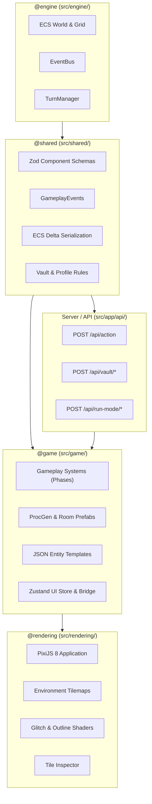

# Branch Handoff: `feat/interactive-environments`

> **Branch:** `feat/interactive-environments`  
> **Base:** `origin/main`  
> **Status:** Fully Implemented, Verified, and Ready for Merge / Next Workstream  
> **Test Suite:** 146 / 146 Test Suites Passing (915 Tests)  
> **Static Analysis:** Zero TypeScript errors (`tsc --noEmit`), Zero ESLint errors  
> **Build:** Turbopack Production Build Verified (`next build`)

---

## 1. Executive Summary

The `feat/interactive-environments` branch represents a foundational evolution of *Nirmata Runner*, transitioning the game from static dungeon corridor crawl into a tactical, reactive, environmental roguelike. Across **25 commits** touching **187 files** (+12,516 / -381 lines), this branch delivers:

1. **Environmental ECS & Data-Driven Architecture (Milestone 1 / ENV-01)**: Six canonical ECS components (`Prop`, `SecurityLock`, `Container`, `InteractiveSurface`, `CorruptedNode`, `InteractPropIntent`), augment trigger hooks (`ON_HACK`, `ON_COVER_BROKEN`), and environmental run scoring (`vaultsBreached`, `trapsDisarmed`).
2. **Hybrid ProcGen & Sector Archetypes (Milestone 2 / ENV-02)**: Bespoke room prefabs (`server-core`, `freight-bay`, `decon-airlock`, `zero-day-vault`), 13 JSON entity templates, procedural anchor classification, and depth-scaled entity budgets.
3. **Prop Interaction Systems & Safeguards (Milestone 3 / ENV-03)**: Deterministic container loot search, lock picking, heat overclocking bypass, Faraday shield teleport blocking, acoustic alert propagation to enemy AI, audio forensics lore, and the **Two-Tier Bump Safeguard** (0-turn pause on hazard/lock danger).
4. **Directional Tactical Cover & Cascade Hazards (Milestone 4 / ENV-04)**: Intervening cover orthogonal damage reduction (25% base, 35% Bastion Shell), volatile chain-reactions (Cryo-Vat chemical spills, Capacitor Bank EMP shockwaves), and firmware disarm counterplay (`LOGIC_JAM.exe`).
5. **Visual Shaders & Container Overlay (Milestone 5 / ENV-05)**: PixiJS multi-state outline filters (safe cyan, locked amber, corrupted pink), Node Canvas sprite compositing, and an in-run two-column Container Modal.
6. **Tactical UI/UX & Inventory Upgrades**: Tactical mouse hover entity inspection (`TacticalInspectTooltip`), ground item transfer modal (`GroundTransferModal`), in-game hotkeys manual (`HotkeysModal`), press-and-hold software burning/mod removal, all-currency telemetry display, and `/show-map` dev terminal command.
7. **Core Bug Fixes & Gameplay Balancing**: Fixed shell upgrade slot recognition on the server, eliminated overlapping slot tags, converted health potions into stacking consumables (up to 10 per slot) with instant HP/Stability and 3-turn regeneration, enabled A* pathfinding around props, slowed down stability drain, and added reality stability recovery upon defeating hostile threats.

---

## 2. Architecture & Layering Compliance

All code strictly enforces the architectural boundaries mandated in `AGENTS.md`:



### ECS Phase-Driven Intent Rules
- **No Cross-System RPCs**: Gameplay systems never call each other directly. Instead, systems attach components such as `InteractPropIntent`, `AttackIntent`, or `ApplyStatusEffectIntent`.
- **Execution Phases**:
  - `PRE_TURN`: Turn setup, tile corruption tick.
  - `GATHER_INTENT`: Player action translation, AI path calculation, bump checks.
  - `ACTION`: `MovementSystem`, `CombatSystem`, `PropInteractionSystem`.
  - `REACTION`: `StatusEffectSystem`, `HealSystem`, `ItemPickupSystem`, volatile cascade detonations.
  - `CLEANUP`: `TagCleanupSystem`, `GravediggerSystem` (sole caller of `world.destroyEntity()`).
  - `POST_TURN`: Floor state evaluation, stability tick, delta generation.

---

## 3. Milestone-by-Milestone Implementation Details

### Milestone 1 (ENV-01): Environment Schemas, Triggers & Scoring
- **Zod Component Schemas** (`src/shared/components/environment.ts`):
  - `Prop`: Type, searched state, volatile flag, destructibility, passability, vision blocking, decibel emission, and cover modifier.
  - `SecurityLock`: Key requirement (`access_key`, `root_key`), overclock heat cost (+35 default), alarm trigger state.
  - `Container`: Masked client loot storage; exposes only `highestRarity` to client until searched.
  - `CorruptedNode`: Traps with `disarmed`, `damageOnContact`, and `detectionDifficulty`.
  - `InteractPropIntent` and `PropInteractedThisTurn`.
- **Floor State Extensions** (`src/shared/components/floor-state.ts`): Added `sectorCondition`, `accessKeysHeld`, `vaultsBreached`, and `trapsDisarmed`.
- **Scoring Integration** (`src/game/scoring.ts`): Added `vaultsBreached` (+150 pts) and `trapsDisarmed` (+50 pts) to the end-of-run scoring matrix.
- **Augment Trigger Conditions** (`src/shared/components/augment-data.ts`): Added `ON_HACK` and `ON_COVER_BROKEN`.

### Milestone 2 (ENV-02): Hybrid ProcGen, Prefabs & Data Templates
- **Bespoke Room Prefabs** (`src/game/generation/prefabs/`):
  - `server-core.json`: High-density tech workstations, subnet consoles, and cooling vents.
  - `freight-bay.json`: Industrial warehouse with destructible crates, biocabinets, and lockers.
  - `decon-airlock.json`: Chokepoint airlock with security vault doors and decontamination zones.
  - `zero-day-vault.json`: High-security Faraday-shielded vault with corrupted nodes and locked safe containers.
- **13 Entity Templates** (`src/game/entities/templates/`):
  - Props: `prop-workstation.json`, `prop-locker.json`, `prop-biocabinet.json`, `prop-safe-locked.json`, `prop-vault-door.json`, `prop-cooling-vent.json`, `prop-dead-drop.json`, `prop-stabilizer.json`, `prop-subnet-console.json`, `prop-crate-cover.json`, `prop-cryo-vat.json`, `prop-capacitor-bank.json`.
  - Keys: `item-access-key.json`.
- **Generator Integration** (`src/game/generation/dungeon-generator.ts`):
  - Prefab stamping inside BSP rooms with collision boundaries.
  - Sector condition assignment (guaranteed on milestone floors 6, 10, 15; 25% chance elsewhere on F6-F15).
  - Procedural anchor classification: `PROP_DESK_CORNER`, `PROP_LOCKER_WALL`, `SURFACE_TABLE_TOP`, `CONTAINER_RARE`.
- **Entity Budgeting & Masked Loot** (`src/game/generation/entity-placement.ts`):
  - Depth-scaled prop ratios: 40% Scavenge / 40% Tactical / 20% Hazards.
  - Server-side masked loot containers. Guaranteed access key placement whenever locked barriers are generated.

### Milestone 3 (ENV-03): Interactive Systems, Bump Safeguards & Lore
- **Prop Interaction Engine** (`src/game/systems/prop-interaction.ts`):
  - **Containers**: Rolls loot upon search, transferring directly to backpack or dropping to ground on overflow.
  - **Locks**: Consumes access key or allows +35 Heat Overclock bypass.
  - **Acoustic Alerts**: Emits 12-tile sound radius waking up idling/patrolling enemies into chasing state.
  - **Lore Transcripts**: Prints corporate forensics audio logs to the message log based on faction theme.
  - **Vents & Stabilizers**: Cooling vents dump -40 Neural Heat; Reality Stabilizers restore +20% Reality Stability.
- **Two-Tier Bump Safeguard** (`src/game/systems/movement.ts`):
  - Safe, unsearched containers auto-interact cleanly on bump.
  - Risky props (active traps, locked barriers without key, or high-heat bypass) halt player movement with **0 turn cost**, flash an alert, and flush the input buffer.
- **Faraday Shielding** (`src/game/systems/teleport.ts`):
  - Blocks teleportation into zero-day vaults unless the security barrier has been unlocked.

### Milestone 4 (ENV-04): Directional Cover, Cascade Reactions & Augments
- **Directional Cover Reduction** (`src/game/systems/combat.ts`):
  - Raycasts between attacker and defender. Intervening orthogonal cover grants **25% damage reduction** (increased to **35%** for `BASTION-v1` shell).
- **Volatile Detonations & Cascades** (`src/game/systems/combat.ts`):
  - `Cryo-Vat`: Creates a 3×3 chemical spill dealing 4 tick damage and applying `MOVEMENT_SLOW`.
  - `Capacitor Bank`: Discharges a 2-tile Manhattan EMP shockwave dealing 10 damage and applying `DISRUPT` stun.
  - Cascade propagation: Deals 15 structural damage within distance 2 without recursion loops.
- **Environmental Augments**:
  - `scavenger-siphon.json`: Restores 5 HP upon opening high-tier containers and boosts scrap collection by 20%.
  - `kinetic-breacher.json`: Breaches cover props in a single blow, converting shrapnel into an offensive spray.
  - `thermal-bypass.json`: Eliminates heat buildup from overclocking locked terminals.
- **Firmware Counterplay** (`src/game/systems/firmware.ts`):
  - `LOGIC_JAM.exe` safely disarms Corrupted Nodes (+50 score, triggers `ON_HACK`).
  - `Extended_Sight.sys` / `GHOST_PULSE.exe` reveals hidden traps in unexplored or dark tiles.

### Milestone 5 (ENV-05): Visual Asset Integration, PixiJS Shaders & UI
- **Handcrafted Tile Assets** (`scripts/build-environment-tiles.cjs`):
  - Node Canvas script composites custom 16×16 environment sprites into `public/assets/tileset.png` with pixel-perfect alignment.
- **PixiJS Outline & Glitch Shaders** (`src/rendering/filters/glitch-effects.ts`, `src/rendering/render-system.ts`):
  - Multi-state outline highlights:
    - **Cyan (#00F0FF)**: Safe, searchable interactables.
    - **Amber (#FF9500)**: Locked barriers, safes, and vault doors.
    - **Pink / Crimson (#FF0055)**: Armed traps and volatile hazard canisters with jitter.
    - **Dimmed Alpha (0.4)**: Depleted/searched props.
- **Container Modal Overlay** (`src/components/ui/inventory/ContainerOverlay.tsx`):
  - 2-column construct for swapping items between container loot and player inventory. Supports keyboard ESC and quick "Take All".

---

## 4. UI/UX Modernization & In-Run Tooling

| Feature | Primary File(s) | Description |
| :--- | :--- | :--- |
| **Tactical Mouse Hover Inspector** | `TacticalInspectTooltip.tsx` | Live cursor inspection on canvas hover showing entity archetype, health, armor, status effects, cover values, and threat level. Press `T` to toggle detailed flavor lore. |
| **Ground Transfer Modal** | `GroundTransferModal.tsx` | Modal opening when standing over ground items or pressing `G`/Space. Take, Take-All, or drop items directly with immediate client-server reconciliation. |
| **Press-and-Hold Actions** | `HoldToConfirmButton.tsx` | 1.5-second hold radial progress bar for destructive or permanent actions (burning software to physical gear, removing corrupted software mods). |
| **In-Game Hotkeys Manual** | `HotkeysModal.tsx` | Modal accessed via `?` or `H` displaying all categorized keybindings (movement, combat, inventory, dev controls). |
| **All-Currency Telemetry** | `PlayerHUD.tsx` | Real-time display of all 4 currencies: Scrap, Flux, Nanites, and Blueprints with Taikoku Vector styling. |
| **DevTerminal `/show-map`** | `DevTerminal.tsx` | Replaced accidental map reveal hotkeys with a deliberate `/show-map` console command. |

---

## 5. Critical Bug Fixes & Gameplay Balancing

### 1. Loadout Upgrade Slot Equipping & Double-Click Support
- **Problem**: Purchasing shell port expansions in the Workshop allowed slots to appear in the loadout, but double-clicking items to equip caused them to disappear from stash without equipping, or fail server validation.
- **Fix**:
  - Updated `src/app/api/vault/equip-from-vault/route.ts` to execute `applyShellUpgradesToRecord(shellRecord, profile.shellUpgrades?.[shellId])` before capacity checks, recognizing upgraded firmware, augment, and software limits.
  - Updated `src/components/ui/hub/LoadoutTab.tsx` to query `effectivePortConfig` instead of base ports, and hardened rollback with `structuredClone(profile)`.

### 2. Elimination of Overlapping "UNLOCKED" Tag
- **Problem**: Added slots rendered an `.unlockedTag` label that collided visually with item icons.
- **Fix**: Removed the DOM label element in `src/components/ui/hub/SlotBox.tsx` while retaining subtle border styling (`styles.unlockedExpansion`) and screen-reader `aria-label`.

### 3. Consumable Health Potions with 10x Stacking & Regeneration
- **Problem**: Health potions were misclassified as software (occupying software slots), did not stack, and lacked consumable mechanics.
- **Fix**:
  - Reclassified `health-potion.json` from `software` to `consumable`. Updated `vault.ts`, `item-metadata.ts`, `StashItemList.tsx`, and `VaultTab.tsx`.
  - Added 10-per-slot stacking in `src/game/engine-factory.ts` with `x{quantity}` badges in `src/components/ui/hub/ItemCard.tsx`.
  - Enhanced `USE_CONSUMABLE` in `src/app/api/action/route.ts`: gives +5 HP and +10 Reality Stability instantly, and triggers a 3-turn `regeneration` status effect (+2 HP per turn handled in `status-effects.ts`).

### 4. Auto-Pathfinding Prop Navigation
- **Problem**: Click-to-move / auto-pathing pathfinder ignored solid props and collided repeatedly with furniture.
- **Fix**: Updated `src/game/debug/auto-pathfind.ts` to query the ECS spatial grid for `Prop`, `BlocksMovement`, and `Hostile` entities, routing A* paths cleanly around obstacles.

### 5. Reality Stability Rebalancing & Mid-Run Recovery
- **Problem**: Reality Stability drained too aggressively on early floors, punishing exploration.
- **Fix**:
  - In `src/game/systems/stability.ts`:
    - `perTurnBleedScale`: reduced from 0.1 to **0.02**.
    - `perTurnBleedBase`: reduced from 0.01 to **0.005**.
    - `perFloorChunkBase`: reduced from 5 to **3**.
    - `perFloorChunkScale`: reduced from 0.5 to **0.2**.
    - Added mid-run recovery: Eliminating a hostile enemy emits `ENTITY_DIED` (`reason: 'threat_purged'`), recovering **+2% Reality Stability**.
  - Increased Reality Stabilizer prop restoration from +10% to **+20%** in `prop-interaction.ts`.

### 6. React Duplicate Key Diagnostic Interceptor
- **Problem**: React logged generic `Encountered two children with the same key, '31'` warnings with no culprit identifier or stack.
- **Fix**:
  - Implemented diagnostic console wrapper in `src/engine/utils/logger.ts` that intercepts duplicate key warnings and logs an informative banner detailing the duplicate key, component trace, and invocation stack.
  - Fixed duplicate key collisions across all hub and vault list components.

---

## 6. Verification & Quality Matrix

| Quality Gate | Command | Result | Notes |
| :--- | :--- | :--- | :--- |
| **Unit & Integration Tests** | `npm test` | **146 passed** (146 files, 915 tests) | 100% test pass rate across `@engine`, `@shared`, `@game`, `@rendering`, and API routes. |
| **Typecheck** | `npm run typecheck` | **0 errors** | Strict TypeScript check (`tsc --noEmit`) passes cleanly. |
| **Linter** | `npm run lint` | **0 errors, 0 warnings** | ESLint layer boundary constraints enforced without warnings. |
| **Production Build** | `npm run build` | **Build Successful** | Next.js 16 + Turbopack compiled all static and dynamic routes. |

---

## 7. Key File Registry

### Core Schemas & Types
- `src/shared/components/environment.ts` — Canonical environment ECS components.
- `src/shared/components/floor-state.ts` — Extended floor state tracking keys, breaches, traps.
- `src/shared/types.ts` — Action schemas including `INTERACT_PROP`, `USE_CONSUMABLE`.
- `src/shared/events/types.ts` — Authoritative gameplay event definitions.

### Gameplay Systems
- `src/game/systems/prop-interaction.ts` — Container search, lock bypass, vents, stabilizers, lore.
- `src/game/systems/movement.ts` — Movement phase resolution and Two-Tier bump safeguard.
- `src/game/systems/combat.ts` — Directional cover reduction and volatile cascade explosions.
- `src/game/systems/stability.ts` — Reality stability bleed, collapse, and threat purge recovery.
- `src/game/systems/firmware.ts` — Firmware effects, trap disarming, and vision pulses.
- `src/game/systems/status-effects.ts` — Status tick downs and consumable regeneration.

### ProcGen & Prefabs
- `src/game/generation/dungeon-generator.ts` — Hybrid BSP/Prefab generator and sector conditions.
- `src/game/generation/entity-placement.ts` — Depth-scaled entity spawning and container masking.
- `src/game/generation/prefabs/` — JSON prefab definitions (`server-core`, `freight-bay`, etc.).

### UI Components
- `src/components/ui/TacticalInspectTooltip.tsx` — Mouse hover entity inspection.
- `src/components/ui/inventory/ContainerOverlay.tsx` — Two-column container loot overlay.
- `src/components/ui/inventory/GroundTransferModal.tsx` — Adjacent and ground loot transfer modal.
- `src/components/ui/HotkeysModal.tsx` — In-game keyboard manual cheatsheet.
- `src/components/ui/atomic/HoldToConfirmButton.tsx` — Press-and-hold radial progress button.
- `src/components/ui/hub/LoadoutTab.tsx` — Hub loadout manager with upgraded port support.

---

## 8. Operator & Developer Playbook

### Running & Testing the Project
> [!IMPORTANT]
> **Never** use the project `Makefile`. It is reserved for manual human operations.

- **Run Unit Tests**:
  ```bash
  npm test
  ```
- **Run Typechecker**:
  ```bash
  npm run typecheck
  ```
- **Run Linter**:
  ```bash
  npm run lint
  ```
- **Build Production Bundle**:
  ```bash
  npm run build
  ```
- **Start Local Dev Server**:
  ```bash
  npm run dev
  ```

### Developer Controls & In-Game Cheats
- **Open DevTerminal**: Press `~` (Tilde) during an active run.
- **Reveal Map**: Type `/show-map` in the DevTerminal and press Enter.
- **Inspect Entities**: Hover cursor over any monster, prop, or item on the canvas. Press `T` to toggle extended flavor lore.
- **Loot Ground Items**: Press `G` or `Space` while standing on or adjacent to dropped items to open the `GroundTransferModal`.
- **Keyboard Cheatsheet**: Press `?` or `H` at any time to inspect active keybindings.

---

## 9. Recommended Future Enhancements

1. **Environmental Sound FX**: Wire synthetic 8-bit audio clips into the acoustic alert triggers and prop searches.
2. **Additional Sector Conditions**: Introduce conditions such as `LOW_GRAVITY` (halved movement cost, increased knockback) or `TOXIC_VENTILATION` (periodic chemical hazard ticks across open hallways).
3. **Vitest Coverage Gate**: Configure `@vitest/coverage-v8` thresholds across `@engine`, `@shared`, and `@server` in `vitest.config.ts`.
