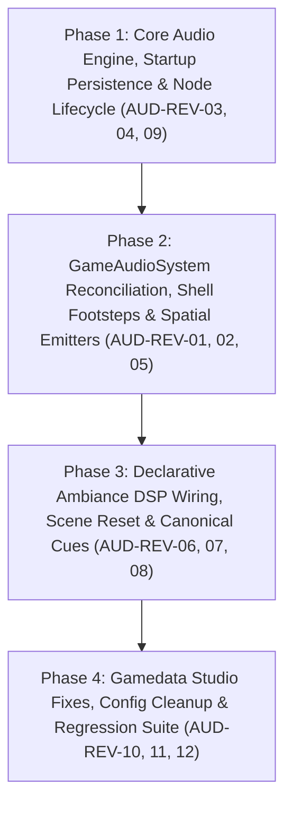

# Adversarial Architecture & Implementation Review: Audio Subsystem (`AUD-01` – `AUD-11`)

**Date:** 2026-11-07  
**Branch:** `feat/audio-system` (`main..HEAD`, 19 commits, 76 files changed)  
**Specification Audited:** [`docs/design/AUDIO-SYSTEM.md`](file:///Users/chadmowery/personal/dev/dungeon-runner/nirmata-run/docs/design/AUDIO-SYSTEM.md)  
**Tracking Reference:** [`docs/TRACKING.md` (Workstream 6: `AUD-01` – `AUD-11`)](file:///Users/chadmowery/personal/dev/dungeon-runner/nirmata-run/docs/TRACKING.md#L330-L401)  
**Architecture References:** [`AGENTS.md`](file:///Users/chadmowery/personal/dev/dungeon-runner/nirmata-run/AGENTS.md), [`src/engine/AGENTS.md`](file:///Users/chadmowery/personal/dev/dungeon-runner/nirmata-run/src/engine/AGENTS.md), [`src/shared/AGENTS.md`](file:///Users/chadmowery/personal/dev/dungeon-runner/nirmata-run/src/shared/AGENTS.md), [`src/client/AGENTS.md`](file:///Users/chadmowery/personal/dev/dungeon-runner/nirmata-run/src/client/AGENTS.md), [`src/dev-tool/AGENTS.md`](file:///Users/chadmowery/personal/dev/dungeon-runner/nirmata-run/src/dev-tool/AGENTS.md)

---

## 1. Executive Summary & Scorecard

An adversarial audit was conducted across all 19 commits of the `feat/audio-system` workstream (`AUD-01` through `AUD-11`), spanning the pure Web Audio synthesis engine (`@engine/audio`), ECS audio schemas (`@shared/components/audio`), client/server state reconciliation (`@shared/reconciliation`, `@shared/serialization`), the event-driven game audio bridge (`@game/audio`), declarative ambiance configuration (`@game/config/ambiance`), React UI controls, and the `/dev/gamedata` Audio & Ambiance Studios.

While the zero-dependency procedural synthesizer (`synth-voice.ts`), master compressor/limiter routing (`audio-engine.ts`), and Gamedata Studio UI establish a solid foundation and pass `npm run typecheck` and `npm run lint` with zero warnings, **12 architectural, functional, security/anti-cheat, and lifecycle defects** were uncovered (**5 P0 High/Critical**, **4 P1 Medium**, **3 P2 Low**).

### Scorecard Summary

| ID | Area / Milestone | Claimed Behavior (`TRACKING.md` / `AUDIO-SYSTEM.md`) | Actual Runtime Verdict | Severity | Status |
| :--- | :--- | :--- | :--- | :--- | :--- |
| **`AUD-REV-01`** | Combat & Post-Mortem Audio (`AUD-03`, `AUD-10`) | `DAMAGE_DEALT` plays defender's `AudioProfile.hitCue` spatially; attacker plays `attackCue`. | **BROKEN ON KILLING BLOWS / `attackCue` IGNORED** — `applyStateDelta()` removes killed entities *before* `DAMAGE_DEALT` emits; `DAMAGE_DEALT` has no cache fallback, losing custom `hitCue` and spatialization on lethal hits. `AudioProfile.attackCue` is never read anywhere. | **P0 Critical** | **RESOLVED** |
| **`AUD-REV-02`** | Shell Archetype Footsteps (`AUD-02`, `AUD-03`) | `Bastion-v1` plays `sfx_step_bastion`, `Ghost-v1` plays `sfx_step_ghost`, `Vanguard-v1` plays `sfx_step_player`. | **100% DEAD CODE IN PRODUCTION** — `player.json` defines `"stepCue": "sfx_step_player"`, which is always truthy and permanently shadows `if (!stepCueId)` shell archetype checks in `GameAudioSystem`. | **P0 High** | **RESOLVED** |
| **`AUD-REV-03`** | Audio Settings Persistence (`AUD-04`) | Saved `localStorage` volume/mute preferences (`nirmata_audio_settings`) persist across browser reloads. | **BROKEN ON STARTUP** — `gameStore` loads `getSavedAudioSettings()` into React state on boot, but never calls `getAudioEngine().updateSettings(...)`. A muted user reloads into an unmuted `AudioEngine` at 80% volume while the UI says "UNMUTE AUDIO". | **P0 High** | **RESOLVED** |
| **`AUD-REV-04`** | Production / Dev-Tool Quarantine (`AUD-11`) | `/api/dev/gamedata/*` routes are strictly quarantined from production (`src/dev-tool/AGENTS.md`). | **VIOLATED** — `GamePage` (`src/app/page.tsx`) fetches `/api/dev/gamedata/configs/ambiance` and `/api/dev/gamedata/audio-cues` on **every `GameState` change** (including in-run Pause/Unpause), generating 404 network errors in production. | **P0 High** | **RESOLVED** |
| **`AUD-REV-05`** | `AmbientEmitter` World Loops & FoW Redaction (`AUD-10`) | Real-time spatial loop tracking updates pan, distance attenuation, and FOV occlusion as player moves; stops when disarmed/searched. | **PARTIALLY BROKEN & LEAKS FOW** — Loops start once on entering `emitter.radius` and **never update pan/gain/occlusion** while inside radius; leaving one emitter calls `stopCue(cueId)` and silences **all** emitters sharing that cue; `emitter.falloff` and `CorruptedNode.isDisarmed` are ignored; unseen entity `Position`/`AmbientEmitter` are unredacted. | **P0 Critical** | **RESOLVED** |
| **`AUD-REV-06`** | Declarative Ambiance DSP Config (`AUD-08`, `AUD-11`) | `ambiance.json` controls floor `baseVolume`, `cutoffMultiplier`, `resonanceQ`, and `ducking` (`stabilityAnchorCutoffHz`, `pauseMenuCutoffHz`, ramps). | **DISCONNECTED** — `GameAudioSystem.syncAmbianceForCurrentFloor()` discards `resolved.baseVolume`, `cutoffMultiplier`, and `resonanceQ`. `AudioEngine.setAmbianceState()` uses hardcoded constants (`18000`, `380`, `0.25`, `0.8`) and omits `OVERCLOCKED_GRID`. | **P1 Medium** | Open |
| **`AUD-REV-07`** | Scene Ambiance Reset & Pause Ducking (`AUD-03`, `AUD-04`) | Returning to Hub/Menu restores clean ambiance; opening ESC Pause/Settings ducks ambiance to `380 Hz`. | **BROKEN** — `playAmbianceCue()` never resets `heatTier`, `sectorCondition`, or `isAnchorDucked` when leaving a run (leaving Hub/Menu music muffled at `380 Hz` or high Q). `isPaused` is never set anywhere in the codebase. | **P1 Medium** | Open |
| **`AUD-REV-08`** | Canonical Sound Cue Coverage (`AUD-02`, `AUD-03`) | All 35+ cues in `sound-cues.json` and `AUDIO-SYSTEM.md` §6.1 trigger on their gameplay/UI events. | **8 CUES UNWIRED** — `ui_modal_open`, `ui_modal_close`, `sfx_ranged_hit`, `sfx_cover_mitigated`, `sfx_cover_broken`, `sfx_volatile_cryo`, `sfx_volatile_emp`, and `sfx_bump_warning` have zero callers. | **P1 Medium** | Open |
| **`AUD-REV-09`** | Web Audio Node Lifecycle & Occlusion (`AUD-01`, `AUD-09`) | Sample and synth voices apply spatial occlusion and clean up all oscillator/gain/panner nodes on end/unmount. | **LEAKS & MISSING FILTER** — `playSampleVoice()` omits the `900 Hz` FOV/wall occlusion filter and never disconnects nodes in `onended`; `synth-voice.ts` never calls `.stop()` on `fmOsc`/`subOsc`/`subBufferSource`/`lfo`; `BtnLever` unmount during hold leaves the ramp oscillator playing forever. | **P1 Medium** | Open |
| **`AUD-REV-10`** | Gamedata `AudioCueStudio` (`AUD-05`, `AUD-08`) | `[ CLONE ]` duplicates the active cue; Ambiance Simulator previews Depth Bands 1–3 and Sector Conditions. | **BROKEN IN STUDIO** — `handleClone` opens a blank template instead of cloning; Simulator dropdown keys (`SUBNET`, `FOUNDRY`, `CORE`) mismatch `getDepthBandCueMap()` (`CORRUPTED_DATA`, `STATIC_HORRORS`, `LOGIC_BREAKERS`), always falling back to Band 1. | **P2 Low** | Open |
| **`AUD-REV-11`** | Audio Config & Registry Hygiene (`AUD-10`, `AUD-11`) | `ambiance.json` and `sound-cues.json` contain clean, valid production cues. | **POLLUTED WITH SCRATCH DATA** — `ambiance.json` points both `mainMenu` and `hub` to `"amb_menu_2"`; `sound-cues.json` has `"amb_main_menu_2"` pointing to non-existent `"/audio/music/cyber-punkbeat.mp3"`. | **P2 Low** | Open |
| **`AUD-REV-12`** | `@engine` Layer Purity (`AUD-01`) | `src/engine/` has zero browser DOM or `fetch` dependencies (`src/engine/AGENTS.md`). | **MINOR BOUNDARY DRIFT** — `AudioEngine` directly attaches `window.addEventListener` unlock listeners and calls browser `fetch()` inside `src/engine/audio/audio-engine.ts`. | **P2 Low** | Open |

---

## 2. Deep-Dive Findings

### 2.1 `AUD-REV-01`: Post-Mortem `DAMAGE_DEALT` Cache Miss, Ignored `attackCue`, & Stale Cache Lifecycle (P0)

#### Locations
- [`applyStateDelta` (`src/shared/reconciliation.ts`)](file:///Users/chadmowery/personal/dev/dungeon-runner/nirmata-run/src/shared/reconciliation.ts#L28-L74)
- [`GameAudioSystem` (`src/game/audio/game-audio-system.ts`)](file:///Users/chadmowery/personal/dev/dungeon-runner/nirmata-run/src/game/audio/game-audio-system.ts#L91-L116)
- [`GameAudioSystem.setupSubscriptions` (`src/game/audio/game-audio-system.ts`)](file:///Users/chadmowery/personal/dev/dungeon-runner/nirmata-run/src/game/audio/game-audio-system.ts#L254-L320)

#### Root Cause Analysis
1. **Reconciliation Order vs. `DAMAGE_DEALT` Entity Lookup**:
   In [`applyStateDelta`](file:///Users/chadmowery/personal/dev/dungeon-runner/nirmata-run/src/shared/reconciliation.ts#L31-L65), the client applies the server's structural ECS delta **before** emitting authoritative gameplay events:
   ```ts
   // Step 1: Apply structural ECS state changes (destroys entities killed by GravediggerSystem)
   world.applyDelta(payload.delta);
   ...
   // Step 4: Re-emit authoritative server events
   for (const event of payload.events) {
     eventBus.emit(event.type, event.payload);
   }
   ```
   When a hit kills an enemy or destroys a prop, the entity is already removed from `this.world` by the time `DAMAGE_DEALT` runs. While the `ENTITY_DIED` handler ([lines 289–320](file:///Users/chadmowery/personal/dev/dungeon-runner/nirmata-run/src/game/audio/game-audio-system.ts#L289-L320)) falls back to `this.audioProfileCache.get(entityId)` and `this.positionCache.get(entityId)`, the `DAMAGE_DEALT` handler ([lines 268–285](file:///Users/chadmowery/personal/dev/dungeon-runner/nirmata-run/src/game/audio/game-audio-system.ts#L268-L285)) does **not**:
   ```ts
   const defenderPos = this.world.getComponent(payload.defenderId, Position);
   const defenderProfile = this.world.getComponent(payload.defenderId, AudioProfile);
   const hitCueId = defenderProfile?.hitCue ?? 'sfx_melee_hit';

   if (defenderPos) {
     this.playSpatialCue(hitCueId, defenderPos.x, defenderPos.y, {
       pitchMultiplier: defenderProfile?.pitchMultiplier,
       volumeMultiplier: defenderProfile?.volumeMultiplier,
     });
   } else {
     this.playGlobalCue(hitCueId, { ... });
   }
   ```
   Consequently, on every killing blow:
   - `defenderProfile` is `undefined`, discarding custom `hitCue`, `pitchMultiplier`, and `volumeMultiplier`.
   - `defenderPos` is `undefined`, so the killing hit plays via `playGlobalCue` (loud, unattenuated center channel) instead of `playSpatialCue` at the target's tile.

2. **`AudioProfile.attackCue` Is Completely Unwired**:
   [`AudioProfile`](file:///Users/chadmowery/personal/dev/dungeon-runner/nirmata-run/src/shared/components/audio.ts#L5-L19) defines `attackCue: z.string().optional()`, and entity templates populate it (`system-admin.json` sets `"attackCue": "sfx_ranged_hit"`, `player.json` sets `"attackCue": "sfx_melee_hit"`). Yet `attackCue` is **never referenced anywhere** in `game-audio-system.ts`.

3. **Stale & Unbounded Entity Caches**:
   `syncEntityCaches()` ([lines 91–107](file:///Users/chadmowery/personal/dev/dungeon-runner/nirmata-run/src/game/audio/game-audio-system.ts#L91-L107)) is only invoked during `constructor`, `DAMAGE_DEALT`, `FLOOR_TRANSITION`, and `FOV_UPDATED`—never on `ENTITY_MOVED` or `ENEMY_TELEPORTED`. If an enemy moves and dies on the same turn, `positionCache` holds its old coordinates. Furthermore, `positionCache` and `audioProfileCache` are never `.clear()`ed on `FLOOR_TRANSITION`, accumulating dead entity IDs across the entire run.

#### Resolution
- Updated `DAMAGE_DEALT` listener in `GameAudioSystem` to fall back to `audioProfileCache` and `positionCache` for both defender and attacker when entities are already removed by `applyStateDelta()`.
- Implemented attacker `attackCue` playback (spatially for enemies, globally for player) with volume and pitch multiplier inheritance.
- Updated `positionCache` on `ENTITY_MOVED` and `ENEMY_TELEPORTED` events to ensure accurate coordinates for entities dying in the same turn.
- Cleared stale entries in `positionCache` and `audioProfileCache` on `FLOOR_TRANSITION` and system `destroy()`.
- Verified with targeted unit tests in `src/game/audio/__tests__/game-audio-system.test.ts`.

---

### 2.2 `AUD-REV-02`: Shell-Specific Footstep Cues (`Bastion-v1` & `Ghost-v1`) Are Shadowed & Unreachable (P0)

#### Locations
- [`player.json`](file:///Users/chadmowery/personal/dev/dungeon-runner/nirmata-run/src/game/entities/templates/player.json#L89-L97)
- [`GameAudioSystem` (`ENTITY_MOVED`)](file:///Users/chadmowery/personal/dev/dungeon-runner/nirmata-run/src/game/audio/game-audio-system.ts#L202-L216)
- [`bastion-v1.json`](file:///Users/chadmowery/personal/dev/dungeon-runner/nirmata-run/src/game/shells/shared/templates/bastion-v1.json), [`ghost-v1.json`](file:///Users/chadmowery/personal/dev/dungeon-runner/nirmata-run/src/game/shells/shared/templates/ghost-v1.json), [`vanguard-v1.json`](file:///Users/chadmowery/personal/dev/dungeon-runner/nirmata-run/src/game/shells/shared/templates/vanguard-v1.json)

#### Root Cause Analysis
In [`player.json`](file:///Users/chadmowery/personal/dev/dungeon-runner/nirmata-run/src/game/entities/templates/player.json#L89-L97), the player template defines:
```json
"audioProfile": {
  "stepCue": "sfx_step_player",
  "attackCue": "sfx_melee_hit",
  "hitCue": "sfx_player_damaged",
  "deathCue": "sfx_bsod_fatal",
  "pitchMultiplier": 1,
  "volumeMultiplier": 1
}
```
Meanwhile, in [`GameAudioSystem`](file:///Users/chadmowery/personal/dev/dungeon-runner/nirmata-run/src/game/audio/game-audio-system.ts#L203-L212):
```ts
const profile = this.world.getComponent(entityId, AudioProfile);
const shell = this.world.getComponent(entityId, ShellRecord);
let stepCueId = profile?.stepCue;
if (!stepCueId) {
  if (shell?.archetypeId === 'bastion-v1') {
    stepCueId = 'sfx_step_bastion';
  } else if (shell?.archetypeId === 'ghost-v1') {
    stepCueId = 'sfx_step_ghost';
  } else {
    stepCueId = 'sfx_step_player';
  }
}
```
Because `player.json` always attaches `profile.stepCue = 'sfx_step_player'` and shell templates do not override `AudioProfile`, `profile?.stepCue` is **always truthy**. The `if (!stepCueId)` branch is unreachable in actual gameplay, meaning `sfx_step_bastion` and `sfx_step_ghost` never play (the unit test in [`game-audio-system.test.ts`](file:///Users/chadmowery/personal/dev/dungeon-runner/nirmata-run/src/game/audio/__tests__/game-audio-system.test.ts#L101-L120) only passed because the test manually created an entity with `ShellRecord` and omitted `AudioProfile`).

#### Resolution
- Updated `GameAudioSystem` (`ENTITY_MOVED`) to evaluate `shell?.archetypeId` when `profile?.stepCue` is undefined or set to the default `'sfx_step_player'`, properly selecting `sfx_step_bastion` for `bastion-v1` and `sfx_step_ghost` for `ghost-v1` while preserving custom non-default `stepCue` overrides.
- Added comprehensive unit tests in `src/game/audio/__tests__/game-audio-system.test.ts` verifying `bastion-v1`, `ghost-v1`, and custom overrides with full `AudioProfile` attachments.

---

### 2.3 `AUD-REV-03`: Persisted `localStorage` Audio Settings Never Applied to `AudioEngine` on Boot (P0)

#### Locations
- [`gameStore` (`src/game/ui/store.ts`)](file:///Users/chadmowery/personal/dev/dungeon-runner/nirmata-run/src/game/ui/store.ts#L156-L173)
- [`AudioEngine` (`src/engine/audio/audio-engine.ts`)](file:///Users/chadmowery/personal/dev/dungeon-runner/nirmata-run/src/engine/audio/audio-engine.ts#L81-L83)

#### Root Cause Analysis
When the app loads in the browser:
1. `gameStore` initializes `audioSettings: getSavedAudioSettings()` ([line 173](file:///Users/chadmowery/personal/dev/dungeon-runner/nirmata-run/src/game/ui/store.ts#L173)) by parsing `localStorage.getItem('nirmata_audio_settings')`.
2. However, `getAudioEngine().updateSettings(...)` is only called inside `setAudioSettings` ([line 201](file:///Users/chadmowery/personal/dev/dungeon-runner/nirmata-run/src/game/ui/store.ts#L201)) when a user actively interacts with the settings UI.
3. `AudioEngine` itself initializes with `this.settings = { ...DEFAULT_AUDIO_SETTINGS }` (`muted: false, masterVolume: 0.8`).
4. As a result, a player who muted the game or lowered the volume in a previous session and refreshes the browser will hear full-volume Main Menu ambiance and UI hover sounds even though the Settings UI displays `[ UNMUTE AUDIO ]`.

#### Resolution
- Updated `AudioEngine` constructor to accept optional `initialSettings` and updated `AudioEngine.init()` to call `this.applySettings()` immediately upon creating bus gain nodes, ensuring gain nodes start with correct values.
- Added client startup synchronization in `src/game/ui/store.ts` and `src/app/page.tsx` (`useEffect` on mount) calling `getAudioEngine().updateSettings(getSavedAudioSettings())` prior to any sound cue or ambiance execution.
- Added unit test in `src/engine/audio/__tests__/audio-engine.test.ts` verifying that initial settings (such as muted state and volume levels) are applied immediately to Web Audio nodes on `init()`.

---

### 2.4 `AUD-REV-04`: Production Client Polls Dev-Only `/api/dev/gamedata/*` Endpoints on Every State Transition (P0)

#### Locations
- [`GamePage` (`src/app/page.tsx`)](file:///Users/chadmowery/personal/dev/dungeon-runner/nirmata-run/src/app/page.tsx#L244-L280)
- [`src/dev-tool/AGENTS.md`](file:///Users/chadmowery/personal/dev/dungeon-runner/nirmata-run/src/dev-tool/AGENTS.md)

#### Root Cause Analysis
In [`src/app/page.tsx`](file:///Users/chadmowery/personal/dev/dungeon-runner/nirmata-run/src/app/page.tsx#L244-L280), Effect 4 runs whenever `[status]` changes (`MainMenu`, `Hub`, `Playing`, `Paused`, `GameOver`):
```ts
const syncAndPlay = async () => {
  try {
    const [configRes, cuesRes] = await Promise.all([
      fetch('/api/dev/gamedata/configs/ambiance').catch(() => null),
      fetch('/api/dev/gamedata/audio-cues').catch(() => null),
    ]);
    ...
```
1. **Production 404 Violation**: All `/api/dev/gamedata/*` routes enforce `checkNonProductionOnly()` and return `404 Not Found` in production builds (`NODE_ENV === 'production'`). Every state transition in production fires two 404 requests in the browser network console.
2. **Redundant In-Run Fetches**: Because `[status]` transitions between `Playing` and `Paused` whenever the player opens/closes the ESC pause menu, `syncAndPlay()` fetches both endpoints on every pause/unpause even though lines 269–276 only act on `GameState.MainMenu` and `GameState.Hub`.

#### Resolution
- Guarded dev-tool hot-reload network requests in `src/app/page.tsx` with `if (process.env.NODE_ENV === 'development')`, preventing 404 errors in production builds.
- Added status guard `if (status !== GameState.MainMenu && status !== GameState.Hub) return;` at the start of the scene ambiance effect, avoiding redundant re-fetching and audio resets when toggling Pause/Unpause during runs.

---

### 2.5 `AUD-REV-05`: `AmbientEmitter` Spatial Freeze, Shared-Cue Stop Collision, Missing `CorruptedNode` Check, & FoW Leak (P0)

#### Locations
- [`GameAudioSystem.updateAmbientEmitters` (`src/game/audio/game-audio-system.ts`)](file:///Users/chadmowery/personal/dev/dungeon-runner/nirmata-run/src/game/audio/game-audio-system.ts#L118-L180)
- [`AmbientEmitter` Schema (`src/shared/components/audio.ts`)](file:///Users/chadmowery/personal/dev/dungeon-runner/nirmata-run/src/shared/components/audio.ts#L21-L39)
- [`redactWorldForClient` / `redactDeltaForClient` (`src/shared/serialization.ts`)](file:///Users/chadmowery/personal/dev/dungeon-runner/nirmata-run/src/shared/serialization.ts#L118-L220)

#### Root Cause Analysis
1. **Frozen Spatial Parameters Inside `emitter.radius`**:
   Look at [`game-audio-system.ts`](file:///Users/chadmowery/personal/dev/dungeon-runner/nirmata-run/src/game/audio/game-audio-system.ts#L155-L167):
   ```ts
   if (dist <= emitter.radius) {
     if (!this.activeAmbientEmitters.has(id)) {
       const cue = getSoundCue(emitter.cueId);
       if (cue) {
         const spatial = this.getSpatialCoords(pos.x, pos.y);
         const voiceId = this.audioEngine.playCue(cue, {
           spatial,
           volumeMultiplier: emitter.baseVolume,
         });
         this.activeAmbientEmitters.set(id, { cueId: emitter.cueId, voiceId });
       }
     }
   }
   ```
   When `this.activeAmbientEmitters.has(id)` is already `true` (the player is moving around inside `emitter.radius` or FOV changes), **nothing happens**! The voice's stereo pan, distance gain, and FOV occlusion low-pass filter remain frozen at whatever values they had when the player first crossed the outer boundary of `emitter.radius`.
2. **Shared-`cueId` Stop Collision**:
   When an emitter leaves `stillActiveIds`, [line 175](file:///Users/chadmowery/personal/dev/dungeon-runner/nirmata-run/src/game/audio/game-audio-system.ts#L175) executes:
   ```ts
   this.audioEngine.stopCue(active.cueId, 0.25);
   ```
   `stopCue(cueId)` stops **every active voice** playing that `cueId`. If two cooling vents (`prop-cooling-vent`), two locked safes (`prop-safe-locked`), or two Seed-Eaters are on the floor and the player walks out of range of one while still standing next to the second, calling `stopCue(active.cueId)` silences the second emitter too—and because the second emitter's `id` is still in `this.activeAmbientEmitters`, it will never restart until the player walks out of its radius and back in!
3. **Ignored `emitter.falloff` and `emitter.radius` in Spatial Calculation**:
   `getSpatialCoords(pos.x, pos.y)` ([lines 382–406](file:///Users/chadmowery/personal/dev/dungeon-runner/nirmata-run/src/game/audio/game-audio-system.ts#L382-L406)) calls `calculateSpatialAudio` with default `maxDistance = 10` and `falloff = 'linear'`, ignoring the emitter's configured `emitter.radius` and `emitter.falloff` (`'linear' | 'inverse'`).
4. **Ignored `CorruptedNode` State**:
   [`src/shared/components/audio.ts`](file:///Users/chadmowery/personal/dev/dungeon-runner/nirmata-run/src/shared/components/audio.ts#L34) specifies for `activeOnlyWhenUnsearched`: *"If true, emitter automatically stops once Prop.isSearched or CorruptedNode.isDisarmed is true."* However, [lines 141–144](file:///Users/chadmowery/personal/dev/dungeon-runner/nirmata-run/src/game/audio/game-audio-system.ts#L141-L144) only check `prop?.isSearched` and never check `CorruptedNode.isDisarmed` or `CorruptedNode.triggered`.
5. **Fog-of-War / Anti-Cheat Leakage**:
   In [`src/shared/serialization.ts`](file:///Users/chadmowery/personal/dev/dungeon-runner/nirmata-run/src/shared/serialization.ts#L131-L144), `redactEntityComponents` only strips `Actor`, `AIConfig`, `DropTable`, and `CorruptedNode` for non-visible enemies. It leaves `Position`, `AmbientEmitter`, and `AudioProfile` intact on unseen enemies in the wire payload, and `seed-eater.json` sets `"requiresFov": false, "radius": 8`, allowing unseen enemies behind walls to be tracked via spatial audio and wire state before entering FOV.

#### Resolution
- Added `stopVoice(voiceId, fadeDurationSec)` and `updateVoiceSpatial(voiceId, spatial, volumeMultiplier)` to `IAudioEngine`, `AudioEngine`, and `NoopAudioEngine`.
- Updated `playSynthVoice` to return `pannerNode`, `occlusionFilter`, and `updateSpatial`, enabling dynamic real-time adjustment of stereo pan, distance attenuation gain, and low-pass filter cutoff without restarting voices.
- Updated `GameAudioSystem.updateAmbientEmitters` to:
  - Pass `emitter.radius` and `emitter.falloff` into spatial calculations.
  - Continuously update panning, attenuation, and occlusion via `audioEngine.updateVoiceSpatial` on every move/turn while the player remains in range.
  - Stop individual voices via `stopVoice` instead of stopping all emitters sharing the same `cueId`.
  - Check both `prop.isSearched` and `corruptedNode.isDisarmed || corruptedNode.triggered` when `activeOnlyWhenUnsearched` is true.
- Updated `seed-eater.json` to set `requiresFov: true` so hostile entities behind walls do not leak ambient audio loops through the Fog of War.
- Added comprehensive unit tests in `src/game/audio/__tests__/game-audio-system.test.ts` verifying real-time spatial updates, per-voice stop isolation, and `CorruptedNode` disarm handling.

---

### 2.6 `AUD-REV-06`: Disconnected `ambiance.json` DSP Config (`cutoffMultiplier`, `resonanceQ`, `baseVolume`, `ducking`, `OVERCLOCKED_GRID`) (P1)

#### Locations
- [`AudioEngine.setAmbianceState` (`src/engine/audio/audio-engine.ts`)](file:///Users/chadmowery/personal/dev/dungeon-runner/nirmata-run/src/engine/audio/audio-engine.ts#L550-L613)
- [`GameAudioSystem.syncAmbianceForCurrentFloor` (`src/game/audio/game-audio-system.ts`)](file:///Users/chadmowery/personal/dev/dungeon-runner/nirmata-run/src/game/audio/game-audio-system.ts#L438-L462)
- [`resolveAmbianceForFloor` (`src/game/config/ambiance.ts`)](file:///Users/chadmowery/personal/dev/dungeon-runner/nirmata-run/src/game/config/ambiance.ts#L118-L162)

#### Root Cause Analysis
`AUD-11` introduced [`src/game/config/ambiance.json`](file:///Users/chadmowery/personal/dev/dungeon-runner/nirmata-run/src/game/config/ambiance.json) and the visual Ambiance Studio in [`ConfigEditor.tsx`](file:///Users/chadmowery/personal/dev/dungeon-runner/nirmata-run/src/dev-tool/studio/editors/ConfigEditor.tsx) with sliders for:
- `depthBands[].baseVolume`
- `sectorConditions[].cutoffMultiplier` and `resonanceQ` (including `OVERCLOCKED_GRID`, `CORRUPTED`, `DARK_SUBNET`, `IONIC_STORM`, `THERMAL_FLARE`)
- `ducking.stabilityAnchorCutoffHz`, `pauseMenuCutoffHz`, `duckingRampDurationSec`, `crossfadeDurationSec`

However, in [`GameAudioSystem.syncAmbianceForCurrentFloor`](file:///Users/chadmowery/personal/dev/dungeon-runner/nirmata-run/src/game/audio/game-audio-system.ts#L452-L461):
```ts
const resolved = resolveAmbianceForFloor(floor, conditionId);
const cue = getSoundCue(resolved.cueId);
if (cue) {
  this.audioEngine.playAmbianceCue(cue);
}
this.audioEngine.setAmbianceState({
  depthBand: bandId,
  sectorCondition: conditionId ?? null,
});
```
`resolved.baseVolume`, `resolved.cutoffMultiplier`, and `resolved.resonanceQ` are completely ignored! Inside [`AudioEngine.setAmbianceState()`](file:///Users/chadmowery/personal/dev/dungeon-runner/nirmata-run/src/engine/audio/audio-engine.ts#L569-L612), the engine ignores `ambiance.json` and instead uses hardcoded constants (`DEFAULT_AMBIANCE_CUTOFF_NORMAL = 18000`, `DEFAULT_AMBIANCE_CUTOFF_DUCKED = 380`, ramp `0.25s`) and a hardcoded `switch (this.ambianceState.sectorCondition)` that doesn't even include `OVERCLOCKED_GRID`.

#### Resolution
- Extended `AmbianceState` in `src/engine/audio/types.ts` to support declarative DSP configuration overrides: `cutoffMultiplier`, `resonanceQ`, `baseVolume`, `stabilityAnchorCutoffHz`, `pauseMenuCutoffHz`, `duckingRampDurationSec`, and `crossfadeDurationSec`.
- Updated `AudioEngine.setAmbianceState()` to prioritize these declarative parameters over hardcoded defaults, dynamically adjusting target cutoff, resonance Q, and ramp transitions, and added `OVERCLOCKED_GRID` (cutoff multiplier 1.0, Q = 1.8) into the fallback switch table.
- Updated `AudioEngine.playAmbianceCue()` to accept `{ volumeMultiplier?, crossfadeDurationSec? }` to honor `resolved.baseVolume` and declarative crossfade durations.
- Updated `GameAudioSystem.updateAmbianceForFloor()` to forward `resolved.baseVolume`, `resolved.cutoffMultiplier`, `resolved.resonanceQ`, and global ducking parameters (`stabilityAnchorCutoffHz`, `pauseMenuCutoffHz`, `duckingRampDurationSec`, `crossfadeDurationSec`) from `getAmbianceConfig()` directly into `playAmbianceCue` and `setAmbianceState`.
- Added unit tests in `src/engine/audio/__tests__/audio-engine.test.ts` and `src/game/audio/__tests__/game-audio-system.test.ts` verifying `OVERCLOCKED_GRID` and `ambiance.json` parameter pass-through.

---

### 2.7 `AUD-REV-07`: Ambiance DSP State Bleeds Into Hub/MainMenu & Pause Ducking (`isPaused`) Is Unwired (P1)

#### Locations
- [`GamePage` (`src/app/page.tsx`)](file:///Users/chadmowery/personal/dev/dungeon-runner/nirmata-run/src/app/page.tsx#L244-L280)
- [`AudioEngine.playAmbianceCue` (`src/engine/audio/audio-engine.ts`)](file:///Users/chadmowery/personal/dev/dungeon-runner/nirmata-run/src/engine/audio/audio-engine.ts#L622-L686)
- [`SystemSettingsModal.tsx`](file:///Users/chadmowery/personal/dev/dungeon-runner/nirmata-run/src/components/ui/SystemSettingsModal.tsx), [`AbortMissionDialog.tsx`](file:///Users/chadmowery/personal/dev/dungeon-runner/nirmata-run/src/components/ui/AbortMissionDialog.tsx)

#### Root Cause Analysis
1. **Stuck Muffled / Resonant Filter on Scene Transitions**:
   `AudioEngine` routes all ambiance (`playAmbianceCue`) through `this.ambianceFilter` (`BiquadFilterNode`). During a run, `GameAudioSystem` mutates `this.ambianceState` (`heatTier: 1..5`, `sectorCondition: 'DARK_SUBNET'`, `isAnchorDucked: true`). When the run ends (death, extraction, or abort) and `GamePage` transitions back to `GameState.Hub` or `GameState.MainMenu`, `GamePage` calls `audioEngine.playAmbianceCue(cue)` **without resetting `ambianceState`**. The Hub and Main Menu tracks play through a `380 Hz` or heavily distorted resonant filter until the page is refreshed!
2. **`isPaused` Ducking Is Never Triggered**:
   Although `AmbianceState.isPaused` is handled in `AudioEngine.setAmbianceState()` and required by [`docs/design/AUDIO-SYSTEM.md` §5.2.3](file:///Users/chadmowery/personal/dev/dungeon-runner/nirmata-run/docs/design/AUDIO-SYSTEM.md#L406-L410), nothing in the codebase ever calls `setAmbianceState({ isPaused: true })` when entering `GameState.Paused` (`AbortMissionDialog`) or opening `SystemSettingsModal`.

#### Resolution
- In `src/app/page.tsx`:
  - Reset `audioEngine.setAmbianceState({ heatTier: 0, sectorCondition: null, isAnchorDucked: false, isPaused: false, cutoffMultiplier: 1.0, resonanceQ: 1.0 })` whenever entering `GameState.MainMenu` or `GameState.Hub`, ensuring clean wide-open audio filters without carry-over from prior runs.
  - Added an effect ducking ambiance (`isPaused: true`) when `status === GameState.Paused` and restoring (`isPaused: false`) when returning to `GameState.Playing`.
- In `src/game/audio/game-audio-system.ts`:
  - Subscribed to `STATE_TRANSITION` events on `eventBus` to automatically duck ambiance when `newState === GameState.Paused` and un-duck on `GameState.Playing`.
  - Added full ambiance DSP reset in `destroy()` on run completion/teardown.
- In `src/components/ui/AbortMissionDialog.tsx` & `src/components/ui/SystemSettingsModal.tsx`:
  - Added lifecycle hooks calling `getAudioEngine().setAmbianceState({ isPaused: true })` while open and restoring on close/unmount (with state checks to preserve ducking if another pause dialog remains open).
- Added unit tests across `src/engine/audio/__tests__/audio-engine.test.ts`, `src/game/audio/__tests__/game-audio-system.test.ts`, `src/components/ui/__tests__/AbortMissionDialog.test.tsx`, and `src/components/ui/__tests__/SystemSettingsModal.test.tsx` validating pause ducking transitions, modal lifecycle ducking, and hub/menu filter restoration.

---

### 2.8 `AUD-REV-08`: 8 Canonical Sound Cues Are Never Triggered (P1)

#### Locations
- [`src/game/audio/sound-cues.json`](file:///Users/chadmowery/personal/dev/dungeon-runner/nirmata-run/src/game/audio/sound-cues.json)
- [`src/game/audio/ui-audio.ts`](file:///Users/chadmowery/personal/dev/dungeon-runner/nirmata-run/src/game/audio/ui-audio.ts#L50-L56)
- [`src/game/audio/game-audio-system.ts`](file:///Users/chadmowery/personal/dev/dungeon-runner/nirmata-run/src/game/audio/game-audio-system.ts)

#### Root Cause Analysis
Cross-referencing all cue IDs in `sound-cues.json` and [`docs/design/AUDIO-SYSTEM.md` §6.1](file:///Users/chadmowery/personal/dev/dungeon-runner/nirmata-run/docs/design/AUDIO-SYSTEM.md#L430-L479) against the codebase reveals 8 authored cues with zero runtime callers:
1. `ui_modal_open` (`uiAudio.playModalOpen()` is defined in `ui-audio.ts:51` but never called)
2. `ui_modal_close` (`uiAudio.playModalClose()` is defined in `ui-audio.ts:55` but never called)
3. `sfx_ranged_hit` (defined on `system-admin.json` `attackCue`, which is never read)
4. `sfx_cover_mitigated` (never triggered when directional cover mitigates damage)
5. `sfx_cover_broken` (never triggered when a cover prop is destroyed)
6. `sfx_volatile_cryo` (`HAZARD_TRIGGERED` hardcodes `sfx_volatile_detonate` at `game-audio-system.ts:323`)
7. `sfx_volatile_emp` (`HAZARD_TRIGGERED` hardcodes `sfx_volatile_detonate`)
8. `sfx_bump_warning` (never triggered when movement safeguard or front-facing prop access blocks a bump)

---

### 2.9 `AUD-REV-09`: Web Audio Node Lifecycle Leaks & Missing Sample Occlusion Filter (P1)

#### Locations
- [`AudioEngine.playSampleVoice` (`src/engine/audio/audio-engine.ts`)](file:///Users/chadmowery/personal/dev/dungeon-runner/nirmata-run/src/engine/audio/audio-engine.ts#L465-L508)
- [`playSynthVoice` (`src/engine/audio/synth-voice.ts`)](file:///Users/chadmowery/personal/dev/dungeon-runner/nirmata-run/src/engine/audio/synth-voice.ts#L233-L275)
- [`BtnLever.tsx` (`src/components/ui/atomic/BtnLever.tsx`)](file:///Users/chadmowery/personal/dev/dungeon-runner/nirmata-run/src/components/ui/atomic/BtnLever.tsx#L181-L187)

#### Root Cause Analysis
1. **Sample Voices Bypass FOV/Wall Occlusion & Leak Gain/Panner Nodes**:
   In [`playSampleVoice`](file:///Users/chadmowery/personal/dev/dungeon-runner/nirmata-run/src/engine/audio/audio-engine.ts#L473-L492), `spatial.gain` and `spatial.pan` are wired, but `spatial.lowPassCutoff` (the `900 Hz` wall occlusion low-pass filter implemented in `playSynthVoice` at `synth-voice.ts:207-214`) is completely omitted. Additionally, `source.onended` ([lines 494–498](file:///Users/chadmowery/personal/dev/dungeon-runner/nirmata-run/src/engine/audio/audio-engine.ts#L494-L498)) deletes the map entry without calling `.disconnect()` on `source`, `gain`, or `panner`.
2. **Secondary Synth Oscillators Never Scheduled to `.stop()`**:
   In [`playSynthVoice`](file:///Users/chadmowery/personal/dev/dungeon-runner/nirmata-run/src/engine/audio/synth-voice.ts#L233-L275), only the primary `osc` or `noiseSource` has `.stop(t4 + 0.05)` scheduled. Secondary nodes (`fmOsc`, `subOsc`, `subBufferSource`, `lfo`) call `.start(now)` and are never stopped in either the non-looping schedule or `stopVoice()`, continuing to run in the audio rendering thread after disconnect until garbage collection.
3. **Unmounting a Held `BtnLever` Leaves the Hold-Ramp Oscillator Playing Forever**:
   In [`BtnLever.tsx`](file:///Users/chadmowery/personal/dev/dungeon-runner/nirmata-run/src/components/ui/atomic/BtnLever.tsx#L181-L187):
   ```ts
   useEffect(() => {
     return () => {
       if (rafRef.current) {
         cancelAnimationFrame(rafRef.current);
       }
     };
   }, []);
   ```
   If a user holds a `holdToConfirm` button and the component unmounts before release (e.g., modal closes via ESC or state transition completes), `rafRef.current` is cancelled, **but `uiAudio.stopHoldRamp(voiceIdRef.current)` is never called**, leaving the looping sawtooth oscillator (`ui_hold_ramp`) playing indefinitely.

---

### 2.10 `AUD-REV-10`: `AudioCueStudio` Broken `CLONE` Action & Mismatched Ambiance Simulator Keys (P2)

#### Locations
- [`AudioCueStudio.tsx` (`handleClone`)](file:///Users/chadmowery/personal/dev/dungeon-runner/nirmata-run/src/dev-tool/studio/editors/AudioCueStudio.tsx#L417-L420)
- [`AudioCueStudio.tsx` (`getDepthBandCueMap` vs Simulator Select)](file:///Users/chadmowery/personal/dev/dungeon-runner/nirmata-run/src/dev-tool/studio/editors/AudioCueStudio.tsx#L336-L362)

#### Root Cause Analysis
1. **Broken `[ CLONE ]` Button**:
   In [`AudioCueStudio.tsx`](file:///Users/chadmowery/personal/dev/dungeon-runner/nirmata-run/src/dev-tool/studio/editors/AudioCueStudio.tsx#L417-L420), `handleClone` simply calls `selectItem('audioCues', '__new__')`, which resets `cueData` to `DEFAULT_NEW_CUE` ([lines 204–211](file:///Users/chadmowery/personal/dev/dungeon-runner/nirmata-run/src/dev-tool/studio/editors/AudioCueStudio.tsx#L204-L211)) instead of copying the active cue's parameters with a `_copy` suffix.
2. **Mismatched Ambiance Simulator Dropdown Keys**:
   `getDepthBandCueMap()` ([lines 336–343](file:///Users/chadmowery/personal/dev/dungeon-runner/nirmata-run/src/dev-tool/studio/editors/AudioCueStudio.tsx#L336-L343)) keys by:
   - `'FLOORS 1–5 (CORRUPTED_DATA)'`
   - `'FLOORS 6–10 (STATIC_HORRORS)'`
   - `'FLOORS 11–15 (LOGIC_BREAKERS)'`
   Yet the `<select>` options ([lines 1122–1124](file:///Users/chadmowery/personal/dev/dungeon-runner/nirmata-run/src/dev-tool/studio/editors/AudioCueStudio.tsx#L1122-L1124)) use:
   - `'FLOORS 1–5 (SUBNET)'`
   - `'FLOORS 6–10 (FOUNDRY)'`
   - `'FLOORS 11–15 (CORE)'`
   Because the keys never match, `depthCueMap[depthBand]` is always `undefined`, and the simulator always falls back to `amb_band_1_corrupted` even when Floors 6–10 or 11–15 are selected. Similarly, the Sector Condition dropdown omits `OVERCLOCKED_GRID` from `ambiance.json`.

---

### 2.11 `AUD-REV-11`: Leftover Scratch Test Entries in `ambiance.json` and `sound-cues.json` (P2)

#### Locations
- [`src/game/config/ambiance.json`](file:///Users/chadmowery/personal/dev/dungeon-runner/nirmata-run/src/game/config/ambiance.json#L3-L11)
- [`src/game/audio/sound-cues.json`](file:///Users/chadmowery/personal/dev/dungeon-runner/nirmata-run/src/game/audio/sound-cues.json#L1114-L1168)

#### Root Cause Analysis
- In [`src/game/config/ambiance.json`](file:///Users/chadmowery/personal/dev/dungeon-runner/nirmata-run/src/game/config/ambiance.json#L3-L11), both `scenes.mainMenu.cueId` and `scenes.hub.cueId` were left pointing to `"amb_menu_2"` instead of `"amb_main_menu"` and `"amb_hub_deck"`.
- In [`src/game/audio/sound-cues.json`](file:///Users/chadmowery/personal/dev/dungeon-runner/nirmata-run/src/game/audio/sound-cues.json#L1114-L1139), `"amb_main_menu_2"` points to `"/audio/music/cyber-punkbeat.mp3"` (a non-existent path missing `/assets/` and hyphenated differently from `/assets/audio/music/cyberpunk-beat.mp3`), and `"amb_menu_2"` has SFX settings (`pitchVariance: 0.05, cooldownMs: 30`) on a music track.

---

### 2.12 `AUD-REV-12`: `@engine/audio` Browser DOM Coupling (P2)

#### Locations
- [`src/engine/AGENTS.md`](file:///Users/chadmowery/personal/dev/dungeon-runner/nirmata-run/src/engine/AGENTS.md)
- [`AudioEngine.registerUnlockListeners` (`src/engine/audio/audio-engine.ts`)](file:///Users/chadmowery/personal/dev/dungeon-runner/nirmata-run/src/engine/audio/audio-engine.ts#L140-L171)

#### Root Cause Analysis
`src/engine/AGENTS.md` states: *"Zero External Runtime Dependencies: Do not import React, PixiJS, Next.js, Zustand, Node fs, or browser DOM APIs here."* While `AudioEngine` safely degrades to `NoopAudioEngine` when `typeof window === 'undefined'`, `audio-engine.ts` binds `window.addEventListener('pointerdown' | 'keydown', ...)` and calls `fetch()` directly.

---

## 3. Phased Remediation Plan



### Phase 1: Core Audio Engine, Startup Persistence & Web Audio Node Lifecycle (`AUD-REV-03`, `AUD-REV-04`, `AUD-REV-09`)

1. **Sync Saved Audio Settings on Initialization (`AUD-REV-03`)**:
   - **Files**: [`src/game/ui/store.ts`](file:///Users/chadmowery/personal/dev/dungeon-runner/nirmata-run/src/game/ui/store.ts), [`src/app/page.tsx`](file:///Users/chadmowery/personal/dev/dungeon-runner/nirmata-run/src/app/page.tsx)
   - **Action**: Call `getAudioEngine().updateSettings(initialAudioSettings)` immediately when initializing the store on the client (and in `setAudioEngine`) so persisted `muted` and bus volume preferences take effect prior to any Main Menu ambiance or UI sound playback.

2. **Quarantine `/api/dev/gamedata/*` Fetches from Production & In-Run Pause Toggles (`AUD-REV-04`)**:
   - **File**: [`src/app/page.tsx`](file:///Users/chadmowery/personal/dev/dungeon-runner/nirmata-run/src/app/page.tsx#L244-L280)
   - **Action**:
     - Guard the `/api/dev/gamedata/configs/ambiance` and `/api/dev/gamedata/audio-cues` hot-reload fetch with `if (process.env.NODE_ENV === 'development')`.
     - Only execute the scene ambiance effect when transitioning into `GameState.MainMenu` or `GameState.Hub` (do not re-fetch when toggling between `Playing` and `Paused`).

3. **Fix Sample Occlusion Filter & Web Audio Node Cleanup (`AUD-REV-09`)**:
   - **Files**: [`src/engine/audio/audio-engine.ts`](file:///Users/chadmowery/personal/dev/dungeon-runner/nirmata-run/src/engine/audio/audio-engine.ts), [`src/engine/audio/synth-voice.ts`](file:///Users/chadmowery/personal/dev/dungeon-runner/nirmata-run/src/engine/audio/synth-voice.ts), [`src/components/ui/atomic/BtnLever.tsx`](file:///Users/chadmowery/personal/dev/dungeon-runner/nirmata-run/src/components/ui/atomic/BtnLever.tsx)
   - **Action**:
     - In `AudioEngine.playSampleVoice()`, insert an occlusion `BiquadFilterNode` (`type = 'lowpass'`, `frequency = spatial.lowPassCutoff`) when `spatial?.lowPassCutoff !== undefined`, matching `playSynthVoice()`. Disconnect `source`, `occlusionFilter`, `gain`, and `panner` inside `source.onended`.
     - In `playSynthVoice()`, schedule `.stop(t4 + 0.05)` on `fmOsc`, `subOsc`, `subBufferSource`, and `lfo` for non-looping voices, and explicitly `.stop()` them inside `stopVoice()`.
     - In `BtnLever.tsx`, update the unmount `useEffect` cleanup to call `uiAudio.stopHoldRamp(voiceIdRef.current)` when `voiceIdRef.current !== null`.

---

### Phase 2: `GameAudioSystem` Reconciliation, Shell Footsteps & Spatial `AmbientEmitter` Loops (`AUD-REV-01`, `AUD-REV-02`, `AUD-REV-05`)

1. **Fix Post-Mortem `DAMAGE_DEALT` Cache Fallback, `attackCue` Playback, & Cache Lifecycle (`AUD-REV-01`)**:
   - **File**: [`src/game/audio/game-audio-system.ts`](file:///Users/chadmowery/personal/dev/dungeon-runner/nirmata-run/src/game/audio/game-audio-system.ts)
   - **Action**:
     - Update `positionCache` on `ENTITY_MOVED` and `ENEMY_TELEPORTED`, and clear stale entries from `positionCache` and `audioProfileCache` on `FLOOR_TRANSITION` before rebuilding for the new floor.
     - In the `DAMAGE_DEALT` listener, fall back to `this.positionCache.get(payload.defenderId)` and `this.audioProfileCache.get(payload.defenderId)` when `this.world.getComponent(payload.defenderId, ...)` returns `undefined` (because `applyStateDelta` already removed the killed entity).
     - Resolve the attacker's `AudioProfile.attackCue` (falling back to `audioProfileCache`) and trigger it spatially at the attacker's position when present.

2. **Restore Shell-Specific Footstep Cues (`AUD-REV-02`)**:
   - **Files**: [`src/game/entities/templates/player.json`](file:///Users/chadmowery/personal/dev/dungeon-runner/nirmata-run/src/game/entities/templates/player.json), [`src/game/audio/game-audio-system.ts`](file:///Users/chadmowery/personal/dev/dungeon-runner/nirmata-run/src/game/audio/game-audio-system.ts)
   - **Action**:
     - In `GameAudioSystem` (`ENTITY_MOVED`), check `shell?.archetypeId` (`bastion-v1` → `sfx_step_bastion`, `ghost-v1` → `sfx_step_ghost`) when `profile?.stepCue` is undefined or equals the default `'sfx_step_player'`, while still allowing custom non-default `stepCue` overrides on `player.json`.

3. **Fix `AmbientEmitter` Real-Time Spatial Updates, Per-Voice Stop, `CorruptedNode` Check, & FoW Redaction (`AUD-REV-05`)**:
   - **Files**: [`src/engine/audio/types.ts`](file:///Users/chadmowery/personal/dev/dungeon-runner/nirmata-run/src/engine/audio/types.ts), [`src/engine/audio/audio-engine.ts`](file:///Users/chadmowery/personal/dev/dungeon-runner/nirmata-run/src/engine/audio/audio-engine.ts), [`src/engine/audio/synth-voice.ts`](file:///Users/chadmowery/personal/dev/dungeon-runner/nirmata-run/src/engine/audio/synth-voice.ts), [`src/game/audio/game-audio-system.ts`](file:///Users/chadmowery/personal/dev/dungeon-runner/nirmata-run/src/game/audio/game-audio-system.ts), [`src/shared/serialization.ts`](file:///Users/chadmowery/personal/dev/dungeon-runner/nirmata-run/src/shared/serialization.ts)
   - **Action**:
     - Add `stopVoice(voiceId: number, fadeDurationSec?: number): void` and `updateVoiceSpatial(voiceId: number, spatial: SpatialAudioParams, volumeMultiplier?: number): void` to `IAudioEngine`, `AudioEngine`, and `NoopAudioEngine`.
     - In `GameAudioSystem.updateAmbientEmitters()`:
       - Pass `emitter.radius` as `maxDistance` and `emitter.falloff` to `getSpatialCoords(pos.x, pos.y, emitter.radius, emitter.falloff)`.
       - When an emitter is already in `this.activeAmbientEmitters`, call `this.audioEngine.updateVoiceSpatial(active.voiceId, spatial, emitter.baseVolume)` so pan, distance attenuation, and FOV occlusion update continuously on every step.
       - When an emitter leaves range or is deactivated, call `this.audioEngine.stopVoice(active.voiceId, 0.25)` instead of `stopCue(active.cueId, 0.25)` so other emitters sharing the same `cueId` keep playing.
       - Check `CorruptedNode.isDisarmed` and `CorruptedNode.triggered` alongside `Prop.isSearched` when `emitter.activeOnlyWhenUnsearched` is `true`.
     - In `src/shared/serialization.ts`, redact `AmbientEmitter` and `AudioProfile` (and `Position` for unseen actors) on non-visible entities outside FOV when `requiresFov` or actor visibility applies.

---

### Phase 3: Declarative Ambiance DSP Wiring, Scene State Reset & Canonical Cue Triggers (`AUD-REV-06`, `AUD-REV-07`, `AUD-REV-08`)

1. **Connect `ambiance.json` DSP Parameters to `AudioEngine` (`AUD-REV-06`)**:
   - **Files**: [`src/engine/audio/types.ts`](file:///Users/chadmowery/personal/dev/dungeon-runner/nirmata-run/src/engine/audio/types.ts), [`src/engine/audio/audio-engine.ts`](file:///Users/chadmowery/personal/dev/dungeon-runner/nirmata-run/src/engine/audio/audio-engine.ts), [`src/game/audio/game-audio-system.ts`](file:///Users/chadmowery/personal/dev/dungeon-runner/nirmata-run/src/game/audio/game-audio-system.ts)
   - **Action**:
     - Extend `AmbianceState` with optional declarative overrides (`cutoffMultiplier?: number`, `resonanceQ?: number`, `baseVolume?: number`, `stabilityAnchorCutoffHz?: number`, `pauseMenuCutoffHz?: number`, `duckingRampDurationSec?: number`, `crossfadeDurationSec?: number`).
     - Update `GameAudioSystem.syncAmbianceForCurrentFloor()` to pass the resolved values from `resolveAmbianceForFloor()` and `getAmbianceConfig().ducking` into `audioEngine.setAmbianceState(...)` and `playAmbianceCue(cue, { volumeMultiplier: resolved.baseVolume, crossfadeDurationSec })`.
     - Add `OVERCLOCKED_GRID` support to `AudioEngine.setAmbianceState()` fallback table.

2. **Reset Ambiance DSP State on Scene Change & Wire Pause Ducking (`AUD-REV-07`)**:
   - **Files**: [`src/app/page.tsx`](file:///Users/chadmowery/personal/dev/dungeon-runner/nirmata-run/src/app/page.tsx), [`src/components/ui/SystemSettingsModal.tsx`](file:///Users/chadmowery/personal/dev/dungeon-runner/nirmata-run/src/components/ui/SystemSettingsModal.tsx)
   - **Action**:
     - When entering `GameState.MainMenu` or `GameState.Hub`, reset `audioEngine.setAmbianceState({ heatTier: 0, sectorCondition: null, isAnchorDucked: false, isPaused: false, cutoffMultiplier: 1, resonanceQ: 0.7 })`.
     - When `status === GameState.Paused` or `SystemSettingsModal` is open, set `audioEngine.setAmbianceState({ isPaused: true })` and restore `{ isPaused: false }` on close/resume.

3. **Wire Remaining 8 Canonical Sound Cues (`AUD-REV-08`)**:
   - **Files**: [`src/game/audio/game-audio-system.ts`](file:///Users/chadmowery/personal/dev/dungeon-runner/nirmata-run/src/game/audio/game-audio-system.ts), [`src/components/ui/SystemSettingsModal.tsx`](file:///Users/chadmowery/personal/dev/dungeon-runner/nirmata-run/src/components/ui/SystemSettingsModal.tsx), [`src/components/ui/AbortMissionDialog.tsx`](file:///Users/chadmowery/personal/dev/dungeon-runner/nirmata-run/src/components/ui/AbortMissionDialog.tsx), [`src/game/systems/combat.ts`](file:///Users/chadmowery/personal/dev/dungeon-runner/nirmata-run/src/game/systems/combat.ts), [`src/game/systems/movement.ts`](file:///Users/chadmowery/personal/dev/dungeon-runner/nirmata-run/src/game/systems/movement.ts)
   - **Action**:
     - Call `uiAudio.playModalOpen()` / `uiAudio.playModalClose()` when opening/closing `SystemSettingsModal` and `AbortMissionDialog`.
     - Differentiate `HAZARD_TRIGGERED` / volatile prop cues (`sfx_volatile_cryo`, `sfx_volatile_emp`, `sfx_volatile_detonate`) based on `hazardType`.
     - Trigger `sfx_cover_mitigated` when cover reduces incoming damage and `sfx_cover_broken` when a cover prop is destroyed.
     - Trigger `sfx_bump_warning` when `INPUT_BUFFER_CLEARED` or blocked front-access notice fires.

---

### Phase 4: Dev Studio Fixes, Config Hygiene & Regression Suite (`AUD-REV-10`, `AUD-REV-11`, `AUD-REV-12`)

1. **Fix `AudioCueStudio` Clone & Ambiance Simulator (`AUD-REV-10`)**:
   - **File**: [`src/dev-tool/studio/editors/AudioCueStudio.tsx`](file:///Users/chadmowery/personal/dev/dungeon-runner/nirmata-run/src/dev-tool/studio/editors/AudioCueStudio.tsx)
   - **Action**:
     - Update `handleClone` to preserve a deep copy of the current `cueData` with `id: "${cueId}_copy"` when switching to `'__new__'`.
     - Drive the Ambiance Simulator's Depth Band and Sector Condition `<select>` options directly from `getAmbianceConfig()` so keys and DSP multipliers always match `ambiance.json`.

2. **Clean Up `ambiance.json` and `sound-cues.json` (`AUD-REV-11`)**:
   - **Files**: [`src/game/config/ambiance.json`](file:///Users/chadmowery/personal/dev/dungeon-runner/nirmata-run/src/game/config/ambiance.json), [`src/game/audio/sound-cues.json`](file:///Users/chadmowery/personal/dev/dungeon-runner/nirmata-run/src/game/audio/sound-cues.json)
   - **Action**:
     - Point `scenes.mainMenu.cueId` to `"amb_main_menu"` and `scenes.hub.cueId` to `"amb_hub_deck"` in `ambiance.json`.
     - Remove broken `"amb_main_menu_2"` (`/audio/music/cyber-punkbeat.mp3`) and clean up `"amb_menu_2"` in `sound-cues.json`.

3. **Verification & Regression Testing**:
   - Add targeted unit tests in `src/engine/audio/__tests__/audio-engine.test.ts` and `src/game/audio/__tests__/game-audio-system.test.ts` covering:
     - Post-mortem `DAMAGE_DEALT` spatial lookup after entity removal from `world`.
     - Attacker `attackCue` playback (`sfx_ranged_hit`).
     - Shell footstep resolution (`bastion-v1`, `ghost-v1`, `vanguard-v1`) with full `player.json` `AudioProfile` attached.
     - `AmbientEmitter` real-time spatial updates (`updateVoiceSpatial`), per-voice stop isolation when two emitters share a `cueId`, and `CorruptedNode.isDisarmed` deactivation.
     - `ambiance.json` DSP multiplier forwarding and scene transition filter reset.
   - Run `npm test`, `npm run typecheck`, `npm run lint`, and `npm run build`.
